> **Uyarı:** Bu içerik, SCÜ Şarkışla UBYO Web Programlama I dersi kapsamında tamamen eğitim amaçlı çevrilmiş ve derlenmiştir. Orijinal dokümantasyon kaynakları (MDN Web Docs, Vue.js, Three.js vb.) kendi orijinal lisanslarına (CC-BY-SA, MIT) tabidir. Bu çalışmanın hiçbir ticari amacı yoktur.

# Faz 1: Çeviri ve Mimari Notlar

**Takım:** Ş.B. Mimari

**Konu:** Web forms (Web formları) ve Understanding client-side tools ()

**Kaynak:** MDN Web Docs, Learn web development → Extension modules

**Hazırlayan:** Musa KORKUT(Çeviri ve Mimari Slayt)

**EXTENSİON MODULES**

**(Web forms, Understanding client-side tools)**

**&lt;u&gt;MODÜL 1: WEB FORMS(WEB FORMLARI)&lt;/u&gt;**

Bu modül, web formlarının temel unsurlarını öğrenmenize yardımcı olacak bir dizi makale sunmaktadır. Web formları, kullanıcılarla etkileşim kurmak için çok güçlü bir araçtır — en yaygın olarak, kullanıcılardan veri toplamak veya kullanıcıların bir kullanıcı arayüzünü kontrol etmelerine olanak sağlamak amacıyla kullanılırlar. Ancak, tarihsel ve teknik nedenlerden ötürü, bunların potansiyelini tam olarak nasıl kullanacağınız her zaman açık değildir. Aşağıda listelenen makalelerde, HTML yapısını işaretleme, form denetimlerini biçimlendirme, form verilerini doğrulama ve verileri sunucuya gönderme dahil olmak üzere web formlarının tüm temel yönlerini ele alacağız.

**Prerequisites (Ön koşullar):**

Bu module başlamadan önce, en azından“HTML’e Giriş”(Introduction to HTML) bölümümüzü baştan sona gözden geçirmelisiniz.

Bu aşamada, Giriş derslerini kolayca anlayabilmeniz ve ayrıca Temel yerel form denetimleri dersimizden yararlanabilmeniz gerekir.

Ancak formları ustaca kullanabilmek için sadece HTML bilgisi yetmez — form denetimlerini biçimlendirmek için bazı özel teknikleri de öğrenmeniz gerekir; ayrıca, doğrulama ve özel form denetimleri oluşturma gibi işlemleri gerçekleştirmek için bir miktar komut dosyası bilgisi de gereklidir. Bu nedenle, aşağıda listelenen diğer bölümlere geçmeden önce, biraz CSS ve JavaScript öğrenmenizi tavsiye ederiz.

Yukarıdaki metin, web formlarını HTML, CSS ve JavaScript konu alanlarına parçalar halinde karıştırmaya çalışmak yerine neden kendi başına bağımsız bir modül haline getirdiğimizi gösteren iyi bir göstergedir — form ögeleri diğer HTML ögelerinin çoğundan daha karmaşıktır ve bunlardan en iyi şekilde yararlanabilmek için ilgili CSS ve JavaScript tekniklerinin birbiriyle sıkı bir şekilde entegre edilmesi gerekir.

**Introductory tutorials (Giriş dersleri):**

**Your first form (İlk formunuz):**

Serimizin ilk makalesi, basit bir form tasarımı, doğru HTML ögelerini kullanarak bu formu hayata geçirme, CSS ile çok basit stil uygulamaları ekleme ve verilerin sunucuya nasıl gönderildiğini de içeren, web formu oluşturma konusundaki ilk deneyiminizi sunuyor.

**How to structure a web form (Bir web formu nasıl yapılandırılır?)**

Temel konuları ele aldıktan sonra, şimdi bir formun farklı bölümlerine yapı ve anlam kazandırmak için kullanılan unsurları daha ayrıntılı olarak inceleyeceğiz.

**The different form controls (Çeşitli form denetimleri):**

**Basic native form controls (Temel yerel form denetimleri):**

Bu bölüme, orijinal HTML \<input\> etiketlerinin işlevlerini ayrıntılı olarak inceleyerek başlıyoruz ve farklı türde verileri toplamak için hangi seçeneklerin mevcut olduğuna bakıyoruz.

**The HTML5 input types (HTML5 giriş türleri):**

Burada, \<input\> ögesini derinlemesine incelemeye devam ederek, HTML5’in yayınlanmasıyla birlikte sunulan ek giriş türlerini ve bunların sağladığı çeşitli kullanıcı arayüzü denetimlerini ve veri toplama iyileştirmelerini ele alıyoruz. Ayrıca, \<output\> ögesini de inceliyoruz.

**Other form controls (Diğer form denetimleri):**

Ardından, \<input\> dışındaki tüm form denetimlerine ve bunlarla ilişkili araçlara, örneğin \<select\>, \<textarea\>, \<meter\> ve \<progress\> gibi ögelere göz atacağız.

**Form styling tutorials (Form stillendirme kılavuzları):**

**Styling web forms (Web formlarının biçimlendirilmesi):**

Bu makale, temel stil verme işlemleri için bilmeniz gereken tüm temel bilgileri de içeren, CSS ile formlara stil verme konusuna bir giriş sunmaktadır.

**Advanced form styling (Gelişmiş form biçimlendirme):**

Burada, stil verilmesi daha zor olan bazı form ögeleriyle uğraşırken kullanılması gereken, daha gelişmiş form stil verme tekniklerini ele alacağız.

**Customizable select elements (Özelleştirilebilir seçim ögeleri):**

Bu makale, tamamen özelleştirilmiş \<select\> ögeleri oluşturmak için özel ve modern HTML ve CSS özelliklerinin birlikte nasıl kullanılacağını açıklamaktadır. Buna, seçim düğmesi, açılır menü, ok simgesi, mevcut seçim onay işareti ve her bir \<option\> ögesinin stilini tam olarak kontrol etme imkânı da dahildir.

**Customizable select listboxes (Özelleştirilebilir seçim listeleri):**

Bu makale, bir önceki makalenin devamı niteliğinde olup, özelleştirilebilir liste kutusu \<select\> ögelerinin nasıl biçimlendirileceğini ele almaktadır.

**UI pseudo-classes (UI sözde sınıfları):**

HTML form denetimlerinin mevcut durumlarına göre hedeflenmesini sağlayan UI sözde sınıflarına bir giriş.

**Validating and submitting form data**

**(Form verilerinin doğrulanması ve gönderilmesi):**

**Client-side form validation (İstemci tarafında form doğrulama):**

Verileri göndermek yeterli değildir — kullanıcıların formlara girdikleri verilerin, başarılı bir şekilde işlenebilmesi için doğru formatta olduğundan ve uygulamalarımızın çalışmasını engellemeyeceğinden de emin olmalıyız. Ayrıca, kullanıcılarımızın formlarımızı doğru bir şekilde doldurmalarına ve uygulamalarımızı kullanmaya çalışırken sıkıntı yaşamamalarına yardımcı olmak istiyoruz. Form doğrulama, bu hedefleri gerçekleştirmemize yardımcı olur — bu makale, bilmeniz gerekenleri anlatmaktadır.

**Sending form data (Form verilerinin gönderilmesi):**

Bu makale, bir kullanıcı bir formu gönderdiğinde neler olduğunu ele almaktadır — veriler nereye gider ve oraya ulaştığında bu verileri nasıl işleriz? Ayrıca, form verilerinin gönderilmesiyle ilgili bazı güvenlik sorunlarını da inceleyeceğiz.

**Additional tutorials (Ek öğreticiler):**

Aşağıdaki makaleler öğrenme yoluna dahil değildir; ancak yukarıdaki teknikleri iyice öğrendikten ve daha fazlasını öğrenmek istediğinizde ilginç ve faydalı olacaklardır.

**How to build custom form controls**

**(Özel form denetimleri nasıl oluşturulur?)**

Bazı durumlarda, örneğin stil veya işlevsellik nedeniyle, yerleşik form bileşenlerinin ihtiyaçlarınızı tam olarak karşılamadığını görebilirsiniz. Bu tür durumlarda, ham HTML kullanarak kendi form bileşeninizi oluşturmanız gerekebilir. Bu makale, pratik bir vaka çalışmasıyla birlikte, bunu nasıl yapacağınızı ve bu süreçte dikkat etmeniz gereken hususları açıklamaktadır.

**Sending forms through JavaScript**

**(JavaScript aracılığıyla form gönderme):**

Bu makale, standart form gönderimi yerine, bir formu kullanarak HTTP isteği oluşturmanın ve bunu özel JavaScript aracılığıyla göndermenin yollarını ele almaktadır. Ayrıca, bunu neden yapmak isteyebileceğiniz ve bunun getireceği sonuçlar da incelenmektedir. (Ayrıca FormData nesnelerinin kullanımı.)

**HTML forms in legacy browsers**

**(Eski tarayıcılardaki HTML formları):**

Bu makale, HTML formlarınızda eski tarayıcıları desteklemeniz gerektiğinde, bu sürecin zorluklarını hafifletmeye yardımcı olacak ipuçları ve püf noktaları sunmaktadır.

**User input methods and controls**

**(Kullanıcı giriş yöntemleri ve denetimleri):**

Bu makale, kullanıcıların formlar ve diğer web içerikleriyle etkileşim kurdukları farklı yolları göstermekte ve kullanıcı girdilerini yönetmeye yönelik öneriler, gerçek hayattan örnekler ve daha fazla bilgiye yönlendiren bağlantılar sunmaktadır.

**Your first form (İlk formunuz):**

Serimizin ilk makalesi, basit bir form tasarımı, doğru HTML form denetimleri ve diğer HTML ögelerini kullanarak bunu hayata geçirme, CSS aracılığıyla çok basit stil uygulamaları ekleme ve verilerin sunucuya nasıl gönderildiğini açıklama gibi konuları kapsayarak, size bir web formu oluşturma konusunda ilk deneyiminizi sunuyor. Bu alt konuların her birini, modülün ilerleyen bölümlerinde daha ayrıntılı olarak ele alacağız.

|              |                                                                                                                                                                                          |
|--------------|------------------------------------------------------------------------------------------------------------------------------------------------------------------------------------------|
| Ön koşullar: | HTML hakkında temel bilgi.                                                                                                                                                               |
| Amaç:        | Web formlarının ne olduğu, ne amaçla kullanıldığı, tasarımlarında nelere dikkat edilmesi gerektiği ve basit durumlar için ihtiyaç duyacağınız temel HTML öğeleri hakkında bilgi edinmek. |

**What are web forms? (Web formları nedir?)**

Web formları, kullanıcı ile bir web sitesi veya uygulama arasındaki etkileşimin temel unsurlarından biridir. Formlar, kullanıcıların veri girmelerine olanak tanır; bu veriler genellikle işlenmek ve depolanmak üzere bir web sunucusuna gönderilir(Modülün ilerleyen bölümlerinde yer alan “Form verilerinin gönderilmesi” başlığına bakınız),

ya da istemci tarafında kullanılarak arayüzü bir şekilde anında güncellemek için

(örneğin, bir listeye başka bir öğe eklemek ya da bir kullanıcı arayüzü özelliğini göstermek veya gizlemek).

Bir web formunun HTML kodu, bir veya daha fazla form denetimi (bazen “widget” olarak da adlandırılır) ile formun genel yapısını oluşturmaya yardımcı olan bazı ek öğelerden oluşur; bunlara genellikle HTML formları denir. Denetimler, tek satırlı veya çok satırlı metin alanları, açılır menüler, düğmeler, onay kutuları veya radyo düğmeleri olabilir ve çoğunlukla \<input\> öğesi kullanılarak oluşturulur; ancak öğrenilmesi gereken başka öğeler de vardır.

Form denetimleri, girilecek belirli biçimleri veya değerleri zorunlu kılmak üzere programlanabilir (form doğrulama) ve hem gören hem de görme engelli kullanıcılara amaçlarını açıklayan metin etiketleriyle eşleştirilebilir.

**Designing your form (Formunuzu tasarlama):**

Kodlamaya başlamadan önce, bir adım geri çekilip formunuz üzerinde düşünmek için zaman ayırmak her zaman daha iyidir. Hızlı bir taslak hazırlamak, kullanıcınızdan girmesini isteyeceğiniz doğru veri kümesini belirlemenize yardımcı olacaktır. Kullanıcı deneyimi (UX) açısından, formunuz ne kadar büyükse, kullanıcıları sinirlendirme ve kaybetme riskinizin o kadar artacağını unutmamak önemlidir. Formunuzu basit tutun ve odaklanın: Yalnızca kesinlikle ihtiyaç duyduğunuz verileri isteyin.

Bir web sitesi veya uygulama geliştirirken form tasarımı önemli bir adımdır. Formların kullanıcı deneyimini ele almak bu makalenin kapsamı dışındadır; ancak bu konuyu daha derinlemesine incelemek isterseniz aşağıdaki makaleleri okumanızı öneririz:

- Smashing Magazine’de formların kullanıcı deneyimi (UX) ile ilgili bazı iyi makaleler bulunuyor; bunların arasında eski ama hâlâ güncelliğini koruyan “Web Formlarının Kullanılabilirliğine İlişkin Kapsamlı Kılavuz” başlıklı makale de yer alıyor.

- UXMatters, temel en iyi uygulamalardan çok sayfalı formlar gibi karmaşık konulara kadar uzanan yararlı tavsiyeler içeren, oldukça kapsamlı bir kaynaktır.

  Bu makalede, basit bir iletişim formu oluşturacağız. Öncelikle kabaca bir taslak çizelim.

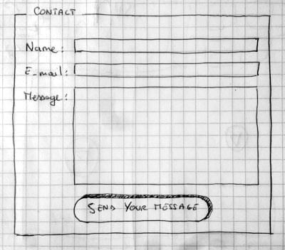

Formumuzda üç metin alanı ve bir düğme bulunacak. Kullanıcıdan adını, e-posta adresini ve göndermek istediği mesajı istiyoruz. Düğmeye basıldığında, veriler bir web sunucusuna gönderilecek.

**Implementing our form HTML**

**(HTML formumuzu uygulamaya koymak):**

Peki, formumuzun HTML kodunu oluşturmaya bir bakalım. Aşağıdaki HTML ögelerini kullanacağız: \<form\>, \<label\>, \<input\>, \<textarea\> ve \<button\>.

Devam etmeden önce, basit HTML şablonumuzun yerel bir kopyasını oluşturun — formunuzun HTML kodunu buraya gireceksiniz.

\<form\> öğesi

Tüm formlar, aşağıdaki gibi bir \<form\> ögesiyle başlar:

**HTML:**

```html
<form action="/my-handling-form-page" method="post">…</form>
```

Bu öge, bir formu biçimsel olarak tanımlar. \<section\> veya \<footer\> ögeleri gibi bir kapsayıcı ögedir, ancak özellikle formları barındırmak için tasarlanmıştır; ayrıca, formun davranışını yapılandırmaya yarayan bazı özel öznitelikleri de destekler. Tüm öznitelikleri isteğe bağlıdır, ancak her zaman en azından action ve method

öz niteliklerinin ayarlanması standart bir uygulamadır:

- “action” özniteliği, form gönderildiğinde formda toplanan verilerin gönderilmesi gereken konumu (URL) belirler.

- “method” özniteliği, verilerin hangi HTTP yöntemiyle gönderileceğini belirler (genellikle GET veya POST).

  Şimdilik, yukarıdaki \<form\> ögesini HTML \<body\> etiketinizin içine ekleyin.

  \<label\>, \<input\> ve \<textarea\> ögeleri

  İletişim formumuz karmaşık değildir: veri girişi bölümü, her biri karşılık gelen bir \<label\> etiketine sahip üç metin alanı içerir:

- Ad için giriş alanı, tek satırlık bir metin alanıdır.

- E-posta için giriş alanı, “email” türünde bir giriş alanıdır: yalnızca e-posta adreslerini kabul eden tek satırlık bir metin alanıdır.

- Mesaj için giriş alanı, \<textarea\> etiketiyle tanımlanan çok satırlı bir metin alanıdır.

  HTML kodu açısından, bu form bileşenlerini uygulamak için aşağıdakine benzer bir şeye ihtiyacımız var:

  **HTML:**

```html
<form action="/my-handling-form-page" method="post">
<p>
<label for="name">Name:</label>
<input type="text" id="name" name="user_name" />
</p>
<p>
<label for="mail">Email:</label>
<input type="email" id="mail" name="user_email" />
</p>
<p>
<label for="msg">Message:</label>
<textarea id="msg" name="user_message"></textarea>
</p>
</form>
```

  Form kodunuzu yukarıdaki gibi olacak şekilde güncelleyin.

  \<p\> öğeleri, kodumuzu düzenli bir şekilde yapılandırmak ve stil uygulamasını kolaylaştırmak amacıyla kullanılmaktadır (makalenin ilerleyen bölümlerine bakınız). Kullanılabilirlik ve erişilebilirlik açısından, her form denetimi için açık bir etiket ekliyoruz. Tüm \<label\> öğelerinde for özniteliğinin kullanıldığına dikkat edin; bu özniteliğin değeri, ilişkili olduğu form denetiminin kimliği (id) olarak alınır — bir form denetimini etiketiyle ilişkilendirmek işte bu şekilde yapılır.

  Bunu yapmanın büyük bir faydası vardır — etiket ile form kontrolünü birbirine bağlar; böylece fare, izleme paneli ve dokunmatik cihaz kullanıcıları, ilgili kontrolü etkinleştirmek için etikete tıklayabilir; ayrıca ekran okuyucuların kullanıcılarına sesli olarak okutabileceği erişilebilir bir ad sağlar. Form etiketleriyle ilgili daha fazla ayrıntıyı “Bir web formu nasıl yapılandırılır?” başlıklı bölümde bulabilirsiniz.

  \<input\> öğesinde en önemli öznitelik, type özniteliğidir. Bu öznitelik, \<input\> öğesinin nasıl görüneceğini ve nasıl davranacağını belirlediği için son derece önemlidir. Bu konu hakkında daha fazla bilgiyi, ilerleyen bölümlerdeki “Temel yerel form denetimleri” başlıklı makalede bulabilirsiniz.

- Basit örneğimizde, ilk giriş alanı için “text” değerini kullanıyoruz — bu özniteliğin varsayılan değeri budur. Bu, her türlü metin girişini kabul eden temel bir tek satırlık metin alanını temsil eder.

- İkinci girdi için, yalnızca biçim kurallarına uygun e-posta adreslerini kabul eden tek satırlı bir metin alanını tanımlayan “email” değerini kullanıyoruz. Bu, basit bir metin alanını, kullanıcı tarafından girilen veriler üzerinde bazı doğrulama kontrolleri gerçekleştirecek bir tür “akıllı” alana dönüştürür. Ayrıca, akıllı telefonlar gibi dinamik klavyeli cihazlarda e-posta adreslerini girmek için daha uygun bir klavye düzeninin (örneğin, varsayılan olarak @ sembolü içeren) görünmesini sağlar. Form doğrulama hakkında daha fazla bilgiyi, ilerleyen bölümlerdeki istemci tarafı form doğrulama makalesinde bulabilirsiniz.

  Son olarak, \<input\> ile \<textarea\>\</textarea\> arasındaki sözdizimine dikkat edin. Bu, HTML’nin tuhaflıklarından biridir. \<input\> etiketi boş bir öğedir; yani kapanış etiketine ihtiyaç duymaz. \<textarea\> ise boş bir öğe değildir; yani uygun bir kapanış etiketiyle kapatılması gerekir. Bu durum, formların belirli bir özelliği olan varsayılan değeri tanımlama şekli üzerinde etkili olur. Bir \<input\> öğesinin varsayılan değerini tanımlamak için value özniteliğini şu şekilde kullanmanız gerekir:

  **HTML:**

```html
<input type="text" value="by default this element is filled with this text" />
```

  Öte yandan, bir \<textarea\> öğesi için varsayılan bir değer tanımlamak isterseniz, bunu \<textarea\> öğesinin açılış ve kapanış etiketleri arasına şu şekilde yerleştirirsiniz:

  **HTML:**

```html
<textarea>
by default this element is filled with this text
</textarea>
```

  \<button\> öğesi

  Formumuzun işaretlemesi neredeyse tamamlandı; artık kullanıcının formu doldurduktan sonra verilerini gönderebilmesi veya “gönderebilmesi” için bir düğme eklememiz gerekiyor. Bu, \<button\> öğesi kullanılarak yapılır; aşağıdaki kodu, kapanış \</form\> etiketinin hemen üstüne ekleyin:

  **HTML:**

```html
<p class="button">
<button type="submit">Send your message</button>
</p>
```

  \<button\> öğesi ayrıca bir type özniteliği de kabul eder; bu öznitelik üç değerden birini alır: submit, reset veya button.

- Gönder düğmesine (varsayılan değer) tıklandığında, formun verileri \<form\> öğesinin action özniteliğiyle tanımlanan web sayfasına gönderilir.

- Sıfırla düğmesine tıklandığında, tüm form bileşenleri anında varsayılan değerlerine sıfırlanır. Kullanıcı deneyimi açısından bu, kötü bir uygulama olarak kabul edilir; bu nedenle, bunu eklemek için gerçekten iyi bir nedeniniz olmadığı sürece bu tür bir düğmeyi kullanmaktan kaçınmalısınız.

- Bir düğmeye tıklamak hiçbir şey yapmıyor! Kulağa saçma gelebilir, ancak özel düğmeler oluşturmak için inanılmaz derecede kullanışlıdır — JavaScript ile bu düğmelerin gerçekleştireceği işlevleri tanımlayabilirsiniz.

  **Basic form styling (Temel form biçimlendirme):**

  Formunuzun HTML kodunu yazmayı tamamladığınıza göre, şimdi bunu kaydedip bir tarayıcıda görüntülemeyi deneyin. Şu anda, oldukça çirkin göründüğünü fark edeceksiniz.Formların şık bir şekilde biçimlendirilmesi oldukça zordur. Form biçimlendirmeyi ayrıntılı olarak anlatmak bu makalenin kapsamı dışındadır; bu nedenle şimdilik, formun düzgün görünmesi için biraz CSS eklemenizi sağlayacağız.

  Öncelikle, sayfanıza, HTML başlık bölümü içine bir \<style\> öğesi ekleyin. Şu şekilde görünmelidir:

  **HTML:**

```html
<style>
/* CSS goes here */
</style>
```

  style etiketlerinin içine aşağıdaki CSS kodunu ekleyin:

  **CSS:**

```css
body {
/* Center the form on the page */
text-align: center;
}
form {
display: inline-block;
/* Form outline */
padding: 1em;
border: 1px solid #cccccc;
border-radius: 1em;
}
p + p {
margin-top: 1em;
}
label {
/* Uniform size & alignment */
display: inline-block;
min-width: 90px;
text-align: right;
}
input,
textarea {
/* To make sure that all text fields have the same font settings
By default, text areas have a monospace font */
font: 1em sans-serif;
/* Uniform text field size */
width: 300px;
box-sizing: border-box;
/* Match form field borders */
border: 1px solid #999999;
}
input:focus,
textarea:focus {
/* Set the outline width and style */
outline-style: solid;
/* To give a little highlight on active elements */
outline-color: black;
}
textarea {
/* Align multiline text fields with their labels */
vertical-align: top;
/* Provide space to type some text */
height: 5em;
}
.button {
/* Align buttons with the text fields */
padding-left: 90px; /* same size as the label elements */
}
button {
/* This extra margin represent roughly the same space as the space
between the labels and their text fields */
margin-left: 0.5em;
}
```

  Kaydedip sayfayı yeniden yüklediğinizde, formunuzun çok daha az çirkin göründüğünü fark edeceksiniz.

  **Sending form data to your web server**

  **(Form verilerini web sunucunuza gönderme):**

  Son kısım, ve belki de en zor olanı, form verilerini sunucu tarafında işlemektir. \<form\> öğesi, action ve method öznitelikleri sayesinde verilerin nereye ve nasıl gönderileceğini belirler.

  Her form denetimi için bir “name” özniteliği belirleriz. Bu adlar hem istemci hem de sunucu tarafında önemlidir; tarayıcıya her bir veri parçasına hangi adı vereceğini bildirir ve sunucu tarafında ise sunucunun her bir veri parçasını adına göre işlemesine olanak tanır. Form verileri, sunucuya ad/değer çiftleri olarak gönderilir.

  Formdaki verilere ad vermek için, belirli bir veriyi toplayacak her form bileşeninde “name” özniteliğini kullanmanız gerekir. Form kodumuzun bir kısmına tekrar göz atalım:

  **HTML:**

```html
<form action="/my-handling-form-page" method="post">
<p>
<label for="name">Name:</label>
<input type="text" id="name" name="user_name" />
</p>
<p>
<label for="mail">Email:</label>
<input type="email" id="mail" name="user_email" />
</p>
<p>
<label for="msg">Message:</label>
<textarea id="msg" name="user_message"></textarea>
</p>
…
</form>
```

  Örneğimizde, form user_name, user_email ve user_message adlı 3 adet veri gönderecektir. Bu veriler, HTTP POST yöntemi kullanılarak /my-handling-form-page URL’sine gönderilecektir.

  Sunucu tarafında, /my-handling-form-page URL’sindeki komut dosyası, verileri HTTP isteğinde yer alan 3 anahtar/değer öğesinden oluşan bir liste olarak alacaktır. Bu komut dosyasının verileri nasıl işleyeceği size kalmıştır. Her sunucu tarafı dilinin (PHP, Python, Ruby, Java, C# vb.) form verilerini işleme konusunda kendine özgü bir mekanizması vardır. Bu konuyu derinlemesine ele almak bu öğreticinin kapsamı dışındadır, ancak daha fazla bilgi edinmek isterseniz, ilerleyen bölümlerdeki Form verilerini gönderme başlıklı makalemizde bazı örnekler sunmuş bulunmaktayız.

  **Özet:**

  Tebrikler, ilk web formunuzu oluşturdunuz. Canlı olarak şöyle görünüyor:

  **Görünüm:**

  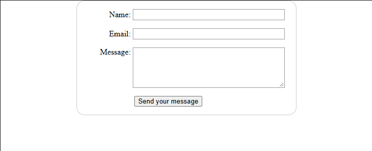

  Ancak bu sadece başlangıç — şimdi daha derinlemesine bir inceleme yapmanın zamanı geldi. Formlar, burada gördüğümüzden çok daha fazla işlevselliğe sahiptir ve bu modüldeki diğer makaleler, geri kalan kısımları da tam olarak öğrenmenize yardımcı olacaktır.

  **How to structure a web form(Bir web formu nasıl yapılandırılır?)**

  Temel konuları ele aldıktan sonra, şimdi bir formun farklı bölümlerine yapı ve anlam kazandırmak için kullanılan öğeleri daha ayrıntılı olarak inceleyeceğiz.

|              |                                                                                                                                                              |
|--------------|--------------------------------------------------------------------------------------------------------------------------------------------------------------|
| Ön koşullar: | HTML hakkında temel bilgi.                                                                                                                                   |
| Amaç:        | HTML formlarını nasıl yapılandırılacağını ve bunların kullanılabilir ve erişilebilir olması için onlara nasıl anlamsal özellikler kazandırılacağını anlamak. |

Formların esnekliği, onları HTML’deki en karmaşık yapılardan biri haline getirir; özel form öğeleri ve özniteliklerini kullanarak her türlü temel formu oluşturabilirsiniz. Bir HTML formu oluştururken doğru yapıyı kullanmak, formun hem kullanışlı hem de erişilebilir olmasını sağlamaya yardımcı olur.

**The \<form\> element(\<form\> öğesi):**

\<form\> öğesi, bir formu ve formun davranışını belirleyen öznitelikleri resmi olarak tanımlar. Bir HTML formu oluşturmak istediğinizde, her seferinde bu öğeyi kullanarak başlamalı ve tüm içeriği bu öğenin içine yerleştirmelisiniz. Birçok yardımcı teknoloji ve tarayıcı eklentisi, \<form\> öğelerini algılayabilir ve bunların kullanımını kolaylaştırmak için özel işlevler uygulayabilir.

Bunu bir önceki makalede daha önce ele almıştık.

> [!WARNING]
> Bir formu başka bir formun içine yerleştirmek kesinlikle yasaktır! Formları iç içe yerleştirmek öngörülemez davranışlara yol açar.

Bir form denetimini \<form\> öğesinin dışında kullanmak her zaman mümkündür. Bunu yaparsanız, varsayılan olarak bu denetim, form özniteliğini kullanarak onu bir formla ilişkilendirmediğiniz sürece hiçbir formla ilişkili olmaz. Bu özellik, bir denetimin formun içinde yer almaması durumunda bile onu bir forma açıkça bağlayabilmenizi sağlamak amacıyla eklenmiştir.

Şimdi ilerleyelim ve bir formun içinde yer alan yapısal öğeleri ele alalım.

**The \<fieldset\> and \<legend\> elements(\<fieldset\> ve \<legend\> öğeleri):**

\<fieldset\> öğesi, stil ve anlamsal amaçlarla aynı amaca hizmet eden widget grupları oluşturmak için kullanışlı bir yoldur. \<fieldset\> öğesine, açılış \<fieldset\> etiketinin hemen altına bir \<legend\> öğesi ekleyerek bir etiket atayabilirsiniz. \<legend\> öğesinin metin içeriği, içinde yer aldığı \<fieldset\> öğesinin amacını resmi olarak tanımlar.

Birçok yardımcı teknoloji, \<legend\> öğesini, sanki ilgili \<fieldset\> öğesi içindeki her bir denetimin etiketinin bir parçasıymış gibi kullanır. Örneğin, Jaws ve NVDA gibi bazı ekran okuyucular, her bir denetimin etiketini seslendirmeden önce açıklama metninin içeriğini seslendirir.

**Örnek:**

**HTML:**

```html
<fieldset>
<legend>Fruit juice size</legend>
<p>
<input type="radio" name="size" id="size_1" value="small" />
<label for="size_1">Small</label>
</p>
<p>
<input type="radio" name="size" id="size_2" value="medium" />
<label for="size_2">Medium</label>
</p>
<p>
<input type="radio" name="size" id="size_3" value="large" />
<label for="size_3">Large</label>
</p>
</fieldset>
```

**Görünüm:**

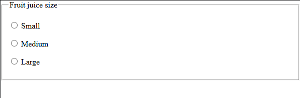

Yukarıdaki formu okurken, bir ekran okuyucu ilk radyo düğmesinin etiketini “Küçük boy meyve suyu”, ikincisini “Orta boy meyve suyu” ve üçüncüsünü “Büyük boy meyve suyu” olarak seslendirecektir.

Bir grup radyo düğmesi kullandığınızda, bunları her zaman bir \<fieldset\> öğesinin içine yerleştirmelisiniz. Bunun dışında başka kullanım durumları da vardır ve genel olarak \<fieldset\> öğesi, bir formu bölümlere ayırmak için de kullanılabilir. İdeal olarak, uzun formlar birden fazla sayfaya yayılmalıdır; ancak bir form uzamaya başlıyorsa ve tek bir sayfada kalması gerekiyorsa, birbiriyle ilişkili farklı bölümleri farklı \<fieldsets\> öğelerinin içine yerleştirmek kullanılabilirliği artırır.

Yardımcı teknolojiler üzerindeki etkisi nedeniyle, \<fieldset\> öğesi erişilebilir formlar oluşturmak için kilit öğelerden biridir; ancak, bu öğeyi kötüye kullanmamak sizin sorumluluğunuzdadır. Mümkünse, her form oluşturduğunuzda ekran okuyucunun bunu nasıl yorumladığını dinlemeye çalışın. Kulağa tuhaf geliyorsa, form yapısını iyileştirmeye çalışın.

**The \<label\> element(\<label\> öğesi):**

Bir önceki makalede gördüğümüz gibi, \<label\> öğesi, bir HTML form bileşeni için etiket tanımlamanın resmi yoludur. Erişilebilir formlar oluşturmak istiyorsanız bu, en önemli öğedir — doğru şekilde uygulandığında, ekran okuyucular form öğesinin etiketini ilgili talimatlarla birlikte sesli olarak okur; ayrıca bu, görme engelli olmayan kullanıcılar için de yararlıdır. Bir önceki makalede gördüğümüz şu örneği ele alalım:

**HTML:**

```html
<label for="name">Name:</label> <input type="text" id="name" name="user_name" />
```

\<label\> öğesi, \<input\> öğesiyle “for” özniteliği aracılığıyla (bu öznitelik, \<input\> öğesinin “id” özniteliğini içerir) doğru şekilde ilişkilendirildiğinde, ekran okuyucu “Ad, metni düzenle” gibi bir ifadeyi sesli olarak okuyacaktır.

Bir form denetimini bir etiketle ilişkilendirmenin başka bir yolu daha vardır: form denetimini \<label\> etiketinin içine yerleştirmek; bu şekilde denetim, dolaylı olarak etiketle ilişkilendirilir.

**HTML:**

```html
<label for="name">
Name: <input type="text" id="name" name="user_name" />
</label>
```

Ancak bu tür durumlarda bile, tüm yardımcı teknolojilerin etiket ile widget arasındaki ilişkiyi doğru bir şekilde algılamasını sağlamak için \`for\` özniteliğini ayarlamak en iyi uygulama olarak kabul edilir.

Eğer bir etiket yoksa ya da form denetimi ne örtük ne de açık bir şekilde bir etiketle ilişkilendirilmişse, ekran okuyucu “Metin düzenleme alanı” gibi bir ifade okur; bu da hiç de yararlı değildir.

**Labels are clickable, too! (Etiketlere de tıklanabilir!):**

Doğru şekilde ayarlanmış etiketlerin bir başka avantajı da, ilgili widget’ı etkinleştirmek için etikete tıklayabilmeniz veya dokunabilmenizdir. Bu, metin giriş alanları gibi denetimler için kullanışlıdır; bu tür denetimlerde odaklanmak için hem etikete hem de giriş alanına tıklayabilirsiniz. Ancak bu özellik özellikle radyo düğmeleri ve onay kutuları için çok yararlıdır — bu tür denetimlerin tıklanabilir alanı çok küçük olabileceğinden, etkinleştirmeyi olabildiğince kolaylaştırmak faydalıdır.

Örneğin, aşağıdaki örnekteki “Kirazı severim” etiket metnine tıklandığında, taste_cherry onay kutusunun seçili durumu değişecektir:

**HTML:**

```html
<p>
<input type="checkbox" id="taste_1" name="taste_cherry" value="cherry" />
<label for="taste_1">I like cherry</label>
</p>
<p>
<input type="checkbox" id="taste_2" name="taste_banana" value="banana" />
<label for="taste_2">I like banana</label>
</p>
```

**Görünüm:**

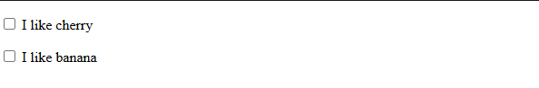

**Multiple labels (Birden fazla etiket):**

Aslında, tek bir widget’a birden fazla etiket ekleyebilirsiniz, ancak bazı yardımcı teknolojilerin bunları işlerken sorun yaşayabileceği için bu iyi bir fikir değildir. Birden fazla etiket olması durumunda, widget’ı ve etiketlerini tek bir \<label\> öğesinin içine yerleştirmelisiniz.

Şu örneği ele alalım:

**HTML:**

```html
<p>Please complete all required (*) fields.</p>
<!-- So this: -->
<!--<div>
<label for="username">Name:</label>
<input id="username" type="text" name="username" required />
<label for="username">*</label>
</div>-->
<!-- would be better done like this: -->
<!--<div>
<label for="username">
<span>Name:</span>
<input id="username" type="text" name="username" required />
<span>*</span>
</label>
</div>-->
<!-- But this is probably best: -->
<div>
<label for="username">Name *:</label>
<input id="username" type="text" name="username" required />
</div>
```

**Görünüm:**

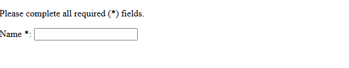

En üstteki paragraf, zorunlu öğelerle ilgili bir kuralı belirtmektedir. Bu kural, görme engelli olmayan kullanıcılar ile ekran okuyucu gibi yardımcı teknolojiler (AT) kullanan kullanıcıların, zorunlu bir öğeyle karşılaşmadan önce kuralın ne anlama geldiğini öğrenebilmeleri için, kuralın kullanılmasından önce eklenmelidir.

**Common HTML structures used with forms**

**(Formlarda yaygın olarak kullanılan HTML yapıları):**

Web formlarına özgü yapıların ötesinde, form işaretlemesinin aslında sadece HTML olduğunu unutmamak gerekir. Bu, bir web formunu yapılandırmak için HTML’nin tüm olanaklarından yararlanabileceğiniz anlamına gelir.

Örneklerde de görebileceğiniz gibi, bir etiketi ve ilgili widget’ı \<ul\> veya \<ol\> listesi içindeki bir \<li\> öğesiyle sarmak yaygın bir uygulamadır. \<p\> ve \<div\> öğeleri de sıklıkla kullanılır. Birden fazla onay kutusu veya radyo düğmesini yapılandırmak için listelerin kullanılması önerilir.

\<fieldset\> öğesinin yanı sıra, karmaşık formları yapılandırmak için HTML başlıklarını (örn. h1, h2) ve bölümleme öğelerini (örn. \<section\>) kullanmak da yaygın bir uygulamadır.

Her şeyden önce, erişilebilir ve kullanımı kolay formlar ortaya çıkaran, size uygun bir kodlama stili bulmak size kalmıştır. İşlevselliğin her bir bölümü ayrı bir \<section\> öğesi içinde yer almalı ve radyo düğmelerini içeren \<fieldset\> öğeleri kullanılmalıdır.

**Building a form structure(Form yapısının oluşturulması):**

Şimdi bu fikirleri uygulamaya geçirelim ve biraz daha karmaşık bir form oluşturalım — bir ödeme formu. Bu form, henüz tam olarak anlamadığınız bazı kontrol türlerini içerecektir. Şimdilik bunun için endişelenmeyin; bunların nasıl çalıştığını bir sonraki makalede (Temel yerel form denetimleri) öğreneceksiniz. Şimdilik, aşağıdaki talimatları izlerken açıklamaları dikkatlice okuyun ve formu yapılandırmak için hangi sarmalayıcı öğeleri kullandığımızı ve neden kullandığımızı anlamaya çalışın.

1.  İlk olarak, boş şablon dosyamızın bir kopyasını bilgisayarınızdaki yeni bir dizine kaydedin.

2.  Ardından, bir \<form\> öğesi ekleyerek formunuzu oluşturun:

    **HTML:**

```html
<form>
```

3.  \<form\> öğesinin içine, kullanıcılara zorunlu alanların nasıl işaretlendiğini belirtmek için bir başlık ve paragraf ekleyin:

    **HTML:**

```html
<h1>Payment form</h1>
<p>Please complete all required (*) fields.</p>
```

4.  Şimdi, forma önceki girdimizin altına daha büyük bir kod bölümü ekleyeceğiz. Burada, iletişim bilgileri alanlarını ayrı bir \<section\> öğesinin içine aldığımızı göreceksiniz. Ayrıca, her biri kendi liste (\<li\>) öğesinin içine yerleştirdiğimiz üç adet radyo düğmesi bulunmaktadır. Ayrıca, her biri bir \<p\> öğesinin içinde yer alan iki standart metin \<input\> öğesi ve bunlara ait \<label\> öğeleri ile şifre girmek için bir şifre giriş alanı da bulunmaktadır. Bu kodu formunuza ekleyin:

    **HTML:**

```html
<section>
<h2>Contact information</h2>
<fieldset>
<legend>Title</legend>
<ul>
<li>
<label for="title_1">
<input type="radio" id="title_1" name="title" value="A" />
Ace
</label>
</li>
<li>
<label for="title_2">
<input type="radio" id="title_2" name="title" value="K" />
King
</label>
</li>
<li>
<label for="title_3">
<input type="radio" id="title_3" name="title" value="Q" />
Queen
</label>
</li>
</ul>
</fieldset>
<p>
<label for="name">Name *:</label>
<input type="text" id="name" name="username" required />
</p>
<p>
<label for="mail">Email *:</label>
<input type="email" id="mail" name="user-mail" required />
</p>
<p>
<label for="pwd">Password *:</label>
<input type="password" id="pwd" name="password" required />
</p>
</section>
```

5.  Formumuzun ikinci \<section\> bölümü ödeme bilgileridir. Her biri bir \<p\> etiketi içinde yer alan, etiketleriyle birlikte üç ayrı kontrolümüz bulunmaktadır. İlki, kredi kartı türünü seçmek için kullanılan bir açılır menüdür (\<select\>). İkincisi, kredi kartı numarasını girmek için kullanılan “tel” türünde bir \<input\> öğesidir; “number” türünü de kullanabilirdik, ancak sayının spinner kullanıcı arayüzünü istemiyoruz. Sonuncusu ise kartın son kullanma tarihini girmek için kullanılan text türünde bir \<input\> öğesidir; bu öğe, doğru biçimi belirten bir placeholder özniteliği ve girilen tarihin doğru biçimde olup olmadığını kontrol eden bir pattern içerir. Bu yeni giriş türleri, HTML5 giriş türleri bölümünde yeniden tanıtılmıştır.

    Önceki bölümün altına aşağıdakileri girin:

    **HTML:**

```html
<section>
<h2>Payment information</h2>
<p>
<label for="card">
<span>Card type:</span>
</label>
<select id="card" name="user-card">
<option value="visa">Visa</option>
<option value="mc">Mastercard</option>
<option value="amex">American Express</option>
</select>
</p>
<p>
<label for="number">Card number *:</label>
<input type="tel" id="number" name="card-number" required />
</p>
<p>
<label for="expiration">Expiration date *:</label>
<input
type="text"
id="expiration"
name="expiration"
required
placeholder="MM/YY"
pattern="^(0[1-9]|1[0-2])\([0-9]{2})\$" />
</p>
</section>
```

6.  Ekleyeceğimiz son bölüm çok daha basit; form verilerini göndermek için yalnızca submit türünde bir \<button\> etiketi içeriyor. Bunu şimdi formunuzun en altına ekleyin:

    **HTML:**

```html
<section>
<p>
<button type="submit">Validate the payment</button>
</p>
</section>
```

7.  Son olarak, \<form\> dış kapanış etiketini ekleyerek formunuzu tamamlayın:

    **HTML:**

```html
</form>
```

    Aşağıdaki tamamlanmış forma bazı ek CSS stilleri uyguladık. Formunuzun görünümünde değişiklik yapmak isterseniz, örnekten stilleri kopyalayabilir veya “Web formlarını stilize etme” sayfasını ziyaret edebilirsiniz.

    **Görünüm:**

    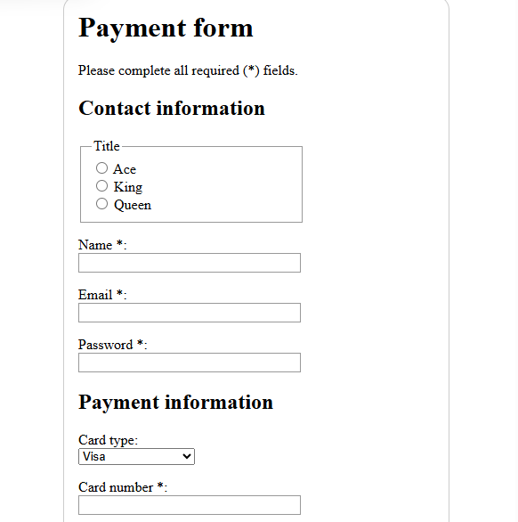

    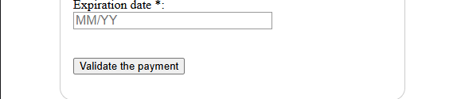

    **Özet:**

    Artık web formlarınızı doğru bir şekilde yapılandırmak için ihtiyacınız olan tüm bilgilere sahipsiniz. Burada tanıtılan özelliklerin çoğunu önümüzdeki birkaç makalede ele alacağız; bir sonraki makalede ise kullanıcılarınızdan bilgi toplamak için kullanmak isteyeceğiniz çeşitli form bileşenlerinin kullanımını daha ayrıntılı olarak inceleyeceğiz.

    **Basic native form controls(Temel yerel form denetimleri):**

    Bir önceki makalede, işlevsel bir web formu örneğini kodlayarak bazı form denetimlerini ve yaygın yapısal öğeleri tanıtmış ve erişilebilirlikle ilgili en iyi uygulamalara odaklanmıştık. Şimdi ise, farklı form denetimlerinin (ya da widget’ların) işlevselliğini ayrıntılı olarak inceleyeceğiz; farklı türde verileri toplamak için kullanılabilen tüm seçenekleri ele alacağız. Bu makalede, web’in ilk günlerinden beri tüm tarayıcılarda mevcut olan orijinal form denetimleri kümesine odaklanacağız.

|              |                                                                                                                                                                      |
|--------------|----------------------------------------------------------------------------------------------------------------------------------------------------------------------|
| Ön koşullar: | HTML hakkında temel bilgi.                                                                                                                                           |
| Amaç:        | Tarayıcılarda veri toplamak için mevcut olan orijinal yerel form bileşenlerini ayrıntılı olarak anlamak ve bunların HTML kullanılarak nasıl uygulanacağını öğrenmek. |

Daha önce \<form\>, \<fieldset\>, \<legend\>, \<textarea\>, \<label\>, \<button\> ve \<input\> gibi bazı form öğeleriyle tanışmıştınız. Bu makalede şu konular ele alınmaktadır:

- Yaygın giriş türleri şunlardır: düğme, onay kutusu, dosya, gizli alan, resim, şifre, radyo düğmesi, sıfırla, gönder ve metin.

- Tüm form denetimlerinde ortak olarak bulunan bazı özellikler.

  **Text input fields(Metin giriş alanları):**

  \<input\> metin alanları, en temel form bileşenleridir. Kullanıcının her türlü veriyi girmesine olanak tanıyan oldukça kullanışlı bir yöntemdir ve bu konuda daha önce birkaç basit örnek görmüştük.

  Tüm temel metin denetimleri bazı ortak davranışlara sahiptir:

- Bu alanlar “salt okunur” olarak işaretlenebilir (kullanıcı giriş değerini değiştiremez, ancak bu değer yine de form verilerinin geri kalanıyla birlikte gönderilir) veya “devre dışı” olarak işaretlenebilir (giriş değeri değiştirilemez ve form verilerinin geri kalanıyla birlikte hiçbir zaman gönderilmez).

- Yer tutucu içerebilirler; bu, metin giriş kutusunun içinde görünen ve kutunun amacını kısaca açıklamak için kullanılması gereken metindir.

- Boyut (kutunun fiziksel boyutu) ve maksimum uzunluk (kutuya girilebilecek maksimum karakter sayısı) açısından sınırlandırılabilirler.

- Yazım denetiminden yararlanabilirler (spellcheck özniteliğini kullanarak).

  **Single line text fields(Tek satırlık metin alanları):**

  Tek satırlı bir metin alanı, type özniteliğinin değeri text olarak ayarlanmış bir \<input\> öğesi kullanılarak ya da type özniteliği tamamen atlanarak oluşturulur (text varsayılan değerdir). Bu özniteliğin text değeri, type özniteliği için belirttiğiniz değer tarayıcı tarafından tanınmadığında da yedek değer olarak kullanılır (örneğin, type="color" belirtirseniz ve tarayıcı yerel renk seçicileri desteklemiyorsa).

  İşte temel bir tek satırlık metin alanı örneği:

  **HTML:**

```html
<input type="text" id="comment" name="comment" value="I'm a text field" />
```

  Şu şekilde görüntüleniyor:

  **Görünüm:**

  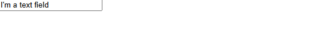

  Tek satırlık metin alanlarının tek gerçek kısıtlaması şudur: Satır sonları içeren metin yazarsanız, tarayıcı verileri sunucuya göndermeden önce bu satır sonlarını kaldırır.

  Aşağıdaki ekran görüntüsü, bir metin giriş alanının varsayılan, odaklanmış ve devre dışı durumlarını göstermektedir. Çoğu tarayıcı, odaklanmış durumu kontrolün etrafındaki bir odak halkasıyla, devre dışı durumu ise gri metin veya soluk/yarı saydam bir kontrol ile belirtir

  **Görünüm:**

  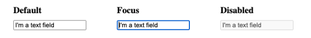

  Bu belgede kullanılan ekran görüntüleri, macOS üzerinde Chrome tarayıcısında çekilmiştir. Farklı tarayıcılarda bu alanlar/düğmelerde küçük farklılıklar olabilir, ancak temel vurgulama yöntemi benzer kalır.

  **Password field(Şifre alanı):**

  İlk giriş türlerinden biri, şifre metin alanı türüdür:

  **HTML:**

```html
<input type="password" id="pwd" name="pwd" />
```

  Bu, temel tek satırlık metin alanına benzer şekilde görüntülenir:

  **Görünüm:**

  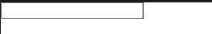

  Ancak, alana bir şeyler yazmayı deneyin — girilen her karakter bir nokta olarak gösterilecektir.

  Şifre özelliği, girilen metne herhangi bir özel kısıtlama getirmez; ancak alana girilen değeri gizleyerek başkalarının kolayca okumasını engeller.

  > [!WARNING]
> `type="password"` yalnızca görsel bir gizleme sağlar. Formunuzu HTTPS (SSL) üzerinden göndermediğiniz sürece şifreler ağ üzerinden düz metin (şifrelenmemiş) olarak iletilir. Kullanıcıları bundan korumanın en iyi yolu, form içeren tüm sayfaları güvenli bir bağlantı üzerinden barındırmaktır (yani, https:// adresinde yer alması gerekir); böylece veriler gönderilmeden önce şifrelenir.

  Tarayıcılar, güvenli olmayan bir bağlantı üzerinden form verilerinin gönderilmesinin güvenlik açısından doğurduğu sonuçların farkındadır ve kullanıcıları güvenli olmayan formları kullanmaktan caydırmak amacıyla uyarılar gösterir.

  **Hidden content(Gizli içerik):**

  Bir başka orijinal metin denetimi de gizli giriş türüdür. Bu, kullanıcı tarafından görülemeyen, ancak form gönderildiğinde diğer form verileriyle birlikte sunucuya iletilen bir form denetimi oluşturmak için kullanılır — örneğin, bir siparişin ne zaman verildiğini belirten bir zaman damgasını sunucuya göndermek isteyebilirsiniz. Gizli olduğu için kullanıcı bu değeri göremez veya kasıtlı olarak düzenleyemez; bu denetim asla odak almaz ve ekran okuyucu da onu algılamaz.

  **HTML:**

```html
<input type="hidden" id="timestamp" name="timestamp" value="1286705410" />
```

  Böyle bir öğe oluşturursanız, ad ve değer özniteliklerini ayarlamanız gerekir. Değer, JavaScript aracılığıyla dinamik olarak ayarlanabilir. Gizli giriş türüne bir etiket atanmamalıdır.

  Arama, url ve tel gibi diğer metin giriş türleri, bir sonraki ders olan “HTML5 giriş türleri”nde ele alınacaktır.

  **Checkable items: checkboxes and radio buttons**

  **(İşaretlenebilir öğeler: onay kutuları ve radyo düğmeleri):**

  İşaretlenebilir öğeler, üzerlerine veya bunlarla ilişkili etiketlere tıklayarak durumlarını değiştirebileceğiniz denetimlerdir. İki tür işaretlenebilir öğe vardır: onay kutusu ve radyo düğmesi. Her ikisi de, widget’ın varsayılan olarak işaretli olup olmadığını belirtmek için “checked” özniteliğini kullanır.

  Bu widget’ların diğer form widget’ları gibi tam olarak çalışmadığını belirtmek gerekir. Çoğu form widget'ında, form gönderildiğinde, değer girilmemiş olsa bile “name” özniteliğine sahip tüm widget'lar gönderilir. İşaretlenebilir öğeler söz konusu olduğunda, değerleri yalnızca işaretlendikleri takdirde gönderilir. İşaretlenmemişlerse, adları dahil hiçbir şey gönderilmez. İşaretlenmiş ancak değeri girilmemişse, adları “on” değeri ile birlikte gönderilir.

  Maksimum kullanılabilirlik ve erişilebilirlik için, ilgili öğelerin her bir listesini bir \<fieldset\> etiketiyle çevrelemeniz ve listenin genel açıklamasını içeren bir \<legend\> etiketi kullanmanız önerilir. Her bir \<label\>/\<input\> öğesi çifti, kendi liste öğesi (veya benzeri) içinde yer almalıdır. İlgili \<label\> öğesi genellikle radyo düğmesinin veya onay kutusunun hemen önüne veya arkasına yerleştirilir; radyo düğmesi veya onay kutusu grubuna ilişkin talimatlar ise genellikle \<legend\> öğesinin içeriğini oluşturur.

  **Checkbox(Onay kutusu):**

  Bir onay kutusu, type özniteliği “checkbox” değerine ayarlanmış \<input\> öğesi kullanılarak oluşturulur.

  **HTML:**

```html
<input type="checkbox" id="questionOne" name="subscribe" value="yes" checked />
```

  **HTML:**

```html
<fieldset>
<legend>Choose all the vegetables you like to eat</legend>
<ul>
<li>
<label for="carrots">Carrots</label>
<input
type="checkbox"
id="carrots"
name="vegetable"
value="carrots"
checked />
</li>
<li>
<label for="peas">Peas</label>
<input type="checkbox" id="peas" name="vegetable" value="peas" />
</li>
<li>
<label for="cabbage">Cabbage</label>
<input type="checkbox" id="cabbage" name="vegetable" value="cabbage" />
</li>
</ul>
</fieldset>
```

  Bu örnek şu şekilde görüntülenir:

  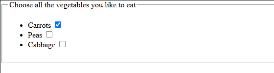

  Aşağıdaki ekran görüntüsü, onay kutularının varsayılan, odaklanmış ve devre dışı durumlarını göstermektedir. Varsayılan ve devre dışı durumdaki onay kutuları işaretli görünürken, odaklanmış durumda onay kutusu işaretli değildir ve etrafında odak halkası bulunur.

  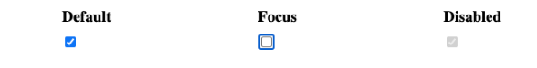

  On-off özelliğinden dolayı, onay kutusu bir geçiş düğmesi olarak kabul edilir; bu nedenle birçok geliştirici ve tasarımcı, varsayılan onay kutusu stilini genişleterek geçiş düğmesi gibi görünen düğmeler oluşturur. Burada bunun bir örneğini görebilirsiniz (ayrıca kaynak koduna da bakabilirsiniz).

  **Radio button(Radyo düğmesi):**

  Bir radyo düğmesi, type özniteliği radio değerine ayarlanmış \<input\> öğesi kullanılarak oluşturulur:

  **HTML:**

```html
<input type="radio" id="soup" name="meal" value="soup" checked />
```

  Birkaç radyo düğmesi birbirine bağlanabilir. Eğer “name” özniteliği için aynı değeri paylaşıyorlarsa, aynı düğme grubu içinde oldukları kabul edilir. Belirli bir grupta aynı anda yalnızca bir düğme işaretli olabilir; bu, bunlardan biri işaretlendiğinde diğerlerinin tümünün otomatik olarak işaretinin kaldırıldığı anlamına gelir. Form gönderildiğinde, yalnızca işaretli radyo düğmesinin değeri gönderilir. Hiçbiri işaretli değilse, radyo düğmelerinin tamamı bilinmeyen bir durumda kabul edilir ve formla birlikte hiçbir değer gönderilmez. Aynı adlı bir düğme grubundaki radyo düğmelerinden biri işaretlendiğinde, kullanıcının formu sıfırlamadan tüm düğmelerin işaretini kaldırması mümkün değildir.

  **HTML:**

```html
<fieldset>
<legend>What is your favorite meal?</legend>
<ul>
<li>
<label for="soup">Soup</label>
<input type="radio" id="soup" name="meal" value="soup" checked />
</li>
<li>
<label for="curry">Curry</label>
<input type="radio" id="curry" name="meal" value="curry" />
</li>
<li>
<label for="pizza">Pizza</label>
<input type="radio" id="pizza" name="meal" value="pizza" />
</li>
</ul>
</fieldset>
```

  Bu örnek şu şekilde görüntülenir:

  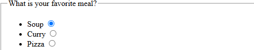

  Aşağıdaki ekran görüntüsünde, varsayılan ve devre dışı bırakılmış radyo düğmelerinin işaretli hali ile odaklanmış olan, ancak işaretlenmemiş bir radyo düğmesi gösterilmektedir.

  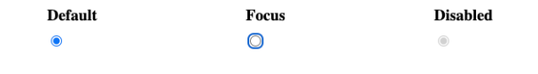

  **Actual buttons(Gerçek düğmeler):**

  Radyo düğmesi, ismine rağmen aslında bir düğme değildir; hadi devam edelim ve gerçek düğmelere bir göz atalım! Düğme oluşturan üç giriş türü vardır:

  **Submit(gönder): reset(sıfırla):button(Düğme):**

  Form verilerini sunucuya gönderir. \<button\> öğeleri için, type özniteliğinin atlanması (veya type özniteliğine geçersiz bir değerin girilmesi) bir gönder düğmesinin oluşturulmasına neden olur.

  **Reset(sıfırla):**

  Tüm form bileşenlerini varsayılan değerlerine sıfırlar.

  **Button(Düğme):**

  Otomatik bir işlevi olmayan, ancak JavaScript kodu kullanılarak özelleştirilebilen düğmeler.

  Ayrıca \<button\> öğesinin kendisi de mevcuttur. Bu öğe, yukarıda bahsedilen üç \<input\> türünün davranışını taklit etmek için “submit”, “reset” veya “button” değerlerini alan bir “type” özniteliği alabilir. İkisi arasındaki temel fark, gerçek \<button\> öğelerinin stilinin çok daha kolay ayarlanabilmesidir.

  **HTML:**

```html
<p>Using &lt;input></p>
<p>
<input type="submit" value="Submit this form" />
<input type="reset" value="Reset this form" />
<input type="button" value="Do Nothing without JavaScript" />
</p>
<p>Using &lt;button></p>
<p>
<button type="submit">Submit this form</button>
<button type="reset">Reset this form</button>
<button type="button">Do Nothing without JavaScript</button>
</p>
```

  **Görünüm:**

  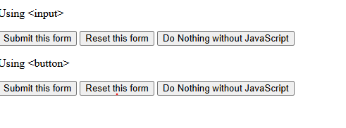

  Aşağıda, her bir \<input\> türü düğmenin örneklerini, bunlara karşılık gelen \<button\> türüyle birlikte bulabilirsiniz. Her bir çift, yeni bir satıra ayrılması için bir \<div\> öğesi içine alınmıştır.

- **Submit button(Gönder düğmesi):**

  **HTML:**

```html
<div>
<button type="submit">This is a <strong>submit button</strong></button>
<input type="submit" value="This is a submit button" />
</div>
```

- **Reset button(Sıfırla düğmesi):**

  **HTML:**

```html
<div>
<button type="reset">This is a <strong>reset button</strong></button>
<input type="reset" value="This is a reset button" />
</div>
```

- **Anonymous button(Anonim düğmesi):**

  **HTML:**

```html
<div>
<button type="button">This is an <strong>anonymous button</strong></button>
<input type="button" value="This is an anonymous button" />
</div>
```

  Bu örnekler şu şekilde görüntülenir:

  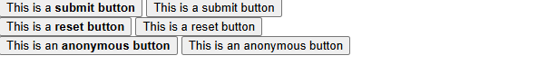

  Düğmeler, ister \<button\> öğesini ister \<input\> öğesini kullanın, her zaman aynı şekilde çalışır. Ancak örneklerden de görebileceğiniz gibi, \<button\> öğeleri, açılış ve kapanış \<button\> etiketleri arasına yerleştirilen HTML kodunu içerik olarak kullanmanıza izin verir. Öte yandan, \<input\> öğeleri boş öğelerdir; görüntülenen içerikleri value özniteliğinin içine yerleştirilir ve bu nedenle içerik olarak yalnızca düz metin kabul ederler.

  Aşağıdaki ekran görüntüsü, bir düğmeyi varsayılan, odaklanmış ve devre dışı durumlarında göstermektedir. Odaklanmış durumda, düğmenin çevresinde bir odak halkası bulunur; devre dışı durumda ise düğme gri renkte görünür.

  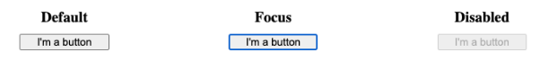

  **Image button(Resim düğmesi):**

  Görüntü düğmesi denetimi, \ öğesiyle tamamen aynı şekilde görüntülenir; ancak kullanıcı bu düğmeye tıkladığında, bir gönder düğmesi gibi davranır.

  Bir resim düğmesi, type özniteliği “image” değerine ayarlanmış bir \<input\> öğesi kullanılarak oluşturulur. Bu öğe, \ öğesiyle tamamen aynı öznitelik kümesini destekler; buna ek olarak, diğer form düğmelerinin desteklediği tüm öznitelikleri de destekler.

  **HTML:**

```html
<input type="image" alt="Click me!" src="my-img.png" width="80" height="30" />
```

  Formun gönderilmesi için resim düğmesi kullanılırsa, bu denetim kendi değerini göndermez; bunun yerine, resim üzerinde tıklamanın X ve Y koordinatları gönderilir (koordinatlar resme göredir; yani resmin sol üst köşesi (0, 0) koordinatını temsil eder). Koordinatlar iki anahtar/değer çifti olarak gönderilir:

- X değeri anahtarı, name özniteliğinin değerinin sonuna “.x” dizesi eklenmesiyle oluşur.

- Y değeri anahtarı, name özniteliğinin değerinin ardından “.y” dizesi eklenmiş halidir.

  Örneğin, (123, 456) koordinatındaki resme tıkladığınızda ve bu işlem GET yöntemi ile gönderildiğinde, URL’ye aşağıdaki gibi değerlerin eklendiğini göreceksiniz:

  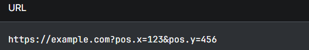

  Bu, bir “hot map” oluşturmak için oldukça kullanışlı bir yöntemdir. Bu değerlerin nasıl gönderilip alındığı, “Form verilerini gönderme” başlıklı makalede ayrıntılı olarak açıklanmaktadır.

  **File picker(Dosya seçici):**

  Erken dönem HTML’de karşımıza çıkan son bir \<input\> türü daha vardır: dosya giriş türü. Formlar, sunucuya dosya gönderebilir (bu özel işlem, “Form verilerinin gönderilmesi” başlıklı makalede de ayrıntılı olarak açıklanmıştır). Gönderilecek bir veya daha fazla dosyayı seçmek için dosya seçici widget’ı kullanılabilir.

  Bir dosya seçici widget’ı oluşturmak için, type özniteliği file olarak ayarlanmış \<input\> öğesini kullanırsınız. Kabul edilen dosya türleri, accept özniteliği kullanılarak sınırlandırılabilir. Ayrıca, kullanıcının birden fazla dosya seçmesine izin vermek isterseniz, multiple özniteliğini ekleyerek bunu sağlayabilirsiniz.

  **Örnek:**

  Bu örnekte, grafik görüntü dosyalarını isteyen bir dosya seçici oluşturulmuştur. Bu durumda kullanıcı birden fazla dosya seçebilir.

  **HTML:**

```html
<input type="file" name="file" id="file" accept="image/*" multiple />
```

  Bazı mobil cihazlarda, dosya seçici, “accept” özniteliğine aşağıdaki gibi yakalama bilgilerini ekleyerek, cihazın kamerası ve mikrofonu tarafından doğrudan çekilen fotoğraflara, videolara ve ses dosyalarına erişebilir:

  **HTML:**

```html
<input type="file" accept="image/*;capture=camera" />
<input type="file" accept="video/*;capture=camcorder" />
<input type="file" accept="audio/*;capture=microphone" />
```

  Aşağıdaki ekran görüntüsü, herhangi bir dosya seçilmediğinde dosya seçici widget’ının varsayılan, odaklanmış ve devre dışı durumlarını göstermektedir.

  **Görünüm:**

  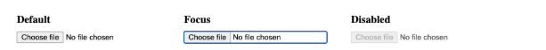

  **Common attributes(Ortak özellikler):**

  Form denetimlerini tanımlamak için kullanılan öğelerin çoğunun kendine özgü bazı öznitelikleri vardır. Bununla birlikte, tüm form öğelerinde ortak olan bir dizi öznitelik de mevcuttur. Bunların bir kısmıyla daha önce tanışmış olabilirsiniz, ancak referans olması açısından aşağıda bu ortak özniteliklerin bir listesi yer almaktadır:

&lt;table&gt;
&lt;colgroup&gt;
&lt;col style=&quot;width: 25%&quot; /&gt;
&lt;col style=&quot;width: 20%&quot; /&gt;
&lt;col style=&quot;width: 53%&quot; /&gt;
&lt;/colgroup&gt;
&lt;tbody&gt;
&lt;tr class=&quot;odd&quot;&gt;
&lt;td&gt;&lt;p&gt;&lt;strong&gt;Attribute name&lt;/strong&gt;&lt;/p&gt;
&lt;p&gt;&lt;strong&gt;(Özellik adı)&lt;/strong&gt;&lt;/p&gt;&lt;/td&gt;
&lt;td&gt;&lt;p&gt;&lt;strong&gt;Default value&lt;/strong&gt;&lt;/p&gt;
&lt;p&gt;&lt;strong&gt;(varsayılan değer )&lt;/strong&gt;&lt;/p&gt;&lt;/td&gt;
&lt;td&gt;&lt;strong&gt;Description(Açıklama)&lt;/strong&gt;&lt;/td&gt;
&lt;/tr&gt;
&lt;tr class=&quot;even&quot;&gt;
&lt;td&gt;&lt;p&gt;&lt;strong&gt;Autofocus&lt;/strong&gt;&lt;/p&gt;
&lt;p&gt;&lt;strong&gt;(otomatik odaklama)&lt;/strong&gt;&lt;/p&gt;&lt;/td&gt;
&lt;td&gt;&lt;p&gt;False&lt;/p&gt;
&lt;p&gt;(yanlış)&lt;/p&gt;&lt;/td&gt;
&lt;td&gt;Bu Boole özniteliği, sayfa yüklendiğinde öğenin otomatik olarak giriş odağına sahip olması gerektiğini belirtmenizi sağlar. Bir belgedeki formla ilişkili öğelerden yalnızca bir tanesi için bu öznitelik belirtilebilir.&lt;/td&gt;
&lt;/tr&gt;
&lt;tr class=&quot;odd&quot;&gt;
&lt;td&gt;&lt;p&gt;&lt;strong&gt;Disabled&lt;/strong&gt;&lt;/p&gt;
&lt;p&gt;&lt;strong&gt;(engelli)&lt;/strong&gt;&lt;/p&gt;&lt;/td&gt;
&lt;td&gt;&lt;p&gt;False&lt;/p&gt;
&lt;p&gt;(yanlış)&lt;/p&gt;&lt;/td&gt;
&lt;td&gt;Bu Boole özniteliği, kullanıcının öğeyle etkileşime giremeyeceğini belirtir. Bu öznitelik belirtilmezse, öğe ayarını içeren öğeden devralır; örneğin, &amp;lt;fieldset&amp;gt;. Eğer “disabled” özniteliği ayarlanmış bir içeren öğe yoksa, öğe etkin hale gelir.&lt;/td&gt;
&lt;/tr&gt;
&lt;tr class=&quot;even&quot;&gt;
&lt;td&gt;&lt;strong&gt;Form&lt;/strong&gt;&lt;/td&gt;
&lt;td&gt;___&lt;/td&gt;
&lt;td&gt;Widget’ın ilişkili olduğu &amp;lt;form&amp;gt; öğesi; widget söz konusu formun içinde iç içe yer almıyorsa bu öğe kullanılır. Bu özniteliğin değeri, aynı belgedeki bir &amp;lt;form&amp;gt; öğesinin id özniteliği olmalıdır. Bu sayede, bir form denetimini, farklı bir form öğesinin içinde olsa bile, kendi dışında bulunan bir formla ilişkilendirebilirsiniz.&lt;/td&gt;
&lt;/tr&gt;
&lt;tr class=&quot;odd&quot;&gt;
&lt;td&gt;&lt;p&gt;&lt;strong&gt;Name&lt;/strong&gt;&lt;/p&gt;
&lt;p&gt;&lt;strong&gt;(ad)&lt;/strong&gt;&lt;/p&gt;&lt;/td&gt;
&lt;td&gt;___&lt;/td&gt;
&lt;td&gt;Öğenin adı; bu, form verileriyle birlikte gönderilir.&lt;/td&gt;
&lt;/tr&gt;
&lt;tr class=&quot;even&quot;&gt;
&lt;td&gt;&lt;p&gt;&lt;strong&gt;Value&lt;/strong&gt;&lt;/p&gt;
&lt;p&gt;&lt;strong&gt;(değer)&lt;/strong&gt;&lt;/p&gt;&lt;/td&gt;
&lt;td&gt;___&lt;/td&gt;
&lt;td&gt;Öğenin başlangıç değeri.&lt;/td&gt;
&lt;/tr&gt;
&lt;/tbody&gt;
&lt;/table&gt;

**Özet:**

Bu makalede, HTML'nin ilk dönemlerinde tanıtılan ve tüm tarayıcılarda iyi bir şekilde desteklenen eski giriş türleri ele alınmıştır. Bir sonraki bölümde ise, type özniteliğinin daha modern değerlerine göz atacağız.

**The HTML5 input types(HTML5 giriş türleri):**

Bir önceki makalede, \<input\> öğesini incelemiş ve HTML'nin ilk günlerinden beri mevcut olan type özniteliğinin orijinal değerlerini ele almıştık. Şimdi ise daha sonra eklenen bazı giriş türlerinin işlevlerini ayrıntılı olarak inceleyeceğiz.

|              |                                                                                                                                               |
|--------------|-----------------------------------------------------------------------------------------------------------------------------------------------|
| Ön koşullar: | HTML hakkında temel bilgi.                                                                                                                    |
| Amaç:        | Yerel form denetimleri oluşturmak için kullanılabilen yeni giriş türü değerlerini ve bunların HTML kullanılarak nasıl uygulanacağını anlamak. |

HTML form denetimlerinin görünümü, tasarımcının belirlediği özelliklerden oldukça farklı olabileceğinden, web geliştiricileri bazen kendi özel form denetimlerini oluştururlar. Bu konuyu ileri düzey bir eğitimde ele alıyoruz: Özel form widget’ları nasıl oluşturulur?

**Email address field(E-posta adresi alanı):**

Bu tür bir alan, type özniteliği için “email” değeri kullanılarak ayarlanır:

**HTML:**

```html
<input type="email" id="email" name="email" />
```

**Görünüm:**

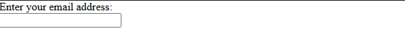

Bu tür kullanıldığında, değerin geçerli olabilmesi için bir e-posta adresi olması gerekir. Başka herhangi bir içerik girilmesi durumunda, form gönderildiğinde tarayıcı bir hata mesajı görüntüler. Aşağıdaki ekran görüntüsünde bunun nasıl çalıştığını görebilirsiniz.

**Görünüm:**

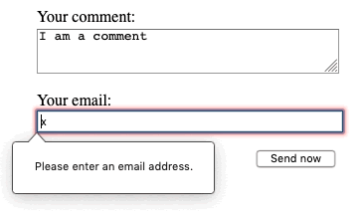

Aynı giriş alanına virgülle ayrılmış birden fazla e-posta adresinin girilmesini sağlamak için, “multiple” özniteliğini “email” giriş türüyle birlikte kullanabilirsiniz:

**HTML:**

```html
<input type="email" id="email" name="email" multiple />
```

Bazı cihazlarda — özellikle akıllı telefonlar gibi dinamik klavyeli dokunmatik cihazlarda — @ tuşu da dahil olmak üzere e-posta adreslerini girmek için daha uygun olan farklı bir sanal tuş takımı görüntülenebilir:

**Görünüm:**


Bu, bu yeni giriş türlerini kullanmak için bir başka iyi neden olup, bu cihazları kullananların kullanıcı deneyimini iyileştirir.

**Client-side validation(İstemci tarafında doğrulama):**

e-posta — diğer yeni giriş türleriyle birlikte — veriler sunucuya gönderilmeden önce tarayıcı tarafından gerçekleştirilen, yerleşik istemci tarafı hata doğrulama özelliği sunar. Bu, kullanıcıların formları doğru bir şekilde doldurmalarına yardımcı olur ve zaman tasarrufu sağlar: sunucuya gidip gelme sürecini beklemek yerine, verilerinizin doğru olmadığını anında öğrenmek oldukça yararlıdır.

> [!WARNING]
> İstemci tarafı (tarayıcı) doğrulama asla tek başına bir güvenlik önlemi değildir! Kötü niyetli kullanıcılar tarayıcı doğrulamasını kolayca devre dışı bırakıp HTTP isteğini değiştirebilir. Sunucu tarafında mutlaka güvenlik denetimi yapılmalıdır.

> [!NOTE]
> `a@b` ifadesi varsayılan kurala göre geçerli bir e-posta adresidir; çünkü `type="email"` intranet e-posta adreslerine (yerel ağ) varsayılan olarak izin verir. Farklı bir doğrulama davranışı uygulamak için pattern özniteliğini kullanabilirsiniz. Ayrıca hata mesajlarını da özelleştirebilirsiniz. Bu özelliklerin nasıl kullanılacağına ilişkin ayrıntılara, daha sonra “İstemci Tarafında Form Doğrulama” başlıklı makalede değineceğiz.

**Search field(Arama alanı):**

Arama alanları, sayfalarda ve uygulamalarda arama kutuları oluşturmak amacıyla tasarlanmıştır. Bu tür bir alan, tür özniteliği için “search” değeri kullanılarak ayarlanır:

**HTML:**

```html
<input type="search" id="search" name="search" />
```

**Görünüm:**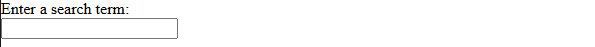

Bir metin alanı ile bir arama alanı arasındaki temel fark, tarayıcının bu alanların görünümünü nasıl şekillendirdiğidir. Bazı tarayıcılarda arama alanları yuvarlatılmış köşelerle görüntülenir. Bazı tarayıcılarda ise, tıklandığında alandaki tüm değerleri silen bir “Ⓧ” silme simgesi gösterilir. Bu silme simgesi yalnızca alanda bir değer varsa görünür ve Safari hariç, yalnızca alan odaklandığında görüntülenir. Ayrıca, dinamik klavyeye sahip cihazlarda klavyedeki Enter tuşunda “arama” yazısı yer alabilir veya bir büyüteç simgesi görüntülenebilir.

Dikkat çekici bir başka özellik ise, bir arama alanındaki değerlerin otomatik olarak kaydedilip aynı web sitesinin farklı sayfalarında otomatik tamamlama özelliği sunmak üzere yeniden kullanılabilmesidir; bu, çoğu modern tarayıcıda genellikle otomatik olarak gerçekleşir.

**Phone number field(Telefon numarası alanı):**

“type” özniteliğinin değeri olarak “tel” kullanılarak telefon numaralarının girilmesi için özel bir alan oluşturulabilir:

**HTML:**

```html
<input type="tel" id="tel" name="tel" />
```

**Görünüm:**

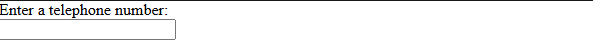

Dinamik klavyeye sahip bir dokunmatik cihazdan erişildiğinde, type="tel" özniteliği ile karşılaşıldığında çoğu cihazda sayısal tuş takımı görüntülenir; bu da, bu türün sayısal tuş takımı kullanışlı olduğu her durumda faydalı olduğu ve sadece telefon numaraları için kullanılmak zorunda olmadığı anlamına gelir.

**Görünüm:**


Dünya çapında telefon numarası biçimlerinin çok çeşitli olması nedeniyle, bu tür bir alan, kullanıcı tarafından girilen değer üzerinde herhangi bir kısıtlama uygulamaz (yani, harfler vb. içerebilir).

Daha önce de belirttiğimiz gibi, kısıtlamaları uygulamak için “pattern” özniteliği kullanılabilir; bu konuyu “İstemci Tarafında Form Doğrulama” bölümünde öğreneceksiniz.

**URL field(URL alanı):**

type özniteliği için url değeri kullanılarak, URL'leri girmek üzere özel bir alan türü oluşturulabilir:

**HTML:**

```html
<input type="url" id="url" name="url" />
```

**Görünüm:**

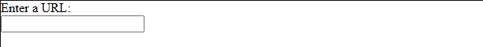

Bu, alana özel doğrulama kısıtlamaları ekler. Herhangi bir protokol (örneğin http:) girilmezse veya URL başka bir şekilde hatalı biçimlendirilmişse, tarayıcı bir hata bildirir. Dinamik klavyelere sahip cihazlarda, varsayılan klavye genellikle iki nokta üst üste, nokta ve eğik çizginin bir kısmını veya tamamını varsayılan tuşlar olarak gösterir.

> [!NOTE]
> Bir URL'nin biçimsel (sentaks) olarak doğru olması, o internet adresinin gerçekten var olduğu veya yayında olduğu anlamına gelmez.

**Numeric field(Sayısal alan):**

Sayı girişi için denetimler, \<input\> türündeki sayı denetimleriyle oluşturulabilir. Bu denetim bir metin alanına benzer, ancak yalnızca kayan noktalı sayılara izin verir ve genellikle denetimin değerini artırmak ve azaltmak için bir döner düğme şeklinde düğmeler sunar. Dinamik klavyeli cihazlarda genellikle sayısal klavye görüntülenir.

**HTML:**

```html
<input type="number" id="number" name="number" />
```

**Görünüm:**

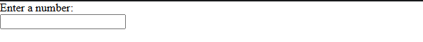

Sayı giriş türüyle, min ve max özniteliklerini ayarlayarak izin verilen minimum ve maksimum değerleri sınırlayabilirsiniz.

Ayrıca, step özniteliğini kullanarak, spinner düğmelerine basıldığında gerçekleşecek artış ve azalış adımlarını belirleyebilirsiniz. Varsayılan olarak, step özniteliğinin değeri 1 olduğundan, sayı giriş türü yalnızca sayı tam sayı ise geçerlilik kontrolü yapar. Kesirli sayılara izin vermek için step="any" değerini belirtin veya kesirli sayıları sınırlamak için step="0.01" gibi belirli bir değer girin. Bu öznitelik belirtilmezse, step değerinin varsayılan değeri 1 olduğundan yalnızca tam sayılar geçerli olur.

Şimdi birkaç örneğe bakalım:

Bu örnekte, geçerli değeri 1 ile 10 arasındaki tek sayılarla sınırlı bir sayı kontrolü oluşturulur. Artırma ve azaltma düğmeleri, değeri minimum değerden başlayarak 2'şer birim artırır veya azaltır.

**HTML:**

```html
<input type="number" name="age" id="age" min="1" max="10" step="2" />
```

**Görünüm:**

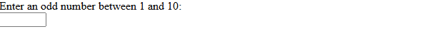

Bu örnekte, değeri 0 ile 1 arasında (her iki değer dahil) sınırlandırılmış ve artırma ile azaltma düğmeleriyle değeri 0,01'er artırılan veya azaltılan bir sayı kontrolü oluşturulur.

**HTML:**

```html
<input type="number" name="change" id="pennies" min="0" max="1" step="0.01" />
```

**Görünüm:**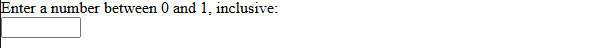

“Number” giriş türü, geçerli değer aralığının sınırlı olduğu durumlarda (örneğin bir kişinin yaşı veya boyu gibi) mantıklıdır. Aralığın, kademeli artışların mantıklı olamayacağı kadar geniş olması durumunda (örneğin 00001 ile 99999 arasında değişen ABD posta kodları gibi), “tel” türü daha iyi bir seçenek olabilir; bu tür, sayısal tuş takımını sunarken sayının döner çubuk kullanıcı arayüzü özelliğinden vazgeçer.

**Slider controls(Kaydırma çubukları):**

Bir sayı seçmenin bir başka yolu da kaydırma çubuğunu kullanmaktır. Bunları, örneğin alışveriş siteleri gibi, filtreleme yapmak için bir mülkün maksimum fiyatını belirlemek istediğiniz sitelerde sık sık görürsünüz. Bunu açıklamak için canlı bir örneğe bakalım:

**Görünüm:**


Kullanım açısından kaydırma çubukları, metin alanlarına göre daha az hassastır. Bu nedenle, kesin değeri çok da önemli olmayan bir sayıyı seçmek için kullanılırlar.

\<input\> etiketiyle, type özniteliği “range” değerine ayarlanmış bir kaydırma çubuğu oluşturulur. Kaydırma çubuğunun imleci, fare veya dokunma yoluyla ya da tuş takımındaki ok tuşlarıyla hareket ettirilebilir.

Kaydırma çubuğunuzu doğru şekilde yapılandırmanız önemlidir. Bu amaçla, sırasıyla minimum, maksimum ve artış değerlerini belirleyen min, max ve step özniteliklerini ayarlamanız şiddetle tavsiye edilir.

Yukarıdaki örneğin arkasındaki koda bir göz atalım ki, bunun nasıl yapıldığını görebilesiniz. Öncelikle, temel HTML kodu:

**HTML:**

```html
<label for="price">Choose a maximum house price: </label>
<input
type="range"
name="price"
id="price"
min="50000"
max="500000"
step="1000"
value="250000" />
<output class="price-output" for="price"></output>
```

Bu örnekte, değeri 50000 ile 500000 arasında değişebilen ve her seferinde 1000'er artan veya azalan bir kaydırıcı oluşturulmaktadır. \`value\` özniteliğini kullanarak kaydırıcıya 250000 değerinde bir varsayılan değer atadık.

Kaydırma çubuklarının bir sorunu, mevcut değerin ne olduğu konusunda herhangi bir görsel geri bildirim sunmamalarıdır. Bu nedenle, mevcut değeri barındırmak üzere bir \<output\> öğesi ekledik. Herhangi bir öğenin içinde bir giriş değerini veya bir hesaplamanın sonucunu görüntüleyebilirsiniz, ancak \<output\> — tıpkı \<label\> gibi — özel bir öğedir ve sonuç değerinin geldiği öğe veya öğelerle ilişkilendirmenizi sağlayan bir “for” özniteliği alabilir.

Mevcut değeri gerçekten görüntülemek ve değiştiğinde güncellemek için JavaScript kullanmanız gerekir; bu, birkaç komutla gerçekleştirilebilir:

**JS:**

```javascript
const price = document.querySelector("#price");
const output = document.querySelector(".price-output");
output.textContent = price.value;
price.addEventListener("input", () => {
output.textContent = price.value;
});
```

Burada, aralık girişi ve çıktısına ait referansları iki değişkende saklıyoruz. Ardından, çıktının textContent özelliğini hemen girişin o andaki değerine ayarlıyoruz. Son olarak, aralık kaydırıcısı her hareket ettirildiğinde çıktının textContent özelliğinin yeni değere güncellenmesini sağlamak için bir olay dinleyicisi ayarlanıyor.

**Date and time pickers(Tarih ve saat seçiciler):**

Genel olarak, tarih ve saat değerlerini toplarken iyi bir kullanıcı deneyimi sağlamak için bir takvim seçimi kullanıcı arayüzü sunmak önemlidir. Bu sayede kullanıcılar, yerel takvim uygulamasına geçmek zorunda kalmadan veya ayrıştırılması zor farklı biçimlerde tarih girmek zorunda kalmadan tarih seçebilirler. Geçen milenyumun son dakikası şu farklı şekillerde ifade edilebilir: 1999/12/31, 23:59 veya 12/31/99T11:59PM.

Bu özel veri türünü işlemek için HTML tarih denetimleri mevcuttur; bunlar takvim widget’ları sunar ve verileri tek tip hale getirir.

Tarih ve saat denetimi, \<input\> öğesi kullanılarak ve tarih, saat ya da her ikisini birden toplamak istediğinize bağlı olarak type özniteliği için uygun bir değer belirlenerek oluşturulur. İşte canlı bir örnek:

**Görünüm:**

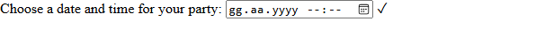

Mevcut farklı türlere kısaca bir göz atalım. Bu türlerin kullanımının, özellikle tarayıcı desteği göz önüne alındığında (aşağıya bakınız) oldukça karmaşık olduğunu unutmayın; tüm ayrıntıları öğrenmek için, ayrıntılı örnekler de dahil olmak üzere her bir türün referans sayfalarına yönlendiren aşağıdaki bağlantıları takip edin.

**Date(Tarih):**

\<input type="date"\>, bir tarihi (yıl, ay ve gün; saat bilgisi olmadan) görüntülemek ve seçmek için bir widget oluşturur.

```html
<input type="date" name="date" id="date" />
```

**Görünüm:**

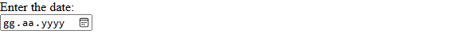

**Datetime-local:**

\<input type="datetime-local"\>, belirli bir saat dilimi bilgisi olmadan tarih ve saati görüntülemek ve seçmek için bir widget oluşturur.

**HTML:**

```html
<input type="datetime-local" name="datetime" id="datetime" />
```

**Görünüm:**

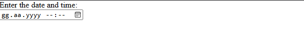

**Month(Ay):**

\<input type="month"\>, bir yılı içeren bir ayı görüntülemek ve seçmek için bir widget oluşturur.

**HTML:**

```html
<input type="month" name="month" id="month" />
```

**Görünüm:**

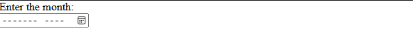

**Time(Zaman):**

\<input type="time"\>, bir zaman değerini görüntülemek ve seçmek için bir widget oluşturur. Zaman 12 saatlik biçimde görüntülenebilse de, döndürülen değer 24 saatlik biçimdedir.

**HTML:**

```html
<input type="time" name="time" id="time" />
```

**Görünüm:**

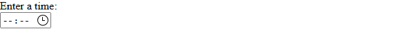

**Week(Hafta):**

\<input type="week"\>, bir hafta numarasını ve ilgili yılı görüntülemek ve seçmek için bir widget oluşturur.

Haftalar Pazartesi günü başlar ve Pazar gününe kadar sürer. Ayrıca, her yılın 1. haftası o yılın ilk Perşembe gününü içerir; bu, yılın ilk gününü kapsamayabileceği gibi, önceki yılın son birkaç gününü de kapsayabilir.

**HTML:**

```html
<input type="week" name="week" id="week" />
```

**Görünüm:**

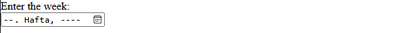

**Constraining date/time values**

**(Tarih/saat değerlerine kısıtlama getirme):**

Tüm tarih ve saat denetimleri, min ve max öznitelikleri kullanılarak kısıtlanabilir; ayrıca step özniteliği aracılığıyla da (değeri giriş türüne göre değişen) ek kısıtlamalar uygulanabilir.

**HTML:**

```html
<label for="myDate">When are you available this summer?</label><br />
<input
type="date"
name="myDate"
min="2025-06-01"
max="2025-08-31"
step="7"
id="myDate" />
```

**Görünüm:**

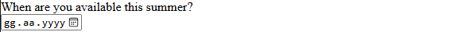

**Color picker control(Renk seçici denetimi):**

Renklerle çalışmak her zaman biraz zordur. Renkleri ifade etmenin pek çok yolu vardır: RGB değerleri (ondalık veya onaltılık), HSL değerleri, anahtar kelimeler vb.

\<input\> öğesi kullanılarak, type özniteliği color değerine ayarlanmış bir renk kontrolü oluşturulabilir:

**HTML:**

```html
<input type="color" name="color" id="color" />
```

**Görünüm:**

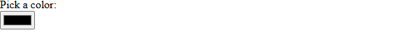

Bir renk denetimine tıkladığınızda, genellikle seçim yapabilmeniz için işletim sisteminin varsayılan renk seçme işlevi görüntülenir. Döndürülen değer her zaman küçük harfli, 6 basamaklı onaltılık bir renk kodudur.

**Özet:**

Böylece HTML5 form giriş türleri turumuzun sonuna geldik. Çok özel davranışları nedeniyle kolayca bir gruba dahil edilemeyen, ancak yine de bilinmesi gereken birkaç başka kontrol türü daha var. Bunları bir sonraki makalede ele alacağız.

**Other form controls(Diğer form denetimleri):**

Şimdi, açılır listeler ve çok satırlı metin alanları gibi diğer kontrol türlerinden, \<output\> öğesi (bunu bir önceki makalede uygulamalı olarak görmüştük) ve ilerleme çubukları gibi diğer kullanışlı form özelliklerine kadar, \<input\> dışındaki form öğelerinin işlevselliğini ayrıntılı olarak inceleyeceğiz.

|              |                                                                                                    |
|--------------|----------------------------------------------------------------------------------------------------|
| Ön koşullar: | HTML hakkında temel bilgi.                                                                         |
| Amaç:        | \<input\> dışındaki form özelliklerini ve bunların HTML kullanılarak nasıl uygulanacağını anlamak. |

**Multi-line text fields(Çok satırlı metin alanları):**

Çok satırlı bir metin alanı, \<input\> öğesi yerine \<textarea\> öğesi kullanılarak tanımlanır.

**HTML:**

```html
<textarea cols="30" rows="8"></textarea>
```

**Görünüm:**

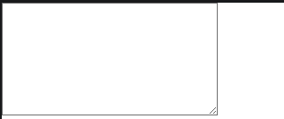

\<textarea\> ile normal tek satırlık metin alanı arasındaki temel fark, kullanıcıların veriler gönderildiğinde de aktarılacak sabit satır sonları (yani, Enter tuşuna basarak) ekleyebilmeleridir.

\<textarea\> etiketi de bir kapanış etiketi alır; bu etiketin içermesini istediğiniz varsayılan metin, açılış ve kapanış etiketleri arasına yerleştirilmelidir. Buna karşılık, \<input\> etiketi, kapanış etiketi olmayan boş bir öğedir — herhangi bir varsayılan değer, value özniteliğinin içine yazılır.

\<textarea\> öğesinin içine her ne yazarsa yazın (diğer HTML öğeleri, CSS ve JavaScript dahil), bu öğenin doğası gereği tümünün düz metin içeriğiymiş gibi görüntüleneceğini unutmayın. (Form dışı denetimlerde contenteditable özelliğinin kullanılması, düz metin yerine HTML/“zengin” içeriği yakalamak için bir API sağlar).

Görsel olarak, girilen metin satır sonlarına sığar ve form denetimi varsayılan olarak boyutlandırılabilir. Çoğu tarayıcı, metin alanının boyutunu artırmak veya azaltmak için sürükleyebileceğiniz bir sürükleme tutamağı sunar.

**Controlling multi-line rendering(Çok satırlı görüntülemenin kontrol edilmesi):**

\<textarea\> öğesi, birkaç satıra yayılmasını kontrol etmek için üç öznitelik kabul eder:

**Cols:**

Metin denetiminin görünür genişliğini (sütun sayısı), ortalama karakter genişlikleri cinsinden belirtir. Bu değer, \<textarea\> öğesinin boyutunun değiştirilmesiyle değiştirilebildiği ve CSS kullanılarak geçersiz kılınabildiği için, fiilen başlangıç genişliğidir. Belirtilmediği takdirde varsayılan değer 20’dir.

**Rows(Satır):**

Denetimin görünür metin satırlarının sayısını belirtir. Bu değer, \<textarea\> öğesinin boyutunun değiştirilmesiyle değiştirilebildiği ve CSS kullanılarak geçersiz kılınabildiği için, fiilen başlangıç yüksekliği olarak kabul edilir. Belirtilmediği takdirde varsayılan değer 2’dir.

**Wrap:**

Denetimin metni nasıl satır sonuna sığdıracağını belirler. Değerler şunlardır: soft (varsayılan değer); bu, gönderilen metnin satır sonuna sığdırılmadığı, ancak tarayıcı tarafından görüntülenen metnin satır sonuna sığdırıldığı anlamına gelir; hard (bu değer kullanılırken cols özniteliği belirtilmelidir); bu, hem gönderilen hem de görüntülenen metinlerin satır sonuna sığdırıldığı anlamına gelir; ve off; bu, satır sonuna sığdırmayı devre dışı bırakır.

**Controlling textarea resizability**

**(Textarea'nın boyut değiştirilebilirliğini kontrol etme):**

\<textarea\> öğesinin boyutunu değiştirme özelliği, CSS’deki resize özelliği ile kontrol edilir. Bu özelliğin alınabilecek değerleri şunlardır:

- both: Varsayılan ayar — yatay ve dikey yönde boyutlandırmaya izin verir.

- horizontal: Yalnızca yatay yönde boyutlandırmaya izin verir.

- vertical: Yalnızca dikey yönde boyutlandırmaya izin verir.

- none: Boyutlandırmaya izin vermez.

- block ve inline: Yalnızca blok veya satır içi yönde boyutlandırmaya izin veren deneysel değerlerdir (bu, metninizin yönüne göre değişir; daha fazla bilgi edinmek istiyorsanız “Farklı metin yönleriyle başa çıkma” bölümünü okuyun.)

  Bunların nasıl çalıştığını görmek için, boyut değiştirme referans sayfasının en üstünde yer alan etkileşimli örnekle deneme yapın.

  **Drop-down controls(Açılır menü denetimleri):**

  Açılır menüler, kullanıcıların kullanıcı arayüzünde fazla yer kaplamadan birçok seçenek arasından seçim yapabilmelerini sağlayan basit bir yöntemdir. HTML’de iki tür açılır menü bulunur: seçim kutusu ve otomatik tamamlama kutusu. Her iki açılır menü türünde de etkileşim aynıdır — menü etkinleştirildikten sonra tarayıcı, kullanıcının seçim yapabileceği değerlerin bir listesini görüntüler.

  **Select box(Seçim kutusu):**

  Bir veya daha fazla \<option\> öğesini alt öğesi olarak içeren bir \<select\> öğesi kullanılarak basit bir seçim kutusu oluşturulur; bu alt öğelerin her biri, olası değerlerden birini belirtir.

  **Basit örnek:**

  **HTML:**

```html
<select id="simple" name="simple">
<option>Banana</option>
<option selected>Cherry</option>
<option>Lemon</option>
</select>
```

  **Görünüm:**

  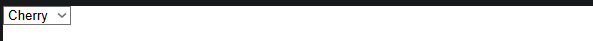

  Gerekirse, seçim kutusunun varsayılan değeri, istenen \<option\> öğesindeki “selected” özniteliği kullanılarak ayarlanabilir; bu durumda sayfa yüklendiğinde bu seçenek önceden seçili olarak görünür.

  **Using optgroup(optgroup kullanımı):**

  \<option\> öğeleri, görsel olarak birbiriyle ilişkili değer grupları oluşturmak amacıyla \<optgroup\> öğelerinin içine yerleştirilebilir:

  **HTML:**

```html
<select id="groups" name="groups">
<optgroup label="fruits">
<option>Banana</option>
<option selected>Cherry</option>
<option>Lemon</option>
</optgroup>
<optgroup label="vegetables">
<option>Carrot</option>
<option>Eggplant</option>
<option>Potato</option>
</optgroup>
</select>
```

  **Görünüm:**

  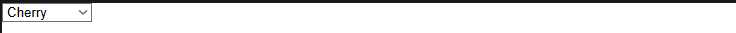

  \<optgroup\> öğesinde, label özniteliğinin değeri, iç içe geçmiş seçeneklerin değerlerinden önce görüntülenir. Tarayıcı genellikle bunları seçeneklerden görsel olarak ayırır (yani, kalın harflerle yazarak ve farklı bir iç içe geçme düzeyinde göstererek), böylece bunların gerçek seçeneklerle karıştırılma olasılığı azalır.

  **Using the value attribute(value özniteliğinin kullanılması):**

  Bir \<option\> öğesinde açıkça belirtilmiş bir value özniteliği varsa, bu seçenek seçili haldeyken form gönderildiğinde söz konusu değer iletilir. Yukarıdaki örneklerde olduğu gibi value özniteliği belirtilmezse, \<option\> öğesinin içeriği değer olarak kullanılır. Dolayısıyla value özniteliği zorunlu değildir; ancak seçim kutusunda görsel olarak gösterilenden daha kısa veya farklı bir değeri sunucuya göndermek isteyebileceğiniz durumlar olabilir.

  **Basit örnek:**

  **HTML:**

```html
<select id="simple" name="simple">
<option value="banana">Big, beautiful yellow banana</option>
<option value="cherry">Succulent, juicy cherry</option>
<option value="lemon">Sharp, powerful lemon</option>
</select>
```

  Varsayılan olarak, seçim kutusunun yüksekliği tek bir değeri görüntülemek için yeterlidir. İsteğe bağlı size özniteliği, seçim kutusu odaklanmadığında kaç seçeneğin görünür olacağını belirler.

  **Multiple choice select box(Çoktan seçmeli seçim kutusu):**

  Varsayılan olarak, bir seçim kutusu kullanıcının yalnızca bir değer seçmesine izin verir. \<select\> öğesine “multiple” özniteliğini ekleyerek, kullanıcıların birden fazla değer seçmesine izin verebilirsiniz. Kullanıcılar, işletim sistemi tarafından sağlanan varsayılan mekanizmayı kullanarak birden fazla değer seçebilir (örneğin, masaüstü bilgisayarlarda Cmd/Ctrl tuşlarını basılı tutarken birden fazla değere tıklanabilir).

  **HTML:**

```html
<select id="multi" name="multi" multiple size="3">
<optgroup label="fruits">
<option>Banana</option>
<option selected>Cherry</option>
<option>Lemon</option>
</optgroup>
<optgroup label="vegetables">
<option>Carrot</option>
<option>Eggplant</option>
<option>Potato</option>
</optgroup>
</select>
```

  **Görünüm:**

  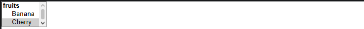

  **Autocomplete box(Otomatik tamamlama kutusu):**

  Görüntülenecek değerleri belirtmek için, \<datalist\> öğesini ve bunun altındaki \<option\> öğelerini kullanarak form bileşenleri için önerilen, otomatik olarak tamamlanan değerler sunabilirsiniz. \<datalist\> öğesine bir kimlik (id) atanması gerekir.

  Veri listesi daha sonra, \<input\> öğesine (örneğin, metin veya e-posta girişi türü) list özniteliği kullanılarak bağlanır; bu özniteliğin değeri, bağlanacak veri listesinin kimliğidir.

  Bir veri listesi bir form bileşeniyle ilişkilendirildiğinde, bu listenin seçenekleri kullanıcı tarafından girilen metni otomatik olarak tamamlamak için kullanılır; genellikle bu, kullanıcıya giriş alanına yazdıkları metne uygun olası eşleşmeleri listeleyen bir açılır menü olarak sunulur.

  **Basit örnek:**örneğe bir bakalım.

  **HTML:**

```html
<label for="myFruit">What's your favorite fruit?</label>
<input type="text" name="myFruit" id="myFruit" list="mySuggestion" />
<datalist id="mySuggestion">
<option>Apple</option>
<option>Banana</option>
<option>Blackberry</option>
<option>Blueberry</option>
<option>Lemon</option>
<option>Lychee</option>
<option>Peach</option>
<option>Pear</option>
</datalist>
```

  **Görünüm:**

  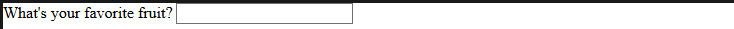

  **Less obvious datalist uses(Daha az bilinen datalist kullanımları):**

  HTML spesifikasyonuna göre, list özniteliği ve \<datalist\> öğesi, kullanıcı girdisi gerektiren her türlü widget ile kullanılabilir. Bu durum, ilk bakışta pek açık görünmeyen bazı kullanımlara yol açmaktadır.

  Örneğin, \<datalist\> özelliğini range giriş türlerinde destekleyen tarayıcılarda, her bir datalist \<option\> değeri için aralığın üzerinde küçük bir işaret görüntülenir. Bunun bir uygulama örneğini \<input type="range"\> referans sayfasında görebilirsiniz.

  Ayrıca, \<datalist\> ve \<input type="color"\> öğelerini destekleyen tarayıcılar, varsayılan olarak özelleştirilmiş bir renk paleti göstermeli, ancak tam renk paletini de kullanıma açık tutmalıdır.

  Bu durumda, farklı tarayıcılar duruma göre farklı davranışlar sergiler; bu nedenle bu tür kullanımları aşamalı geliştirme kapsamında değerlendirin ve sorunsuz bir şekilde geriye uyumlu olmalarını sağlayın.

  **Other form features(Diğer form özellikleri):**

  Daha önce bahsettiğimiz özellikler kadar göze çarpmayan, ancak yine de bazı durumlarda yararlı olan birkaç form özelliği daha var; bu nedenle bunlara kısaca değinmenin faydalı olacağını düşündük.

  **Meters and progress bars(Sayaçlar ve ilerleme çubukları):**

  Ölçerler ve ilerleme çubukları (\<meter\> ve \<progress\> öğeleri kullanılarak oluşturulan), sayısal değerlerin görsel gösterimleridir.

  **Meter(Sayaç):**

  Bir ölçer çubuğu, maksimum ve minimum değerlerle sınırlanan bir aralıktaki sabit bir değeri temsil eder. Bu değer görsel olarak bir çubuk şeklinde gösterilir ve bu çubuğun nasıl göründüğünü anlamak için, değeri diğer bazı belirlenmiş değerlerle karşılaştırırız:

- En düşük ve en yüksek değerler, aralığı aşağıdaki üç bölüme ayırır:

  - Aralığın alt kısmı, minimum ve düşük değerler arasındadır (bu değerler dahil).

  - Aralığın orta kısmı, düşük ve yüksek değerlerin arasında yer alır (bu değerler hariç).

  - Aralığın üst kısmı, yüksek değer ile maksimum değer arasında yer alır (bu değerler dahil).

&lt;!-- --&gt;

- Optimum değer, \<meter\> öğesi için optimum değeri belirler. Düşük ve yüksek değerlerle birlikte, aralığın hangi kısmının tercih edildiğini belirler:

  - Optimum değer aralığın alt kısmında yer alıyorsa, aralığın alt kısmı tercih edilen kısım, orta kısım ortalama kısım ve aralığın üst kısmı ise en kötü kısım olarak kabul edilir.

  - Optimum değer aralığın orta kısmında yer alıyorsa, aralığın alt kısmı ortalama bir kısım, orta kısmı tercih edilen kısım ve üst kısmı da yine ortalama bir kısım olarak kabul edilir.

  - Optimum değer aralığın üst kısmında yer alıyorsa, aralığın alt kısmı en kötü kısım, orta kısmı ortalama kısım ve üst kısmı ise tercih edilen kısım olarak kabul edilir.

    \<meter\> öğesini destekleyen tüm tarayıcılar, ölçer çubuğunun rengini değiştirmek için şu değerleri kullanır:

&lt;!-- --&gt;

- Mevcut değer aralığın tercih edilen kısmında ise, çubuk yeşil renktedir.

- Mevcut değer aralığın ortalama kısmında yer alıyorsa, çubuk sarı renktedir.

- Mevcut değer aralığın en kötü kısmında yer alıyorsa, çubuk kırmızı renktedir.

  Bu tür bir çubuk, \<meter\> öğesi kullanılarak oluşturulur. Bu öğe, her türlü göstergeyi uygulamak için kullanılır; örneğin, bir diskte kullanılan toplam alanı gösteren ve disk dolmaya başladığında kırmızıya dönen bir çubuk.

  **HTML:**

```html
<meter min="0" max="100" value="75" low="33" high="66" optimum="0">75</meter>
```

  **Görünüm:**

  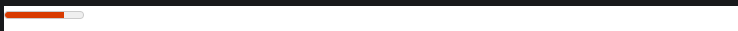

  \<meter\> öğesinin içindeki içerik, bu öğeyi desteklemeyen tarayıcılar ve onu sesli olarak okutmak isteyen yardımcı teknolojiler için bir yedek çözümdür.

  **Progress(İlerleme):**

  Bir ilerleme çubuğu, zaman içinde değişen ve “max” özniteliğiyle belirtilen maksimum değere kadar ulaşan bir değeri gösterir. Bu tür bir çubuk, \<progress\> öğesi kullanılarak oluşturulur.

  **HTML:**

```html
<progress max="100" value="75">75/100</progress>
```

  **Görünüm:**

  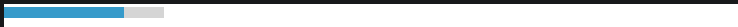

  Bu, indirilen toplam dosya sayısının yüzdesi veya bir ankette yanıtlanan soru sayısı gibi, ilerleme raporlaması gerektiren her türlü durumun uygulanması içindir.

  \<progress\> öğesinin içindeki içerik, bu öğeyi desteklemeyen tarayıcılar ve ekran okuyucuların bunu sesli olarak okumasını sağlamak amacıyla hazırlanmış bir yedek içeriğidir.

  **Özet:**

  Son birkaç makalede de gördüğünüz gibi, birçok farklı türde form denetimi bulunmaktadır. Tüm bu ayrıntıları bir kerede ezberlemenize gerek yoktur; ayrıntıları gözden geçirmek için bu makalelere istediğiniz sıklıkta geri dönebilirsiniz.

  Artık mevcut çeşitli form denetimlerinin arkasındaki HTML kodunu anladığınıza göre, şimdi de bunların stilini nasıl ayarlayacağımıza bir göz atacağız.

  **Styling web forms(Web formlarının biçimlendirilmesi):**

  Önceki birkaç makalede, HTML ile web formlarının nasıl oluşturulacağını göstermiştik. Şimdi ise CSS ile bu formlara nasıl stil vereceğimizi göstereceğiz.

|              |                                                                                                                         |
|--------------|-------------------------------------------------------------------------------------------------------------------------|
| Ön koşullar: | HTML ve CSS stil oluşturma ilkeleri hakkında temel bilgi.                                                               |
| Amaç:        | Formların stilini belirlemenin ardındaki konuları anlamak ve size faydalı olacak bazı temel stil tekniklerini öğrenmek. |

**Challenges in styling form widgets**

**(Form bileşenlerinin stilini belirlemede karşılaşılan zorluklar):**

**History(Tarihçe):**

1995 yılında, HTML 2 spesifikasyonu form denetimlerini (diğer adıyla “form widget’ları” veya “form öğeleri”) getirmiştir. Ancak CSS, 1996 yılının sonlarına kadar yayınlanmamış ve yıllar sonra çoğu tarayıcı tarafından desteklenmeye başlanmıştır; bu nedenle, bu ara dönemde tarayıcılar, form widget’larını görüntülemek için altta yatan işletim sistemine güvenmek zorunda kalmıştır.

CSS mevcut olsa bile, tarayıcı üreticileri başlangıçta form öğelerinin stil verilebilir hale getirilmesine isteksizdi; çünkü kullanıcılar kendi tarayıcılarının görünümlerine çok alışmışlardı. Ancak durum değişti ve birkaç istisna dışında form bileşenleri artık çoğunlukla stil verilebilir hale geldi.

**Types of widgets(Widget türleri):**

**Easy-to-style(Şekillendirmesi kolay):**

1.  \<form\>

2.  \<fieldset\> ve \<legend\>

3.  Tek satırlık metin \<input\>'leri (örn. metin, URL, e-posta), \<input type="search"\> hariç.

4.  Çok satırlı \<textarea\>

5.  Düğmeler (hem \<input\> hem de \<button\>)

6.  \<label\>

7.  \<output\>

    **Harder-to-style(Şekillendirmesi daha zor):**

- Onay kutuları ve seçim düğmeleri

- \<input type="search"\>

  “Gelişmiş form stillendirme” başlıklı makalede, bunların nasıl stillendirileceği anlatılmaktadır.

  **Having internals can't be styled in CSS alone**

  **(İç öğelerin stili yalnızca CSS ile belirlenemez):**

- \<input type="color"\>

- \<input type="datetime-local"\> gibi tarihle ilgili denetimler

- \<input type="range"\>

- \<input type="file"\>

- \<select\>, \<option\>, \<optgroup\> ve \<datalist\> dahil olmak üzere, açılır menü widget’larının oluşturulmasında kullanılan öğeler.

- \<progress\> ve \<meter\>

  Örneğin, tarih seçici takvimi ve \<select\> adresindeki, tıklandığında bir seçenek listesi görüntüleyen düğme, yalnızca CSS kullanılarak biçimlendirilemez.

  “Gelişmiş form stillendirme” ve “Özel form denetimleri nasıl oluşturulur?” başlıklı makalelerde, bunların nasıl stillendirileceği açıklanmaktadır.

  **Styling simple form widgets(Basit form bileşenlerini biçimlendirme):**

  Önceki bölümde bahsedilen “stil uygulaması kolay” widget’ların stilini, “İlk formunuz” ve “CSS yapı taşları” başlıklı makalelerde anlatılan teknikler kullanılarak belirleyebilirsiniz. Ayrıca, kullanıcı arayüzünün o anki durumuna göre stil uygulamanızı sağlayan özel seçiciler — UI sözde sınıfları — da mevcuttur.

  Bu makalenin sonunda bir örnek üzerinden inceleme yapacağız — ancak öncelikle, form stilinin bilmeye değer bazı özel yönlerini ele alalım.

  **Fonts and text(Yazı tipleri ve metin):**

  CSS yazı tipi ve metin özellikleri herhangi bir widget ile kolayca kullanılabilir (ve evet, form widget’larında @font-face kullanabilirsiniz). Ancak tarayıcıların davranışları genellikle tutarsızdır. Varsayılan olarak, bazı widget’lar üst öğelerinden font-family ve font-size özelliklerini devralmaz. Bunun yerine birçok tarayıcı, sistemin varsayılan görünümünü kullanır. Formlarınızın görünümünü içeriğinizin geri kalanıyla tutarlı hale getirmek için stil sayfanıza aşağıdaki kuralları ekleyebilirsiniz:

  **CSS:**

  **button,**

  **input,**

  **select,**

```css
textarea {
font-family: inherit;
font-size: 100%;
}
```

  “inherit” özellik değeri, söz konusu özelliğin değerinin üst öğenin özelliğinin hesaplanan değeriyle eşleşmesini sağlar; böylece üst öğenin değeri devralınır.

  Aşağıdaki ekran görüntüleri aradaki farkı göstermektedir. Solda, macOS üzerinde Chrome tarayıcısında \<input type="text"\>, \<input type="date"\>, \<select\>, \<textarea\>, \<input type="submit"\> ve \<button\> öğelerinin, platformun varsayılan yazı tipi stili kullanılarak görüntülenmiş hali yer almaktadır. Sağda ise aynı öğeler, yukarıda belirtilen stil kuralı uygulanmış haliyle gösterilmektedir.

  **Görünüm:**

  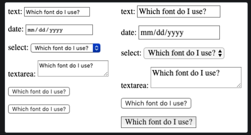

  Varsayılan ayarlar birçok açıdan farklılık gösteriyordu. Kalıtım, yazı tiplerini üst öğenin yazı tipi ailesine göre değiştirmelidir — bu durumda, üst kapsayıcının varsayılan serif yazı tipi.

> [!NOTE]
> Chrome tarayıcısında `<input type="submit">` üst öğeden yazı tipi ailesini (font-family) miras almaz; varsayılan olarak `system-ui` kullanır. Bu nedenle `<button>` kullanmak daha tutarlıdır.

  Formların, sistemin varsayılan stilleriyle mi yoksa içeriğinize uyacak şekilde tasarlanmış özelleştirilmiş stillerle mi daha iyi göründüğü konusunda pek çok tartışma vardır. Bu kararı, sitenizin veya web uygulamanızın tasarımcısı olarak siz vermelisiniz.

  **Box sizing(Kutu boyutlandırma):**

  Tüm metin alanları, genişlik, yükseklik, iç boşluk, kenar boşluğu ve kenarlık gibi CSS kutu modeliyle ilgili her türlü özelliği tam olarak destekler. Ancak daha önce olduğu gibi, tarayıcılar bu widget’ları görüntülerken sistemin varsayılan stillerini kullanır. Bunları içeriğinize nasıl entegre etmek istediğiniz size kalmıştır. Widget’ların özgün görünüm ve hissini korumak istiyorsanız, onlara tutarlı bir boyut vermek istediğinizde biraz zorlukla karşılaşabilirsiniz.

  Bunun nedeni, her bir widget’ın kenarlık, iç dolgu ve kenar boşluğu için kendine özgü kurallara sahip olmasıdır. Birkaç farklı widget’a aynı boyutu vermek için, box-sizing özelliğini diğer özellikler için tutarlı değerlerle birlikte kullanabilirsiniz:

  **CSS:**

  **input,**

  **textarea,**

  **select,**

```css
button {
width: 150px;
padding: 0;
margin: 0;
box-sizing: border-box;
}
```

  Aşağıdaki ekran görüntüsünde, sol sütun bir \<input type="radio"\>, \<input type="checkbox"\>, \<input type="range"\>, \<input type="text"\>, \<input type="date"\>, \<select\>, \<textarea\>, \<input type="submit"\> ve \<button\> öğelerinin varsayılan görüntülenişini göstermektedir. Sağ sütun ise aynı öğeleri, yukarıdaki kuralımız uygulanmış haliyle göstermektedir. Bu sayede, platformun her bir widget türü için belirlediği varsayılan kurallara rağmen, tüm öğelerin aynı miktarda yer kaplamasını nasıl sağladığımıza dikkat edin.

  **Görünüm:**

  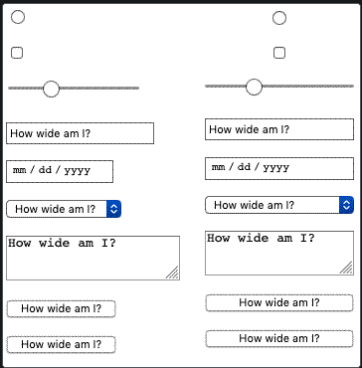

  Ekran görüntüsünden açıkça anlaşılmayabilecek bir nokta, radyo düğmesi ve onay kutusu denetimlerinin görünüş olarak aynı kalmasına rağmen, “width” özelliğiyle sağlanan 150 piksel genişlikteki yatay alanda ortalanmış olmalarıdır. Diğer tarayıcılar bu denetimleri ortalamayabilir, ancak ayrılan alana uymaktadırlar.

  **Legend placement(açıklama yerleşimi):**

  \<legend\> öğesine stil uygulamak mümkündür, ancak konumunu kontrol etmek biraz zor olabilir. Varsayılan olarak, bu öğe her zaman \<fieldset\> üst öğesinin üst kenarının üzerine, sol üst köşeye yakın bir yerde konumlandırılır. Bu öğeyi başka bir yere, örneğin fieldset’in içine veya sol alt köşeye yakın bir yere yerleştirmek için konumlandırma özelliklerini kullanmanız gerekir.

  Şu örneği ele alalım:

  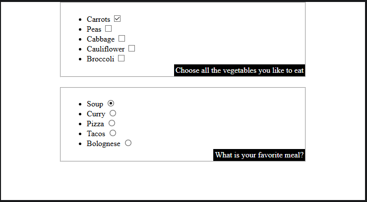

  Açıklama metnini bu şekilde konumlandırmak için aşağıdaki CSS kodunu kullandık (kısalık amacıyla diğer tanımlamalar çıkarılmıştır):

  **CSS:**

```css
fieldset {
position: relative;
}
legend {
position: absolute;
bottom: 0;
right: 0;
}
```

  \<fieldset\> öğesinin de konumlandırılması gerekir; böylece \<legend\> öğesi ona göre konumlandırılır (aksi takdirde \<legend\> öğesi, \<body\> öğesine göre konumlandırılır).

  \<legend\> öğesi erişilebilirlik açısından çok önemlidir — bu öğe, fieldset içindeki her bir form öğesinin etiketinin bir parçası olarak yardımcı teknolojiler tarafından seslendirilecektir — ancak yukarıdaki gibi bir teknik kullanmak da uygundur. Legend öğesinin içeriği yine aynı şekilde seslendirilecektir; sadece görsel konumu değişmiştir.

  **A specific styling example(Somut bir stil örneği):**

  HTML formuna stil uygulamanın somut bir örneğine bakalım. Şık görünümlü bir “kartpostal” iletişim formu oluşturacağız; bitmiş halini burada görebilirsiniz.

  Bu örneği adım adım takip etmek istiyorsanız, postcard-start.html dosyasının yerel bir kopyasını oluşturun ve aşağıdaki talimatları izleyin.

  **The HTML(HTML):**

  Bu HTML kodu, “İlk formunuz” başlıklı bölümde kullandığımız örnekten sadece biraz daha karmaşıktır; sadece birkaç ek ID ve bir başlık içerir.

  **HTML:**

```html
<form>
<h1>to: Mozilla</h1>
<div id="from">
<label for="name">from:</label>
<input type="text" id="name" name="user_name" />
</div>
<div id="reply">
<label for="mail">reply:</label>
<input type="email" id="mail" name="user_email" />
</div>
<div id="message">
<label for="msg">Your message:</label>
<textarea id="msg" name="user_message"></textarea>
</div>
<div class="button">
<button type="submit">Send your message</button>
</div>
</form>
```

  Yukarıdaki kodu HTML sayfanızın gövdesine ekleyin.

  **Organizing your assets(Varlıklarınızı düzenleme):**

  İşte eğlence burada başlıyor! Kodlamaya başlamadan önce üç ek öğeye ihtiyacımız var:

1.  Kartpostal arka planı — bu görseli indirin ve çalışma HTML dosyanızla aynı dizine kaydedin.

2.  Bir daktilo yazı tipi: dafont.com sitesinden “Veteran Typewriter” yazı tipi — ZIP dosyasını indirin, açın ve TTF dosyasını yukarıdaki dizine kopyalayın.

3.  El yazısı yazı tipi: dafont.com sitesinden “Journal” yazı tipi — ZIP dosyasını indirin, açın ve TTF dosyasını yukarıdaki ile aynı dizine kopyalayın.

    Başlamadan önce yazı tiplerinizin biraz daha işlenmesi gerekiyor:

&lt;!-- --&gt;

1.  Transfonter Webfont oluşturucusuna gidin.

2.  “Yazı tiplerini ekle” düğmesine basın ve her iki TTF dosyanızı da yükleyin.

3.  Yükleme tamamlandığında, bir web yazı tipi kiti oluşturmak için “Dönüştür” düğmesine basın.

4.  “İndir” bağlantısını kullanarak kiti bilgisayarınıza indirin.

5.  Sağlanan zip dosyasını açın.

6.  Açılan klasörün içinde bazı yazı tipi dosyaları bulacaksınız (bu yazının yazıldığı tarihte iki .woff dosyası ve iki .woff2 dosyası; gelecekte bu sayılar değişebilir). Bu dosyaları, daha önce oluşturduğunuz “fonts” adlı klasöre kopyalayın. Tarayıcı uyumluluğunu en üst düzeye çıkarmak için her yazı tipi için iki farklı dosya kullanıyoruz; daha fazla bilgi için Web yazı tipleri makalemize bakın.

    **The CSS(CSS):**

    Şimdi örneğin CSS kodunu inceleyebiliriz. Aşağıda gösterilen tüm kod bloklarını, verilen \<style\> öğesinin içine arka arkaya ekleyin.

    **Overall layout(Genel düzen):**

    Öncelikle, @font-face kurallarımızı tanımlayarak ve \<body\> ile \<form\> öğeleri için belirlenen tüm temel stilleri ayarlayarak hazırlık yapıyoruz.

    İndirdiğiniz web yazı tipi setinin içindeki stylesheet.css dosyasında @font-face bloklarını bulun ve aşağıdaki @font-face bloklarını bunlarla değiştirin. Yazı tipi dosyalarının yollarını güncelleyin ve Journal ile Veteran Typewriter yazı tipi ailelerinin adlarının sırasıyla handwriting ve typewriter olarak ayarlandığından emin olun. Transfonter çıktınız bizimkinden biraz farklı olabilir, ancak istenen değişiklikleri yaptığınız sürece sorun yoktur.

    **CSS:**

```css
@font-face {
font-family: "handwriting";
```

    **src:**

    **url("fonts/Journal.woff2") format("woff2"),**

```css
url("fonts/Journal.woff") format("woff");
font-weight: normal;
font-style: normal;
font-display: swap;
}
@font-face {
font-family: "typewriter";
```

    **src:**

    **url("fonts/VeteranTypewriter.woff2") format("woff2"),**

```css
url("fonts/VeteranTypewriter.woff") format("woff");
font-weight: normal;
font-style: normal;
font-display: swap;
}
body {
font: 1.3rem sans-serif;
padding: 0.5em;
margin: 0;
background: #222222;
}
form {
position: relative;
width: 740px;
height: 498px;
margin: 0 auto;
padding: 1em;
box-sizing: border-box;
background: white url("background.jpg");
/* we create our grid */
display: grid;
gap: 20px;
grid-template-columns: repeat(2, 1fr);
grid-template-rows: 10em 1em 1em 1em;
}
```

    Formun düzenini oluşturmak için biraz CSS Grid ve Flexbox kullandığımızı unutmayın. Bunları kullanarak başlık ve tüm form öğeleri dahil olmak üzere öğelerimizi kolayca yerleştirebiliriz:

    **CSS:**

```css
h1 {
```

    **font:**

    **1em "typewriter",**

```css
monospace;
align-self: end;
}
#message {
grid-row: 1 / 5;
}
#from,
#reply {
display: flex;
}
```

    **Labels and controls(Etiketler ve denetimler):**

    Artık form öğelerinin kendileri üzerinde çalışmaya başlayabiliriz. Öncelikle, \<label\> öğelerine doğru yazı tipi atandığından emin olalım:

    **CSS:**

```css
label {
```

    **font:**

    **0.8em "typewriter",**

```
sans-serif;
}
```

    Metin alanları için bazı genel kurallar gereklidir. Başka bir deyişle, bu alanların kenarlıklarını ve arka planlarını kaldırıp, iç boşluklarını ve kenar boşluklarını yeniden tanımlıyoruz:

    **CSS:**

    **input,**

```css
textarea {
```

    **font:**

    **1.4em/1.5em "handwriting",**

    **cursive,**

```
sans-serif;
border: none;
padding: 0 10px;
margin: 0;
width: 80%;
background: none;
}
```

    Bu alanlardan biri odaklandığında, onu açık gri, şeffaf bir arka planla vurgularız (kullanılabilirlik ve klavye erişilebilirliği açısından odak stiline sahip olmak her zaman önemlidir):

    **CSS:**

    **input:focus,**

```css
textarea:focus {
background: rgb(0 0 0 / 10%);
border-radius: 5px;
}
```

    Metin alanlarımız tamamlandığına göre, tek satırlık ve çok satırlık metin alanlarının görünümünü birbirine uyumlu hale getirmemiz gerekiyor; zira varsayılan ayarlarla genellikle aynı görünmezler.

    **Tweaking the text areas(Metin alanlarını düzenleme):**

    \<textarea\> öğeleri varsayılan olarak inline-block öğesi olarak görüntülenir. Burada dikkat edilmesi gereken iki önemli nokta, resize ve overflow özellikleridir. Tasarımımız sabit boyutlu olsa da ve resize özelliğini kullanarak kullanıcıların çok satırlı metin alanımızın boyutunu değiştirmesini engelleyebilsek de, kullanıcıların istedikleri takdirde bir textarea’nın boyutunu değiştirmesini engellememek en iyisidir. overflow özelliği, alanın tarayıcılar arasında daha tutarlı bir şekilde görüntülenmesini sağlamak için kullanılır. Bazı tarayıcılarda varsayılan değer auto iken, bazılarında scroll'dur. Bizim durumumuzda, herkesin auto değerini kullanacağından emin olmak daha iyidir:

    **CSS:**

```css
textarea {
display: block;
padding: 10px;
margin: 10px 0 0 -10px;
width: 100%;
height: 90%;
border-right: 1px solid;
/* resize : none; */
overflow: auto;
}
```

    **Styling the submit button(Gönder düğmesinin stilini belirleme):**

    \<button\> öğesini CSS ile biçimlendirmek gerçekten çok kolaydır; isterseniz sahte öğeler kullanarak bile dilediğiniz her şeyi yapabilirsiniz:

    **CSS:**

```css
button {
padding: 5px;
font: bold 0.6em sans-serif;
border: 2px solid #333333;
border-radius: 5px;
background: none;
cursor: pointer;
transform: rotate(-1.5deg);
}
button::after {
content: " >>>";
}
button:hover,
button:focus {
background: black;
color: white;
}
```

    **The final result(son sonuç):**

    Ve işte! Formunuz artık şuna benzer bir görünüme sahip olmalı:

    **Görünüm:**

    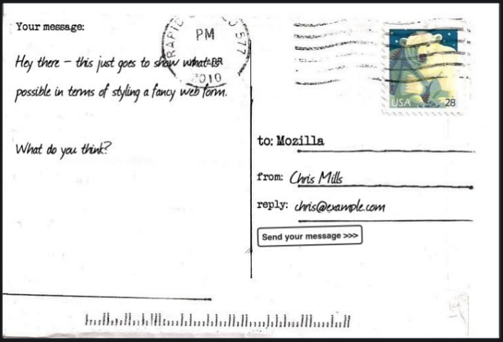

    **Özet:**

    Gördüğünüz gibi, formları yalnızca metin alanları ve düğmelerden oluşturmak istediğimiz sürece, bunları CSS kullanarak kolayca biçimlendirebiliriz. Bir sonraki makalede ise, “kötü” ve “çirkin” kategorilerine giren form bileşenlerini nasıl ele alacağımızı göreceğiz.

    **Advanced form styling(Gelişmiş form biçimlendirme):**

    Bu makalede, stil vermesi daha zor olan form denetim türlerini — yani “kötü” ve “çirkin” kategorilerindeki denetimleri — CSS ile nasıl stilize edebileceğimizi inceleyeceğiz. Bir önceki makalede gördüğümüz gibi, metin alanları ve düğmelerin stilini vermek son derece kolaydır; şimdi ise daha sorunlu olan kısımların stilini vermeye odaklanacağız.

|              |                                                                                                                                                  |
|--------------|--------------------------------------------------------------------------------------------------------------------------------------------------|
| Ön koşullar: | HTML ve CSS hakkında temel bilgi.                                                                                                                |
| Amaç:        | Formların hangi kısımlarının stil vermesi zor olduğunu ve bunun nedenlerini anlamak; bunları özelleştirmek için neler yapılabileceğini öğrenmek. |

Bir önceki makalede söylediklerimizi özetlemek gerekirse, elimizde şunlar var:

Olumsuz yönleri: Bazı öğelerin stilini ayarlamak daha zordur; bu da daha karmaşık CSS kodları veya daha özel bazı püf noktaları gerektirir:

- Onay kutuları ve seçim düğmeleri

- \<input type="search"\>

  Olumsuz yön: Bazı öğelerin CSS kullanılarak tam anlamıyla biçimlendirilmesi mümkün değildir. Bunlar arasında şunlar yer alır:

- \<select\>, \<option\>, \<optgroup\> ve \<datalist\> dahil olmak üzere, açılır menü widget’larının oluşturulmasında kullanılan öğeler.

- \<input type="color"\>

- \<input type="datetime-local"\> gibi tarihle ilgili denetimler

- \<input type="range"\>

- \<input type="file"\>

- \<progress\> ve \<meter\>

  Öncelikle, yukarıda bahsedilen tüm unsurları daha stilize edilebilir hale getirmede yararlı olan “appearance” özelliğinden bahsedelim.

  **Appearance: controlling OS-level styling**

  **(görünüm: İşletim sistemi düzeyinde stil ayarlaması):**

  Bir önceki makalede, tarihsel olarak web form denetimlerinin stilinin büyük ölçüde altta yatan işletim sisteminden kaynaklandığını belirtmiştik; bu durum, söz konusu denetimlerin görünümünü özelleştirmenin zor olmasının nedenlerinden biridir.

  appearance özelliği, web formu denetimlerine hangi işletim sistemi veya sistem düzeyindeki stilin uygulanacağını kontrol etmek amacıyla oluşturulmuştur. Bu özellik için en yararlı değer, ve muhtemelen kullanacağınız tek değer, “none”dır. Bu değer, uyguladığınız herhangi bir denetimin sistem düzeyindeki stilleri mümkün olduğunca kullanmasını engeller ve stilleri CSS kullanarak kendiniz oluşturmanıza olanak tanır.

  Örneğin, şu kontrol öğelerini ele alalım:

  **HTML:**

```html
<p>
<label for="search">search: </label>
<input id="search" name="search" type="search" />
</p>
<p>
<label for="text">text: </label>
<input id="text" name="text" type="text" />
</p>
<p>
<label for="date">date: </label>
<input id="date" name="date" type="datetime-local" />
</p>
<p>
<label for="radio">radio: </label>
<input id="radio" name="radio" type="radio" />
</p>
<p>
<label for="checkbox">checkbox: </label>
<input id="checkbox" name="checkbox" type="checkbox" />
</p>
<p><input type="submit" value="submit" /></p>
<p><input type="button" value="button" /></p>
```

  Aşağıdaki CSS kodunu bunlara uyguladığınızda, sistem düzeyindeki stil özellikleri kaldırılır.

  **CSS:**

```css
input {
appearance: none;
}
```

  Aşağıdaki canlı örnek, bunların sisteminizde nasıl göründüğünü göstermektedir — solda varsayılan görünüm, sağda ise yukarıdaki CSS uygulandığında nasıl göründüğü.

  **Görünüm:**

  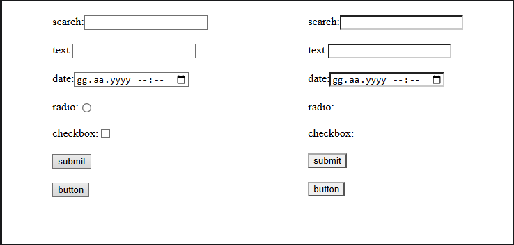

  Çoğu durumda, bu işlem stilize edilmiş kenarlığı kaldırır; bu da CSS ile stil vermeyi biraz kolaylaştırır, ancak zorunlu değildir. Radyo düğmeleri ve onay kutuları gibi bazı durumlarda ise bu işlem çok daha kullanışlı hale gelir. Şimdi bunlara bir göz atalım.

  **Search boxes and appearance(Arama kutuları ve görünüm):**

  appearance: none; değeri, eskiden \<input type="search"\> öğelerine tutarlı bir şekilde stil uygulamak için özellikle kullanışlıydı. Bu değer olmadan Safari, bu öğelere yükseklik veya yazı tipi boyutu değerlerinin ayarlanmasına izin vermiyordu. Ancak Safari 16 ve sonraki sürümlerde durum artık böyle değildir. Tarayıcı destek matrisinizde 16'dan eski Safari sürümleri yer alıyorsa, yine de input\[type=“search”\] öğelerini appearance: none; ile açıkça hedeflemek isteyebilirsiniz.

  Arama girişlerinde, değer boş olmadığında görünen “x” silme düğmesi, Edge ve Chrome’da girişin odağı kaybolduğunda kaybolur, ancak Safari’de yerinde kalır. CSS yoluyla kaldırmak için aşağıdaki kuralı kullanabilirsiniz:

  **CSS:**

```css
input[type="search"]:not(:focus, :active)::-webkit-search-cancel-button {
display: none;
}
Setting form control color tints using accent-color
```

  **(“accent-color” kullanarak form denetimlerinin renk tonlarını ayarlama):**

  Yalnızca onay kutularının, radyo düğmelerinin veya aralık kaydırıcılarının ana renk tonunu biçimlendirmek istiyorsanız, “accent-color” özelliği “appearance: none” ayarına gerek kalmadan bunu sağlar. Bu, temel biçimlendirme durumları için kullanışlıdır; çünkü denetimler işletim sistemi düzeyindeki biçimlerini korurken ana renkleri değiştirilir.

  **HTML:**

```html
<fieldset>
<legend>Fruit preferences</legend>
<p>
<label>
<input type="checkbox" name="fruit" value="cherry" checked />
I like cherry
</label>
</p>
<p>
<label>
<input type="radio" name="favorite" value="banana" checked />
Banana is my favorite
</label>
</p>
<p>
<label>
How much do you like fruit?
<input type="range" name="amount" min="0" max="10" value="7" />
</label>
</p>
</fieldset>
```

  **CSS:**

```css
input {
accent-color: rebeccapurple;
}
```

  **Görünüm:**

  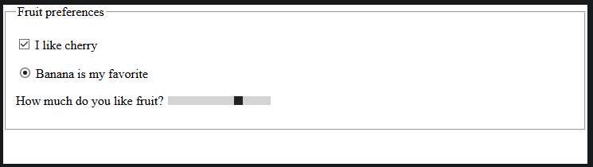

  Kontroller orijinal görünümlerini korudukları için, sizin tarafınızdan ek bir işlem yapmanıza gerek kalmadan platform kurallarına — zorunlu renk modları dahil — uyarlar. Ayrıca, tarayıcı, kontrolün erişilebilirliğini sağlamak için vurgu rengiyle yeterli kontrast oluşturan tamamlayıcı bir ikincil rengi otomatik olarak seçer. Yukarıdaki canlı örneği deneyin ve etkilerini görmek için bazı açık ve koyu vurgu rengi değerleri ayarlayın.

  **Styling checkboxes and radio buttons using appearance**

  **(Görünüm özelliğini kullanarak onay kutularını ve radyo düğmelerini biçimlendirme):**

  Bir onay kutusunun veya radyo düğmesinin stilini daha fazla özelleştirmek daha fazla çaba gerektirir. Onay kutuları ve radyo düğmelerinin varsayılan boyutları değiştirilmek üzere tasarlanmamıştır ve bunu denediğinizde tarayıcılar çok farklı tepkiler verir. Bazıları kontrolün boyutunu artırırken, bazıları ise boyutunu aynı tutar ve kontrolün etrafına fazladan boşluk ekler.

  Çok daha iyi bir yaklaşım, \`appearance: none;\` ile onay kutularının ve radyo düğmelerinin varsayılan görünümünü tamamen ortadan kaldırmak ve ardından bunların çeşitli durumlarına kendi stillerinizi eklemektir.

  Şu HTML örneğini ele alalım:

  **HTML:**

```html
<fieldset>
<legend>Fruit preferences</legend>
<p>
<label>
<input type="checkbox" name="fruit" value="cherry" />
I like cherry
</label>
</p>
<p>
<label>
<input type="checkbox" name="fruit" value="banana" disabled />
I can't like banana
</label>
</p>
<p>
<label>
<input type="checkbox" name="fruit" value="strawberry" />
I like strawberry
</label>
</p>
</fieldset>
```

  Bunlara özel bir onay kutusu tasarımı uygulayalım. Öncelikle orijinal onay kutusu stillerini kaldırarak başlayacağız:

  **CSS:**

```css
input[type="checkbox"] {
appearance: none;
}
```

  Böylece, durumları değiştikçe özel onay kutularımızın görünümünü değiştirmek için :checked ve :disabled sözde sınıflarını kullanabiliriz:

  **CSS:**

```css
input[type="checkbox"] {
position: relative;
width: 1em;
height: 1em;
border: 1px solid gray;
/* Adjusts the position of the checkboxes on the text baseline */
vertical-align: -2px;
/* Set here so that Windows' High-Contrast Mode can override */
color: green;
}
input[type="checkbox"]::before {
content: "✔";
position: absolute;
font-size: 1.2em;
right: -1px;
top: -0.3em;
visibility: hidden;
}
input[type="checkbox"]:checked::before {
/* Use `visibility` instead of `display` to avoid recalculating layout */
visibility: visible;
}
input[type="checkbox"]:disabled {
border-color: black;
background: #dddddd;
color: gray;
}
```

  Bu tür sözde sınıflar ve daha fazlası hakkında bir sonraki makalede daha ayrıntılı bilgi edineceksiniz; yukarıdakiler şu işlevleri yerine getirir:

- :checked — onay kutusu (veya radyo düğmesi) işaretli durumdadır — kullanıcı bunu tıklamış/etkinleştirmiştir.

- :disabled — onay kutusu (veya radyo düğmesi) devre dışı durumdadır — bu öğeyle etkileşim kurulamaz.

  **Görünüm:**

  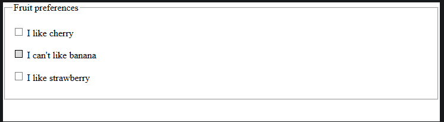

  Size daha fazla fikir vermek amacıyla birkaç örnek daha hazırladık:

- Şekillendirilmiş radyo düğmeleri: Özel radyo düğmesi stillendirme.

- Toggle anahtarı örneği: Toggle anahtarı gibi görünecek şekilde stillendirilmiş bir onay kutusu.

  **What can be done about the "ugly" elements?**

  **(“Çirkin” unsurlar konusunda ne yapılabilir?):**

  Şimdi dikkatimizi “çirkin” denilen denetimlere yöneltelim — yani stilini tam anlamıyla düzenlemesi gerçekten zor olanlara. Kısacası bunlar, açılır menüler, renk ve yerel tarih-saat gibi karmaşık denetim türleri ile \<progress\> ve \<meter\> gibi geri bildirim odaklı denetimlerdir.

  Sorun şu ki, bu öğelerin tarayıcılarda varsayılan görünümleri birbirinden çok farklıdır ve her ne kadar bunları belirli şekillerde biçimlendirebilseniz de, iç yapılarındaki bazı kısımları biçimlendirmek imkânsızdır.

  Görünüm ve his açısından bazı farklılıklarla yaşamaya hazırsanız, birkaç basit stil ayarlamasıyla durumu önemli ölçüde iyileştirebilirsiniz. Buna, arka plan rengi gibi özelliklerin boyutlarının ve stillerinin tutarlı bir şekilde ayarlanması ve bazı sistem düzeyindeki stil özelliklerini kaldırmak için \`appearance\` özelliğinin kullanılması da dahildir.

  Aşağıdaki örneği ele alalım; bu örnekte, “çirkin” biçim özelliklerinden birkaçı uygulamada gösterilmektedir:

  **Görünüm:**

  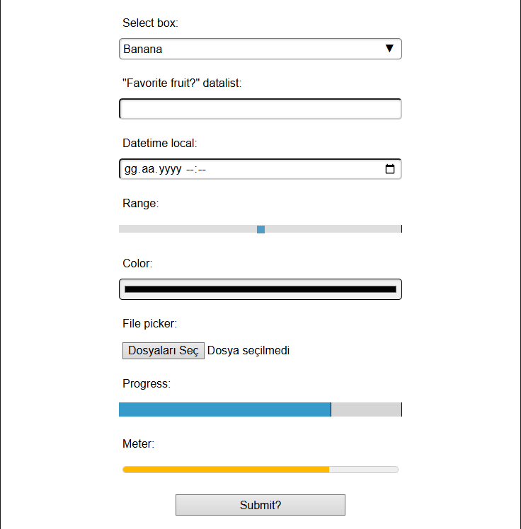

  Ayrıca, MDN Playground'da örneği çalıştırmak ve kaynak kodunu düzenlemek için Oynat düğmesine basabilirsiniz.

  Bu örneğe aşağıdaki CSS uygulanmıştır:

  **CSS:**

```css
body {
font-family: "Josefin Sans", sans-serif;
margin: 20px auto;
max-width: 400px;
}
.controls > div {
margin-bottom: 20px;
}
select {
appearance: none;
width: 100%;
height: 100%;
}
.select-wrapper {
position: relative;
}
.select-wrapper::after {
content: "▼";
font-size: 1rem;
top: 6px;
right: 10px;
position: absolute;
}
button,
label,
input,
select,
progress,
meter {
display: block;
font-family: inherit;
font-size: 100%;
margin: 0;
box-sizing: border-box;
width: 100%;
padding: 5px;
height: 30px;
}
input[type="text"],
input[type="datetime-local"],
input[type="color"],
select {
box-shadow: inset 1px 1px 3px #cccccc;
border-radius: 5px;
}
label {
margin-bottom: 5px;
}
button {
width: 60%;
margin: 0 auto;
}
```

  Dosya seçici tarafından seçilen dosyaları listeleyen sayfaya, kontrolün hemen altına bir JavaScript kodu ekledik. Bu, \<input type="file"\> referans sayfasında yer alan örneğin basitleştirilmiş bir versiyonudur:

  **JS:**

```javascript
const fileInput = document.querySelector("#file");
const fileList = document.querySelector("#file-list");
fileInput.addEventListener("change", updateFileList);
function updateFileList() {
while (fileList.firstChild) {
fileList.removeChild(fileList.firstChild);
}
const curFiles = fileInput.files;
if (!(curFiles.length === 0)) {
for (const file of curFiles) {
const listItem = document.createElement("li");
listItem.textContent = `File name: \${file.name}; file size: \${returnFileSize(file.size)}.`;
fileList.appendChild(listItem);
}
}
}
function returnFileSize(number) {
if (number < 1e3) {
return `\${number} bytes`;
} else if (number >= 1e3 && number < 1e6) {
return `\${(number / 1e3).toFixed(1)} KB`;
}
return `\${(number / 1e6).toFixed(1)} MB`;
}
```

  **“Global” stiller:**

  Önceki örnekte, çirkin kontrollerimizin modern tarayıcılarda tek tip görünmesini sağlamayı oldukça iyi başardık.

  Önceki makalede de belirtildiği gibi, tüm denetimlere ve etiketlerine, boyutlarının aynı şekilde ayarlanması, üst öğenin yazı tipini benimsemesi vb. amaçlarla bazı genel normalleştirme CSS kuralları uyguladık:

  **CSS:**

  **button,**

  **label,**

  **input,**

  **select,**

  **progress,**

```css
meter {
display: block;
font-family: inherit;
font-size: 100%;
margin: 0;
box-sizing: border-box;
width: 100%;
padding: 5px;
height: 30px;
}
```

  Ayrıca, uygun olduğu yerlerde denetimlere tek tip gölge ve yuvarlatılmış köşeler ekledik:

  **CSS:**

```css
input[type="text"],
input[type="datetime-local"],
input[type="color"],
select {
box-shadow: inset 1px 1px 3px #cccccc;
border-radius: 5px;
}
```

  Aralık türleri, ilerleme çubukları ve göstergeler gibi diğer denetimlerde ise, denetim alanının etrafına çirkin bir kutu ekliyorlar; bu da hiç mantıklı gelmiyor.

  Şimdi bu kontrol türlerinin her birinin bazı ayrıntılarını ele alalım ve bu süreçteki zorlukları da vurgulayalım.

  **Selects and datalists(Seçimler ve veri listeleri):**

  Bazı tarayıcılar artık “Özelleştirilebilir select öğeleri”ni desteklemektedir. Bu, \<select\> öğelerinin ve içeriklerinin, tıpkı herhangi bir standart DOM öğesi gibi tamamen özelleştirilmesini sağlayan bir dizi HTML ve CSS özelliğidir. Bu özelliği destekleyen tarayıcılarda ve kod tabanlarında, \<select\> öğeleriyle ilgili olarak aşağıda açıklanan eski teknikler konusunda artık endişelenmenize gerek yoktur.

  Veri listeleri ve seçim kutularını stilize etmek (özelleştirilebilir seçim kutularını desteklemeyen tarayıcılarda), görünüm ve hissi varsayılanlardan çok fazla değiştirmek istemediğiniz sürece kabul edilebilir düzeyde bir özelleştirme imkânı sunar. Kutuların oldukça tekdüze ve tutarlı görünmesini sağlamayı başardık. Zaten veri listesini çağıran denetim bir \<input type="text"\> öğesidir, bu yüzden bunun bir sorun olmayacağını biliyorduk.

  İki husus biraz daha sorunlu. Öncelikle, bunun bir açılır menü olduğunu gösteren select öğesinin “ok” simgesi tarayıcılardan tarayıcıya farklılık gösteriyor. Ayrıca, select kutusunun boyutunu büyütürseniz ya da çirkin bir şekilde yeniden boyutlandırırsanız bu simge de değişme eğilimindedir. Örneğimizde bunu düzeltmek için, öncelikle eski dostumuz \`appearance: none\` özelliğini kullanarak simgeyi tamamen ortadan kaldırdık:

  **CSS:**

```css
select {
appearance: none;
}
```

  Ardından, oluşturulan içeriği kullanarak kendi simgemizi tasarladık. Kontrolün etrafına ek bir sarmalayıcı yerleştirdik, çünkü ::before/::after, \<select\> öğelerinde çalışmaz (bu öğelerin içeriği tamamen tarayıcı tarafından kontrol edilir):

  **HTML:**

```html
<label for="select">Select a fruit</label>
<div class="select-wrapper">
<select id="select" name="select">
<option>Banana</option>
<option>Cherry</option>
<option>Lemon</option>
</select>
</div>
```

  Ardından, oluşturulan içeriği kullanarak küçük bir aşağı ok oluşturuyoruz ve konumlandırma özelliğini kullanarak bunu doğru yere yerleştiriyoruz:

  **CSS:**

```css
.select-wrapper {
position: relative;
}
.select-wrapper::after {
content: "▼";
font-size: 1rem;
top: 6px;
right: 10px;
position: absolute;
}
```

  İkinci ve biraz daha önemli olan konu ise, \<select\> kutucuğuna tıklayarak açtığınızda seçenekleri içeren kutucuk üzerinde herhangi bir kontrolünüzün olmamasıdır. Üst öğede ayarlanan yazı tipini devralabilirsiniz, ancak aralık ve renkler gibi ayarları yapamazsınız. Aynı durum, \<datalist\> ile görüntülenen otomatik tamamlama listesi için de geçerlidir.

  Seçeneklerin görünümünü tam olarak kontrol etmeniz gerekiyorsa, ya bir kütüphane kullanarak özel bir denetim oluşturmanız ya da kendi denetiminizi geliştirmeniz gerekecektir. \<select\> örneğinde, “multiple” özniteliğini kullanarak tüm seçeneklerin sayfada görünmesini sağlayabilir ve bu özel sorunu aşabilirsiniz:

  **HTML:**

```html
<label for="select">Select fruits</label>
<select id="select" name="select" multiple>
…
</select>
```

  Elbette, bu durum hedeflediğiniz tasarıma uymayabilir, ancak yine de dikkate alınmaya değer!

  **Date input types(Tarih giriş türleri):**

  Tarih/saat giriş türlerinin (datetime-local, time, week, month) hepsinde aynı temel sorun mevcuttur. Bu giriş alanlarını barındıran kutuya stil uygulamak, herhangi bir metin girişi kadar kolaydır ve bu demoda gördüğümüz sonuç gayet iyi görünüyor.

  Ancak, kontrolün iç bileşenleri (örneğin, tarih seçmek için kullandığınız açılır takvim, değerleri artırmak veya azaltmak için kullanabileceğiniz döner çubuk) hiçbir şekilde stil verilebilir değildir ve bunları \`appearance: none;\` kullanarak ortadan kaldıramazsınız. Stil üzerinde tam kontrol sahibi olmanız gerekiyorsa, ya özel bir kontrol oluşturmak için bir kütüphane kullanmanız ya da kendi kontrolünüzü geliştirmeniz gerekecektir.

  **Range input types(Aralık giriş türleri):**

  \<input type="range"\> öğesinin stilini ayarlamak can sıkıcıdır. Varsayılan kaydırma çubuğunu tamamen kaldırıp yerine özel bir stil (bu örnekte ince kırmızı bir çubuk) uygulamak için aşağıdaki gibi bir kod kullanabilirsiniz:

  **CSS:**

```css
input[type="range"] {
appearance: none;
background: red;
height: 2px;
padding: 0;
outline: 1px solid transparent;
}
```

  Ancak, aralık kontrolünün sürükleme tutamacının stilini özelleştirmek oldukça zordur — aralığın stilini tam olarak kontrol edebilmek için, standart dışı ve tarayıcıya özgü birçok sözde öğe içeren karmaşık CSS kodları kullanmanız gerekecektir. Bunun için nelerin gerekli olduğuna dair ayrıntılı bir açıklamayı CSS Tricks’teki “CSS ile Tarayıcılar Arası Uyumlu Aralık Girişlerinin Stilini Belirleme” başlıklı yazıda bulabilirsiniz.

  **Color input types(Renk giriş türleri):**

  “color” türündeki giriş denetimleri fena sayılmaz. Bu özelliği destekleyen tarayıcılarda, genellikle küçük bir kenarlık içeren düz renkli bir blok gösterirler.

  Şu şekilde bir yöntem kullanarak kenarlığı kaldırıp sadece renkli bloğu bırakabilirsiniz:

  **CSS:**

```css
input[type="color"] {
border: 0;
padding: 0;
}
```

  Ancak, önemli ölçüde farklı bir sonuç elde etmenin tek yolu özel bir çözümdür.

  **File input types(Dosya giriş türleri):**

  “file” türündeki girdiler genellikle sorunsuzdur — sayfanın geri kalanıyla uyumlu bir şey oluşturmak oldukça kolaydır. Girdiye böyle bir talimat verirseniz, denetimin bir parçası olan çıktı satırı üst öğenin yazı tipini devralır ve dosya adları ile boyutlarından oluşan özel listeyi istediğiniz şekilde biçimlendirebilirsiniz.

  Dosya seçiciyi açmak için tıkladığınız düğme, diğer tüm düğmelerle aynı özellikleri kabul eden ::file-selector-button sözde öğesi ile biçimlendirilebilir:

  **HTML:**

```html
<label for="avatar">Choose a profile picture</label>
<input id="avatar" name="avatar" type="file" />
```

  **CSS:**

```css
input[type="file"]::file-selector-button {
border: 1px solid darkgrey;
border-radius: 5px;
background: linear-gradient(to bottom, #eeeeee, #cccccc);
padding: 0.25em 0.75em;
font: inherit;
}
```

  **Görünüm:**

  

  Düğmenin yanındaki metni — “dosya seçilmedi” mesajı — ya da dosya seçildikten sonra görüntülenen dosya adını biçimlendiremezsiniz. Bu metin tarayıcı tarafından oluşturulur ve CSS’ye açık değildir. Bu sorunu aşmak için, kontrolün etiketini ve etikete tıklanmasının kontrolü etkinleştirdiği gerçeğini kullanın.

  Gerçek form girişini şu şekilde gizleyebilirsiniz:

  **CSS:**

```css
input[type="file"] {
height: 0;
padding: 0;
opacity: 0;
}
```

  Ardından, etiketi bir düğme gibi davranacak şekilde biçimlendirin; bu düğmeye basıldığında, beklendiği gibi dosya seçici açılacaktır:

  **CSS:**

```css
label[for="file"] {
box-shadow: 1px 1px 3px #cccccc;
background: linear-gradient(to bottom, #eeeeee, #cccccc);
border: 1px solid darkgrey;
border-radius: 5px;
text-align: center;
line-height: 1.5;
}
label[for="file"]:hover {
background: linear-gradient(to bottom, white, #dddddd);
}
label[for="file"]:active {
box-shadow: inset 1px 1px 3px #cccccc;
}
```

  Yukarıdaki CSS stilinin sonucunu aşağıdaki canlı örnekte görebilirsiniz.

  **Görünüm:**

  

  Ayrıca, MDN Playground'da örneği çalıştırmak ve kaynak kodun tamamını incelemek için Oynat düğmesine basabilirsiniz.

  **Meters and progress bars(Sayaçlar ve ilerleme çubukları):**

  \<meter\> ve \<progress\> muhtemelen bu tür öğeler arasında en kötüleridir. Önceki örnekte de gördüğünüz gibi, bunları istenen genişliğe nispeten doğru bir şekilde ayarlayabiliriz. Ancak bunun ötesinde, stil vermeleri gerçekten zordur. Yükseklik ayarlarını hem kendi aralarında hem de tarayıcılar arasında tutarlı bir şekilde uygulamazlar; arka planı renklendirebilirsiniz ancak ön plan çubuğunu renklendiremezsiniz; ayrıca bunlara \`appearance: none\` ayarını uygulamak durumu daha da kötüleştirir, iyileştirmez.

  Bu özelliklerin stilini kontrol etmek için kendi özel çözümünüzü oluşturmak ya da progressbar.js gibi bir üçüncü taraf çözümünü kullanmak daha kolaydır.

  **Özet:**

  HTML formlarının stilini belirlemek bazı zorluklar barındırır; ancak bunların çoğunu aşmanın yolları vardır. Kesin ve evrensel bir çözüm bulunmamakla birlikte, modern tarayıcılar yeni imkânlar sunmaktadır. Şu an için en iyi çözüm, farklı tarayıcıların HTML form denetimlerine uygulanan CSS’yi nasıl desteklediğini daha ayrıntılı olarak öğrenmektir.

  Bir sonraki makalede, bu amaçla sunulan özel ve modern HTML ve CSS özelliklerini kullanarak tamamen özelleştirilmiş \<select\> öğelerinin oluşturulmasını ele alacağız.

  **Customizable select elements(Özelleştirilebilir seçim öğeleri):**

  Bu makale, deneysel tarayıcı özelliklerini kullanarak tamamen özelleştirilmiş \<select\> öğelerinin nasıl oluşturulacağını açıklamaktadır. Buna, seçim düğmesi, açılır menü, ok simgesi, mevcut seçimin işaret işareti ve her bir \<option\> öğesinin stilini tam olarak kontrol etme imkânı da dahildir.

  **Background(Arka Plan):**

  Geleneksel olarak, \<select\> öğelerinin görünümünü ve hissini özelleştirmek zor olmuştur; çünkü bu öğeler, işletim sistemi düzeyinde stil verilen ve CSS kullanılarak hedeflenemeyen iç bileşenler içerir. Bunlar arasında açılır menü seçici, ok simgesi ve benzeri öğeler yer alır.

  Daha önce, özel bir JavaScript kütüphanesi kullanmanın dışında mevcut en iyi seçenek, işletim sistemi düzeyindeki stilin bir kısmını ortadan kaldırmak için \<select\> öğesinin “none” görünüm değerini ayarlamak ve ardından stil verilebilen kısımları özelleştirmek için CSS kullanmaktı. Bu teknik, “Gelişmiş form stillendirme” bölümünde açıklanmaktadır.

  Özelleştirilebilir \<select\> öğeleri bu sorunlara bir çözüm sunar. Bu öğeler, yalnızca HTML ve CSS kullanarak aşağıdaki gibi örnekler oluşturmanıza olanak tanır; bu örnekler, destekleyen tarayıcılarda tamamen özelleştirilebilir. Buna \<select\> ve açılır menü seçicisinin düzeni, renk şeması, simgeler, yazı tipi, geçiş efektleri, konumlandırma, seçilen simgeyi gösteren işaretçiler ve daha fazlası dahildir.

  **Görünüm:**

  

  Buna ek olarak, mevcut işlevselliğin üzerine aşamalı bir geliştirme sunarlar ve bu özelliği desteklemeyen tarayıcılarda “klasik” seçim menülerine geri dönerler.

  Aşağıdaki bölümlerde bu örneği nasıl oluşturacağınızı öğreneceksiniz.

  **What features comprise a customizable select?**

  **(Özelleştirilebilir bir seçim öğesini hangi özellikler oluşturur?):**

  Aşağıdaki HTML ve CSS özelliklerini kullanarak özelleştirilebilir \<select\> öğeleri oluşturabilirsiniz:

- \<selectedcontent\> öğesi, isteğe bağlı olarak \<select\> öğesinin ilk alt öğesi olan \<button\> öğesinin içine eklenebilir; böylece, kapalı \<select\> öğesinin içinde o anda seçili olan değer görüntülenebilir. Bu öğe, o anda seçili olan \<option\> öğesinin içeriğinin bir kopyasını içerir (arka planda cloneNode() işlevi kullanılarak oluşturulur).

- ::picker(select) sözde öğesi, seçici öğesinin tüm içeriğini hedefler. Bu, ilk alt \<button\> öğesi hariç, \<select\> öğesinin içindeki tüm öğeleri içerir.

- “base-select” görünüm özelliği değeri, \<select\> öğesini ve ::picker(select) sözde öğesini, özelleştirilebilir select için tarayıcı tarafından tanımlanan varsayılan stil ve davranışlara uyarlamaktadır.

- :open sözde sınıfı, seçici (::picker(select)) açıkken seç düğmesini hedefler.

- ::picker-icon sözde öğesi, seçim düğmesinin içindeki simgeyi hedefler — yani, seçim kapalıyken aşağıyı gösteren ok.

- :checked sözde sınıfı, o anda seçili olan \<option\> öğesini hedefler.

- ::checkmark sözde öğesi, hangi öğenin seçili olduğunu görsel olarak belirtmek amacıyla, o anda seçili olan \<option\> öğesinin içine yerleştirilmiş onay işaretini hedefler.

  Buna ek olarak, \<select\> öğesi ve buna ait açılır menü seçicisi, örtük bir bağlantı referansına sahiptir; bu, seçicinin CSS bağlantı konumlandırması yoluyla \<select\> öğesiyle otomatik olarak ilişkilendirildiği anlamına gelir. Tarayıcının varsayılan stilleri, seçiciyi düğmeye (bağlantı noktasına) göre konumlandırır ve bu konumu, “Öğeleri bağlantı noktalarına göre konumlandırma” bölümünde açıklandığı şekilde özelleştirebilirsiniz. Tarayıcının varsayılan stilleri ayrıca, seçicinin görüntü alanını taşma tehlikesi olması durumunda konumunu yeniden ayarlayan bazı konum deneme yedek çözümleri de tanımlar. Konum deneme yedek çözümleri, “Taşma durumunu yönetme: deneme yedek çözümleri ve koşullu gizleme” bölümünde açıklanmaktadır.

  Sayfanın üst kısmında gösterilen örneği adım adım inceleyerek, yukarıda bahsedilen tüm özelliklerin nasıl çalıştığına bir göz atalım.

  **Customizable select markup(Özelleştirilebilir seçim işaretlemesi):**

  Örneğimiz, bir evcil hayvan seçmenize olanak tanıyan tipik bir \<select\> menüsüdür. İşaretleme şöyledir:

  **HTML:**

```html
<form>
<p>
<label for="pet-select">Select pet:</label>
<select id="pet-select">
<button>
<selectedcontent></selectedcontent>
</button>
<option value="">Please select a pet</option>
<option value="cat">
<span class="icon" aria-hidden="true">🐱</span>
<span class="option-label">Cat</span>
</option>
<option value="dog">
<span class="icon" aria-hidden="true">🐶</span>
<span class="option-label">Dog</span>
</option>
<option value="hamster">
<span class="icon" aria-hidden="true">🐹</span>
<span class="option-label">Hamster</span>
</option>
<option value="chicken">
<span class="icon" aria-hidden="true">🐔</span>
<span class="option-label">Chicken</span>
</option>
<option value="fish">
<span class="icon" aria-hidden="true">🐟</span>
<span class="option-label">Fish</span>
</option>
<option value="snake">
<span class="icon" aria-hidden="true">🐍</span>
<span class="option-label">Snake</span>
</option>
</select>
</p>
</form>
```

  Örnek işaretleme, “klasik” \<select\> işaretlemesiyle neredeyse aynıdır; ancak aşağıdaki farklılıklar vardır:

- \<button\>\<selectedcontent\>\</selectedcontent\>\</button\> yapısı, \<button\> seçimini temsil eder. \<selectedcontent\> öğesinin eklenmesi, tarayıcının o anda seçili olan \<option\> öğesini düğmenin içine kopyalamasına neden olur; böylece bu öğe için özel stiller belirleyebilirsiniz. Bu yapı işaretlemenize dahil edilmezse, tarayıcı seçili seçeneğin metnini varsayılan düğmenin içinde görüntülemeye devam eder ve bu metne stil uygulamak o kadar kolay olmaz.

- \<select\> içeriğinin geri kalanı, açılır menüyü temsil eder; bu menü genellikle, menüdeki farklı seçenekleri temsil eden \<option\> öğeleriyle sınırlıdır. Menüye başka içerikler de ekleyebilirsiniz, ancak bu tavsiye edilmez.

- Geleneksel olarak, \<option\> öğeleri yalnızca metin içerebilirdi; ancak özelleştirilebilir bir seçim listesinde resimler, etkileşimli olmayan diğer metin düzeyindeki anlamsal öğeler ve daha fazlası gibi başka işaretleme yapılarını da ekleyebilirsiniz. Hatta ::before ve ::after sözde öğelerini kullanarak başka içerikler de ekleyebilirsiniz; ancak bunların gönderilebilir değere dahil edilmeyeceğini unutmayın. Örneğimizde, her bir \<option\> öğesi, sırasıyla bir simge ve bir metin etiketi içeren iki \<span\> öğesi barındırır; bu sayede her birinin stili ve konumu bağımsız olarak belirlenebilir.

  Bu tasarım, bu özelliği desteklemeyen tarayıcıların klasik \<select\> deneyimine geri dönmesini sağlar. \<button\>\<selectedcontent\>\</selectedcontent\>\</button\> yapısı tamamen göz ardı edilecek ve metin dışı \<option\> içerikler kaldırılarak yalnızca metin düğümü içerikleri kalacaktır; ancak sonuç yine de çalışır durumda olacaktır.

  **Opting in to the custom select rendering**

  **(Özel seçim görüntüleme özelliğini etkinleştirme):**

  Özel seçim işlevini ve minimal tarayıcı temel stillerini etkinleştirmek (ve işletim sistemi tarafından sağlanan stilleri kaldırmak) için, \<select\> öğenize ve bunun açılır menü seçicisine (::picker(select) sözde öğesiyle temsil edilir) her ikisine de “base-select” görünüm değeri atanmalıdır:

  **CSS:**

  **select,**

```css
::picker(select) {
appearance: base-select;
}
```

  Yeni işlevselliği yalnızca \<select\> öğesi için etkinleştirmeyi seçebilir ve seçiciyi varsayılan işletim sistemi stilinde bırakabilirsiniz; ancak çoğu durumda her ikisini de etkinleştirmek isteyeceksiniz. \<select\> öğesini etkinleştirmeden seçiciyi etkinleştiremezsiniz.

  Bu işlem tamamlandığında, sonuçta \<select\> öğesinin oldukça sade bir görüntüsü ortaya çıkar:

  **Görünüm:**

  

  Artık bunu istediğiniz şekilde şekillendirebilirsiniz. Öncelikle, \<select\> öğesinde özel kenarlık, arka plan (:hover veya :focus durumlarında değişir) ve iç boşluk değerleri ayarlanmış; ayrıca arka plan değişikliğinin yumuşak bir şekilde gerçekleşmesi için bir geçiş efekti eklenmiştir:

  **CSS:**

```css
select {
border: 2px solid #dddddd;
background: #eeeeee;
padding: 10px;
transition: 0.4s;
}
select:hover,
select:focus {
background: #dddddd;
}
```

  **Styling the picker icon(Seçici simgesini biçimlendirme):**

  Seçim düğmesinin içindeki simgeyi — seçim kapalıyken aşağıyı gösteren ok — biçimlendirmek için, ::picker-icon sözde öğesini kullanarak bu simgeyi hedefleyebilirsiniz. Aşağıdaki kod, simgeye özel bir renk ve bir geçiş efekti atayarak, rotate özelliğindeki değişikliklerin yumuşak bir animasyonla gösterilmesini sağlar:

  **CSS:**

```css
select::picker-icon {
color: #999999;
transition: 0.4s rotate;
}
```

  Ardından, ::picker-icon, :open sözde sınıfıyla birleştirilir — bu sözde sınıf, açılır menü seçici açık olduğunda yalnızca seçme düğmesini hedefler — böylece \<select\> açıldığında simgeye 180deg döndürme değeri verilir.

  **CSS:**

```css
select:open::picker-icon {
rotate: 180deg;
}
```

  Şimdiye kadar yapılan çalışmaya bir göz atalım — \<select\> açılıp kapandığında seçici okunun 180 derece boyunca ne kadar akıcı bir şekilde döndüğüne dikkat edin:

  **Görünüm:**

  

  **Styling the drop-down picker(Açılır menü seçicisinin stilini belirleme):**

  Açılır menü, ::picker(select) sözde öğesi kullanılarak hedeflenebilir. Daha önce de belirtildiği gibi, açılır menü, \<select\> öğesinin içinde düğme ve \<selectedcontent\> öğesi dışında kalan her şeyi içerir. Örneğimizde bu, tüm \<option\> öğelerini ve bunların içeriklerini ifade eder.

  Seçici bir açılır penceredir. Bu nedenle, seçici açıldığında içeriği (::picker(select) sözde öğesi içinde bulunan) en üst katmana taşınır. Bu, seçicinin diğer öğelerin üzerinde görüntülenmesini ve sayfadaki diğer açılır pencerelerle sorunsuz bir şekilde etkileşime girmesini sağlar (örneğin, halihazırda açık olan ve konuyla ilgisi olmayan açılır pencereleri kapatır).

  Örneğimizde, öncelikle seçicinin varsayılan siyah kenarlığını kaldırarak başlıyoruz:

  **CSS:**

```css
::picker(select) {
border: none;
}
```

  Artık \<option\> öğelerinin stil ayarları yapılmıştır. Bu öğeler flexbox ile düzenlenerek, hepsi flex konteynerinin başlangıcına hizalanmış ve aralarında 20 piksel boşluk bırakılmıştır. Ayrıca, tutarlı bir görünüm ve his sağlamak amacıyla her bir \<option\> öğesine \<select\> öğesiyle aynı kenarlık, arka plan, iç dolgu ve geçiş özellikleri atanmıştır:

  **CSS:**

```css
option {
display: flex;
justify-content: flex-start;
gap: 20px;
border: 2px solid #dddddd;
background: #eeeeee;
padding: 10px;
transition: 0.4s;
}
```

  Ardından, :first-of-type, :last-of-type ve :not() sözde sınıflarının bir kombinasyonu kullanılarak, üst ve alt \<option\> öğelerine uygun bir border-radius ayarlanır ve tüm \<option\> öğelerinden border-bottom kaldırılır — sonuncusu hariç; böylece kenarlıklar dağınık ve çift görünmez. Ayrıca, sayfada farklı bir arka plan rengi belirlemeye karar vermemiz durumunda seçeneklerin etrafında çirkin, kare şeklinde beyaz bir kutu oluşmaması için dıştaki ::picker(select) konteynerine de aynı kenarlık yarıçapı ayarlıyoruz.

  **CSS:**

```css
option:first-of-type {
border-radius: 8px 8px 0 0;
}
option:last-of-type {
border-radius: 0 0 8px 8px;
}
::picker(select) {
border-radius: 8px;
}
option:not(option:last-of-type) {
border-bottom: none;
}
```

  Ardından, zebra deseni oluşturmak için :nth-of-type(odd) seçicisi kullanılarak tek sayılı \<option\> öğelerine farklı bir arka plan rengi atanır; ayrıca, seçim sırasında kullanışlı bir görsel vurgu sağlamak amacıyla, odaklandığında ve fareyle üzerine gelindiğinde \<option\> öğelerine farklı bir arka plan rengi atanır:

  **CSS:**

```css
option:nth-of-type(odd) {
background: white;
}
option:hover,
option:focus {
background: plum;
}
```

  Son olarak, bu bölümde \<option\> simgelerine (icon sınıfına sahip \<span\> öğeleri içinde yer alan) daha büyük bir yazı tipi boyutu atanarak simgelerin boyutu artırılmış ve text-box özelliği kullanılarak simge emojilerinin blok başlangıcı ve sonu kenarlarında bulunan rahatsız edici boşlukların bir kısmı ortadan kaldırılmış, böylece simgelerin metin etiketleriyle daha iyi hizalanması sağlanmıştır:

  **CSS:**

```css
option .icon {
font-size: 1.6rem;
text-box: trim-both cap alphabetic;
}
```

  Örneğimiz artık şu şekilde görüntüleniyor:

  

  **Adjusting the styling of the selected option contents inside the select button**

  **(Seçim düğmesi içindeki seçili seçenek içeriğinin stilini ayarlama):**

  Son birkaç canlı örnekten herhangi bir evcil hayvan seçeneğini seçerseniz, bir sorun fark edeceksiniz — evcil hayvan simgeleri, seçim düğmesinin yüksekliğinin artmasına neden oluyor; bu da seçici simgesinin konumunu değiştiriyor ve seçenek simgesi ile etiket arasında boşluk kalmıyor.

  Bu sorun, simgenin \<selectedcontent\> etiketinin içine alındığında gizlenmesiyle çözülebilir. Bu etiket, seçme düğmesinin içinde görünen seçili \<option\> öğesinin içeriğini temsil eder. Örneğimizde, simge display: none kullanılarak gizlenmiştir:

  **CSS:**

```css
selectedcontent .icon {
display: none;
}
```

  Bu, açılır menü seçicisinin içinde görüntülenen \<option\> içeriğinin biçimlendirmesini etkilemez.

  **Styling the currently selected option(Şu anda seçili olan seçeneğin stilini belirleme):**

  Şu anda seçili olan \<option\> öğesini, açılır menü seçicisinin içinde göründüğü şekilde biçimlendirmek için, :checked sözde sınıfını kullanarak bu öğeyi hedefleyebilirsiniz. Bu, seçili \<option\> öğesinin font-weight özelliğini kalın olarak ayarlamak için kullanılır:

  **CSS:**

```css
option:checked {
font-weight: bold;
}
Styling the current selection checkmark
```

  **(Seçili öğenin onay işaretinin stilini belirleme):**

  Seçim yapmak için seçiciyi açtığınızda, o anda seçili olan \<option\> öğesinin inline-start ucunda bir onay işareti bulunduğunu muhtemelen fark etmişsinizdir. Bu onay işareti, ::checkmark sözde öğesi kullanılarak hedeflenebilir. Örneğin, bu onay işaretini gizlemek isteyebilirsiniz (örneğin, display: none ile).

  Bununla biraz daha ilginç bir şey yapmayı da tercih edebilirsiniz — daha önce \<option\> öğeleri, flexbox kullanılarak yatay olarak düzenlenmişti ve flex öğeleri satırın başına hizalanmıştı. Aşağıdaki kuralda, onay işaretine 0'dan büyük bir sıralama değeri atanarak satırın başından sonuna taşınmış ve auto margin-left değeri kullanılarak satırın sonuna hizalanmıştır (bkz. Hizalama ve otomatik kenar boşlukları).

Son olarak, görüntülenecek farklı bir simge belirlemek için content özelliğinin değeri farklı bir emojiye ayarlanır.

**CSS:**

```css
option::checkmark {
order: 1;
margin-left: auto;
content: "☑️";
}
```

Örneğin nasıl görüntülendiğine bir kez daha bakalım. Son üç bölümün ardından güncellenen durum şu şekildedir:

**Görünüm:**


**Animating the picker using popover states**

**(Popover durumlarını kullanarak seçiciyi canlandırma):**

Özelleştirilebilir \<select\> öğesinin seçim düğmesi ve açılır menü seçicisine, “Popover API’sını Kullanma” bölümünde açıklandığı gibi otomatik olarak bir çağrıcı/popover ilişkisi atanır. Bu durum, \<select\> öğelerine birçok avantaj sağlar; örneğimizde, geçişler kullanarak popover’ın gizli ve görünür durumları arasında animasyon oluşturma özelliğinden yararlanılmaktadır. :open sözde sınıfı, açık durumdaki select öğelerini temsil eder.

Bu bölümde söz konusu teknik kısaca ele alınmaktadır — daha ayrıntılı bir açıklama için “Popover’ları canlandırma” başlıklı bölümü okuyun.

Öncelikle, seçici ::picker(select) komutuyla seçilir ve opaklık değeri 0, geçiş değeri ise all 0.4s allow-discrete olarak belirlenir. Bu, popover durumunun “gizli”den “görünür”e değişmesi sırasında değerini değiştiren tüm özelliklerin animasyonlu bir şekilde değişmesine neden olur.

**CSS:**

```css
::picker(select) {
opacity: 0;
transition: all 0.4s allow-discrete;
}
```

Geçiş özellikleri listesinde opaklık yer almaktadır; ancak bu liste, değerleri tarayıcının varsayılan stilleriyle belirlenen iki ayrı özelliği de içermektedir:

**Display(Ekran):**

Popover'ın durumu “gizli”den “görünür”e değiştiğinde, ekrandaki değerler “yok”tan “blok”a değişir. Diğer geçişlerin görünür olmasını sağlamak için bu değişimin animasyonlu olması gerekir.

**Overlay:**

Popover’ın durumu “gizli”den “görünür”e değiştiğinde, overlay değeri “none”dan “auto”ya geçer; böylece popover en üst katmana taşınır. Popover gizlendiğinde ise bu değer tekrar “none”a dönerek popover’ın kaldırılmasını sağlar. Bu işlemin animasyonlu olarak gerçekleştirilmesi gerekir; böylece popover’ın en üst katmandan kaldırılması, geçişin tamamlanmasına kadar ertelenir ve geçişin görünür olması sağlanır.

Ardından, :open::picker(select) kullanılarak seçici “gösteriliyor” durumuna getirilir ve opaklık değeri 1 olarak belirlenir — bu, geçişin son durumudur:

**CSS:**

```css
:open::picker(select) {
opacity: 1;
}
```

Son olarak, seçici hareket halindeyken \`display: none\` durumundan onu görünür kılan bir \`display\` değerine geçiş yaptığı için, geçişin başlangıç durumu bir \`@starting-style\` bloğu içinde belirtilmelidir:

**CSS:**

```css
@starting-style {
:open::picker(select) {
opacity: 0;
}
}
```

Bu kurallar, \<select\> açıldığında ve kapatıldığında seçicinin yumuşak bir şekilde görünmeye başlamasını ve kaybolmasını sağlamak üzere birbiriyle uyumlu bir şekilde çalışır.

**Positioning the picker using anchor positioning**

**(Sabitleme noktası konumlandırmasını kullanarak seçiciyi konumlandırma):**

Özelleştirilebilir bir \<select\> öğesinin seçim düğmesi ve açılır menüsü, örtük bir bağlantı referansına sahiptir ve menü, CSS bağlantı konumlandırması yoluyla seçim düğmesiyle otomatik olarak ilişkilendirilir. Bu, anchor-name ve position-anchor özellikleri kullanılarak açık bir ilişkilendirme yapılmasına gerek olmadığı anlamına gelir.

Buna ek olarak, tarayıcının varsayılan stilleri bir varsayılan konum sağlar; bu konumu, “Öğeleri bağlantı noktalarına göre konumlandırma” başlıklı bölümde açıklandığı şekilde özelleştirebilirsiniz.

Demo uygulamamızda, seçicinin konumu, top ve left özellik değerlerinin içinde yer alan anchor() işlevi kullanılarak bağlantı noktasına göre belirlenir:

**CSS:**

```css
::picker(select) {
top: calc(anchor(bottom) + 1px);
left: anchor(10%);
}
```

Bu durum, seçici aracının üst kenarının her zaman seçim düğmesinin alt kenarından 1 piksel aşağıda, sol kenarının ise her zaman seçim düğmesinin genişliğinin %10'u kadar uzaklıkta, sol kenarından karşılıklı konumda yer almasına neden olur.

**Main example final result(Ana örnek: Son sonuç):**

Son iki bölümün ardından, \<select\> adresindeki sayfanın güncellenmiş son hali şu şekilde görüntülenir:

**Görünüm:**


**Styling optgroup elements(optgroup öğelerinin biçimlendirilmesi):**

Özelleştirilebilir seçim listelerindeki \<optgroup\> öğelerinin varsayılan stilı, klasik \<select\> öğelerindekiyle aynıdır — kalın yazılır ve içerdiği seçeneklere göre daha az girintilidir. Ancak özelleştirilebilir seçim listelerinde, seçenek grupları diğer blok düzeyindeki kapsayıcılar gibi davranır ve bu şekilde biçimlendirilebilir. Ayrıca, hedeflemesi ve biçimlendirilmesi kolay bir etiket sağlamak amacıyla \<legend\> öğesinin \<optgroup\> öğesinin alt öğesi olarak kullanılması da mümkündür. Bu, \<optgroup\> öğesinin label özniteliğinde ayarlanan metni değiştirir ve aynı anlambilime sahiptir.

Basit bir örneğe bakalım. HTML kodumuz şöyle görünüyor:

**HTML:**

```html
<label for="animal-select">Select animal:</label><br />
<select id="animal-select">
<optgroup>
<legend>Domestic</legend>
<option value="cat">Cat</option>
<option value="dog">Dog</option>
<option value="guinea">Guinea pig</option>
</optgroup>
<optgroup>
<legend>Farm</legend>
<option value="chicken">Chicken</option>
<option value="cow">Cow</option>
<option value="pig">Pig</option>
</optgroup>
</select>
```

CSS çalışmamıza, \<optgroup\> öğelerinin kendilerine stil uygulayarak başlıyoruz. Bunlar, optgroup öğelerinin alt öğeleri olan \<option\> öğeleri için birer kap gibi görünmesini sağlamak amacıyla uygulanan, çoğunlukla temel düzeyde stillerdir. Her bir optgroup arasında ve en üstteki optgroup ile seçim düğmesi arasında biraz boşluk bırakmak için bu öğelere bir miktar margin-top değeri verdik.

**CSS:**

```css
optgroup {
border: 2px solid #dddddd;
border-radius: 8px;
background: #eeeeee;
padding: 10px 0 0 0;
margin-top: 5px;
}
```

Ardından, \<legend\> öğelerinin stilini belirleyerek metni ortaya hizalıyoruz ve bunları seçeneklerden ayırmak için biraz kenar boşluğu ekliyoruz.

**CSS:**

```css
optgroup legend {
text-align: center;
margin-bottom: 10px;
}
```

Son olarak, \<option\> öğelerini biçimlendirerek bir arka plan rengi ve biraz iç boşluk ekliyoruz; ayrıca her durumda son \<option\> öğesinin alt kenar yuvarlaklığını, üst öğe olan \<optgroup\>'in yuvarlatılmış köşelerine uyum sağlayacak şekilde ayarlıyoruz. Ayrıca, tek sayılı \<option\> öğelerine farklı bir arka plan rengi vererek zebra desenli şeritler oluşturuyoruz ve fareyle üzerine gelindiğinde ve odaklandığında farklı görünümler sağlıyoruz.

**CSS:**

```css
option {
background: #eeeeee;
padding: 10px;
}
option:last-of-type {
border-radius: 0 0 8px 8px;
}
option:nth-of-type(odd) {
background: white;
}
option:hover,
option:focus {
background: plum;
}
```

Kısa tutmak amacıyla diğer stilleri gizledik.

Örnek şu şekilde görüntülenir:


**Browser compatibility(Tarayıcı uyumluluğu):**


- base-select(taban seçimi)

- Base styling for listbox: \<select multiple\> or \<select size="3"\>

  (Liste kutusu için temel stil: \<select multiple\> veya \<select size="3"\>)

- Base styling for multiple dropdown: \<select multiple size="1"\>

  (Birden fazla seçilebilir açılır menü için temel stil: \<select multiple size="1"\>)

- Base styling for single dropdown: \<select\>

  (Tekli açılır menü için temel stil: \<select\>)

   Tam destek  Destek yok

  **Customizable select listboxes(Özelleştirilebilir seçim listesi kutuları):**

  Bu makale, bir önceki makalenin devamı niteliğinde olup, özelleştirilebilir liste kutusu \<select\> öğelerinin nasıl biçimlendirileceğini ele almaktadır.

  Özelleştirilebilir \<select\> liste kutularının “klasik” seçim liste kutularına kıyasla en önemli avantajlarından biri, denetimin tüm bölümlerini tamamen biçimlendirebilmeniz ve bunların içine çok daha geniş bir yelpazede alt öğeler ekleyebilmenizdir; bu da tasarım ve işlevsellik açısından daha fazla esneklik anlamına gelir.

  **Select listboxes vs dropdown selects(Liste kutuları ve açılır menüler):**

  Önceki makalede, “açılır menü” \<select\> öğelerinden bahsetmiştik. Bunlar, tıklandığında bir seçenek seçebileceğiniz bir açılır menü gösteren bir düğmeye sahip denetimlerdir. Bunlar, \<select\> gibi temel HTML kodlarıyla tanımlanır.

  Buna karşılık, “liste kutusu” \<select\> öğeleri, birden fazla seçeneği aynı anda gösteren ve bunlardan bir veya daha fazla seçeneği seçmenize olanak tanıyan bir kutuya sahip denetimlerdir. “Liste kutusu” seçicisini görüntülemek için, multiple özniteliğini (birden fazla seçim yapılmasına izin vermek için) ve/veya 1'den büyük bir size değerini belirtmeniz gerekir. Örneğin, \<select multiple\> veya \<select size="3"\>.

  Aşağıdaki canlı örnek, aradaki farkı göstermektedir

  **Görünüm:**

  

  **How do customizable listboxes compare to customizable dropdowns?**

  **(Özelleştirilebilir liste kutuları ile özelleştirilebilir açılır menüler arasında ne gibi farklar vardır?):**

  Özelleştirilebilir bir liste kutusu \<select\>, açılır menü varyantına kıyasla stil verilmesi daha kolaydır:

- Açılır menü seçici bulunmadığından, ::picker(select) sözde öğesi veya bunun :open ve :closed durumlarıyla stil verme konusunda endişelenmenize gerek yoktur.

- ::picker-icon kullanarak seçim düğmesinin simgesini stilize etmek veya \<selectedcontent\> öğesini kullanarak düğme içinde o anda seçili olan \<option\> öğesinin nasıl görüntüleneceğini ayarlamak konusunda endişelenmenize gerek yoktur.

- Sadece tek bir kapsayıcı söz konusudur; seçicinin düğmeye göre konumunu dert etmenize gerek yoktur.

  **A basic customized listbox(Temel bir özelleştirilmiş liste kutusu):**

  Özelleştirilmiş bir liste kutusunun nasıl uygulandığını göstermek için temel bir örneği inceleyelim. Bu örneğin işaretlemesi şu şekildedir:

  **HTML:**

```html
<p>
<label for="pet-select">Select pets:</label><br />
<select id="pet-select" multiple>
<option value="cat">Cat</option>
<option value="dog">Dog</option>
<option value="chicken">Chicken</option>
<option value="fish">Fish</option>
<option value="hamster">Hamster</option>
</select>
</p>
```

  Burada dikkat çekici bir şey yok. Liste kutumuzu \<select size="3"\> yerine \<select multiple\> kullanarak oluşturduğumuza dikkat edin. Tek fark, tek bir seçenek yerine birden fazla seçenek seçebilmemizdir. Stil uygulaması da tamamen aynı şekilde çalışır.

  Stil uygulamamıza, \<select\> öğesini “base-select” görünüm değeriyle özel stile ayarlayarak başlıyoruz:

  **CSS:**

```css
select {
appearance: base-select;
}
```

  Bunu yaptıktan sonra, artık \<select\> ve \<option\> öğelerimizi istediğimiz gibi şekillendirebiliriz.

  Temel stillerimiz şöyle görünüyor:

  **CSS:**

```css
select {
border: 2px solid #dddddd;
border-radius: 8px;
background: #eeeeee;
width: 200px;
height: 130px;
}
option {
background: #eeeeee;
padding: 10px;
height: 40px;
outline: none;
}
option:nth-of-type(odd) {
background: white;
}
```

  Ardından, seçili seçeneklerin onay işaretinin solda değil sağda görünmesini sağlamak için ::checkmark sözde öğesine 1 değerinde bir sıra numarası atadık ve content özelliğini kullanarak özel bir onay işareti simgesi belirledik.

  **CSS:**

```css
option::checkmark {
order: 1;
margin-left: auto;
content: "☑️";
}
```

  Son olarak, :checked durumundaki seçeneklere kalın yazı tipi ağırlığı uyguladık ve :hover ile :focus durumlarındaki seçenekler için özel bir arka plan rengi belirledik; böylece fareyi hangi seçeneğin üzerine getirdiğinizi veya hangi seçeneğe odaklandığınızı her zaman kolayca anlayabilirsiniz.

  **CSS:**

```css
option:checked {
font-weight: bold;
}
option:hover,
option:focus {
background: plum;
}
```

  Bu örnek şu şekilde görüntülenir:

  

  **Listbox style variations(Liste kutusu stil çeşitleri):**

  Özelleştirilmiş liste kutuları standart HTML öğeleri olduğundan, bunları istediğiniz gibi biçimlendirebilirsiniz. Bu bölümde, önceki örneğe ilişkin birkaç farklı varyasyonu göstereceğiz. Her ikisi de aynı veya benzer bir işaretleme kullanıyor; görünümü ve hissi önemli ölçüde değiştirmek için biraz ek CSS ekledik.

  **Expanding listbox(Genişleyen liste kutusu):**

  Bu örnekte, liste kutusunu varsayılan olarak tek bir seçeneğin yüksekliğinde sunuyoruz, bunun yarattığı taşmayı gizliyoruz ve durumu değiştiğinde \<select\> yüksekliğini yumuşak bir şekilde canlandırmak için bir geçiş efekti ekliyoruz. Ayrıca, tarayıcının uzunluklar ve anahtar kelimeler arasında animasyon oluşturmasını sağlamak için interpolate-size değerini allow-keywords olarak ayarlıyoruz.

  **CSS:**

```css
select {
height: 44px;
overflow: hidden;
transition: 0.6s height;
interpolate-size: allow-keywords;
}
```

  \<select\> öğesinin üzerine fareyle gelindiğinde veya odaklandığında, tam yüksekliğine genişlemesi için yüksekliği “fit-content” olarak değiştiriyoruz. Özelleştirilmiş bir select öğesine Tab tuşuyla geçtiğinizde, odak \<select\> öğesinin kendisi yerine ilk \<option\> öğesine geçer. Sonuç olarak, bir \<option\> öğesi odaklandığında \<select\> öğesini seçmek için sadece select:focus yerine select:has(option:focus) kullanmamız gerekti.

  **CSS:**

  **select:hover,**

```css
select:has(option:focus) {
height: fit-content;
}
```

  Örnek artık şu şekilde görüntüleniyor:

  

  **Horizontal listbox(Yatay liste kutusu):**

  Bu örnekte, liste kutusu seçeneklerini dikey yerine yatay olarak sunuyoruz.

  HTML kodu önceki örneklerle aynıdır; tek fark, \<select\> öğesine bir genişlik ayarlayabilmemiz ve ardından tüm \<option\> öğelerinin tek satırda kalmasını sağlamak için sarmalayıcıya farklı bir genişlik ayarlayabilmemiz amacıyla ek bir \<div\> sarmalayıcısı eklemiş olmamızdır. Böylece, \<select\> öğesi tüm öğeleri sığdıramayacak kadar daraldığında, öğeler kaydırılabilir.

  **HTML:**

```html
<p>
<label for="pet-select">Select pets:</label><br />
<select id="pet-select" multiple>
<div class="wrapper">
<option value="cat">Cat</option>
<option value="dog">Dog</option>
<option value="chicken">Chicken</option>
<option value="fish">Fish</option>
<option value="hamster">Hamster</option>
<option value="gerbil">Gerbil</option>
<option value="guinea">Guinea pig</option>
</div>
</select>
</p>
```

  CSS’de, demonun görüntü alanında yatay olarak ortalanması ve genişliğin büyük bir kısmını kaplaması için öncelikle içeren \<p\> öğesinin genişliğini ve kenar boşluğunu ayarlıyoruz. Ardından, \<select\> öğesinin boyutunu, üst öğesinin tam genişliğini kaplayacak ve yalnızca \<option\> öğelerinin yüksekliği kadar olacak şekilde belirliyoruz. .wrapper \<div\> öğesine flex görüntüleme değeri atanır; bu sayede \<option\> öğeleri yatay olarak bir sıra halinde düzenlenir; ardından genişliğini, her zaman \<option\> öğeleriyle aynı genişlikte olacak şekilde ayarlarız.

  **CSS:**

```css
p {
width: 90%;
margin: 0 auto;
}
select {
width: 100%;
height: fit-content;
}
.wrapper {
display: flex;
width: fit-content;
}
```

  Ardından, \<option\> öğelerine yatay olarak aralık bırakmak için biraz daha fazla iç boşluk ekliyoruz ve alt öğelerini bu öğelere göre konumlandırabilmek için “relative” konum değeri atıyoruz.

  **CSS:**

```css
option {
padding: 10px 30px;
position: relative;
}
```

  Son olarak, seçenek işaret kutularını mutlak konumlandırıyoruz ve onlara özel bir görünüm veriyoruz.

  **CSS:**

```css
option::checkmark {
position: absolute;
top: -2px;
left: 2px;
font-size: 1.5rem;
color: red;
text-shadow: 1px 1px 1px black;
}
```

  İkinci varyasyonumuz şu şekilde görüntüleniyor:

  **Görünüm:**

  

  **A more complex listbox (Daha karmaşık bir liste kutusu):**

  Bu bölümde, yerleşik bir filtre alanı ve (kurgusal) kişi düzenleme moduna erişim sağlayan bir bağlantı içeren bir kişi seçici liste kutusunu ele alacağız.

  **HTML:**

  İşaretlemede bir başlık ve bir \<div\> sarmalayıcı etiketi ekliyoruz. Sarmalayıcının içine, sırasıyla filtre alanımızı temsil eden bir metin \<input\> öğesi, bir liste kutusu \<select\> öğesi ve bir bağlantı içeren üç adet \<div\> öğesi daha ekliyoruz. \<select\> öğesi, JavaScript aracılığıyla kişi seçeneklerimizi temsil eden \<option\> öğeleriyle doldurulacaktır.

  **HTML:**

```html
<h2>Contact select</h2>
<div class="wrapper">
<div class="filter">
<input
type="text"
aria-label="Filter contacts"
placeholder="Filter by name, e.g. amara" />
</div>
<div class="options">
<select
multiple
name="contact-select"
aria-label="Select contacts"></select>
</div>
<div class="edit">
<a href="#">Edit contacts</a>
</div>
</div>
```

  **CSS:**

  CSS'imize, daha önce olduğu gibi \<select\> öğesini özel stil uygulamasına dahil ederek başlıyoruz:

  **CSS:**

```css
select {
appearance: base-select;
}
```

  Stil ayarlarının çoğu oldukça basit olmakla birlikte, önemli noktaları belirtmek suretiyle bunları tek tek gözden geçireceğiz. Öncelikle, .wrapper \<div\> öğesini stilize ederek, tüm kontrolün yatay boyutunu belirleyen sabit bir genişlik atıyoruz.

  **CSS:**

```css
.wrapper {
border: 2px solid #dddddd;
border-radius: 8px;
background: #dddddd;
width: 250px;
}
```

  Ardından, \<input\> öğesini, .options \<div\> öğesini, içindeki \<select\> öğesini ve bağlantıyı içeren .edit \<div\> öğesini stilize ediyoruz. En önemlisi, \<select\> öğesine sabit bir yükseklik ve overflow-y değeri olarak scroll değerini veriyoruz; böylece içindeki \<option\> öğeleri bu öğenin içinde kaydırılabilir hale geliyor.

  **CSS:**

```css
.filter input {
display: block;
padding: 5px;
border-radius: 5px;
border: 1px solid #bbbbbb;
width: 95%;
margin: 8px auto;
}
.options {
padding: 0 5px;
background: #dddddd;
}
select {
height: 200px;
overflow-y: scroll;
width: 100%;
border: 1px solid #bbbbbb;
}
.edit {
height: 36px;
display: flex;
align-items: center;
justify-content: center;
}
```

  \<option\> öğelerimizi önceki örneklere benzer şekilde biçimlendiriyoruz; onlara zebra şeritleri ve net :hover ile :focus stilleri veriyoruz:

  **CSS:**

```css
option {
background: #eeeeee;
padding: 10px;
}
option:nth-of-type(odd) {
background: white;
}
option:checked {
font-weight: bold;
}
option:hover,
option:focus {
background: plum;
}
```

  Bir sonraki adımımız, \<input\>, \<option\> ve \<a\> öğelerinin varsayılan odak çerçevesini ortadan kaldırmaktır. Önceki kod bloğunda \<option\> öğeleri için alternatif stiller sağlamıştık; burada ise \<input\> ve \<a\> öğeleri için daha ince alternatifler sunuyoruz.

  **CSS:**

  **input,**

  **option,**

```css
a {
outline: none;
}
input:hover,
input:focus {
border: 1px solid #999999;
background: #eeeeff;
}
.edit a {
color: #333333;
}
a:hover,
a:focus {
outline: 2px dotted #666666;
}
```

  Son olarak, ::checkmark sözde öğesi aracılığıyla seçili seçeneklerin onay işaretleri için özel stil uygulaması sağlıyoruz:

  **CSS:**

```css
option::checkmark {
order: 1;
margin-left: auto;
content: "☑️";
}
```

  **JavaScript:**

  Örneğimize eklememiz gereken son şey, seçeneklerin doldurulması ve filtreleme işlevselliğini destekleyecek bir JavaScript kodudur.

  Gerçek bir sitede muhtemelen bir sunucudan güncel bir kişi listesi alacaksınız, ancak bu örnekte verileri statik bir kişiler nesnesinde sağladık (kısalık amacıyla kişilerin çoğunu gizledik). Her kişi için bir ad ve \<select\> öğesinde seçilip seçilmediğini belirten bir boole değeri saklıyoruz.

  **JS:**

```javascript
const contacts = [
{ name: "Aisha Khan", selected: false },
// …
];
```

  İlk olarak, .filter \<input\> ve \<select\> öğelerimize referanslar alıyoruz:

  **JS:**

```javascript
const filterInput = document.querySelector(".filter input");
const select = document.querySelector("select");
```

  Ardından, parametre olarak bir nesne dizisi alan populateOptions() adlı bir işlev tanımlıyoruz. İşlevin içinde önce \<select\> öğesinin içeriğini boşaltıyoruz. Daha sonra girdi dizisini döngüye sokarak dizideki her nesne için bir \<option\> öğesi oluşturuyoruz ve bu öğenin textContent ile selected özelliklerini, nesnenin adı ve selected özelliklerine eşit olacak şekilde ayarlıyoruz. Her \<option\> öğesi, \<select\> öğesinin alt öğesi olarak DOM’a eklenir.

  **JS:**

```javascript
function populateOptions(array) {
select.innerHTML = "";
array.forEach((obj) => {
const option = document.createElement("option");
option.textContent = obj.name;
option.selected = obj.selected;
select.appendChild(option);
});
}
```

  Şimdi, bir filtre dizesi ve bir nesne dizisini parametre olarak alan başka bir işlev olan filterOptions()’i tanımlayalım. Dizenin trim() yönteminin döndürdüğü değeri “”, yani boş dize veya bir ya da daha fazla boşluk ile karşılaştırarak, dizenin boş dize ya da bir ya da daha fazla boşluk olup olmadığını kontrol ediyoruz. Bu işlem true değerini döndürürse, populateOptions() işlevini çalıştırıyoruz ve ona tam diziyi aktarıyoruz; böylece \<select\> etiketine tüm \<option\> öğeleri eklenmiş oluyor. Değer false olarak dönerse, input dizisini filter() yöntemini kullanarak filtreleriz; böylece yalnızca name özelliği, filter dizesiyle startsWith() işlemini gerçekleştiren nesneler dahil edilir. Ardından, filtrelenmiş diziyi populateOptions() işlevine aktarırız; böylece \<select\> öğesi, filtrelenmiş bir \<option\> öğeleri kümesiyle doldurulur.

  **JS:**

```javascript
function filterOptions(filter, array) {
if (filter.trim() === "") {
populateOptions(array);
} else {
const filteredArray = array.filter((obj) =>
obj.name.toLowerCase().startsWith(filter.toLowerCase()),
);
populateOptions(filteredArray);
}
}
```

  Ardından, .filter \<input\> öğesine bir giriş olay dinleyicisi ekleriz; böylece değeri düzenlendiğinde, görüntülenen \<option\> öğelerini filtrelemek üzere filterOptions() işlevi çalıştırılır. Bu işlevi çalıştırırken, \<input\> öğesinin geçerli değerini filtre dizesi olarak ve contacts dizisini giriş dizisi olarak geçiririz.

  **JS:**

```javascript
filterInput.addEventListener("input", () => {
filterOptions(filterInput.value, contacts);
});
```

  Aşağıdaki kod parçası, \<select\> öğesine bir değişiklik olay dinleyicisi ekler; böylece bir \<option\> öğesi her seçildiğinde veya seçimi kaldırıldığında, “contacts” dizisindeki nesnelerin seçili durumu, o anda görüntülenen \<option\> nesnelerinin seçili durumuyla senkronize edilir. Bu işlem gereklidir çünkü \<select\> öğemize her yeni bir filtre uyguladığımızda, görüntülenen \<option\> öğeleri, seçili durumlarını da içeren “contacts” dizisinden yeniden oluşturulur. Bunu yapmasaydık, filtreyi her değiştirdiğimizde seçili seçeneklerimizi kaybederdik.

  Bir \<option\> öğesi her değiştirildiğinde, tam olarak hangi öğenin değiştiğini tespit etmenin bir yolu yoktur; bu nedenle sorunu şu şekilde çözdük:

1.  Array.from yöntemini kullanarak select.options koleksiyonundan bir dizi oluşturun ve ardından map() yöntemiyle bu diziyi işleyerek, dizideki her bir \<option\> öğesini kendi değeriyle değiştirin.

2.  Aynı yöntemi kullanarak, şu anda seçili olan tüm \<option\> değerlerinin bir dizisini alın; ancak bu sefer input dizisini select.selectedOptions koleksiyonundan oluşturun.

3.  contacts dizisindeki her bir contact nesnesi için, includes() yöntemini kullanarak contact name özelliğinin değerinin allCurrentValues dizisinde yer alıp almadığını kontrol edin. Eğer yoksa, bunu yok sayın; böylece, ekranda gösterilmeyen kişilerin seçili durumunu değiştirmiş olmazsınız. Eğer içeriyorsa, contact nesnesinin selected özelliğini, currentSelectedValues dizisinin contact name öğesini includes() yöntemiyle içerip içermediğinin kontrol edilmesinin sonucuna göre ayarlayın — eğer içeriyorsa, nesnenin özelliğini true olarak ayarlayın, aksi takdirde false olarak ayarlayın.

    **JS:**

```javascript
select.addEventListener("change", () => {
const allCurrentValues = Array.from(select.options).map(
(option) => option.value,
);
const currentSelectedValues = Array.from(select.selectedOptions).map(
(option) => option.value,
);
contacts.forEach((contact) => {
if (allCurrentValues.includes(contact.name)) {
contact.selected = currentSelectedValues.includes(contact.name);
}
});
});
```

    Son olarak, sayfayı yüklediğimizde tüm kişi listesinin görüntülenmesi için contacts dizisini parametre olarak vererek populateOptions() işlevini çalıştırıyoruz.

    **Result(Sonuç):**

    Örnek şu şekilde görüntülenir:

    **Görünüm:**

    

**UI pseudo-classes(UI sözde sınıfları):**

Önceki makalelerde, çeşitli form denetimlerinin stilini genel bir şekilde ele almıştık. Buna sözde sınıfların bazı kullanımları da dahildi; örneğin, :checked sözde sınıfını kullanarak bir onay kutusunu yalnızca seçili olduğunda hedeflemek gibi. Bu makalede, formları farklı durumlarda stilize etmek için kullanılabilen çeşitli UI sözde sınıflarını inceleyeceğiz.

|              |                                                                                                                                                  |
|--------------|--------------------------------------------------------------------------------------------------------------------------------------------------|
| Ön koşullar: | HTML ve CSS hakkında temel bilgi; sözde sınıflar ve sözde öğeler hakkında genel bilgi dahil                                                      |
| Amaç:        | Formların hangi kısımlarının stil vermesi zor olduğunu ve bunun nedenlerini anlamak; bunları özelleştirmek için neler yapılabileceğini öğrenmek. |

**What pseudo-classes do we have available?(Hangi sözde sınıflar mevcuttur?):**

Aşağıdaki sözde sınıfları zaten biliyor olabilirsiniz:

- :hover: Yalnızca fare imlecinin üzerine getirildiği zaman bir öğeyi seçer.

- :focus: Yalnızca odaklandığında (yani klavyeyle tab tuşuyla seçildiğinde) bir öğeyi seçer.

- :active: Bir öğeyi yalnızca etkinleştirildiğinde (yani, üzerine tıklandığında veya klavyeyle etkinleştirme durumunda Return / Enter tuşuna basıldığında) seçer.

  CSS seçicileri, HTML formlarıyla ilgili birkaç başka sözde sınıf daha sunar. Bunlar, yararlanabileceğiniz çeşitli yararlı hedefleme koşulları sağlar. Bunları aşağıdaki bölümlerde daha ayrıntılı olarak ele alacağız, ancak kısaca bakacak olursak, üzerinde duracağımız başlıca sözde sınıflar şunlardır:

- :required ve :optional: Zorunlu veya isteğe bağlı olmalarına bağlı olarak, zorunlu kılınabilen hedef öğeler (örneğin, HTML’deki required özniteliğini destekleyen öğeler).

- :valid ve :invalid ile :in-range ve :out-of-range: Üzerlerine ayarlanan form doğrulama kısıtlamalarına göre geçerli/geçersiz olan veya aralık içinde/aralık dışında bulunan hedef form denetimleri.

- :enabled ve :disabled ile :read-only ve :read-write: Şu anda etkin mi yoksa devre dışı mı olduklarına ve okuma-yazma mı yoksa salt okunur mu olduklarına göre (ör. disabled HTML özniteliğini destekleyen öğeler), devre dışı bırakılabilen öğeleri ve okuma-yazma veya salt okunur form denetimlerini (ör. readonly HTML özniteliği ayarlanmış öğeler) hedefler.

- :checked, :indeterminate ve :default: Sırasıyla, işaretli olan onay kutularını, belirsiz durumda (ne işaretli ne de işaretli olmayan) olan radyo düğmelerini ve sayfa yüklendiğinde varsayılan olarak seçili olan seçeneği hedefler (ör. checked özniteliği ayarlanmış bir \<input type="checkbox"\> veya selected özniteliği ayarlanmış bir \<option\> öğesi).

  Bunların dışında pek çok örnek daha vardır, ancak yukarıda listelenenler en bariz şekilde kullanışlı olanlardır. Bunların bazıları, çok özel ve niş sorunları çözmeyi amaçlamaktadır. Yukarıda listelenen UI sözde sınıfları, tarayıcılarda mükemmel bir şekilde desteklenmektedir; ancak elbette, hedef kitleniz için çalıştığından emin olmak amacıyla form uygulamalarınızı dikkatlice test etmelisiniz.

  **Styling inputs based on whether they are required or not**

  **(Giriş alanlarının zorunlu olup olmadığına göre biçimlendirilmesi):**

  İstemci tarafında form doğrulamasıyla ilgili en temel kavramlardan biri, bir form giriş alanının zorunlu mu (formun gönderilebilmesi için doldurulması gereken) yoksa isteğe bağlı mı olduğudur.

  \<input\>, \<select\> ve \<textarea\> öğelerinde required özniteliği bulunur; bu öznitelik ayarlandığında, formun başarıyla gönderilebilmesi için o kontrolün doldurulması gerektiği anlamına gelir. Örneğin, aşağıdaki formda ad ve soyad zorunludur, ancak e-posta adresi isteğe bağlıdır:

  **HTML:**

```html
<form>
<fieldset>
<legend>Feedback form</legend>
<div>
<label for="fname">First name: </label>
<input id="fname" name="fname" type="text" required />
</div>
<div>
<label for="lname">Last name: </label>
<input id="lname" name="lname" type="text" required />
</div>
<div>
<label for="email"> Email address (if you want a response): </label>
<input id="email" name="email" type="email" />
</div>
<div><button>Submit</button></div>
</fieldset>
</form>
```

  Bu iki durumu :required ve :optional sözde sınıflarını kullanarak eşleştirebilirsiniz. Örneğin, yukarıdaki HTML'ye aşağıdaki CSS'yi uygularsak:

  **CSS:**

```css
input:required {
border: 2px solid;
}
input:optional {
border: 2px dashed;
}
```

  Zorunlu alanlar kesintisiz kenarlıkla, isteğe bağlı alan ise kesikli kenarlıkla gösterilir. Ayrıca, formu doldurmadan göndermeyi deneyerek, tarayıcıların varsayılan olarak gösterdiği istemci tarafı doğrulama hata mesajlarını görebilirsiniz:

  **Görünüm:**

  

  > [!TIP]
> Formlardaki zorunlu alanları yalnızca kırmızı/yeşil renk kullanarak belirtmeyin. Renk körü kullanıcıların erişebilirliği için mutlaka metin (yıldız `*` veya `"zorunlu"` etiketi) kullanın.

Genel olarak, formlardaki ‘zorunlu’ ve ‘isteğe bağlı’ öğeleri yalnızca renk kullanarak biçimlendirmekten kaçınmalısınız; çünkü bu, renk körü kişiler için pek uygun değildir:

  **CSS:**

```css
input:required {
border: 2px solid red;
}
input:optional {
border: 2px solid green;
}
```

  Web’de zorunlu durumunu belirtmek için kullanılan standart kural, bir yıldız işareti (\*) veya ilgili denetimlerle birlikte “zorunlu” kelimesidir. Bir sonraki bölümde, :required ve oluşturulan içerik kullanarak zorunlu alanları belirtmenin daha iyi bir örneğini inceleyeceğiz.

  **Using generated content with pseudo-classes**

  **(Sözde sınıflarla oluşturulan içerik kullanımı):**

  Önceki makalelerde, oluşturulan içeriğin kullanımını görmüştük, ancak şimdi bu konuyu biraz daha ayrıntılı olarak ele almanın uygun olacağını düşündük.

  Buradaki fikir, ::before ve ::after sözde öğelerini content özelliği ile birlikte kullanarak, etkilenen öğenin önüne veya arkasına bir içerik parçası ekleyebilmemizdir. Bu içerik parçası DOM'a eklenmez, bu nedenle bazı ekran okuyucular tarafından algılanmayabilir. Bu, bir sözde öğe olduğu için, herhangi bir gerçek DOM düğümüyle aynı şekilde stillerle hedeflenebilir.

  Bu, tüm kullanıcılar için erişilebilirliği sağlamak üzere alternatif göstergeler de mevcutken, bir öğeye (örneğin bir etiket veya simge) görsel bir gösterge eklemek istediğinizde gerçekten kullanışlıdır. Örneğin, bir radyo düğmesi seçildiğinde, özel radyo düğmesinin iç dairesinin konumlandırılmasını ve animasyonunu yönetmek için oluşturulan içeriği kullanabiliriz:

  **CSS:**

```css
input[type="radio"]::before {
display: block;
content: " ";
width: 10px;
height: 10px;
border-radius: 6px;
background-color: red;
font-size: 1.2em;
transform: translate(3px, 3px) scale(0);
transform-origin: center;
transition: all 0.3s ease-in;
}
input[type="radio"]:checked::before {
transform: translate(3px, 3px) scale(1);
transition: all 0.3s cubic-bezier(0.25, 0.25, 0.56, 2);
}
```

  Bu gerçekten kullanışlıdır — ekran okuyucular, karşılaştıkları bir radyo düğmesi veya onay kutusunun işaretli/seçili olduğunu kullanıcılarına zaten bildirir; bu nedenle, seçimi gösteren başka bir DOM öğesinin okunmasını istemezsiniz — bu kafa karıştırıcı olabilir. Tamamen görsel bir göstergeye sahip olmak bu sorunu çözer.

  Tüm \<input\> türleri, üzerlerine oluşturulan içeriğin yerleştirilmesini desteklemez. Metin, şifre veya düğme gibi içinde dinamik metin gösteren tüm giriş türleri, oluşturulan içeriği görüntülemez. Aralık, renk, onay kutusu vb. dahil olmak üzere diğerleri ise oluşturulan içeriği görüntüler.

  Daha önceki zorunlu/isteğe bağlı örneğimize geri dönelim; bu sefer girişin kendisinin görünümünü değiştirmeyeceğiz — bir gösterge etiketi eklemek için oluşturulan içeriği kullanacağız.

  Öncelikle, formun en üstüne ne aradığınızı belirten bir paragraf ekleyeceğiz:

  **HTML:**

```html
<p>Required fields are labeled with "required".</p>
```

  Ekran okuyucu kullanıcıları, her bir zorunlu giriş alanına geldiklerinde ek bilgi olarak “zorunlu” ifadesini duyacaklar; görme engelli olmayan kullanıcılar ise bizim etiketimizi görecekler.

  Daha önce de belirtildiği gibi, metin giriş alanları oluşturulan içeriği desteklemez; bu nedenle, oluşturulan içeriği eklemek için boş bir \<span\> etiketi ekliyoruz:

  **HTML:**

```html
<div>
<label for="fname">First name: </label>
<input id="fname" name="fname" type="text" required />
<span></span>
</div>
```

  Bununla ilgili en acil sorun, hem giriş alanı hem de etiket için \`width: 100%\` ayarlandığı için \`span\` öğesinin giriş alanının altındaki yeni bir satıra düşmesiydi. Bunu düzeltmek için, üst öğe olan \<div\> öğesini bir flex konteyneri olacak şekilde stilize ediyoruz, ancak aynı zamanda içeriğin çok uzun olması durumunda içeriğini yeni satırlara sığdırmasını da söylüyoruz:

  **CSS:**

```css
fieldset > div {
margin-bottom: 20px;
display: flex;
flex-flow: row wrap;
}
```

  Bunun sonucu olarak, etiket ve giriş alanı her ikisi de width: 100% olarak ayarlandığı için ayrı satırlarda yer alıyor; ancak \<span\> öğesinin genişliği 0 olduğu için giriş alanıyla aynı satırda yer alabiliyor.

  Şimdi oluşturulan içeriğe geçelim. Bunu şu CSS kodunu kullanarak oluşturuyoruz:

  **CSS:**

```css
input + span {
position: relative;
}
input:required + span::after {
font-size: 0.7rem;
position: absolute;
content: "required";
color: white;
background-color: black;
padding: 5px 10px;
top: -26px;
left: -70px;
}
```

  \<span\> öğesini position: relative olarak ayarlıyoruz; böylece oluşturulan içeriği position: absolute olarak ayarlayabilir ve onu \<body\> yerine \<span\> öğesine göre konumlandırabiliriz (Oluşturulan içerik, konumlandırma amacıyla, üzerinde oluşturulduğu öğenin alt düğümüymüş gibi davranır).

  Ardından, oluşturulan içeriğe etiketimizde yazmasını istediğimiz “required” metnini veriyoruz ve istediğimiz şekilde stilini belirleyip konumlandırıyoruz. Sonuç aşağıda görülebilir (MDN Playground'da örneği çalıştırmak ve kaynak kodunu düzenlemek için Oynat düğmesine basın).

  **Görünüm:**

  

  **Styling controls based on whether their data is valid**

  **(Verilerinin geçerliliğine göre form denetimlerinin biçimlendirilmesi):**

  Form doğrulamada bir diğer gerçekten önemli ve temel kavram, bir form denetiminin verilerinin geçerli olup olmadığıdır (sayısal veriler söz konusu olduğunda, aralık içindeki ve aralık dışındaki verilerden de bahsedebiliriz). Kısıtlamalara sahip form denetimleri, bu durumlara göre hedeflenebilir.

  **:valid ve :invalid:**

  :valid ve :invalid sözde sınıflarını kullanarak form denetimlerini hedefleyebilirsiniz. Akılda tutulması gereken bazı noktalar:

- Kısıtlama doğrulaması olmayan denetimler her zaman geçerli olacaktır ve bu nedenle :valid ile eşleşir.

- “required” özelliği ayarlanmış ancak değeri olmayan denetimler geçersiz olarak kabul edilir — bunlar :invalid ve :required ile eşleşir.

- \<input type="email"\> veya \<input type="url"\> gibi yerleşik doğrulamaya sahip denetimler, içine girilen veriler aradıkları desene uymadığında :invalid ile eşleştirilir (ancak boş olduklarında geçerlidir).

- Mevcut değeri min ve max öznitelikleriyle belirtilen aralık sınırlarının dışında olan denetimler :invalid ile eşleştirilir, ancak daha sonra göreceğiniz gibi :out-of-range ile de eşleştirilir.

- “İstemci tarafında form doğrulama” makalesinde göreceğiniz gibi, bir öğenin :valid/:invalid ile eşleştirilmesini sağlamanın başka yolları da vardır. Ancak şimdilik konuyu basit tutacağız.

  Şimdi :valid/:invalid örneklerine bir göz atalım.

  Önceki örnekte olduğu gibi, içerik oluşturmak için ek \<span\> etiketlerimiz var; bunları geçerli/geçersiz verilerin göstergelerini sağlamak için kullanacağız:

  **HTML:**

```html
<div>
<label for="fname">First name: </label>
<input id="fname" name="fname" type="text" required />
<span></span>
</div>
```

  Bu göstergeleri sağlamak için aşağıdaki CSS’yi kullanıyoruz:

  **CSS:**

```css
input + span {
position: relative;
}
input + span::before {
position: absolute;
right: -20px;
top: 5px;
}
input:invalid {
border: 2px solid red;
}
input:invalid + span::before {
content: "✖";
color: red;
}
input:valid + span::before {
content: "✓";
color: green;
}
```

  Daha önce olduğu gibi, oluşturulan içeriği bunlara göre konumlandırabilmek için \<span\> öğelerini position: relative olarak ayarlıyoruz. Ardından, form verilerinin geçerli olup olmadığına bağlı olarak farklı oluşturulan içerikleri mutlak konumlandırıyoruz — sırasıyla yeşil bir onay işareti veya kırmızı bir çarpı işareti. Geçersiz verilere biraz daha aciliyet katmak için, geçersiz olduğunda giriş alanlarına kalın kırmızı bir kenarlık da ekledik.

  Aşağıda bunu deneyebilirsiniz (MDN Playground’da örneği çalıştırmak ve kaynak kodunu düzenlemek için Oynat düğmesine basın):

  **Görünüm:**

  

  Zorunlu metin giriş alanlarının boş olduğunda geçersiz, ancak bir şey girildiğinde geçerli olduğunu fark edin. Öte yandan, e-posta giriş alanı zorunlu olmadığı için boş olduğunda geçerlidir, ancak geçerli bir e-posta adresi olmayan bir şey içerdiğinde geçersizdir.

  **In-range and out-of-range data(Aralık içi ve aralık dışı veriler):**

  Yukarıda da değindiğimiz gibi, dikkate alınması gereken iki ilgili sözde sınıf daha vardır: :in-range ve :out-of-range. Bunlar, aralık sınırları min ve max ile belirtilen sayısal girişlerle eşleşir; verileri sırasıyla belirtilen aralığın içinde veya dışında olduğunda.

  Verileri aralık içinde olan girdilerin :valid sözde sınıfıyla da eşleşeceğini, verileri aralık dışında olan girdilerin ise :invalid sözde sınıfıyla da eşleşeceğini belirtmek gerekir. Öyleyse neden her ikisi de var? Asıl mesele semantikle ilgilidir — aralık dışı durum, geçersizliğin daha spesifik bir türüdür; bu nedenle, aralık dışı girişler için “geçersiz” demek yerine kullanıcılara daha yardımcı olacak farklı bir mesaj sunmak isteyebilirsiniz. Hatta her ikisini de sunmak isteyebilirsiniz.

  Tam da bunu yapan bir örneğe bakalım; önceki örneği temel alarak sayısal girişler için aralık dışı mesajlar sunmanın yanı sıra, bunların zorunlu olup olmadığını da belirtelim. Sayısal giriş şu şekilde görünür:

  **HTML:**

```html
<div>
<label for="age">Age (must be 12+): </label>
<input id="age" name="age" type="number" min="12" max="120" required />
<span></span>
</div>
```

  CSS ise şöyle görünüyor:

  **CSS:**

```css
input + span {
position: relative;
}
input + span::after {
font-size: 0.7rem;
position: absolute;
padding: 5px 10px;
top: -26px;
}
input:required + span::after {
color: white;
background-color: black;
content: "Required";
left: -70px;
}
input:out-of-range + span::after {
color: white;
background-color: red;
width: 155px;
content: "Outside allowable value range";
left: -182px;
}
```

  Bu, daha önce :required örneğinde gördüğümüze benzer bir durumdur; ancak burada, herhangi bir ::after içeriğine uygulanan bildirimleri ayrı bir kural olarak ayırdık ve :required ile :out-of-range durumları için ayrı ::after içeriklerine kendi içerik ve stillerini verdik. Bunu burada deneyebilirsiniz (MDN Playground'da örneği çalıştırmak ve kaynak kodunu düzenlemek için Oynat düğmesine basın):

  **Görünüm:**

  

  Sayı girişi aynı anda hem zorunlu hem de aralık dışı olabilir; peki bu durumda ne olur? :out-of-range kuralı, kaynak kodda :required kuralından daha sonra yer aldığı için basamaklı kurallar devreye girer ve aralık dışı mesajı gösterilir.

  Bu oldukça iyi çalışıyor — sayfa ilk yüklendiğinde, kırmızı bir çarpı işareti ve kenarlıkla birlikte “Required” yazısı gösterilir. Geçerli bir yaş girdikten sonra (yani 12-120 aralığında), giriş geçerli hale gelir. Ancak, yaş girişini aralık dışı bir değere değiştirirseniz, “Gerekli” mesajının yerine “İzin verilen değer aralığı dışında” mesajı açılır.

  **Styling enabled and disabled inputs, and read-only and read-write**

  **(Etkin ve devre dışı bırakılmış giriş alanlarının stillendirilmesi ile salt okunur ve okunur-yazılabilir alanlar):**

  Etkin bir öğe, etkinleştirilebilen bir öğedir; seçilebilir, üzerine tıklanabilir, içine yazı girilebilir vb. Öte yandan, devre dışı bırakılmış bir öğeyle hiçbir şekilde etkileşim kurulamaz ve verileri sunucuya bile gönderilmez.

  Bu iki durum, :enabled ve :disabled seçicileri kullanılarak hedeflenebilir. Devre dışı bırakılmış giriş alanları neden kullanışlıdır? Bazı veriler belirli bir kullanıcı için geçerli değilse, kullanıcı formu gönderdiğinde bu verilerin de gönderilmesini istemeyebilirsiniz. Klasik bir örnek, gönderim formudur — genellikle fatura ve

  gönderim adresi olarak aynı adresi kullanmak isteyip istemediğiniz sorulur; eğer öyleyse, sunucuya tek bir adres gönderebilirsiniz ve fatura adresi alanlarını devre dışı bırakabilirsiniz.

  İşte tam da bunu yapan bir örneğe bakalım. Öncelikle, HTML'de metin giriş alanları ve fatura adresini devre dışı bırakıp etkinleştirmek için bir onay kutusu bulunmaktadır. Fatura adresi alanları varsayılan olarak devre dışıdır.

  **HTML:**

```html
<fieldset id="shipping">
<legend>Shipping address</legend>
<div>
<label for="name1">Name: </label>
<input id="name1" name="name1" type="text" required />
</div>
<div>
<label for="address1">Address: </label>
<input id="address1" name="address1" type="text" required />
</div>
<div>
<label for="zip-code1">Zip/postal code: </label>
<input id="zip-code1" name="zip-code1" type="text" required />
</div>
</fieldset>
<fieldset id="billing">
<legend>Billing address</legend>
<div>
<label for="billing-checkbox">Same as shipping address:</label>
<input type="checkbox" id="billing-checkbox" checked />
</div>
<div>
<label for="name" class="billing-label disabled-label">Name: </label>
<input id="name" name="name" type="text" disabled required />
</div>
<div>
<label for="address2" class="billing-label disabled-label">
```

  **Address:**

```html
</label>
<input id="address2" name="address2" type="text" disabled required />
</div>
<div>
<label for="zip-code2" class="billing-label disabled-label">
```

  **Zip/postal code:**

```html
</label>
<input id="zip-code2" name="zip-code2" type="text" disabled required />
</div>
</fieldset>
```

  Şimdi CSS’e geçelim. Bu örneğin en önemli kısımları şunlardır:

  **CSS:**

```css
input[type="text"]:disabled {
background: #eeeeee;
border: 1px solid #cccccc;
}
label:has(+ :disabled) {
color: #aaaaaa;
}
```

  Devre dışı bırakmak istediğimiz giriş alanlarını \`input\[type=“text”\]:disabled\` seçicisiyle doğrudan seçtik, ancak ilgili metin etiketlerini de gri renge çevirmek istedik. Etiketler giriş alanlarının hemen önünde yer aldığından, bunları \`:has\` sözde sınıfını kullanarak seçtik.

  Son olarak, fatura adresi alanlarının devre dışı bırakılmasını değiştirmek için biraz JavaScript kullandık:

  **JS:**

```javascript
function toggleBilling() {
// Select the billing text fields
const billingItems = document.querySelectorAll('#billing input[type="text"]');
// Toggle the billing text fields
for (const item of billingItems) {
item.disabled = !item.disabled;
}
}
// Attach `change` event listener to checkbox
document
.getElementById("billing-checkbox")
.addEventListener("change", toggleBilling);
```

  Bu kod, change olayını kullanarak kullanıcının fatura alanlarını etkinleştirip devre dışı bırakmasına ve ilgili etiketlerin stilini değiştirmesine olanak tanır.

  Aşağıda örneğin nasıl çalıştığını görebilirsiniz (MDN Playground'da örneği çalıştırmak ve kaynak kodunu düzenlemek için Oynat düğmesine basın):

  **Görünüm:**

  

  **Read-only and read-write(Salt okunur ve okuma-yazma):**

  :disabled ve :enabled ile benzer şekilde, :read-only ve :read-write sözde sınıfları, girişlerin arasında geçiş yaptığı iki durumu hedefler. Devre dışı bırakılmış girişlerde olduğu gibi, kullanıcı salt okunur girişleri düzenleyemez. Ancak, devre dışı bırakılmış girişlerin aksine, salt okunur giriş değerleri sunucuya gönderilir. Okuma-yazma, bunların düzenlenebileceği anlamına gelir — bu, varsayılan durumlarıdır.

  Bir giriş alanı, readonly özniteliği kullanılarak salt okunur olarak ayarlanır. Örnek olarak, geliştiricinin önceki sayfalarda doldurulan ayrıntıları bu sayfaya aktardığı bir onay sayfasını düşünün; buradaki amaç, kullanıcının tüm bilgileri tek bir yerden kontrol etmesini, gerekli son verileri eklemesini ve ardından göndererek siparişi onaylamasını sağlamaktır. Bu noktada, tüm son form verileri tek seferde sunucuya gönderilebilir.

  Bir formun nasıl görünebileceğine bir göz atalım.

  HTML kodunun bir parçası aşağıdaki gibidir — readonly özniteliğine dikkat edin:

  **HTML:**

```html
<div>
<label for="name">Name: </label>
<input id="name" name="name" type="text" value="Mr Soft" readonly />
</div>
```

  Canlı örneği denerseniz, formun üst kısmındaki öğelerin düzenlenebilir olmadığını göreceksiniz. Gönderilen bir formda bu salt okunur değerler yine de dahil edilecektir. Form denetimlerini şu şekilde :read-only ve :read-write sözde sınıflarını kullanarak biçimlendirdik:

  **CSS:**

  **input:read-only,**

```css
textarea:read-only {
border: 0;
box-shadow: none;
background-color: white;
}
textarea:read-write {
box-shadow: inset 1px 1px 3px #cccccc;
border-radius: 5px;
}
```

  Örneğin tamamı şöyle görünür (MDN Playground’da örneği çalıştırmak ve kaynak kodunu düzenlemek için Oynat düğmesine basın):

  **Görünüm:**

  

  **Radio and checkbox states — checked, default, indeterminate**

  **(Radyo düğmeleri ve onay kutularının durumları — işaretli, varsayılan, belirsiz):**

  Bu modülün önceki makalelerinde gördüğümüz gibi, radyo düğmeleri ve onay kutuları işaretli veya işaretli olmayabilir. Ancak dikkate alınması gereken birkaç başka durum daha vardır:

- :default: Sayfa yüklendiğinde varsayılan olarak işaretli olan radyo düğmeleri/onay kutularıyla eşleşir (yani, üzerlerine checked özniteliği atanmış olanlar). Bunlar, kullanıcı işaretlerini kaldırsa bile :default sözde sınıfıyla eşleşir.

- :indeterminate: Radyo düğmeleri/onay kutuları ne işaretli ne de işaretli değilse, belirsiz olarak kabul edilir ve :indeterminate sözde sınıfıyla eşleşir. Bunun ne anlama geldiğine ilişkin daha fazla bilgi aşağıda verilmiştir.

  **:checked**

  İşaretlendiğinde, bu öğeler :checked sözde sınıfıyla eşleştirilir.

  Bunun en yaygın kullanımı, appearance: none; komutuyla sistemin varsayılan stilini kaldırdığınız ve stilleri kendiniz yeniden oluşturmak istediğiniz durumlarda, işaretlendiğinde onay kutusuna veya radyo düğmesine farklı bir stil eklemektir. Bunun örneklerini, önceki makalede “appearance kullanarak onay kutuları ve radyo düğmelerine stil verme” konusunu ele alırken görmüştük.

  Özetlemek gerekirse, “Stil verilmiş radyo düğmeleri” örneğimizdeki :checked kodu şu şekildedir:

  **CSS:**

```css
input[type="radio"]::before {
display: block;
content: " ";
width: 10px;
height: 10px;
border-radius: 6px;
background-color: red;
font-size: 1.2em;
transform: translate(3px, 3px) scale(0);
transform-origin: center;
transition: all 0.3s ease-in;
}
input[type="radio"]:checked::before {
transform: translate(3px, 3px) scale(1);
transition: all 0.3s cubic-bezier(0.25, 0.25, 0.56, 2);
}
```

  Buradan deneyebilirsiniz (MDN Playground’da örneği çalıştırmak ve kaynak kodunu düzenlemek için Oynat düğmesine basın):

  **Görünüm:**

  

  Temel olarak, bir radyo düğmesinin “iç dairesi”nin stilini ::before sözde öğesini kullanarak oluşturuyoruz, ancak üzerine scale(0) dönüşümü uyguluyoruz. Ardından, radyo düğmesi seçildiğinde/işaretlendiğinde, giriş alanındaki oluşturulan içeriğin ekrana güzel bir animasyonla görünmesini sağlamak için bir geçiş kullanıyoruz. Genişlik/yükseklik geçişi yerine transform kullanmanın avantajı, transform-origin özelliğini kullanarak içeriğin dairenin köşesinden değil, merkezinden büyüyormuş gibi görünmesini sağlayabilmenizdir; ayrıca, kutu modeli özellik değerleri güncellenmediği için sıçrama davranışı da olmaz.

  **:default and :indeterminate:**

  Yukarıda belirtildiği gibi, :default sözde sınıfı, sayfa yüklendiğinde varsayılan olarak işaretli olan radyo düğmelerini/onay kutularını, işaretli olmasalar bile eşleştirir. Bu, kullanıcıların seçimlerini sıfırlamak istemeleri durumunda, varsayılanların (veya başlangıç seçeneklerinin) ne olduğunu hatırlatmak için seçenekler listesine bir gösterge eklemek amacıyla yararlı olabilir.

  Ayrıca, yukarıda bahsedilen radyo düğmeleri ve onay kutuları, ne işaretli ne de işaretli olmayan bir durumda olduklarında :indeterminate sözde sınıfıyla eşleşir. Peki bu ne anlama gelir? Belirsiz olan öğeler şunlardır:

- \<input/radio\> girişleri, aynı adlı bir gruptaki tüm radyo düğmelerinin işaretlenmemiş olması durumunda

- JavaScript aracılığıyla “indeterminate” özelliği “true” olarak ayarlanan \<input/checkbox\> girişleri

- Değeri olmayan \<progress\> öğeleri.

  Bu, muhtemelen çok sık kullanacağınız bir özellik değildir. Bir kullanım örneği, kullanıcılara bir sonraki adıma geçmeden önce mutlaka bir radyo düğmesi seçmeleri gerektiğini belirten bir gösterge olabilir.

  Kullanıcıya varsayılan seçeneğin ne olduğunu hatırlatan ve “indeterminate” durumundayken radyo düğmelerinin etiketlerini stilize eden önceki örneğin birkaç değiştirilmiş versiyonuna bakalım. Her ikisi de girişler için aşağıdaki HTML yapısına sahiptir:

  **HTML:**

```html
<p>
<input type="radio" name="fruit" value="cherry" id="cherry" />
<label for="cherry">Cherry</label>
<span></span>
</p>
```

  :default örneği için, ortadaki radyo düğmesi girişine checked özniteliğini ekledik, böylece sayfa yüklendiğinde varsayılan olarak seçili olacaktır. Ardından bunu aşağıdaki CSS ile stilize ediyoruz:

  **CSS:**

```css
input ~ span {
position: relative;
}
input:default ~ span::after {
font-size: 0.7rem;
position: absolute;
content: "Default";
color: white;
background-color: black;
padding: 5px 10px;
right: -65px;
top: -3px;
}
```

  Bu, sayfa yüklendiğinde başlangıçta seçili olan öğenin üzerine küçük bir “Varsayılan” etiketi ekler. Burada, “Sonraki kardeş” birleştiricisi (+) yerine “ardından gelen kardeş” birleştiricisini (~) kullandığımıza dikkat edin — bunu yapmamızın nedeni, kaynak kod sırasına göre \<span\> öğesinin \<input\> öğesinin hemen ardından gelmemesidir.

  Aşağıdaki canlı sonuca bakın (MDN Playground'da örneği çalıştırmak ve kaynak kodunu düzenlemek için Oynat düğmesine basın):

  **Görünüm:**

  

  :indeterminate örneğinde, varsayılan olarak seçili bir radyo düğmesi yok — bu önemli bir noktadır — eğer olsaydı, stil uygulanacak belirsiz durum da olmazdı. Belirsiz radyo düğmelerine aşağıdaki CSS ile stil uyguluyoruz:

  **CSS:**

```css
input[type="radio"]:indeterminate {
outline: 2px solid red;
animation: 0.4s linear infinite alternate outline-pulse;
}
@keyframes outline-pulse {
from {
outline: 2px solid red;
}
to {
outline: 6px solid red;
}
}
```

  Bu, radyo düğmelerinde eğlenceli, küçük bir animasyonlu çerçeve oluşturur; umarız bu, bunlardan birini seçmeniz gerektiğini gösterir!

  Aşağıdaki canlı sonucu inceleyin (MDN Playground'da örneği çalıştırmak ve kaynak kodunu düzenlemek için Oynat düğmesine basın):

  **Görünüm:**

  

  **More pseudo-classes(Diğer sözde sınıflar):**

  İlgi çekici başka birçok sözde sınıf daha vardır ve burada hepsini ayrıntılı olarak ele alacak yerimiz yok. Zaman ayırıp incelemeniz gereken birkaç tanesinden daha bahsedelim.

- :focus-within sözde sınıfı, odak almış bir öğeyi veya odak almış bir öğeyi içeren bir öğeyi eşleştirir. Bu, içindeki bir giriş öğesi odaklandığında formun tamamının bir şekilde vurgulanmasını istiyorsanız kullanışlıdır.

- :focus-visible sözde sınıfı, dokunma veya fare yerine klavye etkileşimi yoluyla odak alan öğelerle eşleşir; bu, klavye odaklanmasına fare (veya diğer) odaklanmasına kıyasla farklı bir stil göstermek istediğinizde kullanışlıdır.

- :placeholder-shown sözde sınıfı, öğenin değeri boş olduğu için yer tutucusu (yani, placeholder özniteliğinin içeriği) görüntülenen \<input\> ve \<textarea\> öğeleriyle eşleşir.

  Aşağıdakiler de ilgi çekicidir, ancak henüz tarayıcılarda tam olarak desteklenmemektedir:

- :blank sözde sınıfı, boş form denetimlerini seçer. :empty de \<input\> gibi alt öğesi olmayan öğelerle eşleşir, ancak daha geneldir — \<br\> ve \<hr\> gibi diğer boş öğelerle de eşleşir. :empty, tarayıcılarda makul düzeyde desteklenmektedir; :blank sözde sınıfının spesifikasyonu henüz tamamlanmadığından, şu anda hiçbir tarayıcıda desteklenmemektedir.

- :user-invalid sözde sınıfı, desteklendiğinde :invalid ile benzer olacaktır, ancak daha iyi bir kullanıcı deneyimi sunacaktır. Giriş öğesi odağı aldığında değer geçerliyse, değer geçici olarak geçersiz hale geldiğinde kullanıcı veri girerken öğe :invalid ile eşleşebilir; ancak öğe odağı kaybettiğinde yalnızca :user-invalid ile eşleşecektir. Değer başlangıçta geçersizse, odak süresince hem :invalid hem de :user-invalid ile eşleşecektir. :invalid ile benzer şekilde, değer geçerli hale gelirse :user-invalid ile eşleşme sona erer.

  **ÖZET:**

  Bu, form girişleriyle ilgili UI sözde sınıflarına yönelik incelememizi tamamlar. Bunlarla denemeler yapmaya devam edin ve eğlenceli form stilleri oluşturun! Sırada, farklı bir konuya geçeceğiz: istemci tarafında form doğrulama.

  **Client-side form validation(İstemci tarafında form doğrulama):**

  Kullanıcı tarafından girilen form verilerini sunucuya göndermeden önce, tüm zorunlu form denetimlerinin doğru biçimde doldurulduğundan emin olmak önemlidir. Bu istemci tarafında form doğrulama, girilen verilerin çeşitli form denetimlerinde belirtilen gerekliliklere uygun olmasını sağlamaya yardımcı olur.

  Bu makale, istemci tarafında form doğrulamanın temel kavramlarını ve örneklerini ele almaktadır.

|              |                                                                                                                                                 |
|--------------|-------------------------------------------------------------------------------------------------------------------------------------------------|
| Ön koşullar: | Bilgisayar okuryazarlığı, HTML, CSS ve JavaScript hakkında makul düzeyde bilgi.                                                                 |
| Amaç:        | İstemci tarafında form doğrulamanın ne olduğunu, neden önemli olduğunu ve bunu uygulamak için çeşitli tekniklerin nasıl kullanıldığını anlamak. |

İstemci tarafı doğrulama, ilk kontrol aşamasıdır ve iyi bir kullanıcı deneyiminin önemli bir özelliğidir; geçersiz veriler istemci tarafında yakalanarak, kullanıcının bunları hemen düzeltebilmesi sağlanır. Veriler sunucuya ulaşıp daha sonra reddedilirse, sunucuya gidip geri gelme süreci nedeniyle belirgin bir gecikme yaşanır ve kullanıcıya verilerini düzeltmesi gerektiği bildirilir.

> [!WARNING]
> İstemci tarafı (tarayıcı) doğrulama asla tek başına bir güvenlik önlemi değildir! Kötü niyetli kullanıcılar tarayıcı doğrulamasını kolayca devre dışı bırakıp HTTP isteğini değiştirebilir. Sunucu tarafında mutlaka güvenlik denetimi yapılmalıdır.

**What is form validation?(Form doğrulama nedir?):**

Kayıt formu bulunan herhangi bir popüler siteye girdiğinizde, verilerinizi beklenen biçimde girmediğinizde geri bildirim aldığınızı fark edeceksiniz. Şu tür mesajlarla karşılaşacaksınız:

- “Bu alan zorunludur” (Bu alanı boş bırakamazsınız).

- “Lütfen telefon numaranızı xxx-xxxx biçiminde girin” (Geçerli sayılması için belirli bir veri biçimi gereklidir).

- “Lütfen geçerli bir e-posta adresi girin” (girdiğiniz veriler doğru biçimde değil). 

- “Şifreniz 8 ile 30 karakter arasında olmalı ve bir büyük harf, bir sembol ve bir rakam içermelidir.” (Verileriniz için çok belirli bir veri biçimi gereklidir).

  Buna form doğrulama denir. Veri girdiğinizde, tarayıcı (ve web sunucusu) verilerin doğru biçimde olup olmadığını ve uygulama tarafından belirlenen kısıtlamalar dahilinde olup olmadığını kontrol eder. Tarayıcıda yapılan doğrulamaya istemci tarafı doğrulama, sunucuda yapılan doğrulamaya ise sunucu tarafı doğrulama denir. Bu bölümde istemci tarafı doğrulamaya odaklanacağız.

  Bilgiler doğru biçimde girilmişse, uygulama verilerin sunucuya gönderilmesine ve (genellikle) bir veritabanına kaydedilmesine izin verir; bilgiler doğru biçimde girilmemişse, kullanıcıya neyin düzeltilmesi gerektiğini açıklayan bir hata mesajı gösterir ve tekrar denemesine izin verir.

  Web formlarını doldurmayı olabildiğince kolay hale getirmek istiyoruz. Öyleyse neden formlarımızı doğrulamakta ısrar ediyoruz? Bunun üç ana nedeni vardır:

- Doğru verileri, doğru biçimde elde etmek istiyoruz. Kullanıcılarımızın verileri yanlış biçimde depolanırsa, hatalıysa veya tamamen eksikse uygulamalarımız düzgün çalışmaz.

- Kullanıcılarımızın verilerini korumak istiyoruz. Kullanıcılarımızı güvenli şifreler girmeye zorlamak, hesap bilgilerini korumayı kolaylaştırır.

- Kendimizi korumak istiyoruz. Kötü niyetli kullanıcıların, korumasız formları kötüye kullanarak uygulamaya zarar verebilecekleri birçok yol vardır. Bkz. Web sitesi güvenliği.

  **Different types of client-side validation(Farklı istemci tarafı doğrulama türleri):**

  Web'de karşılaşabileceğiniz iki farklı istemci tarafı doğrulama türü vardır:

- HTML form doğrulaması: HTML form öznitelikleri, hangi form denetimlerinin zorunlu olduğunu ve kullanıcı tarafından girilen verilerin geçerli olabilmesi için hangi formatta olması gerektiğini tanımlayabilir.

- JavaScript form doğrulaması: JavaScript genellikle HTML form doğrulamasını geliştirmek veya özelleştirmek için kullanılır.

  İstemci tarafında doğrulama, çok az JavaScript kullanılarak veya hiç kullanılmadan gerçekleştirilebilir. HTML doğrulama, JavaScript'ten daha hızlıdır, ancak JavaScript doğrulamasına kıyasla daha az özelleştirilebilir. Genellikle, formlarınızı sağlam HTML özelliklerini kullanarak oluşturmaya başlamanız ve ardından gerektiğinde JavaScript ile kullanıcı deneyimini geliştirmeniz önerilir.

  **Using built-in form validation(Yerleşik form doğrulama özelliğini kullanma):**

  Form denetimlerinin en önemli özelliklerinden biri, JavaScript’e başvurmadan çoğu kullanıcı verisini doğrulayabilme yeteneğidir. Bu, form öğeleri üzerinde doğrulama öznitelikleri kullanılarak gerçekleştirilir. Bunların çoğunu kursun önceki bölümlerinde görmüştük, ancak özetlemek gerekirse:

- required: Formun gönderilebilmesi için bir form alanının doldurulması gerekip gerekmediğini belirtir.

- minlength ve maxlength: Metin verilerinin (dizgilerin) minimum ve maksimum uzunluğunu belirtir.

- min, max ve step: Sayısal giriş türlerinin minimum ve maksimum değerlerini ve minimum değerden başlayarak değerler için artış aralığını (adım) belirtir.

- type: Verinin bir sayı, e-posta adresi veya önceden belirlenmiş başka bir türde olması gerektiğini belirtir.

- pattern: Girilen verinin uyması gereken bir kalıbı tanımlayan düzenli ifadeyi belirtir.

  Bir form alanına girilen veri, alana uygulanan özniteliklerle belirtilen tüm kurallara uyuyorsa geçerli kabul edilir. Aksi takdirde geçersiz kabul edilir.

  Bir öğe geçerli olduğunda, aşağıdaki koşullar geçerlidir:

- Öğe, :valid CSS sözde sınıfıyla eşleşir; bu sayede geçerli öğelere belirli bir stil uygulayabilirsiniz. Kullanıcı kontrol ile etkileşime girmişse, kontrol ayrıca :user-valid ile de eşleşir ve giriş türü ile özniteliklere bağlı olarak :in-range gibi diğer kullanıcı arayüzü sözde sınıflarıyla da eşleşebilir.

- Kullanıcı verileri göndermeye çalışırsa, bunu engelleyen başka bir şey (ör. JavaScript) olmadığı sürece tarayıcı formu gönderir.

  Bir öğe geçersiz olduğunda, aşağıdaki durumlar geçerlidir:

- Öğe, :invalid CSS sözde sınıfıyla eşleşir. Kullanıcı kontrol ile etkileşimde bulunmuşsa, öğe aynı zamanda :user-invalid CSS sözde sınıfıyla da eşleşir. Hataya bağlı olarak :out-of-range gibi diğer UI sözde sınıfları da eşleşebilir. Bunlar, geçersiz öğelere belirli bir stil uygulamanıza olanak tanır.

- Kullanıcı verileri göndermeye çalışırsa, tarayıcı formun gönderilmesini engeller ve bir hata mesajı görüntüler. Hata mesajı, hatanın türüne göre farklılık gösterir. Kısıtlama Doğrulama API'si aşağıda açıklanmaktadır.

  **Built-in form validation examples(Yerleşik form doğrulama örnekleri):**

  Bu bölümde, yukarıda ele aldığımız bazı öznitelikleri deneyeceğiz.

  **Basic starter file(Temel başlangıç dosyası):**

  Temel bir örnekle başlayalım: muz mu yoksa kiraz mı tercih ettiğinizi seçmenize olanak tanıyan bir giriş alanı. Bu örnekte, bir \<input\> metin etiketi, buna bağlı bir \<label\> etiketi ve bir \<button\> gönderme etiketi yer almaktadır.

  **HTML:**

```html
<!doctype html>
<html lang="en-US">
<head>
<meta charset="utf-8" />
<meta name="viewport" content="width=device-width" />
<title>Favorite fruit start</title>
<style>
input:invalid {
border: 2px dashed red;
}
input:valid {
border: 2px solid black;
}
</style>
</head>
<body>
<form>
<label for="choose">Would you prefer a banana or a cherry?</label>
<input id="choose" name="i_like" />
<button>Submit</button>
</form>
</body>
</html>
```

  **Görünüm:**

  

  Başlamak için, önceki HTML kodunu yeni bir index.html dosyasına kopyalayın. Bunu sabit diskinizdeki yeni bir dizine kaydedin.

  **The required attribute(required özniteliği):**

  Yaygın bir HTML doğrulama özelliği, required özniteliğidir. Bir öğeyi zorunlu hale getirmek için bu özniteliği bir giriş alanına ekleyin. Bu öznitelik ayarlandığında, öğe :required UI sözde sınıfıyla eşleşir ve giriş alanı boşsa form gönderilmez; gönderim sırasında bir hata mesajı görüntülenir. Boş olduğu sürece, giriş alanı :invalid UI sözde sınıfıyla eşleşerek geçersiz olarak kabul edilir.

  Aynı adlı bir gruptaki herhangi bir radyo düğmesi required özniteliğine sahipse, grubun geçerli olması için o gruptaki radyo düğmelerinden birinin işaretli olması gerekir; işaretli radyo düğmesinin, özniteliği ayarlanmış olan olması gerekmez.

  Aşağıda gösterildiği gibi giriş elemanınıza bir required özniteliği ekleyin.

  **HTML:**

```html
<form>
<label for="choose">Would you prefer a banana or cherry? *</label>
<input id="choose" name="i-like" required />
<button>Submit</button>
</form>
```

  Öğenin zorunlu, geçerli veya geçersiz olmasına göre uygulanan CSS stillerini ekliyoruz:

  **CSS:**

```css
input:invalid {
border: 2px dashed red;
}
input:invalid:required {
background-image: linear-gradient(to right, pink, lightgreen);
}
input:valid {
border: 2px solid black;
}
```

  Bu CSS, giriş alanı geçersiz olduğunda kırmızı kesikli bir kenarlık, geçerli olduğunda ise daha ince siyah düz bir kenarlık oluşturur. Ayrıca, giriş alanı zorunlu ve geçersiz olduğunda bir arka plan gradyanı da ekledik. Aşağıdaki örnekte yeni davranışı deneyin:

  **Görünüm:**

  

  Formu herhangi bir değer girmeden göndermeyi deneyin. Geçersiz giriş alanının nasıl odaklandığını ve varsayılan bir hata mesajının (“Lütfen bu alanı doldurun”) nasıl göründüğünü gözlemleyin. Formun gönderilmesi de engellenir (ancak, bir değer girildiğinde bile, MDN’nin gömülü formları işleme biçiminden kaynaklanan bir hatayı önlemek için formun gönderilmesini engellediğimizi unutmayın).

  **Validating against a regular expression(Düzenli ifadeyle doğrulama):**

  Bir başka kullanışlı doğrulama özelliği de, değeri olarak bir Düzenli İfade bekleyen pattern özniteliğidir. Düzenli ifade (regexp), metin dizelerindeki karakter kombinasyonlarıyla eşleşmek için kullanılabilen bir kalıptır; bu nedenle düzenli ifadeler, form doğrulaması için idealdir ve JavaScript'te çeşitli başka kullanımlara da hizmet eder.

  Regex'ler oldukça karmaşıktır ve bu makalede bunları size kapsamlı bir şekilde öğretmeyi amaçlamıyoruz. Aşağıda, nasıl çalıştıklarına dair temel bir fikir verecek bazı örnekler yer almaktadır.

- a — a harfiyle eşleşir (b, aa vb. değil).

- abc — a karakterini, ardından b karakterini ve sonra da c karakterini eşleştirir.

- ab?c — a karakterini, isteğe bağlı olarak tek bir b karakterini ve ardından c karakterini eşleştirir. (ac veya abc)

- ab\*c — a karakterini, isteğe bağlı olarak herhangi bir sayıda b karakterini ve ardından c karakterini eşleştirir. (ac, abc, abbbbbc vb.)

- a\|b — a veya b karakterlerinden birini eşleştirir.

- abc\|xyz — tam olarak abc veya tam olarak xyz ile eşleşir (ancak abcxyz, a veya y vb. ile eşleşmez).

  Burada ele almadığımız daha birçok olasılık vardır. Tam liste ve birçok örnek için Düzenli ifade belgelerimize bakın.

  Bir örnek uygulayalım. HTML kodunuzu güncelleyerek şuna benzer bir pattern özniteliği ekleyin:

  **HTML:**

```html
<form>
<label for="choose">Would you prefer a banana or a cherry? *</label>
<input id="choose" name="i-like" required pattern="[Bb]anana|[Cc]herry" />
<button>Submit</button>
</form>
```

  Bu, bize aşağıdaki sonucu verir — deneyin:

  **Görünüm:**

  

  Ayrıca, MDN Playground’da örneği açmak ve kaynak kodunu orada düzenlemek için Oynat düğmesine basabilirsiniz.

  Bu örnekte, \<input\> öğesi dört olası değerden birini kabul eder: “banana”, “Banana”, ‘cherry’ veya “Cherry” dizeleri. Düzenli ifadeler büyük/küçük harfe duyarlıdır, ancak köşeli parantezlerin içine yerleştirilmiş ek bir “Aa” deseni kullanarak hem büyük hem de küçük harfli versiyonları destekleyecek şekilde ayarladık.

  Şimdi, pattern özniteliğindeki değeri daha önce gördüğünüz örneklerden bazılarıyla eşleşecek şekilde değiştirmeyi deneyin ve bunun, giriş değerini geçerli hale getirmek için girebileceğiniz değerleri nasıl etkilediğine bakın. Kendi örneklerinizi yazmayı deneyin ve nasıl sonuçlandığını görün. Örneklerinizin anlamlı olması için mümkün olduğunca meyveyle ilgili olmalarını sağlayın!

  \<input\> öğesinin boş olmayan bir değeri düzenli ifadenin deseniyle eşleşmezse, giriş :invalid sözde sınıfıyla eşleşir. Boşsa ve öğe zorunlu değilse, geçersiz sayılmaz. Bazı \<input\> öğe türleri, düzenli ifadeye göre doğrulanmak için pattern özniteliğine ihtiyaç duymaz. Örneğin, email türünü belirtmek, giriş değerini iyi biçimlendirilmiş bir e-posta adresi desenine göre doğrular; multiple özniteliği varsa, virgülle ayrılmış bir e-posta adresleri listesiyle eşleşen bir desene göre de doğrular.

  **Constraining the length of your entries(Girişlerin uzunluğunun sınırlama):**

  Girişlerin uzunluğunu sınırlama\<input\> veya \<textarea\> ile oluşturulan tüm metin alanlarının karakter uzunluğunu, minlength ve maxlength özniteliklerini kullanarak sınırlayabilirsiniz. Bir alanın bir değeri varsa ve bu değer minlength değerinden daha az karakter içeriyorsa veya maxlength değerinden daha fazla karakter içeriyorsa, bu alan geçersiz sayılır.

  Tarayıcılar genellikle kullanıcının metin alanlarına beklenenden daha uzun bir değer girmesine izin vermez. Yalnızca maxlength özniteliğini kullanmaktan daha iyi bir kullanıcı deneyimi sunmak için, karakter sayısını erişilebilir bir şekilde kullanıcıya bildirmek ve kullanıcının içeriğini uygun boyuta indirgemesine izin vermek de önemlidir. Buna bir örnek, sosyal medyada paylaşım yaparken uygulanan karakter sınırlamasıdır. Bunu sağlamak için, maxlength özniteliğini kullanan çözümler de dahil olmak üzere JavaScript kullanılabilir.

  **Constraining the values of your entries(Girişlerin değerlerinin sınırlandırma):**

  \<input type="number"\> ve çeşitli tarih giriş türleri dahil olmak üzere sayısal alanlar için, min ve max öznitelikleri geçerli değer aralığını belirlemek amacıyla kullanılabilir. Alan bu aralığın dışında bir değer içeriyorsa, geçersiz sayılır.

  Başka bir örneğe bakalım. Önceki dosyanızla aynı dizinde temel başlangıç dosyasının başka bir kopyasını oluşturun; bunu index2.html olarak kaydedin. Şimdi \<body\> öğesinin içeriğini silin ve yerine aşağıdakini yazın:

  **HTML:**

```html
<form>
<div>
<label for="choose">Would you prefer a banana or a cherry? *</label>
<input
type="text"
id="choose"
name="i-like"
required
minlength="6"
maxlength="6" />
</div>
<div>
<label for="number">How many would you like?</label>
<input type="number" id="number" name="amount" value="1" min="1" max="10" />
</div>
<div>
<button>Submit</button>
</div>
</form>
```

- Burada, metin alanına “six” değerinde bir minimum ve maksimum uzunluk belirlediğimizi göreceksiniz; bu, “banana” ve “cherry” kelimeleriyle aynı uzunluktadır.

- Ayrıca sayı alanına minimum bir, maksimum on değerleri belirledik. Bu aralığın dışındaki sayılar geçersiz olarak gösterilir; kullanıcılar, artırma/azaltma oklarını kullanarak değeri bu aralığın dışına taşıyamazlar. Kullanıcı bu aralığın dışındaki bir sayıyı manuel olarak girerse, veri geçersiz sayılır. Sayı alanı zorunlu değildir, bu nedenle değeri silmek geçerli bir değer elde etmenizi sağlar.

  İşte canlı çalışan örnek:

  **Görünüm:**

  

  Ayrıca Oynat düğmesine basarak örneği MDN Playground'da açabilir ve orada kaynak kodunu düzenleyebilirsiniz.

  Sayı, aralık ve tarih gibi sayısal giriş türleri de step özniteliğini alabilir. Bu öznitelik, giriş denetimleri kullanıldığında (yukarı ve aşağı sayı düğmeleri veya aralık kaydırma çubuğu gibi) değerin ne kadar artacağını veya azalacağını belirtir. Örneğimizde step özniteliği atlanmıştır, bu nedenle değer varsayılan olarak 1'dir. Bu, 3,2 gibi kayan noktalı sayılar da geçersiz olarak gösterileceği anlamına gelir.

  **Tam örnek:**

  İşte HTML'nin yerleşik doğrulama özelliklerinin kullanımını gösteren tam bir örnek. Öncelikle, biraz HTML:

  **HTML:**

```html
<form>
<p>Please complete all required (*) fields.</p>
<fieldset>
<legend>Do you have a driver's license? *</legend>
<input type="radio" required name="driver" id="r1" value="yes" />
<label for="r1">Yes</label>
<input type="radio" required name="driver" id="r2" value="no" />
<label for="r2">No</label>
</fieldset>
<p>
<label for="n1">How old are you?</label>
<input type="number" min="12" max="120" step="1" id="n1" name="age" />
</p>
<p>
<label for="t1">What's your favorite fruit? *</label>
<input
type="text"
id="t1"
name="fruit"
list="l1"
required
pattern="[Bb]anana|[Cc]herry|[Aa]pple|[Ss]trawberry|[Ll]emon|[Oo]range" />
<datalist id="l1">
<option>Banana</option>
<option>Cherry</option>
<option>Apple</option>
<option>Strawberry</option>
<option>Lemon</option>
<option>Orange</option>
</datalist>
</p>
<p>
<label for="t2">What's your email address?</label>
<input type="email" id="t2" name="email" />
</p>
<p>
<label for="t3">Leave a short message</label>
<textarea id="t3" name="msg" maxlength="140" rows="5"></textarea>
</p>
<p>
<button>Submit</button>
</p>
</form>
```

  Şimdi de HTML’yi biçimlendirmek için biraz CSS:

  **CSS:**

```css
form {
font: 1em sans-serif;
max-width: 320px;
}
p > label {
display: block;
}
input[type="text"],
input[type="email"],
input[type="number"],
textarea,
fieldset {
width: 100%;
border: 1px solid #333333;
box-sizing: border-box;
}
input:invalid {
box-shadow: 0 0 5px 1px red;
}
input:focus:invalid {
box-shadow: none;
}
```

  Bu, şu şekilde görüntülenir:

  **Görünüm:**

  

  Ayrıca, MDN Playground’da örneği açmak ve kaynak kodunu orada düzenlemek için Oynat düğmesine basabilirsiniz.

  Giriş değerlerini kısıtlamak için kullanılabilecek özniteliklerin ve bunları destekleyen giriş türlerinin tam listesi için bkz. Doğrulama ile ilgili öznitelikler.

  **Validating forms using JavaScript(JavaScript kullanarak formları doğrulama):**

  Yerel hata mesajlarının metnini değiştirmek istiyorsanız, JavaScript gereklidir. Bu bölümde bunu yapmanın farklı yollarını inceleyeceğiz.

  **The Constraint Validation API(Kısıtlama Doğrulama API’si):**

  Kısıtlama Doğrulama API’si, aşağıdaki form öğesi DOM arayüzlerinde kullanılabilen bir dizi yöntem ve özellikten oluşur:

- HTMLButtonElement (\<button\> öğesini temsil eder)

- HTMLFieldSetElement (\<fieldset\> öğesini temsil eder)

- HTMLInputElement (bir \<input\> öğesini temsil eder)

- HTMLOutputElement (bir \<output\> öğesini temsil eder)

- HTMLSelectElement (bir \<select\> öğesini temsil eder)

- HTMLTextAreaElement (bir \<textarea\> öğesini temsil eder)

  Kısıtlama Doğrulama API'si, yukarıdaki öğelerde aşağıdaki özellikleri kullanıma sunar.

&lt;!-- --&gt;

- validationMessage: Kontrolün karşılamadığı doğrulama kısıtlamalarını (varsa) açıklayan, dil uyarlaması yapılmış bir mesaj döndürür. Kontrol, kısıtlama doğrulamasına tabi değilse (willValidate değeri false ise) veya öğenin değeri kısıtlamaları karşılıyorsa (geçerliyse), bu yöntem boş bir dize döndürür.

- validity: Öğenin geçerlilik durumunu açıklayan çeşitli özellikler içeren bir ValidityState nesnesi döndürür. Kullanılabilir tüm özelliklerin ayrıntılı bilgilerini ValidityState referans sayfasında bulabilirsiniz; aşağıda en yaygın olanlardan birkaçı listelenmiştir:

  - patternMismatch: Değer, belirtilen desenle eşleşmezse true, eşleşirse false değerini döndürür. Değer true ise, öğe :invalid CSS sözde sınıfıyla eşleşir.

  - tooLong: Değer, maxlength özniteliğiyle belirtilen maksimum uzunluktan uzunsa true, maksimum uzunluktan kısa veya ona eşitse false değerini döndürür. Değer true ise, öğe :invalid CSS sözde sınıfıyla eşleşir.

  - tooShort: Değer, minlength özniteliğiyle belirtilen minimum uzunluktan kısa ise true, minimum uzunluğa eşit veya daha uzun ise false değerini döndürür. Değer true ise, öğe :invalid CSS sözde sınıfıyla eşleşir.

  - rangeOverflow: Değer, max özniteliğiyle belirtilen maksimum değerden büyükse true, maksimum değere eşit veya daha küçükse false değerini döndürür. Değer true ise, öğe :invalid ve :out-of-range CSS sözde sınıflarıyla eşleşir.

  - rangeUnderflow: Değer, min özniteliğiyle belirtilen minimum değerden küçükse true, minimum değere eşit veya büyükse false değerini döndürür. Değer true ise, öğe :invalid ve :out-of-range CSS sözde sınıflarıyla eşleşir.

  - typeMismatch: Değer, gerekli sözdizimine uymuyorsa (type özniteliği email veya url olduğunda) true değerini, sözdizimi doğruysa false değerini döndürür. Değer true ise, öğe :invalid CSS sözde sınıfıyla eşleşir.

  - ovalid: Öğe tüm doğrulama kısıtlamalarını karşılıyorsa ve dolayısıyla geçerli kabul ediliyorsa true değerini, herhangi bir kısıtlamayı karşılayamıyorsa false değerini döndürür. true olması durumunda öğe :valid CSS sözde sınıfıyla eşleşir; aksi takdirde :invalid CSS sözde sınıfıyla eşleşir.

  - ovalueMissing: Öğenin zorunlu bir özniteliği varsa ancak değeri yoksa true değerini, aksi takdirde false değerini döndürür. true olması durumunda öğe :invalid CSS sözde sınıfıyla eşleşir.

&lt;!-- --&gt;

- willValidate: Form gönderildiğinde öğenin geçerlilik denetiminden geçecekse true, aksi takdirde false değerini döndürür.

  Kısıtlama Geçerlilik Denetimi API'si ayrıca yukarıdaki öğeler ve form öğesi üzerinde aşağıdaki yöntemleri kullanıma sunar.

- checkValidity(): Öğenin değerinde geçerlilik sorunu yoksa true değerini, aksi takdirde false değerini döndürür. Öğe geçersizse, bu yöntem aynı zamanda öğe üzerinde bir invalid olayı tetikler.

- reportValidity(): Geçersiz alanları olaylar kullanarak bildirir. Bu yöntem, bir onSubmit olay işleyicisinde preventDefault() ile birlikte kullanıldığında yararlıdır.

- setCustomValidity(message): Öğeye özel bir hata mesajı ekler; özel bir hata mesajı ayarlarsanız, öğe geçersiz kabul edilir ve belirtilen hata görüntülenir. Bu, standart HTML doğrulama kısıtlamalarının sunduklarından farklı bir doğrulama hatası oluşturmak için JavaScript kodu kullanmanıza olanak tanır. Mesaj, sorun bildirilirken kullanıcıya gösterilir.

  **Implementing a customized error message(Özel bir hata mesajının uygulanması):**

  Daha önce HTML doğrulama kısıtlaması örneklerinde gördüğünüz gibi, bir kullanıcı geçersiz bir formu göndermeye her çalıştığında tarayıcı bir hata mesajı görüntüler. Bu mesajın görüntülenme şekli tarayıcıya bağlıdır.

  Bu otomatik mesajların iki dezavantajı vardır:

- CSS ile görünümlerini ve stilini değiştirmek için standart bir yol yoktur.

- Tarayıcının yerel ayarlarına bağlıdırlar; bu da, aşağıdaki Firefox ekran görüntüsünde görüldüğü gibi, sayfanız bir dilde olsa bile hata mesajının başka bir dilde görüntülenebileceği anlamına gelir.

  **Görünüm:**

  

  Bu hata mesajlarını özelleştirmek, Kısıtlama Doğrulama API'sinin en yaygın kullanım senaryolarından biridir. Bunun nasıl yapılacağına dair bir örnek üzerinden inceleyelim.

  Öncelikle biraz HTML ile başlayalım. İsterseniz bunu temel başlangıç dosyasının başka bir kopyasına ekleyebilirsiniz:

  **HTML:**

```html
<form>
<label for="mail">
```

  **I would like you to provide me with an email address:**

```html
</label>
<input type="email" id="mail" name="mail" />
<button>Submit</button>
</form>
```

  Sayfaya aşağıdaki JavaScript kodunu ekleyin:

  **JS:**

```javascript
const email = document.getElementById("mail");
email.addEventListener("input", (event) => {
if (email.validity.typeMismatch) {
email.setCustomValidity("I am expecting an email address!");
} else {
email.setCustomValidity("");
}
});
```

  Burada e-posta giriş alanına bir referans kaydediyoruz, ardından giriş alanındaki değer her değiştiğinde içindeki kodu çalıştıran bir olay dinleyicisi ekliyoruz.

  İçerdiği kodun içinde, e-posta giriş alanının validity.typeMismatch özelliğinin true değerini döndürüp döndürmediğini kontrol ediyoruz; bu, içerdiği değerin geçerli bir e-posta adresi biçimine uymadığı anlamına gelir. Eğer öyleyse, setCustomValidity() yöntemini özel bir mesajla çağırıyoruz. Bu, giriş alanını geçersiz hale getirir; böylece formu göndermeye çalıştığınızda gönderim başarısız olur ve özel hata mesajı görüntülenir.

  validity.typeMismatch özelliği false değerini döndürürse, setCustomValidity() yöntemini boş bir dizeyle çağırırız. Bu, girişi geçerli hale getirir; dolayısıyla form gönderilir. Doğrulama sırasında, herhangi bir form denetiminde boş dize olmayan bir customError varsa, formun gönderilmesi engellenir.

  Aşağıda bunu deneyebilirsiniz (MDN Playground’da örneği çalıştırmak ve kaynak kodunu düzenlemek için Oynat düğmesine basın):

  **Görünüm:**

  

  **Extending built-in form validation(Yerleşik form doğrulamasını genişletme):**

  Önceki örnekte, belirli bir hata türü (validity.typeMismatch) için özelleştirilmiş bir mesajın nasıl eklenebileceği gösterilmişti. Ayrıca, tüm yerleşik form doğrulama özelliklerini kullanıp, daha sonra setCustomValidity() işlevini kullanarak bunlara eklemeler yapmak da mümkündür.

  Burada, yerleşik \<input type="email"\> doğrulamasını, yalnızca @example.com etki alanına sahip adresleri kabul edecek şekilde nasıl genişletebileceğinizi göstereceğiz. Aşağıdaki \<form\> HTML koduyla başlıyoruz.

  **HTML:**

```html
<form>
<label for="mail">Email address (@example.com only):</label>
<input type="email" id="mail" />
<button>Submit</button>
</form>
```

  Doğrulama kodu aşağıda gösterilmiştir. Herhangi bir yeni giriş yapıldığında kod, önce setCustomValidity(“”) işlevini çağırarak özel geçerlilik mesajını sıfırlar. Ardından email.validity.valid işlevini kullanarak girilen adresin geçersiz olup olmadığını kontrol eder ve geçersizse olay işleyicisinden çıkar. Bu, girilen metin geçerli bir e-posta adresi olmadığı sürece tüm normal yerleşik doğrulama kontrollerinin çalıştırılmasını sağlar.

E-mail adresi geçerli olduğunda, kod özel bir kısıtlama ekler; adres @example.com ile bitmiyorsa setCustomValidity() işlevini bir hata mesajıyla çağırır.

    **JS:**

```javascript
const email = document.getElementById("mail");
email.addEventListener("input", (event) => {
// Validate with the built-in constraints
email.setCustomValidity("");
if (!email.validity.valid) {
return;
}
// Extend with a custom constraints
if (!email.value.endsWith("@example.com")) {
email.setCustomValidity("Please enter an email address of @example.com");
}
});
```

    Geçersiz bir e-posta adresi, @example.com ile bitmeyen geçerli bir e-posta adresi ve @example.com ile biten bir e-posta adresi girmeyi deneyin.

    **Görünüm:**

    

    **A more detailed example(Daha ayrıntılı bir örnek):**

    Gerçekten temel bir örneği gördüğümüze göre, şimdi bu API’yi kullanarak biraz daha karmaşık özel doğrulama işlemleri oluşturmayı inceleyelim.

    Öncelikle HTML koduna bakalım. Yine, isterseniz bizimle birlikte bunu oluşturabilirsiniz:

    **HTML:**

```html
<form novalidate>
<p>
<label for="mail">
<span>Please enter an email address *:</span>
<input type="email" id="mail" name="mail" required minlength="8" />
<span class="error" aria-live="polite"></span>
</label>
</p>
<button>Submit</button>
</form>
```

    Bu form, tarayıcının otomatik doğrulamasını devre dışı bırakmak için novalidate özniteliğini kullanır. Formda novalidate özniteliğinin ayarlanması, formun kendi hata mesajı baloncuklarını göstermesini engeller ve bunun yerine DOM'da kendi seçtiğimiz bir şekilde özel hata mesajlarını görüntülememize olanak tanır. Ancak bu, kısıtlama doğrulama API'sine yönelik desteği veya :valid gibi CSS sözde sınıflarının uygulanmasını devre dışı bırakmaz. Bu, tarayıcının verileri göndermeden önce formun geçerliliğini otomatik olarak kontrol etmemesine rağmen, bunu yine de kendiniz yapabileceğiniz ve formu buna göre biçimlendirebileceğiniz anlamına gelir.

    Doğrulamamız gereken giriş alanımız, zorunlu olan ve minimum uzunluğu 8 karakter olan bir \<input type="email"\> öğesidir. Bunları kendi kodumuzla kontrol edelim ve her biri için özel bir hata mesajı gösterelim.

    Hata mesajlarını bir \<span\> öğesinin içinde göstermeyi hedefliyoruz. Özel hata mesajımızın herkese sunulmasını ve ekran okuyucu kullanıcılarına okunmasını sağlamak için bu \<span\> öğesine aria-live özniteliği eklenmiştir.

    Şimdi, formun görünümünü biraz iyileştirmek ve giriş verileri geçersiz olduğunda görsel geri bildirim sağlamak için bazı temel CSS kodlarına geçelim:

    **CSS:**

```css
body {
font: 1em sans-serif;
width: 200px;
padding: 0;
margin: 0 auto;
}
p * {
display: block;
}
input[type="email"] {
appearance: none;
width: 100%;
border: 1px solid #333333;
margin: 0;
font-family: inherit;
font-size: 90%;
box-sizing: border-box;
}
/* invalid fields */
input:invalid {
border-color: #990000;
background-color: #ffdddd;
}
input:focus:invalid {
outline: none;
}
/* error message styles */
.error {
width: 100%;
padding: 0;
font-size: 80%;
color: white;
background-color: #990000;
border-radius: 0 0 5px 5px;
box-sizing: border-box;
}
.error.active {
padding: 0.3em;
}
```

    Şimdi, özel hata doğrulamasını gerçekleştiren JavaScript koduna bir göz atalım. Bir DOM düğümünü seçmenin birçok yolu vardır; burada formun kendisini, e-posta giriş alanını ve hata mesajını yerleştireceğimiz span öğesini alıyoruz.

    Olay işleyicileri kullanarak, kullanıcı her bir şey yazdığında form alanlarının geçerli olup olmadığını kontrol ediyoruz. Bir hata varsa, bunu gösteriyoruz. Hata yoksa, görüntülenen tüm hata mesajlarını kaldırıyoruz.

    **JS:**

```javascript
const form = document.querySelector("form");
const email = document.getElementById("mail");
const emailError = document.querySelector("#mail + span.error");
email.addEventListener("input", (event) => {
if (email.validity.valid) {
emailError.textContent = ""; // Remove the message content
emailError.className = "error"; // Removes the `active` class
} else {
// If there is still an error, show the correct error
showError();
}
});
form.addEventListener("submit", (event) => {
// if the email field is invalid
if (!email.validity.valid) {
// display an appropriate error message
showError();
// prevent form submission
event.preventDefault();
}
});
function showError() {
if (email.validity.valueMissing) {
// If empty
emailError.textContent = "You need to enter an email address.";
} else if (email.validity.typeMismatch) {
// If it's not an email address,
emailError.textContent = "Entered value needs to be an email address.";
} else if (email.validity.tooShort) {
// If the value is too short,
emailError.textContent = `Email should be at least \${email.minLength} characters; you entered \${email.value.length}.`;
}
// Add the `active` class
emailError.className = "error active";
}
```

    Giriş alanının değerini her değiştirdiğimizde, geçerli veri içerip içermediğini kontrol ederiz. İçeriyorsa, görüntülenmekte olan hata mesajlarını kaldırırız. Veriler geçerli değilse, uygun hatayı göstermek için showError() işlevini çalıştırırız.

    Formu her göndermeye çalıştığımızda, verilerin geçerli olup olmadığını tekrar kontrol ederiz. Eğer öyleyse, formun gönderilmesine izin veririz. Değilse, showError() işlevini çalıştırarak uygun hatayı gösterir ve preventDefault() ile formun gönderilmesini durdururuz.

    showError() işlevi, hatanın ne olduğunu belirlemek için girişin geçerlilik nesnesinin çeşitli özelliklerini kullanır ve ardından uygun bir hata mesajı görüntüler.

    İşte canlı sonuç (MDN Playground'da örneği çalıştırmak ve kaynak kodunu düzenlemek için Oynat düğmesine basın):

    **Görünüm:**

    

    Kısıtlama doğrulama API’si, form doğrulamasını yönetmek için size güçlü bir araç sunar ve yalnızca HTML ve CSS ile yapabileceğinizin çok ötesinde, kullanıcı arayüzü üzerinde muazzam bir kontrol sağlar.

    **Validating forms without a built-in API(Yerleşik API olmadan formları doğrulama):**

    Özel denetimler gibi bazı durumlarda, Kısıtlama Doğrulama API'sini kullanamayabilir veya kullanmak istemeyebilirsiniz. Formunuzu doğrulamak için yine de JavaScript kullanabilirsiniz, ancak bunu kendiniz yazmanız gerekecektir.

    Bir formu doğrulamak için kendinize birkaç soru sorun:

    Ne tür bir doğrulama yapmalıyım?

    Verilerinizi nasıl doğrulayacağınızı belirlemeniz gerekir: dize işlemleri, tür dönüştürme, düzenli ifadeler vb. Seçim size kalmıştır.

    Form doğrulanmazsa ne yapmalıyım?

    Bu açıkça bir kullanıcı arayüzü meselesidir. Formun nasıl davranacağına karar vermelisiniz. Form verileri yine de gönderecek mi? Hatalı alanları vurgulamalı mısınız? Hata mesajları göstermeli misiniz?

    Kullanıcının geçersiz verileri düzeltmesine nasıl yardımcı olabilirim?

    Kullanıcının hayal kırıklığını azaltmak için, girdilerini düzeltmelerine rehberlik etmek amacıyla mümkün olduğunca fazla yardımcı bilgi sunmak çok önemlidir. Ne beklendiğini bilmeleri için önceden öneriler sunmalı ve net hata mesajları vermelisiniz. Form doğrulama kullanıcı arayüzü gereksinimlerini daha derinlemesine incelemek istiyorsanız, okumanız gereken bazı yararlı makaleler şunlardır:

- Kullanıcıların formlara doğru verileri girmelerine yardımcı olun

- Girişlerin doğrulanması

- Formlardaki Hataların Nasıl Bildirileceği: 10 Tasarım Kılavuzu

  **An example that doesn't use the constraint validation API**

  **(Kısıtlama Doğrulama API’sini kullanmayan bir örnek):**

  Bunu açıklamak amacıyla, aşağıda Kısıtlama Doğrulama API’si kullanılmayan önceki örneğin basitleştirilmiş bir versiyonu yer almaktadır.

  HTML kodu neredeyse aynıdır; sadece HTML doğrulama özelliklerini kaldırdık.

  **HTML:**

```html
<form>
<p>
<label for="mail">
<span>Please enter an email address:</span>
</label>
<input type="text" id="mail" name="mail" />
<span id="error" aria-live="polite"></span>
</p>
<button>Submit</button>
</form>
```

  Benzer şekilde, CSS’te de çok fazla değişiklik yapmaya gerek yok; sadece :invalid CSS sözde sınıfını gerçek bir sınıfa dönüştürdük ve öznitelik seçicisini kullanmaktan kaçındık.

  **CSS:**

```css
body {
font: 1em sans-serif;
width: 200px;
padding: 0;
margin: 0 auto;
}
form {
max-width: 200px;
}
p * {
display: block;
}
input {
appearance: none;
width: 100%;
border: 1px solid #333333;
margin: 0;
font-family: inherit;
font-size: 90%;
box-sizing: border-box;
}
/* invalid fields */
input.invalid {
border: 2px solid #990000;
background-color: #ffdddd;
}
input:focus.invalid {
outline: none;
/* make sure keyboard-only users see a change when focusing */
border-style: dashed;
}
/* error messages */
#error {
width: 100%;
font-size: 80%;
color: white;
background-color: #990000;
border-radius: 0 0 5px 5px;
box-sizing: border-box;
}
.active {
padding: 0.3rem;
}
```

  Asıl büyük değişiklikler, çok daha fazla iş yükünü üstlenmesi gereken JavaScript kodunda yer alıyor.

  **JS:**

```javascript
const form = document.querySelector("form");
const email = document.getElementById("mail");
const error = document.getElementById("error");
// Regular expression for email validation as per HTML specification
const emailRegExp = /^[\w.!#\$%&'*+/=?^`{|}~-]+@[a-z\d-]+(?:\[a-z\d-]+)*\$/i;
// Check if the email is valid
const isValidEmail = () => {
const validity = email.value.length !== 0 && emailRegExp.test(email.value);
return validity;
};
// Update email input class based on validity
const setEmailClass = (isValid) => {
email.className = isValid ? "valid" : "invalid";
};
// Update error message and visibility
const updateError = (isValid) => {
if (isValid) {
error.textContent = "";
error.removeAttribute("class");
} else {
error.textContent = "I expect an email, darling!";
error.setAttribute("class", "active");
}
};
// Handle input event to update email validity
const handleInput = () => {
const validity = isValidEmail();
setEmailClass(validity);
updateError(validity);
};
// Handle form submission to show error if email is invalid
const handleSubmit = (event) => {
event.preventDefault();
const validity = isValidEmail();
setEmailClass(validity);
updateError(validity);
};
// Now we can rebuild our validation constraint
// Because we do not rely on CSS pseudo-class, we have to
// explicitly set the valid/invalid class on our email field
const validity = isValidEmail();
setEmailClass(validity);
// This defines what happens when the user types in the field
email.addEventListener("input", handleInput);
// This defines what happens when the user tries to submit the data
form.addEventListener("submit", handleSubmit);
```

  Sonuç şöyle görünüyor:

  **Görünüm:**

  

  Gördüğünüz gibi, kendi başınıza bir doğrulama sistemi oluşturmak o kadar da zor değil. Zor olan kısım, sistemi hem platformlar arası hem de oluşturabileceğiniz herhangi bir formda kullanılabilecek kadar genel hale getirmektir. Validate.js gibi form doğrulaması yapmak için kullanılabilecek birçok kütüphane mevcuttur.

  **Özet:**

  Stil ve hata mesajlarını özelleştirmek istiyorsanız, istemci tarafında form doğrulaması bazen JavaScript gerektirir, ancak her zaman kullanıcıyı dikkatlice düşünmenizi gerektirir. Kullanıcılarınızın girdikleri verileri düzeltmelerine yardımcı olmayı daima unutmayın. Bu amaçla şunlara dikkat edin:

- Açık ve net hata mesajları görüntüleyin.

- Giriş biçimi konusunda esnek olun.

- Özellikle büyük formlarda hatanın tam olarak nerede oluştuğunu belirtin.

  Formun doğru bir şekilde doldurulduğunu kontrol ettikten sonra form gönderilebilir. Bir sonraki bölümde form verilerinin gönderilmesini ele alacağız.

  **Sending form data(Form verilerinin gönderilmesi):**

  Form verileri istemci tarafında doğrulandıktan sonra, formu göndermek mümkündür. Ayrıca, önceki makalede doğrulama konusunu ele aldığımız için artık formu göndermeye hazırız! Bu makalede, bir kullanıcı formu gönderdiğinde neler olduğu ele alınacaktır — veriler nereye gider ve oraya ulaştığında bu veriler nasıl işlenir? Ayrıca, form verilerinin gönderilmesiyle ilgili bazı güvenlik endişelerini de inceleyeceğiz. Translated with DeepL.com (free version)

|              |                                                                                                                                            |
|--------------|--------------------------------------------------------------------------------------------------------------------------------------------|
| Ön koşullar: | HTML bilgisi ve HTTP ile sunucu tarafı programlama konusunda temel bilgi.                                                                  |
| Amaç:        | Form verileri gönderildiğinde neler olduğunu anlamak; buna, verilerin sunucuda nasıl işlendiğine dair temel bir fikir edinmek de dahildir. |

İlk olarak, bir form gönderildiğinde verilere ne olduğunu ele alacağız.

**Client/server architecture(İstemci/sunucu mimarisi):**

En temel haliyle, web şu şekilde özetlenebilecek bir istemci/sunucu mimarisi kullanır: bir istemci (genellikle bir web tarayıcısı), HTTP protokolünü kullanarak bir sunucuya (çoğu zaman Apache, Nginx, IIS, Tomcat gibi bir web sunucusu) istek gönderir. Sunucu, aynı protokolü kullanarak isteğe yanıt verir.

**Görünüm:**


Bir web sayfasındaki HTML formu, sunucuya veri göndermek üzere bir HTTP isteğini yapılandırmanın kullanışlı ve kullanıcı dostu bir yolundan ibarettir. Bu, kullanıcının HTTP isteğinde iletilecek bilgileri sağlamasına olanak tanır.

**On the client side: defining how to send the data**

**(İstemci tarafında: verilerin nasıl gönderileceğinin tanımlanması):**

\<form\> öğesi, verilerin nasıl gönderileceğini tanımlar. Bu öğenin tüm öznitelikleri, bir kullanıcı “gönder” düğmesine tıkladığında gönderilecek isteği yapılandırmanıza olanak sağlamak üzere tasarlanmıştır. En önemli iki öznitelik, action ve method'tır.

**The action attribute(action özniteliği):**

action özniteliği, verilerin nereye gönderileceğini belirler. Değeri, geçerli bir göreceli veya mutlak URL olmalıdır. Bu öznitelik belirtilmezse, veriler formu içeren sayfanın URL’sine — yani geçerli sayfaya — gönderilir.

Bu örnekte, veriler bir mutlak URL’ye — https://www.example.com — gönderilir:

**HTML:**

```html
<form action="https://www.example.com">…</form>
```

Burada ise göreceli bir URL kullanıyoruz — veriler aynı kaynak üzerindeki farklı bir URL'ye gönderilir:

**HTML:**

```html
<form action="/somewhere_else">…</form>
```

Aşağıdaki gibi hiçbir öznitelik belirtilmediğinde, \<form\> verileri, formun bulunduğu sayfaya gönderilir:

**HTML:**

```html
<form>…</form>
```

Dosya olmayan form denetimlerinin adları ve değerleri, sunucuya ampersand (&) ile birleştirilmiş name=value çiftleri olarak gönderilir. action değeri, gelen verileri işleyebilen ve sunucu tarafında doğrulamayı da sağlayan, sunucudaki bir dosya olmalıdır. Ardından sunucu yanıt verir; genellikle verileri işler ve action özniteliğiyle tanımlanan URL’yi yükler, böylece yeni bir sayfa yüklenir (veya action aynı sayfaya işaret ediyorsa mevcut sayfa yenilenir).

Verilerin nasıl gönderileceği, method özniteliğine bağlıdır.

**The method attribute(method özniteliği):**

method özniteliği, verilerin nasıl gönderileceğini tanımlar. HTTP protokolü, istek gerçekleştirmek için çeşitli yollar sunar; HTML form verileri birçok farklı yöntemle iletilebilir; en yaygın olanları GET ve POST yöntemleridir.

Bu iki yöntem arasındaki farkı anlamak için bir adım geriye gidip HTTP’nin nasıl çalıştığını inceleyelim. Web’deki bir kaynağa her erişmek istediğinizde, tarayıcı bir URL’ye istek gönderir. Bir HTTP isteği iki bölümden oluşur: tarayıcının yetenekleri hakkında bir dizi genel meta veri içeren bir başlık ve sunucunun söz konusu isteği işlemesi için gerekli bilgileri içerebilen bir gövde.

**The GET method(GET yöntemi):**

GET yöntemi, tarayıcının sunucudan belirli bir kaynağı geri göndermesini istemek için kullandığı yöntemdir: “Hey sunucu, bu kaynağı almak istiyorum.” Bu durumda tarayıcı boş bir gövde gönderir. Gövde boş olduğu için, bu yöntem kullanılarak bir form gönderilirse sunucuya gönderilen veriler URL'ye eklenir.

Aşağıdaki formu ele alalım:

**HTML:**

```html
<form action="https://www.example.com" method="GET">
<div>
<label for="say">What greeting do you want to say?</label>
<input name="say" id="say" value="Hi" />
</div>
<div>
<label for="to">Who do you want to say it to?</label>
<input name="to" id="to" value="Mom" />
</div>
<div>
<button>Send my greetings</button>
</div>
</form>
```

GET yöntemi kullanıldığı için, formu gönderdiğinizde tarayıcının adres çubuğunda https://www.google.com/search?q=https://www.example.com/%3Fsay%3DHi%26to%3DMom URL'sini göreceksiniz.

**Görünüm:**


Veriler, bir dizi ad/değer çifti olarak URL'ye eklenir. URL web adresinin sonuna bir soru işareti (?) ekledikten sonra, her biri bir ve işareti (&) ile ayrılmış ad/değer çiftlerini ekleriz. Bu durumda, sunucuya iki veri aktarıyoruz:

- say, değeri Hi olan

- to, değeri Mom olan

  HTTP isteği şu şekilde görünür:

  **HTTP:**

```
GET /?say=Hi&to=Mom HTTP/2.0
Host: example.com
```

  **The POST method(POST yöntemi):**

  POST yöntemi biraz farklıdır. Bu, tarayıcının HTTP isteğinin gövdesinde sağlanan verileri dikkate alan bir yanıt talep ederken sunucuyla iletişim kurmak için kullandığı yöntemdir: “Hey sunucu, şu verilere bir göz at ve bana uygun bir sonuç gönder.” Bir form bu yöntemle gönderilirse, veriler HTTP isteğinin gövdesine eklenir.

  Bir örneğe bakalım — bu, yukarıdaki GET bölümünde incelediğimiz formun aynısıdır, ancak method özniteliği POST olarak ayarlanmıştır.

  **HTML:**

```html
<form action="https://www.example.com" method="POST">
<div>
<label for="say">What greeting do you want to say?</label>
<input name="say" id="say" value="Hi" />
</div>
<div>
<label for="to">Who do you want to say it to?</label>
<input name="to" id="to" value="Mom" />
</div>
<div>
<button>Send my greetings</button>
</div>
</form>
```

  Form POST yöntemi kullanılarak gönderildiğinde, URL'ye eklenmiş hiçbir veri olmaz ve HTTP isteği, verilerin bunun yerine istek gövdesine dahil edildiği şekilde şu şekilde görünür:

  **HTTP:**

  **POST / HTTP/2.0**

  **Host: example.com**

  **Content-Type: application/x-www-form-urlencoded**

  **Content-Length: 13**

```
say=Hi&to=Mom
```

  Content-Length başlığı, gövdenin boyutunu belirtir; Content-Type başlığı ise sunucuya gönderilen kaynağın türünü belirtir. Bu başlıkları daha sonra ele alacağız.

  **Viewing HTTP requests(HTTP isteklerini görüntüleme):**

  HTTP istekleri kullanıcıya asla gösterilmez (bunları görmek istiyorsanız, Firefox Ağ İzleyicisi veya Chrome Geliştirici Araçları gibi araçları kullanmanız gerekir). Örnek olarak, form verileriniz Chrome'un Ağ sekmesinde aşağıdaki gibi gösterilecektir. Formu gönderdikten sonra:

1.  Geliştirici araçlarını açın.

2.  “Ağ”ı seçin.

3.  “Tümü”nü seçin.

4.  “Ad” sekmesinde “example.com”u seçin.

5.  “İstek”i (Firefox) veya “Yük”ü (Chrome/Edge) seçin.

Ardından, aşağıdaki resimde gösterildiği gibi form verilerini görebilirsiniz.

**Görünüm:**


Kullanıcıya gösterilen tek şey, çağrılan URL’dir. Yukarıda da belirttiğimiz gibi, bir GET isteğinde kullanıcı verileri URL çubuğunda görür, ancak bir POST isteğinde görmez. Bu, iki nedenden ötürü çok önemli olabilir:

> [!WARNING]
> Şifre, kredi kartı veya kişisel verileri **kesinlikle GET yöntemiyle göndermeyin!** GET verileri URL adres çubuğuna ekler; tarayıcı geçmişine ve sunucu loglarına açıkça kaydedilir.

2.  Büyük miktarda veri göndermeniz gerekiyorsa, bazı tarayıcılar URL boyutlarını sınırladığından POST yöntemi tercih edilir. Ayrıca, birçok sunucu kabul ettikleri URL'lerin uzunluğunu sınırlar.

    **On the server side: retrieving the data(Sunucu tarafında: verilerin alınması):**

    Hangi HTTP yöntemini seçerseniz seçin, sunucu, verileri anahtar/değer çiftleri listesi olarak almak üzere ayrıştırılacak bir dize alır. Bu listeye erişme şekliniz, kullandığınız geliştirme platformuna ve bununla birlikte kullandığınız belirli çerçevelere bağlıdır.

    **Example: Raw PHP(Örnek: Ham PHP):**

    PHP, verilere erişmek için bazı küresel nesneler sunar. POST yöntemini kullandığınızı varsayarsak, aşağıdaki örnek sadece verileri alır ve kullanıcıya gösterir. Elbette, verilerle ne yapacağınız size kalmıştır. Verileri görüntüleyebilir, bir veritabanında saklayabilir, e-posta ile gönderebilir veya başka bir şekilde işleyebilirsiniz.

    **PHP:**

```html
<?php
// The global \$_POST variable allows you to access the data sent with the POST method by name
// To access the data sent with the GET method, you can use \$_GET
\$say = htmlspecialchars(\$_POST["say"]);
\$to = htmlspecialchars(\$_POST["to"]);
echo \$say, " ", \$to;
?>
```

    Bu örnek, gönderdiğimiz verileri içeren bir sayfayı görüntüler. Bunu, daha önce gördüğümüz örnek formun aynısını içeren ve POST yöntemi ile php-example.php eylemini kullanan php-example.html örnek dosyamızda çalışırken görebilirsiniz. Form gönderildiğinde, form verilerini yukarıdaki blokta görülen PHP kodunu içeren php-example.php dosyasına gönderir. Bu kod çalıştırıldığında, tarayıcıda “Hi Mom” çıktısı görüntülenir.

    **Görünüm:**

    

    **Example: Python(Örnek: Python):**

    Bu örnek, aynı şeyi yapmak için (yani gönderilen verileri bir web sayfasında görüntülemek için) Python'u nasıl kullanacağınızı gösterir. Bu örnekte, şablonları oluşturmak, form verilerinin gönderilmesini yönetmek vb. işlemler için Flask çerçevesi kullanılır (python-example.py dosyasına bakın).

    **PYTHON:**

    **from flask import Flask, render_template, request**

```
app = Flask(__name__)
@app.route('/', methods=['GET', 'POST'])
```

    **def form():**

    **return render_template('form.html')**

```
@app.route('/hello', methods=['GET', 'POST'])
```

    **def hello():**

```
return render_template('greeting.html', say=request.form['say'], to=request.form['to'])
```

    **if \_\_name\_\_ == "\_\_main\_\_":**

```
app.run()
```

    Yukarıdaki kodda atıfta bulunulan iki şablon şunlardır (örneği kendiniz çalıştırmaya çalışırsanız, bunların python-example.py dosyasıyla aynı dizinde “templates” adlı bir alt dizinde bulunması gerekir):

- form.html: Yukarıdaki POST yöntemi bölümünde gördüğümüz formun aynısıdır, ancak action değeri {{ url_for(‘hello’) }} olarak ayarlanmıştır. Bu bir Jinja şablonudur; temelde HTML'dir ancak küme parantezleri içinde web sunucusunu çalıştıran Python koduna yapılan çağrılar içerebilir. url_for(‘hello’), temel olarak “form gönderildiğinde /hello adresine yönlendir” anlamına gelir.

- greeting.html: Bu şablon, işlendiğinde kendisine aktarılan iki veri parçasını görüntüleyen tek bir satır içerir. Bu, yukarıda görülen hello() işlevi aracılığıyla gerçekleştirilir; bu işlev, /hello URL’sine yönlendirildiğinde çalışır.

  **Other languages and frameworks(Diğer diller ve çerçeveler):**

  **Python**

- Django

- Flask

- web2py (başlangıç için en kolayı)

- py4web (web2py ile aynı geliştiriciler tarafından yazılmıştır, kurulum açısından Django'ya daha yakındır)

  **Node.js**

- Express

- Next.js (React uygulamaları için)

- Nuxt (Vue uygulamaları için)

- Remix

  **PHP**

- Laravel

- Laminas (eski adıyla Zend Framework)

- Symfony

  **Ruby**

- Ruby On Rails

  **Java**

- Spring Boot

  Bu çerçeveleri kullansanız bile formlarla çalışmanın her zaman kolay olmayacağını belirtmek gerekir. Ancak tüm işlevselliği sıfırdan kendiniz yazmaya çalışmaktan çok daha kolaydır ve size çok zaman kazandıracaktır.

  **A special case: sending files(Özel bir durum: dosya gönderme):**

  HTML formlarıyla dosya göndermek özel bir durumdur. Dosyalar ikili verilerdir — ya da öyle kabul edilir — oysa diğer tüm veriler metin verileridir. HTTP bir metin protokolü olduğu için, ikili verilerin işlenmesinde özel gereklilikler vardır. enctype özniteliği

  **The enctype attribute(enctype özniteliği):**

  Bu öznitelik, form gönderildiğinde oluşturulan isteğe dahil edilen Content-Type HTTP başlığının değerini belirlemenizi sağlar. Bu başlık, sunucuya ne tür verilerin gönderildiğini bildirdiği için çok önemlidir. Varsayılan olarak değeri application/x-www-form-urlencoded'dir. Basitçe ifade etmek gerekirse, bu şu anlama gelir: “Bu, URL parametrelerine kodlanmış form verileridir.”

  Dosya göndermek istiyorsanız, üç ek adım atmanız gerekir:

- Dosya içeriği URL parametrelerinin içine yerleştirilemeyeceği için method özniteliğini POST olarak ayarlayın.

- Veriler birden fazla parçaya bölüneceğinden (her dosya için bir parça ve form gövdesinde yer alan metin verileri için bir parça; metin de forma girilmişse) enctype değerini multipart/form-data olarak ayarlayın.

- Kullanıcılarınızın yüklenecek dosyaları seçebilmesi için bir veya daha fazla \<input type="file"\> kontrolü ekleyin.

  Örneğin:

  **HTML:**

```html
<form
method="post"
action="https://example.com/upload"
enctype="multipart/form-data">
<div>
<label for="file">Choose a file</label>
<input type="file" id="file" name="myFile" />
</div>
<div>
<button>Send the file</button>
</div>
</form>
```

  **Security issues(Güvenlik sorunları):**

  Bir sunucuya veri gönderdiğiniz her seferinde güvenliği göz önünde bulundurmanız gerekir. HTML formları, sunuculara yönelik saldırı vektörleri (saldırıların gerçekleşebileceği noktalar) arasında açık ara en yaygın olanlardır. Sorunlar asla HTML formlarının kendisinden kaynaklanmaz — asıl sorun, sunucunun verileri işleme biçimindedir.

  Sunucu tarafı öğrenme konumuzun “Web Sitesi Güvenliği” başlıklı makalesi, yaygın olarak görülen çeşitli saldırıları ve bunlara karşı alınabilecek olası savunma

  önlemlerini ayrıntılı olarak ele almaktadır. Neler olabileceği konusunda fikir edinmek için bu makaleye göz atmalısınız.

  **Be paranoid: Never trust your users**

  **(Paranoyak olun: Kullanıcılarınıza asla güvenmeyin):**

  Peki, bu tehditlerle nasıl mücadele edersiniz? Bu konu, bu kılavuzun kapsamını çok aşan bir konudur, ancak akılda tutulması gereken birkaç kural vardır. En önemli kural şudur: kendiniz dahil olmak üzere kullanıcılarınıza asla güvenmeyin; güvenilir bir kullanıcı bile ele geçirilmiş olabilir.

  > [!WARNING]
> **Paranoyak olun: Kullanıcılarınıza asla güvenmeyin!**
> Sunucunuza gelen tüm veriler kötü niyetli veya ele geçirilmiş gibi kabul edilmeli; her zaman doğrulanmalı, temizlenmeli (sanitize) ve tehlikeli karakterlerden kaçırılmalıdır (escape).

- Potansiyel olarak tehlikeli karakterleri kaçırın. Dikkat etmeniz gereken belirli karakterler, verilerin kullanıldığı bağlama ve kullandığınız sunucu platformuna göre değişir, ancak tüm sunucu tarafı dillerinde bunun için işlevler mevcuttur. Dikkat etmeniz gerekenler, yürütülebilir kod gibi görünen karakter dizileridir (JavaScript veya SQL komutları gibi).

- Gelen veri miktarını sınırlayarak yalnızca gerekli olanlara izin verin.

- Yüklenen dosyaları sanal ortamda (sandbox) tutun. Bunları farklı bir sunucuda depolayın ve dosyaya erişime yalnızca farklı bir alt etki alanı üzerinden, hatta daha iyisi tamamen farklı bir etki alanı üzerinden izin verin.

  Bu üç kurala uyarsanız birçok/çoğu sorunu önleyebilirsiniz, ancak yetkin bir üçüncü taraf tarafından bir güvenlik incelemesi yaptırmak her zaman iyi bir fikirdir. Olası tüm sorunları gördüğünüzü varsaymayın.

  **Özet:**

  Yukarıda da değindiğimiz gibi, form verilerini göndermek kolaydır, ancak bir uygulamanın güvenliğini sağlamak zor olabilir. Unutmayın ki, verilerin güvenlik modelini tanımlaması gereken kişi ön uç geliştirici değildir. İstemci tarafında form doğrulaması yapmak mümkündür, ancak sunucu bu doğrulamaya güvenemez çünkü istemci tarafında gerçekte ne olduğunu tam olarak bilmesinin bir yolu yoktur.

  Bu öğreticileri sırayla tamamladıysanız, artık bir formu nasıl işaretleyeceğinizi ve stil vereceğinizi, istemci tarafında doğrulama yapmayı biliyorsunuz ve form gönderme konusunda da bir fikir sahibi olmuşsunuzdur.

  **Ayrıca bakınız:**

  Bir web uygulamasını güvenli hale getirme konusunda daha fazla bilgi edinmek istiyorsanız, şu kaynakları inceleyebilirsiniz:

- Sunucu tarafında web sitesi programlamaya ilk adımlar

- Açık Web Uygulaması Güvenlik Projesi (OWASP)

- Mozilla'dan Web Güvenliği

  **Additional tutorials(Ek eğitimler):**

  **Custom form controls(Özel form denetimleri):**

  **How to build custom form controls(Özel form kontrolleri nasıl oluşturulur):**

  Bazı durumlarda, mevcut yerel HTML form denetimlerinin yetersiz kaldığı izlenimi uyandırabilir. Örneğin, \<select\> öğesi gibi bazı denetimlerde gelişmiş stil uygulamaları yapmanız gerekiyorsa veya özel davranışlar sağlamak istiyorsanız, kendi denetimlerinizi oluşturmayı düşünebilirsiniz.

  Bu makalede, özel bir denetimin nasıl oluşturulacağını ele alacağız. Bu amaçla, bir örnek üzerinde çalışacağız: \<select\> öğesini yeniden oluşturmak. Ayrıca, kendi kontrolünüzü oluşturmanın ne zaman ve nasıl mantıklı olacağını, ne zaman gerekli olduğunu ve bir kontrol oluşturmak gerektiğinde nelere dikkat etmeniz gerektiğini de ele alacağız.

  **Design, structure, and semantics(Tasarım, yapı ve anlambilim):**

  Özel bir kontrol oluşturmadan önce, tam olarak ne istediğinizi belirleyerek başlamalısınız. Bu, size değerli zaman kazandıracaktır. Özellikle, kontrolünüzün tüm durumlarını net bir şekilde tanımlamak önemlidir. Bunu yapmak için, durumları ve davranışları iyi bilinen mevcut bir denetimle başlamak iyi bir fikirdir; böylece bunları mümkün olduğunca taklit edebilirsiniz.

  Örneğimizde, \<select\> öğesini yeniden oluşturacağız. İşte ulaşmak istediğimiz sonuç:

  **Görünüm:**

  

  Bu ekran görüntüsü, denetimimizin üç ana durumunu göstermektedir: normal durum (solda); etkin durum (ortada) ve açık durum (sağda).

  Davranış açısından, yerel bir HTML öğesini yeniden oluşturuyoruz. Bu nedenle, bu kontrolün yerel HTML öğesiyle aynı davranışlara ve anlambilimine sahip olması gerekir. Kontrolümüzün, tıpkı herhangi bir yerel kontrol gibi, hem fare hem de klavye ile kullanılabilir olmasını ve ekran okuyucu tarafından anlaşılabilir olmasını istiyoruz. Kontrolün her bir duruma nasıl ulaştığını tanımlayarak başlayalım:

  Kontrol, aşağıdaki durumlarda normal durumundadır:

- sayfa yüklendiğinde.

- kontrol aktifken kullanıcı kontrolün dışındaki herhangi bir yere tıkladığında.

- kontrol aktifken kullanıcı klavyeyi kullanarak (örneğin Tab tuşuyla) odağı başka bir kontrole taşıdığında.

  Kontrol şu durumlarda aktif durumdadır:

- kullanıcı kontrolün üzerine tıkladığında veya dokunmatik ekranda dokunduğunda.

- kullanıcı Tab tuşuna bastığında ve kontrol odağı aldığında.

- kontrol açık durumdayken kullanıcı kontrolün üzerine tıkladığında.

  Kontrol, aşağıdaki durumlarda açık durumdadır:

- kontrol, açık durumdan başka herhangi bir durumda iken kullanıcı üzerine tıklarsa.

  Durumları nasıl değiştireceğimizi öğrendikten sonra, kontrolün değerini nasıl değiştireceğimizi tanımlamak önemlidir:

  Değer, aşağıdaki durumlarda değişir:

- kontrol açık durumdayken kullanıcı bir seçeneğe tıklarsa.

- kontrol etkin durumdayken kullanıcı yukarı veya aşağı ok tuşlarına basarsa.

  Aşağıdaki durumlarda değer değişmez:

- ilk seçenek seçiliyken kullanıcı yukarı ok tuşuna bastığında.

- son seçenek seçiliyken kullanıcı aşağı ok tuşuna bastığında.

  Son olarak, kontrolün seçeneklerinin nasıl davranacağını tanımlayalım:

- Kontrol açıldığında, seçili seçenek vurgulanır.

- Fare bir seçeneğin üzerine geldiğinde, o seçenek vurgulanır ve daha önce vurgulanmış olan seçenek normal durumuna geri döner.

  Örneğimizin amaçları doğrultusunda burada duracağız; ancak dikkatli bir okuyucuysanız, bazı davranışların eksik olduğunu fark edeceksiniz. Örneğin, kontrol açık durumdayken kullanıcı Tab tuşuna basarsa ne olacağını düşünüyorsunuz? Cevap: hiçbir şey olmaz. Tamam, doğru davranış açık gibi görünüyor; ancak gerçek şu ki, bu davranış spesifikasyonlarımızda tanımlanmadığı için gözden kaçması çok kolaydır. Bu durum, kontrolün davranışını tasarlayanlarla bunu uygulayanların farklı olduğu bir ekip ortamında özellikle geçerlidir.

  Bir başka eğlenceli örnek: Kontrol açık durumdayken kullanıcı yukarı veya aşağı ok tuşlarına basarsa ne olur? Bu durum biraz daha karmaşıktır. Etkin durum ile açık durumun tamamen farklı olduğunu düşünürseniz, cevap yine “hiçbir şey olmaz” olacaktır; çünkü açık durum için herhangi bir klavye etkileşimi tanımlamadık. Öte yandan, aktif durum ile açık durumun biraz örtüştüğünü düşünürseniz, değer değişebilir ancak seçenek kesinlikle buna göre vurgulanmayacaktır; çünkü yine, kontrol açık durumdayken seçenekler üzerinde herhangi bir klavye etkileşimi tanımlamadık (sadece kontrol açıldığında ne olması gerektiğini tanımladık, ancak ondan sonra ne olacağını tanımlamadık).

  Biraz daha derinlemesine düşünmeliyiz: peki ya Esc tuşu? Esc tuşuna basmak, açık bir select öğesini kapatır. Unutmayın, mevcut yerel \<select\> öğesiyle aynı işlevselliği sağlamak istiyorsanız, bu öğe tüm kullanıcılar için — klavyeden fareye, dokunmaya, ekran okuyucuya ve diğer tüm giriş aygıtlarına kadar — select öğesiyle tamamen aynı şekilde davranmalıdır.

  Örneğimizde eksik spesifikasyonlar açıkça ortada olduğu için bunları halledeceğiz, ancak bu durum alışılmadık yeni denetimler için gerçek bir sorun oluşturabilir. \<select\> etiketinin de dahil olduğu standartlaştırılmış öğeler söz konusu olduğunda, spesifikasyon yazarları her giriş aygıtı için her kullanım senaryosundaki tüm etkileşimleri tanımlamak üzere aşırı derecede zaman harcamışlardır. Yeni denetimler oluşturmak o kadar kolay değildir; özellikle de daha önce hiç yapılmamış bir şey yaratıyorsanız ve bu nedenle beklenen davranışların ve etkileşimlerin ne olacağı konusunda kimsenin en ufak bir fikri yoksa. En azından select daha önce yapılmış bir şey olduğu için nasıl davranması gerektiğini biliyoruz!

  Yeni etkileşimler tasarlamak genellikle, yarattıkları bir etkileşimin standart haline gelebileceği kadar geniş bir erişime sahip çok büyük sektör oyuncuları için bir seçenektir. Örneğin, Apple 2001 yılında iPod ile birlikte kaydırma tekerleğini piyasaya sürdü. Cihazla etkileşim kurmanın tamamen yeni bir yolunu başarıyla piyasaya sürebilecek pazar payına sahiptiler; bu, çoğu cihaz üreticisinin yapamayacağı bir şeydir.

  Yeni kullanıcı etkileşimleri icat etmemek en iyisidir. Eklediğiniz her etkileşim için tasarım aşamasına zaman ayırmak hayati önem taşır; bir davranışı yanlış tanımlarsanız ya da tanımlamayı unutursanız, kullanıcılar buna alıştıktan sonra yeniden tanımlamak çok zor olacaktır. Şüpheleriniz varsa başkalarının görüşlerini alın ve bütçeniz elveriyorsa kullanıcı testleri yapmaktan çekinmeyin. Bu sürece UX Tasarımı denir. Bu konu hakkında daha fazla bilgi edinmek istiyorsanız, aşağıdaki faydalı kaynaklara göz atmalısınız:

- UXMatters.com 

- SmashingMagazine’in UX Tasarımı bölümü

  **Defining the HTML structure and (some) semantics**

  **(HTML yapısını ve (bazı) semantik özellikleri tanımlama):**

  Kontrolün temel işlevselliği belirlendiğine göre, artık onu oluşturmaya başlama zamanı geldi. İlk adım, HTML yapısını tanımlamak ve ona bazı temel semantik özellikler kazandırmaktır. \<select\> öğesini yeniden oluşturmak için ihtiyacımız olan şeyler şunlardır:

  **HTML:**

```html
<!-- This is our main container for our control.
The tabindex attribute is what allows the user to focus on the control.
We'll see later that it's better to set it through JavaScript. -->
<div class="select" tabindex="0">
<!-- This container will be used to display the current value of the control -->
<span class="value">Cherry</span>
<!-- This container will contain all the options available for our control.
Because it's a list, it makes sense to use the ul element. -->
<ul class="optList">
<!-- Each option only contains the value to be displayed, we'll see later
how to handle the real value that will be sent with the form data -->
<li class="option">Cherry</li>
<li class="option">Lemon</li>
<li class="option">Banana</li>
<li class="option">Strawberry</li>
<li class="option">Apple</li>
</ul>
</div>
```

  Sınıf adlarının kullanımına dikkat edin; bunlar, kullanılan gerçek HTML öğelerinden bağımsız olarak her bir ilgili parçayı tanımlar. Bu, CSS ve JavaScript'imizi sağlam bir HTML yapısına bağlamadığımızdan emin olmak açısından önemlidir; böylece daha sonra, kontrolü kullanan kodları bozmadan uygulama değişiklikleri yapabiliriz. Örneğin, daha sonra \<optgroup\> öğesinin eşdeğerini uygulamak isterseniz ne olur?

  Ancak sınıf adları herhangi bir anlamsal değer sağlamaz. Mevcut durumda, ekran okuyucu kullanıcısı yalnızca sıralanmamış bir listeyi “görür”. Biraz sonra ARIA anlamsal özelliklerini ekleyeceğiz.

  **Creating the look and feel using CSS(CSS kullanarak görünüm ve his oluşturma):**

  Artık bir yapımız olduğuna göre, kontrolümüzü tasarlamaya başlayabiliriz. Bu özel kontrolü oluşturmamızın asıl amacı, onu tam olarak istediğimiz gibi şekillendirebilmektir. Bu amaçla, CSS çalışmalarımızı iki bölüme ayıracağız: ilk bölüm, kontrolümüzün bir \<select\> öğesi gibi davranması için kesinlikle gerekli olan CSS kuralları olacak; ikinci bölüm ise kontrolün istediğimiz gibi görünmesini sağlamak için kullanılacak özel stillerden oluşacak.

  **Required styles(Gerekli stiller):**

  Gerekli stiller, kontrolümüzün üç durumunu yönetmek için gerekli olan stillerdir.

  **CSS:**

```css
.select {
/* This will create a positioning context for the list of options;
adding this to `.select:focus-within` will be a better option when fully supported
*/
position: relative;
/* This will make our control become part of the text flow and sizable at the same time */
display: inline-block;
}
```

  Kontrolümüz aktif durumdayken görünümünü ve hissini tanımlamak için ek bir active sınıfına ihtiyacımız var. Kontrolümüz odaklanılabilir olduğundan, aynı şekilde davranacaklarından emin olmak için bu özel stili :focus sözde sınıfıyla ikiye katlıyoruz.

  **CSS:**

```css
.select.active,
.select:focus {
outline-color: transparent;
/* This box-shadow property is not exactly required, however it's imperative to ensure
active state is visible, especially to keyboard users, that we use it as a default value. */
box-shadow: 0 0 3px 1px #227755;
}
```

  Şimdi, seçenekler listesini ele alalım:

  **CSS:**

  **/\* The .select selector here helps to make sure we only select**

  **element inside our control. \*/**

```css
.select .optList {
/* This will make sure our list of options will be displayed below the value
and out of the HTML flow */
position: absolute;
top: 100%;
left: 0;
}
```

  Seçenekler listesi gizlendiğinde ne olacağını yönetmek için ek bir sınıfa ihtiyacımız var. Bu, tam olarak eşleşmeyen aktif durum ile açık durum arasındaki farkları yönetmek için gereklidir.

  **CSS:**

```css
.select .optList.hidden {
/* This is a simple way to hide the list in an accessible way;
we will talk more about accessibility in the end */
max-height: 0;
visibility: hidden;
}
```

  **Beautification(Görsel İyileştirme):**

  Artık temel işlevselliği hazırladığımıza göre, eğlence başlayabilir. Aşağıdaki örnek, neler yapabileceğinize dair bir göstergedir ve bu makalenin başındaki ekran görüntüsüyle aynı olacaktır. Ancak, dilediğiniz gibi denemeler yapıp neler ortaya çıkarabileceğinizi keşfedebilirsiniz.

  **CSS:**

```css
.select {
/* The computations are made assuming 1em equals 16px which is the default value in most browsers.
If you are lost with px to em conversion, try https://nekocalc.com/px-to-em-converter */
font-size: 0.625em; /* this (10px) is the new font size context for em value in this context */
font-family: "Verdana", "Arial", sans-serif;
box-sizing: border-box;
/* We need extra room for the down arrow we will add */
padding: 0.1em 2.5em 0.2em 0.5em;
width: 10em; /* 100px */
border: 0.2em solid black;
border-radius: 0.4em;
box-shadow: 0 0.1em 0.2em rgb(0 0 0 / 45%);
background: linear-gradient(0deg, #e3e3e3, #fcfcfc 50%, #f0f0f0);
}
.select .value {
/* Because the value can be wider than our control, we have to make sure it will not
change the control's width. If the content overflows, we display an ellipsis */
display: inline-block;
width: 100%;
overflow: hidden;
white-space: nowrap;
text-overflow: ellipsis;
vertical-align: top;
}
```

  BeautificationAşağı okunu tasarlamak için ek bir öğeye ihtiyacımız yok; bunun yerine ::after sözde öğesini kullanıyoruz. Bu, select sınıfına basit bir arka plan görüntüsü eklenerek de uygulanabilir.

  **CSS:**

```css
.select::after {
content: "▼"; /* We use the unicode character U+25BC; make sure to set a charset meta tag */
position: absolute;
z-index: 1; /* This will be important to keep the arrow from overlapping the list of options */
top: 0;
right: 0;
box-sizing: border-box;
height: 100%;
width: 2em;
padding-top: 0.1em;
border-left: 0.2em solid black;
border-radius: 0 0.1em 0.1em 0;
background-color: black;
color: white;
text-align: center;
}
```

  Şimdi, seçenekler listesini stilize edelim:

  **CSS:**

```css
.select .optList {
z-index: 2; /* We explicitly said the list of options will always be on top of the down arrow */
/* this will reset the default style of the ul element */
list-style: none;
margin: 0;
padding: 0;
box-sizing: border-box;
/* If the values are smaller than the control, the list of options
will be as wide as the control itself */
min-width: 100%;
/* In case the list is too long, its content will overflow vertically
(which will add a vertical scrollbar automatically) but never horizontally
(because we haven't set a width, the list will adjust its width automatically.
If it can't, the content will be truncated) */
max-height: 10em; /* 100px */
overflow-y: auto;
overflow-x: hidden;
border: 0.2em solid black;
border-top-width: 0.1em;
border-radius: 0 0 0.4em 0.4em;
box-shadow: 0 0.2em 0.4em rgb(0 0 0 / 40%);
background: #f0f0f0;
}
```

  Seçenekler için, kullanıcının seçeceği (veya seçtiği) değeri belirleyebilmek amacıyla bir highlight sınıfı eklememiz gerekiyor.

  **CSS:**

```css
.select .option {
padding: 0.2em 0.3em; /* 2px 3px */
}
.select .highlight {
background: black;
color: white;
}
```

  İşte üç durumumuzun sonucu (kaynak koduna buradan göz atabilirsiniz):

  **Basic state(Temel durum):**

  **Görünüm:**

  

  **Active state(Etkin durum):**

  **Görünüm:**

  

  **Open state( Açık durum):**

  **Görünüm:**

  

  **Bringing your control to life with JavaScript**

  **(JavaScript ile kontrolünüzü canlandırma):**

  Tasarımımız ve yapımız hazır olduğuna göre, kontrolün gerçekten çalışmasını sağlayacak JavaScript kodunu yazabiliriz.

  **Why isn't it working?(Neden çalışmıyor?):**

  > [!WARNING]
> Tarayıcıda JavaScript her zaman çalışmayabilir (bağlantı kopması, eklenti engeli, script hatası). Özel form bileşeni yazarken, JS çalışmadığında devreye girecek yerel HTML yedeğini (`fallback`) mutlaka tasarlayın. Özel denetimler, her şeyi bir araya getirmek için JavaScript'e dayanır. Ancak, JavaScript'in tarayıcıda çalışamadığı durumlar vardır:

- Kullanıcı JavaScript'i devre dışı bırakmış: Bu nadir bir durumdur; günümüzde çok az kişi JavaScript'i devre dışı bırakır. 

- Komut dosyası yüklenmedi: Bu, özellikle ağ bağlantısının pek güvenilir olmadığı mobil ortamlarda en sık karşılaşılan durumlardan biridir. 

- Komut dosyasında hata var: Bu olasılığı her zaman göz önünde bulundurmalısınız.

- Komut dosyası, üçüncü taraf bir komut dosyasıyla çakışıyor: Bu durum, izleme komut dosyaları veya kullanıcının kullandığı herhangi bir yer imi ile ortaya çıkabilir.

- Komut dosyası, Firefox’un NoScript eklentisi gibi bir tarayıcı eklentisiyle çakışıyor veya bu eklentiden etkileniyor. 

- Kullanıcı eski bir tarayıcı kullanıyor ve ihtiyaç duyduğunuz özelliklerden biri desteklenmiyor: Bu durum, en yeni API’leri kullandığınızda sık sık ortaya çıkar. 

- Kullanıcı, JavaScript’in tamamen indirilmesi, ayrıştırılması ve çalıştırılmasından önce içerikle etkileşime giriyor.

  Bu riskler nedeniyle, JavaScript'inizin çalışmaması durumunda ne olacağını ciddiye almanız gerçekten önemlidir. Dikkate alınması gereken seçenekleri tartışacak ve örneğimizde temel konuları ele alacağız (tüm senaryolar için bu sorunun çözümüne dair kapsamlı bir tartışma bir kitap gerektirir). Unutmayın, komut dosyanızı genel ve yeniden kullanılabilir hale getirmek hayati önem taşır.

  Örneğimizde, JavaScript kodumuz çalışmıyorsa, standart bir \<select\> öğesini görüntülemeye geri döneceğiz. Kontrolümüzü ve \<select\> öğesini ekliyoruz; hangisinin görüntüleneceği, body öğesinin sınıfına bağlıdır; body öğesinin sınıfı ise, kontrolün işlevini yerine getiren komut dosyası tarafından, kontrol başarıyla yüklendiğinde güncellenir.

  Bunu başarmak için iki şeye ihtiyacımız var:

  İlk olarak, özel kontrolümüzün her bir örneğinin önüne normal bir \<select\> öğesi eklememiz gerekiyor. JavaScript'imiz umulduğu gibi çalışsa bile bu “ekstra” seçme öğesine sahip olmanın bir faydası vardır: bu seçme öğesini, özel kontrolümüzden gelen verileri form verilerimizin geri kalanıyla birlikte göndermek için kullanacağız. Bunu daha sonra daha ayrıntılı olarak ele alacağız.

  **HTML:**

```html
<body class="no-widget">
<form>
<select name="myFruit">
<option>Cherry</option>
<option>Lemon</option>
<option>Banana</option>
<option>Strawberry</option>
<option>Apple</option>
</select>
<div class="select">
<span class="value">Cherry</span>
<ul class="optList hidden">
<li class="option">Cherry</li>
<li class="option">Lemon</li>
<li class="option">Banana</li>
<li class="option">Strawberry</li>
<li class="option">Apple</li>
</ul>
</div>
</form>
</body>
```

  İkinci olarak, gereksiz öğeyi gizlememizi sağlayacak iki yeni sınıfa ihtiyacımız var: Komut dosyamız çalışmıyorsa özel kontrolü, çalışıyorsa ise “gerçek” \<select\> öğesini görsel olarak gizleyeceğiz. Varsayılan olarak, HTML kodumuzun özel kontrolümüzü gizlediğini unutmayın.

  **CSS:**

```css
.widget select,
.no-widget .select {
```

  **/\* This CSS selector basically says:**

```css
- either we have set the body class to "widget" and thus we hide the actual <select> element
- or we have not changed the body class, therefore the body class is still "no-widget",
so the elements whose class is "select" must be hidden */
position: absolute;
left: -5000em;
height: 0;
overflow: hidden;
}
```

  Bu CSS, öğelerden birini görsel olarak gizler, ancak ekran okuyucular için hâlâ erişilebilir durumdadır.

  Şimdi, komut dosyasının çalışıp çalışmadığını belirlemek için bir JavaScript anahtarına ihtiyacımız var. Bu anahtar birkaç satırdan oluşur: sayfa yüklendiğinde komut dosyamız çalışıyorsa, no-widget sınıfını kaldırıp widget sınıfını ekleyecek ve böylece \<select\> öğesi ile özel kontrolün görünürlüğünü değiştirecektir.

  **Without JS(JS olmadan):**

  Kaynak kodunun tamamına göz atın.

  **Görünüm:**

  

  **With JS(JS ile):**

  Kaynak kodunun tamamına göz atın.

  **Görünüm:**

  

  **Making the job easier(İşi kolaylaştırma):**

  Oluşturmak üzere olduğumuz kodda, ihtiyacımız olan tüm işleri yapmak için standart JavaScript ve DOM API'lerini kullanacağız. Kullanmayı planladığımız özellikler şunlardır:

1.  classList

2.  addEventListener()

3.  NodeList.forEach()

4.  querySelector() ve querySelectorAll()

    **Building event callbacks(Building event callbacks):**

    Temel hazırlıklar tamamlandı. Artık kullanıcı kontrolümüzle her etkileşime girdiğinde kullanılacak tüm işlevleri tanımlamaya başlayabiliriz.

    **JS:**

    **// This function will be used each time we want to deactivate a custom control**

    **// It takes one parameter**

    **// select : the DOM node with the \`select\` class to deactivate**

```javascript
function deactivateSelect(select) {
// If the control is not active there is nothing to do
if (!select.classList.contains("active")) return;
// We need to get the list of options for the custom control
const optList = select.querySelector(".optList");
// We close the list of option
optList.classList.add("hidden");
// and we deactivate the custom control itself
select.classList.remove("active");
}
// This function will be used each time the user wants to activate the control
// (which, in turn, will deactivate other select controls)
```

    **// It takes two parameters:**

    **// select : the DOM node with the \`select\` class to activate**

    **// selectList : the list of all the DOM nodes with the \`select\` class**

```javascript
function activeSelect(select, selectList) {
// If the control is already active there is nothing to do
if (select.classList.contains("active")) return;
// We have to turn off the active state on all custom controls
// Because the deactivateSelect function fulfills all the requirements of the
// forEach callback function, we use it directly without using an intermediate
// anonymous function.
selectList.forEach(deactivateSelect);
// And we turn on the active state for this specific control
select.classList.add("active");
}
// This function will be used each time the user wants to open/closed the list of options
```

    **// It takes one parameter:**

    **// select : the DOM node with the list to toggle**

```javascript
function toggleOptList(select) {
// The list is kept from the control
const optList = select.querySelector(".optList");
// We change the class of the list to show/hide it
optList.classList.toggle("hidden");
}
// This function will be used each time we need to highlight an option
```

    **// It takes two parameters:**

    **// select : the DOM node with the \`select\` class containing the option to highlight**

    **// option : the DOM node with the \`option\` class to highlight**

```javascript
function highlightOption(select, option) {
// We get the list of all option available for our custom select element
const optionList = select.querySelectorAll(".option");
// We remove the highlight from all options
optionList.forEach((other) => {
other.classList.remove("highlight");
});
// We highlight the right option
option.classList.add("highlight");
}
```

    Özel kontrolün çeşitli durumlarını yönetmek için bunlara ihtiyacınız olacak.

    Ardından, bu işlevleri uygun olaylara bağlayacağız:

    **JS:**

```javascript
const selectList = document.querySelectorAll(".select");
// Each custom control needs to be initialized
selectList.forEach((select) => {
// as well as all its `option` elements
const optionList = select.querySelectorAll(".option");
// Each time a user hovers their mouse over an option, we highlight the given option
optionList.forEach((option) => {
option.addEventListener("mouseover", () => {
// Note: the `select` and `option` variable are closures
// available in the scope of our function call.
highlightOption(select, option);
});
});
// Each times the user clicks on or taps a custom select element
select.addEventListener("click", (event) => {
// Note: the `select` variable is a closure
// available in the scope of our function call.
// We toggle the visibility of the list of options
toggleOptList(select);
});
// In case the control gains focus
// The control gains the focus each time the user clicks on it or each time
// they use the tabulation key to access the control
select.addEventListener("focus", (event) => {
// Note: the `select` and `selectList` variable are closures
// available in the scope of our function call.
// We activate the control
activeSelect(select, selectList);
});
// In case the control loses focus
select.addEventListener("blur", (event) => {
// Note: the `select` variable is a closure
// available in the scope of our function call.
// We deactivate the control
deactivateSelect(select);
});
// Lose focus if the user hits `esc`
select.addEventListener("keyup", (event) => {
// deactivate on keyup of `esc`
if (event.key === "Escape") {
deactivateSelect(select);
}
});
});
```

    Bu noktada, kontrolümüz tasarımımıza göre durumunu değiştirecek, ancak değeri henüz güncellenmeyecektir. Bunu bir sonraki adımda halledeceğiz.

    **Live example(Canlı örnek):**

    Kaynak kodun tamamına göz atın.

    **Görünüm:**

    

    Artık kontrolümüz çalıştığına göre, kullanıcı girdisine göre değerini güncelleyecek ve bu değeri form verileriyle birlikte gönderebilmeyi sağlayacak kod eklememiz gerekiyor.

    Bunu yapmanın en kolay yolu, arka planda yerel bir kontrol kullanmaktır. Böyle bir kontrol, tarayıcı tarafından sağlanan tüm yerleşik kontrollerle değeri takip eder ve form gönderildiğinde değer her zamanki gibi gönderilir. Tüm bunları bizim için halledebilecekken, tekerleği yeniden icat etmenin bir anlamı yoktur.Handling the control's value(Kontrolün değerini işleme):Artık kontrolümüz çalıştığına göre, kullanıcı girdisine göre değerini güncelleyecek ve bu değeri form verileriyle birlikte gönderebilmeyi sağlayacak kod eklememiz gerekiyor. Bunu yapmanın en kolay yolu, arka planda yerel bir kontrol kullanmaktır. Böyle bir kontrol, tarayıcı tarafından sağlanan tüm yerleşik kontrollerle değeri takip eder ve form gönderildiğinde değer her zamanki gibi gönderilir. Tüm bunları bizim için halledebilecekken, tekerleği yeniden icat etmenin bir anlamı yoktur.Daha önce de görüldüğü gibi, erişilebilirlik nedenleriyle zaten bir yerel select denetimini yedek olarak kullanıyoruz; bu denetimin değerini özel denetimimizin değeriyle senkronize edebiliriz:

    **JS:**

    **// This function updates the displayed value and synchronizes it with the native control.**

    **// It takes two parameters:**

    **// select : the DOM node with the class \`select\` containing the value to update**

    **// index : the index of the value to be selected**

```javascript
function updateValue(select, index) {
// We need to get the native control for the given custom control
// In our example, that native control is a sibling of the custom control
const nativeWidget = select.previousElementSibling;
// We also need to get the value placeholder of our custom control
const value = select.querySelector(".value");
// And we need the whole list of options
const optionList = select.querySelectorAll(".option");
// We set the selected index to the index of our choice
nativeWidget.selectedIndex = index;
// We update the value placeholder accordingly
value.textContent = optionList[index].textContent;
// And we highlight the corresponding option of our custom control
highlightOption(select, optionList[index]);
}
// This function returns the current selected index in the native control
```

    **// It takes one parameter:**

    **// select : the DOM node with the class \`select\` related to the native control**

```javascript
function getIndex(select) {
// We need to access the native control for the given custom control
// In our example, that native control is a sibling of the custom control
const nativeWidget = select.previousElementSibling;
return nativeWidget.selectedIndex;
}
```

    Bu iki işlevle, yerel denetimleri özel denetimlere bağlayabiliriz:

    **JS:**

```javascript
const selectList = document.querySelectorAll(".select");
// Each custom control needs to be initialized
selectList.forEach((select) => {
const optionList = select.querySelectorAll(".option");
const selectedIndex = getIndex(select);
// We make our custom control focusable
select.tabIndex = 0;
// We make the native control no longer focusable
select.previousElementSibling.tabIndex = -1;
// We make sure that the default selected value is correctly displayed
updateValue(select, selectedIndex);
// Each time a user clicks on an option, we update the value accordingly
optionList.forEach((option, index) => {
option.addEventListener("click", (event) => {
updateValue(select, index);
});
});
// Each time a user uses their keyboard on a focused control, we update the value accordingly
select.addEventListener("keyup", (event) => {
let index = getIndex(select);
// When the user hits the Escape key, deactivate the custom control
if (event.key === "Escape") {
deactivateSelect(select);
}
// When the user hits the down arrow, we jump to the next option
if (event.key === "ArrowDown" && index < optionList.length - 1) {
index++;
// Prevent the default action of the ArrowDown key press.
// Without this, the page would scroll down when the ArrowDown key is pressed.
event.preventDefault();
}
// When the user hits the up arrow, we jump to the previous option
if (event.key === "ArrowUp" && index > 0) {
index--;
// Prevent the default action of the ArrowUp key press.
event.preventDefault();
}
if (event.key === "Enter" || event.key === " ") {
// If Enter or Space is pressed, toggle the option list
toggleOptList(select);
}
updateValue(select, index);
});
});
```

    Yukarıdaki kodda, tabIndex özelliğinin kullanımına dikkat etmek önemlidir. Bu özelliğin kullanılması, yerel kontrolün asla odağa gelmemesini sağlamak ve kullanıcı klavye veya fareyi kullandığında özel kontrolümüzün odağa gelmesini garanti etmek için gereklidir.

    Bununla işimiz bitti!

    **Live example(Canlı örnek):**

    Kaynak koduna buradan göz atabilirsiniz.

    **Görünüm:**

    

    Ama bir saniye, gerçekten bitti mi?

    **Making it accessible(Erişilebilir hale getirme):**

    Çalışan bir şey geliştirdik ve tam özellikli bir seçim kutusundan çok uzak olsak da, gayet iyi işliyor. Ancak yaptığımız şey, DOM ile biraz oynamaktan öteye gitmiyor. Gerçek bir anlamı yok ve bir seçim kutusu gibi görünse de, tarayıcının bakış açısına göre bir seçim kutusu değil; bu nedenle yardımcı teknolojiler bunun bir seçim kutusu olduğunu anlayamayacak. Kısacası, bu güzel yeni seçim kutusu erişilebilir değil! Neyse ki bir çözüm var ve buna ARIA deniyor. ARIA, “Erişilebilir Zengin İnternet Uygulaması” anlamına gelir ve burada yaptığımız şey için özel olarak tasarlanmış bir W3C spesifikasyonudur: web uygulamalarını ve özel denetimleri erişilebilir hale getirmek. Temelde, HTML'yi genişleten bir dizi özniteliktir; böylece, az önce tasarladığımız öğe, taklit etmeye çalıştığı yerel öğeymiş gibi rollerini, durumlarını ve özelliklerini daha iyi tanımlayabiliriz. Bu özniteliklerin kullanımı, HTML işaretlemesini düzenleyerek gerçekleştirilebilir. Ayrıca, kullanıcı seçtiği değeri güncelledikçe ARIA özniteliklerini JavaScript aracılığıyla da güncelliyoruz.

    **The role attribute(role özniteliği):**

    ARIA tarafından kullanılan temel öznitelik, role özniteliğidir. Role özniteliği, bir öğenin ne amaçla kullanıldığını tanımlayan bir değer alır. Her rol, kendine özgü gereksinimleri ve davranışları tanımlar. Örneğimizde, listbox rolünü kullanacağız. Bu bir “bileşik rol”dür; yani bu role sahip öğelerin, her biri belirli bir role sahip alt öğelere sahip olması beklenir (bu durumda, en az bir alt öğenin option rolüne sahip olması gerekir).

    Ayrıca, ARIA’nın standart HTML işaretlemesine varsayılan olarak uygulanan roller tanımladığını da belirtmek gerekir. Örneğin, \<table\> öğesi grid rolüyle, \<ul\> öğesi ise list rolüyle eşleşir. Biz bir \<ul\> öğesi kullandığımız için, kontrolümüzün listbox rolünün \<ul\> öğesinin list rolünün önüne geçmesini sağlamak istiyoruz. Bu amaçla, “presentation” rolünü kullanacağız. Bu rol, bir öğenin özel bir anlamı olmadığını ve yalnızca bilgiyi sunmak için kullanıldığını belirtmemizi sağlamak üzere tasarlanmıştır. Bunu \<ul\> öğemize uygulayacağız.

    Listbox rolünü desteklemek için HTML kodumuzu şu şekilde güncellememiz yeterlidir:

    **The aria-selected attribute(aria-selected özniteliği):**

    role özniteliğini kullanmak yeterli değildir. ARIA ayrıca birçok durum ve özellik özniteliği sunar. Bunları ne kadar çok ve doğru kullanırsanız, kontrolünüz yardımcı teknolojiler tarafından o kadar iyi anlaşılır. Bizim durumumuzda, kullanımımızı tek bir öznitelikle sınırlayacağız: aria-selected.

    aria-selected özniteliği, hangi seçeneğin şu anda seçili olduğunu belirtmek için kullanılır; bu sayede yardımcı teknolojiler, kullanıcıya mevcut seçimin ne olduğunu bildirebilir. Kullanıcı her seçim yaptığında seçili seçeneği işaretlemek için bunu JavaScript ile dinamik olarak kullanacağız. Bu amaçla, updateValue() işlevimizi revize etmemiz gerekiyor:

    **JS:**

```javascript
function updateValue(select, index) {
const nativeWidget = select.previousElementSibling;
const value = select.querySelector(".value");
const optionList = select.querySelectorAll('[role="option"]');
// We make sure that all the options are not selected
optionList.forEach((other) => {
other.setAttribute("aria-selected", "false");
});
// We make sure the chosen option is selected
optionList[index].setAttribute("aria-selected", "true");
nativeWidget.selectedIndex = index;
value.textContent = optionList[index].textContent;
highlightOption(select, optionList[index]);
}
```

    Ekran okuyucunun ekran dışındaki seçim öğesine odaklanmasını ve stilize edilmiş seçim öğemizi görmezden gelmesini sağlamak daha basit görünebilirdi, ancak bu erişilebilir bir çözüm değildir. Ekran okuyucular sadece görme engelli kişilerle sınırlı değildir; görme yeteneği düşük olan ve hatta görme yeteneği mükemmel olan kişiler de bunları kullanır. Bu nedenle, ekran okuyucunun ekran dışı bir öğeye odaklanmasını sağlayamazsınız.

    Aşağıda tüm bu değişikliklerin nihai sonucu yer almaktadır (NVDA veya VoiceOver gibi bir yardımcı teknolojiyle denediğinizde bunu daha iyi anlayabilirsiniz). Canlı örnek

    **Live example(Canlı örnek):**

    Tam kaynak koduna buradan göz atabilirsiniz.

    **Görünüm:**

    

    İlerlemek istiyorsanız, bu örnekteki kodun genel ve yeniden kullanılabilir hale gelmesi için bazı iyileştirmelere ihtiyacı var. Bu, denemeniz için uygun bir alıştırmadır. Size bu konuda yardımcı olacak iki ipucu: tüm fonksiyonlarımızın ilk argümanı aynıdır, bu da bu fonksiyonların aynı bağlama ihtiyaç duyduğu anlamına gelir. Bu bağlamı paylaşmak için bir nesne oluşturmak akıllıca olacaktır.

    **An alternative approach: Using radio buttons**

    **(Alternatif bir yaklaşım: Radyo düğmelerinin kullanılması):**

    Yukarıdaki örnekte, anlamsal olmayan HTML, CSS ve JavaScript kullanarak bir \<select\> öğesini yeniden oluşturduk. Bu seçim listesi, sınırlı sayıda seçenek arasından bir tanesini seçiyordu; bu, aynı isimdeki bir radyo düğmesi grubunun işlevselliğiyle aynıdır. Dolayısıyla bunu radyo düğmelerini kullanarak da yeniden oluşturabiliriz; hadi bu seçeneğe bir göz atalım.

    İlişkili bir \<label\> öğesi içeren, tamamen anlamsal ve erişilebilir, sıralanmamış bir radyo düğmeleri listesiyle başlayabiliriz; tüm grubu anlamsal olarak uygun bir \<fieldset\> ve \<legend\> çiftiyle etiketleyebiliriz.

    **HTML:**

```html
<fieldset>
<legend>Pick a fruit</legend>
<ul class="styledSelect">
<li>
<input
type="radio"
name="fruit"
value="Cherry"
id="fruitCherry"
checked />
<label for="fruitCherry">Cherry</label>
</li>
<li>
<input type="radio" name="fruit" value="Lemon" id="fruitLemon" />
<label for="fruitLemon">Lemon</label>
</li>
<li>
<input type="radio" name="fruit" value="Banana" id="fruitBanana" />
<label for="fruitBanana">Banana</label>
</li>
<li>
<input
type="radio"
name="fruit"
value="Strawberry"
id="fruitStrawberry" />
<label for="fruitStrawberry">Strawberry</label>
</li>
<li>
<input type="radio" name="fruit" value="Apple" id="fruitApple" />
<label for="fruitApple">Apple</label>
</li>
</ul>
</fieldset>
```

    Bunun yapılabileceğini göstermek için, radyo düğmeleri listesine (açıklama/fieldset'e değil) önceki örneğe biraz benzeyecek şekilde küçük bir stil uygulayacağız:

    **CSS:**

```css
.styledSelect {
display: inline-block;
padding: 0;
}
.styledSelect li {
list-style-type: none;
padding: 0;
display: flex;
}
.styledSelect [type="radio"] {
position: absolute;
left: -100vw;
top: -100vh;
}
.styledSelect label {
margin: 0;
line-height: 2;
padding-left: 4px;
}
.styledSelect:not(:focus-within) input:not(:checked) + label {
height: 0;
outline-color: transparent;
overflow: hidden;
}
.styledSelect:not(:focus-within) input:checked + label {
border: 0.2em solid black;
border-radius: 0.4em;
box-shadow: 0 0.1em 0.2em rgb(0 0 0 / 45%);
}
.styledSelect:not(:focus-within) input:checked + label::after {
content: "▼";
background: black;
float: right;
color: white;
padding: 0 4px;
margin: 0 -4px 0 4px;
}
.styledSelect:focus-within {
border: 0.2em solid black;
border-radius: 0.4em;
box-shadow: 0 0.1em 0.2em rgb(0 0 0 / 45%);
}
.styledSelect:focus-within input:checked + label {
background-color: #333333;
color: white;
width: 100%;
}
```

    JavaScript kullanmadan ve sadece biraz CSS ile, radyo düğmeleri listesini yalnızca işaretli öğeyi gösterecek şekilde şekillendirebiliriz. Odak, \<fieldset\> içindeki \<ul\> öğesinin üzerindeyken liste açılır ve yukarı ve aşağı (ve sol ve sağ) oklar, önceki ve sonraki öğeleri seçmek için çalışır. Deneyin:

    **Görünüm:**

    

    Bu, bir dereceye kadar JavaScript olmadan da çalışıyor. JavaScript çalışmadığında bile işlev gören, özel kontrolümüze benzer bir kontrol oluşturduk. Harika bir çözüm gibi görünüyor, değil mi? Aslında, %100 değil. Klavyeyle çalışıyor, ancak fare tıklamasıyla beklendiği gibi çalışmıyor. Yerel semantiği olmayan öğeler oluşturmak için çerçevelere güvenmek yerine, özel kontrollerin temelini web standartları olarak kullanmak muhtemelen daha mantıklıdır. Ancak, kontrolümüz \<select\> öğesinin doğal olarak sahip olduğu işlevselliğin aynısına sahip değildir.

    Olumlu tarafı ise, bu kontrol ekran okuyucular tarafından tamamen erişilebilir ve klavyeyle tam olarak gezilebilir. Ancak bu kontrol, \<select\> öğesinin yerine geçmez. Farklılık gösteren ve/veya eksik olan işlevler bulunmaktadır. Örneğin, dört ok tuşunun tümü seçenekler arasında gezinmeye yarar; ancak kullanıcı son düğmenin üzerindeyken aşağı ok tuşuna tıklandığında ilk düğmeye gider; \<select\> öğesinin yaptığı gibi seçenek listesinin en üstünde ve en altında durmaz.

    Bu eksik işlevselliği eklemeyi okuyucuya bir alıştırma olarak bırakacağız.

    **Conclusion(Sonuç):**

    Özel bir form denetimi oluşturmanın tüm temel unsurlarını inceledik; ancak gördüğünüz gibi bu, hiç de kolay bir iş değildir. Kendi özel denetiminizi oluşturmadan önce, HTML’nin gereksinimlerinizi yeterince karşılayabilecek alternatif öğeler sunup sunmadığını değerlendirin. Özel bir denetim oluşturmanız gerekiyorsa, kendi denetiminizi geliştirmek yerine üçüncü taraf kütüphanelerden yararlanmak genellikle daha kolaydır. Ancak, kendi kontrolünüzü oluşturursanız, mevcut öğeleri değiştirirseniz veya hazır bir kontrolü uygulamak için bir çerçeve kullanırsanız, kullanışlı ve erişilebilir bir form kontrolü oluşturmanın göründüğünden daha karmaşık olduğunu unutmayın.

    Kendi kodunuzu yazmadan önce göz önünde bulundurmanız gereken birkaç kütüphane şunlardır:

- jQuery UI

- AXE erişilebilir özel seçim açılır menüleri

- msDropDown

  Radyo düğmeleri, kendi JavaScript kodunuz veya bir üçüncü taraf kütüphanesi aracılığıyla alternatif denetimler oluşturursanız, bunların erişilebilir ve özellik açısından sağlam olduğundan emin olun; yani, kullandıkları web standartlarıyla uyumlulukları farklılık gösteren çeşitli tarayıcılarda daha iyi çalışabilmeleri gerekir. İyi çalışmalar!

  **JS form submission(JS form gönderimi):**

  **Sending forms through JavaScript(JavaScript ile form gönderme):**

  Bir kullanıcı, örneğin “Gönder” düğmesine tıklayarak bir HTML formunu gönderdiğinde, tarayıcı formdaki verileri göndermek için bir HTTP isteği oluşturur. Ancak bu bildirimsel yaklaşımın yerine, web uygulamaları bazen fetch() gibi JavaScript API’lerini kullanarak, form gönderimini bekleyen bir uç noktaya verileri programlı olarak gönderir. Bu makale, bunun neden önemli bir kullanım senaryosu olduğunu ve nasıl yapılacağını açıklamaktadır.

  **Why use JavaScript to submit form data?**

  **( Form verilerini göndermek için neden JavaScript kullanılmalı?):**

  Form verilerini gönderme konulu makalemizde de açıklandığı gibi, standart HTML form gönderimi, verilerin gönderildiği URL’yi yükler; bu da tarayıcı penceresinin tam sayfa yüklemesi ile yönlendirilmesi anlamına gelir.

  Ancak birçok web uygulaması, özellikle de aşamalı web uygulamaları ve tek sayfalık uygulamalar, sunucudan veri talep etmek ve sayfanın ilgili kısımlarını güncellemek için JavaScript API’lerini kullanır; böylece tam sayfa yüklemesinin getirdiği ek yükten kaçınırlar.

  Bu nedenle, bu web uygulamaları form verilerini göndermek istediğinde, HTML formlarını yalnızca kullanıcıdan girdi toplamak için kullanır, veri gönderimi için kullanmaz. Kullanıcı verileri göndermeye çalıştığında, uygulama kontrolü ele alır ve fetch() gibi bir JavaScript API'si kullanarak verileri gönderir.

  **The problem with JavaScript form submission**

  **(JavaScript ile form gönderimindeki sorun):**

  Web uygulamasının form verilerini gönderdiği sunucu uç noktası, web uygulaması geliştiricisinin kontrolü altındaysa, geliştirici form verilerini istediği herhangi bir şekilde gönderebilir: örneğin, bir JSON nesnesi olarak.

  Ancak, sunucu uç noktası bir form gönderimi bekliyorsa, web uygulaması verileri belirli bir şekilde kodlamalıdır.

  Örneğin, veriler sadece metin ise, URL kodlu anahtar/değer çiftlerinden oluşan listelerden oluşur ve application/x-www-form-urlencoded Content-Type'ı ile gönderilir. Form ikili veriler içeriyorsa, multipart/form-data içerik türü kullanılarak gönderilmelidir.

  FormData arayüzü, verilerin bu şekilde kodlanma sürecini üstlenir ve bu makalenin geri kalanında FormData'ya hızlı bir giriş sunacağız. Daha fazla ayrıntı için FormData nesnelerini kullanma kılavuzumuza bakın.

  **Building a FormData object manually**

  **(FormData nesnesini manuel olarak oluşturma):**

  FormData nesnesini, eklemek istediğiniz her alan için nesnenin append() yöntemini çağırarak ve alanın adını ve değerini geçirerek doldurabilirsiniz. Değer, metin alanları için bir dize veya File nesneleri dahil olmak üzere ikili alanlar için bir Blob olabilir. Aşağıdaki örnekte, kullanıcı bir düğmeye tıkladığında verileri bir form gönderimi olarak gönderiyoruz:

  **JS:**

```javascript
async function sendData(data) {
// Construct a FormData instance
const formData = new FormData();
// Add a text field
formData.append("name", "Pomegranate");
// Add a file
const selection = await window.showOpenFilePicker();
if (selection.length > 0) {
const file = await selection[0].getFile();
formData.append("file", file);
}
try {
const response = await fetch("https://example.org/post", {
method: "POST",
// Set the FormData instance as the request body
body: formData,
});
console.log(await response.json());
} catch (e) {
console.error(e);
}
}
const send = document.querySelector("#send");
send.addEventListener("click", sendData);
```

1.  Öncelikle yeni ve boş bir FormData nesnesi oluşturuyoruz.

2.  Ardından, FormData nesnesine iki öğe eklemek için append() yöntemini iki kez çağırıyoruz: bir metin alanı ve bir dosya.

3.  Son olarak, fetch() API’sini kullanarak bir POST isteği gönderiyoruz ve FormData nesnesini istek gövdesi olarak ayarlıyoruz.

    > [!TIP]
> `fetch()` kullanırken gövdeye `FormData` verdiğinizde `Content-Type` başlığını **elle yazmayın**. Tarayıcı, dosya sınırlarını (`boundary`) içeren doğru başlığı otomatik olarak ekler.

```
Associating a FormData object and a <form>
```

    **(FormData nesnesini bir \<form\> ile ilişkilendirme):**

    Gönderdiğiniz veriler gerçekten bir \<form\>'dan geliyorsa, formu FormData yapıcıya aktararak FormData örneğini doldurabilirsiniz.

    HTML'mizde bir \<form\> öğesi tanımlandığını varsayalım:

    **HTML:**

```html
<form id="userinfo">
<p>
<label for="username">Enter your name:</label>
<input type="text" id="username" name="username" value="Dominic" />
</p>
<p>
<label for="avatar">Select an avatar</label>
<input type="file" id="avatar" name="avatar" required />
</p>
<input type="submit" value="Submit" />
</form>
```

    Formda bir metin girişi, bir dosya girişi ve bir gönder düğmesi bulunmaktadır. JavaScript kodu şu şekildedir:

    **JS:**

```javascript
const form = document.querySelector("#userinfo");
async function sendData() {
// Associate the FormData object with the form element
const formData = new FormData(form);
try {
const response = await fetch("https://example.org/post", {
method: "POST",
// Set the FormData instance as the request body
body: formData,
});
console.log(await response.json());
} catch (e) {
console.error(e);
}
}
// Take over form submission
form.addEventListener("submit", (event) => {
event.preventDefault();
sendData();
});
```

    Form öğesi için bir gönderme olay işleyicisi ekliyoruz. Bu işleyici önce preventDefault() işlevini çağırarak tarayıcının yerleşik form gönderimini engeller, böylece işlemi devralabiliriz. Ardından sendData() işlevini çağırıyoruz; bu işlev, form öğesini alır ve onu FormData yapıcıya aktarır.

    Bundan sonra, fetch() işlevini kullanarak FormData örneğini bir HTTP POST isteği olarak göndeririz.

    **Forms in legacy browsers(Eski tarayıcılarda formlar):**

    **HTML forms in legacy browsers(Eski tarayıcılardaki HTML formları):**

    Tüm web geliştiricileri, web’in kendileri için ne kadar zorlu bir ortam olduğunu çok çabuk (ve bazen acı bir şekilde) öğrenir. En büyük baş belamız ise eski tarayıcılardır. Eskiden bu terim “Internet Explorer” anlamına gelirdi; ancak günümüzde, ne tarayıcının ne de işletim sisteminin güncellenemediği eski cihazları, özellikle de cep telefonlarını kullanan milyonlarca insan var.

    Bu zorlu ortamla başa çıkmak işin bir parçasıdır. Neyse ki, eski tarayıcıların neden olduğu sorunların çoğunu çözmenize yardımcı olabilecek birkaç püf noktası vardır. Bir tarayıcı HTML \<input\> türünü desteklemiyorsa, hata vermez: sadece type=text varsayılan değerini kullanır.

    **Learn about the issues( Sorunlar hakkında bilgi edinin):**

    Yaygın kalıpları anlamak için belgeleri okumak faydalıdır. Bunu MDN’de okuyorsanız, başlamak için doğru yerdesiniz. Kullanmak istediğiniz öğelerin (veya DOM arayüzlerinin) destek durumunu kontrol etmeniz yeterlidir. MDN’de, bir web sayfasında kullanılabilecek çoğu öğe, özellik ve API için uyumluluk tabloları mevcuttur. HTML formları karmaşık etkileşimler içerdiğinden, önemli bir kural vardır: basit tutun; buna “KISS ilkesi” de denir. “Daha güzel” veya “gelişmiş işlevlere sahip” formlar istediğimiz pek çok durum vardır, ancak verimli HTML formları oluşturmak bir tasarım veya teknoloji meselesi değildir. Aksine, bu basitlik, sezgisellik ve kullanıcı etkileşiminin kolaylığı ile ilgilidir. UX For The Masses sitesindeki “formların kullanılabilirliği” başlıklı eğitimde bu konu iyi bir şekilde açıklanmaktadır.

    **Graceful degradation is web developer's best friend**

    **(“Graceful degradation”, web geliştiricisinin en iyi dostudur):**

    “Graceful degradation” ve “progressive enhancement”, çok çeşitli tarayıcıları aynı anda destekleyerek harika işler ortaya koymanızı sağlayan geliştirme modelleridir. Modern bir tarayıcı için bir şey geliştirdiğinizde ve bunun eski tarayıcılarda da bir şekilde çalışacağından emin olmak istediğinizde, “graceful degradation” uyguluyorsunuz demektir.

    HTML formlarıyla ilgili bazı örnekleri inceleyelim.

    **HTML input types(HTML giriş türleri):**

    Tüm HTML giriş türleri, eski tarayıcılarda bile kullanılabilir; çünkü bu türlerin gerileme şekli oldukça öngörülebilirdir. Bir tarayıcı, \<input\> öğesinin type özniteliğinin değerini tanımazsa, değer sanki textmiş gibi davranarak geri dönüş yapar.

    **HTML:**

```html
<label for="myColor">
Pick a color
<input type="color" id="myColor" name="color" />
</label>
```

    **Görünüm:**

    

    **Form buttons(Form düğmeleri):**

    HTML formları içinde düğmeleri tanımlamanın iki yolu vardır: 

- type özniteliği button, submit, reset veya image değerlerine ayarlanmış \<input\> öğesi 

- \<button\> öğesi \<input\>

- \<input\> öğesi, öğe seçicisini kullanarak CSS uygulamak istediğinizde işleri biraz zorlaştırabilir

  **HTML:**

```html
<input type="button" value="click me" />
```

  Tüm giriş alanlarının kenarlığını kaldırırsak, giriş düğmelerinin varsayılan görünümünü yalnızca global CSS revert değeri ile geri yükleyebiliriz.

  **CSS:**

```css
input {
/* This rule turns off the default rendering for the input types that have a border,
including buttons defined with an input element */
border: 1px solid #cccccc;
}
input[type="button"] {
/* Revert the last border declaration */
border: revert;
}
```

  **Limit styling in legacy browsers(Eski tarayıcılarda stil uygulamasını sınırlandırma):**

  Eski tarayıcılarda HTML formlarıyla ilgili en büyük sorunlardan biri, bu formlara CSS ile stil uygulamaktır. Başka bir bölümde de ele alındığı gibi, varsayılan stilleri kaldırmak ve üzerine kendi stillerinizi oluşturmak için \`appearance: none;\` tanımlayabilirsiniz. Ancak eski tarayıcıların, bu modülün önceki bölümlerinde ele alınan stil tekniklerini destekleme olasılığı, modern tarayıcılara kıyasla daha düşüktür. Eski tarayıcıları desteklemeniz gerekiyorsa, form denetimlerine stil uygulamadan bırakmak daha iyi olabilir. Belirli giriş türleri için desteğin tespit edilmesine ilişkin tavsiyeler için bir sonraki bölüme bakın.

  Eski tarayıcılarda form bileşenlerinizin varsayılan stillerini değiştirmeniz gerekiyorsa, kullanıcı deneyiminin bozulmaması için tüm form denetimleriniz arasında tutarlılığı sağlamak üzere bir stil kılavuzu tanımlayın. Ayrıca, JavaScript ile bileşenleri yeniden oluşturmak gibi bazı karmaşık teknikleri de araştırabilirsiniz, ancak bu, elde edeceğiniz faydaya kıyasla daha fazla zahmet gerektirebilir.

  **Feature detection and polyfills(Özellik algılama ve polyfill'ler):**

  CSS ve JavaScript harika teknolojilerdir, ancak eski tarayıcıların çalışmasını bozmadığınızdan emin olmanız önemlidir. Hedeflediğiniz tarayıcılarda tam olarak desteklenmeyen özellikleri kullanmadan önce, özellik algılama yapmalısınız.

  **CSS feature detection(CSS özellik algılama):**

  Değiştirilmiş bir form denetimi widget'ına stil uygulamadan önce, tarayıcının kullanmayı planladığınız özellikleri destekleyip desteklemediğini @supports ile kontrol edebilirsiniz:

  **CSS:**

```css
@supports (appearance: none) {
input[type="search"] {
appearance: none;
/* restyle the search input */
}
}
```

  appearance özelliği, bir öğeyi platforma özgü stil kullanarak görüntülemek için kullanılabilir veya “none” değeriyle yapıldığı gibi, varsayılan platforma özgü stili kaldırmak için de kullanılabilir.

  **JavaScript form input detection(JavaScript ile form girişi algılama):**

  Belirli bir giriş türünün desteklenip desteklenmediğini algılamak için JavaScript kullanabilirsiniz. Bu, daha önce bahsettiğimiz gerçeğe dayanır: Desteklemeyen tarayıcılarda her giriş türü, \<input type="text"\> öğesine geri döner. Bir test işlevi tanımlayın. İşlev gövdesinin ilk satırı, bir test \<input\> öğesi oluşturmalıdır. Ardından, type özniteliğini test etmek istediğiniz türe ayarlayın. Son olarak, type özniteliğinin değerini test edin. Bu giriş türünü desteklemeyen tarayıcılarda, son satırın hiçbir etkisi olmayacak ve tür text olarak döndürülecektir. Aşağıdaki satırda, olumsuzluk operatörü (!) kullanarak dönüş değerini tersine çeviriyoruz; çünkü tür text değilse, o tür destekleniyor demektir ve bu durumda true değerini döndürmek istiyoruz. İşlevin tamamı şöyle görünür:

  **JS:**

```javascript
function testDatetimeLocalSupport() {
const testInput = document.createElement("input");
testInput.setAttribute("type", "datetime-local");
return testInput.type !== "text";
}
```

  Yukarıdaki örnek, bu tür testlerin ardındaki temel fikri göstermektedir. Ancak, tekerleği yeniden icat etmek yerine, bu tür testleri gerçekleştirmek için bir özellik algılama kütüphanesi kullanmalısınız.

  Bu testin sonuçlarına göre, örneğin desteklenmeyen tür için JavaScript kullanarak özel bir yedek oluşturmayı tercih edebilir veya eski tarayıcılara basit varsayılan stiller sağlamak istediğiniz için desteklenmeyen türü biçimlendiren stil sayfasını uygulamayabilirsiniz.

  **Unobtrusive JavaScript(Göze Batmayan JavaScript):**

  En büyük sorunlardan biri, API’lerin kullanılabilirliğidir. Bu nedenle, “göze batmayan” JavaScript ile çalışmak en iyi uygulama olarak kabul edilir. Bu, iki gerekliliği tanımlayan bir geliştirme modelidir:

- Yapı ve davranışlar arasında kesin bir ayrım.

- Kod çalışmaz hale gelirse, içeriğe ve temel işlevlere erişim ve kullanım mümkün olmalıdır.

  Göze batmayan JavaScript ilkeleri (aslen Peter-Paul Koch tarafından dev.opera.com için yazılmıştır), bu fikirleri çok iyi açıklamaktadır.

  **Pay attention to performance(Performansa dikkat edin):**

> [!WARNING]
> Eski cihazlar ve mobil tarayıcılar zayıf JavaScript motorlarına sahiptir. Çok fazla polyfill yüklemek uygulamanın açılışını ve tepki süresini ciddi şekilde yavaşlatır.

  Bazı polyfill'ler performansa çok dikkat etse de, ek komut dosyalarının yüklenmesi uygulamanızın performansını etkileyebilir. Bu durum özellikle eski tarayıcılarda kritik öneme sahiptir; bunların çoğunda çok yavaş bir JavaScript motoru bulunur ve bu da tüm polyfill'lerinizin yürütülmesini kullanıcı için zorlu hale getirebilir. Performans başlı başına bir konudur, ancak eski tarayıcılar bu konuda çok hassastır: temel olarak yavaştırlar ve ne kadar çok polyfill'e ihtiyaç duyarlarsa, o kadar çok JavaScript işlemek zorunda kalırlar. Dolayısıyla modern tarayıcılara kıyasla iki kat daha fazla yük altındadırlar. Kodunuzu eski tarayıcılarda test ederek gerçekte nasıl çalıştığını görün. Bazen, bazı işlevlerden vazgeçmek, tüm tarayıcılarda tam olarak aynı işlevselliğe sahip olmaktan daha iyi bir kullanıcı deneyimi sağlar. Son bir hatırlatma olarak, her zaman son kullanıcıları düşünün.

  **Sonuç:**

  Gördüğünüz gibi, tarayıcı ve işletim sisteminin varsayılan form denetimlerinin görünümünü dikkate almak önemlidir. Bu sorunu çözmek için pek çok teknik mevcuttur; ancak bunların hepsini derinlemesine ele almak bu makalenin kapsamı dışındadır. Temel ilke, bu işe girişmeden önce varsayılan uygulamanın değiştirilmesinin harcanacak çabaya değip değmeyeceğini değerlendirmektir.

  Bu HTML Formları kılavuzundaki tüm makaleleri okuduysanız, artık formları rahatlıkla kullanabilmelisiniz. Yeni teknikler veya ipuçları keşfederseniz, lütfen kılavuzu geliştirmemize yardımcı olun.

  **UI methods & controls(Eski tarayıcılarda formlar):**

  **User input methods and controls(Kullanıcı giriş yöntemleri ve denetimleri):**

  Web formları, kullanıcı girdisi gerektirir. Web formlarını veya aslında herhangi bir web içeriğini tasarlarken, kullanıcıların cihazları ve tarayıcılarıyla nasıl etkileşim kurduğunu dikkate almak önemlidir. Web kullanıcı girdisi, basit fare ve klavye kullanımının ötesine geçer: örneğin dokunmatik ekranları düşünün.

  Bu makalede, kullanıcıların formlarla ve diğer web içerikleriyle etkileşim kurdukları farklı yollara göz atıyor ve kullanıcı girdisini yönetmeye yönelik öneriler, gerçek hayattan örnekler ve daha fazla bilgiye yönlendiren bağlantılar sunuyoruz.

  Daha karmaşık ve etkileşimli formlar veya diğer kullanıcı arayüzü özellikleri geliştirirken, araştırmak isteyebileceğiniz birçok HTML öğesi ve JavaScript API'si vardır. Örneğin, içeriğin düzenlenebilir olması için anlamsal olmayan öğeler gerektiren özel form denetimleri oluşturmak isteyebilirsiniz. Dokunma olaylarını desteklemek, ekranın yönünü belirlemek veya kontrol etmek, bir formun tam ekranı kaplamasını sağlamak ya da sürükle ve bırak özelliklerini etkinleştirmek isteyebilirsiniz. Bu kılavuz, tüm bu özellikleri tanıtmakta ve her konu hakkında daha fazla bilgiye yönlendirmektedir.

  Mümkün olduğunca çok sayıda kullanıcıya iyi bir deneyim sunmak için fare, klavye, parmakla dokunma vb. dahil olmak üzere birden fazla giriş yöntemini desteklemeniz gerekir. Kullanılabilir giriş mekanizmaları, uygulamayı çalıştıran cihazın özelliklerine bağlıdır.

  Klavye erişilebilirliğini her zaman göz önünde bulundurmalısınız — birçok web kullanıcısı, web sitelerinde ve uygulamalarda gezinmek için yalnızca klavyeyi kullanır ve bu kullanıcıları işlevlerinizden mahrum bırakmak iyi bir fikir değildir.

  **Topics covered(Ele alınan konular):**

- Dokunmatik ekranları desteklemek amacıyla, dokunma olayları mobil cihazlardan buzdolabı panellerine ve müze kiosk ekranlarına kadar dokunmatik kullanıcı arayüzlerindeki parmak hareketlerini yorumlar. 

- Fullscreen API’si, içeriğinizi tam ekran modunda görüntülemenizi sağlar; bu, formunuzun bir buzdolabında veya müze kioskunda sunulması durumunda gereklidir. 

- Zengin metin düzenleyicisi gibi özel bir form denetimi oluşturmanız gerektiğinde, contentEditable özniteliği, normalde düzenlenemeyen HTML öğelerinden düzenlenebilir denetimler oluşturmanıza olanak tanır. 

- Sürükle ve Bırak API’si, kullanıcıların öğeleri sayfa üzerinde sürükleyip farklı konumlara bırakmasına olanak tanır. Bu, yüklemek üzere dosya seçerken veya bir sayfa içindeki içerik modüllerini yeniden sıralarken kullanıcı deneyimini iyileştirmeye yardımcı olabilir. 

- Ekran yönü düzeniniz için önemliyse, CSS medya sorgularını kullanarak formlarınızı tarayıcının yönüne göre biçimlendirebilir veya hatta Ekran Yönü API’sini kullanarak ekran yönü durumunu okuyup başka eylemler gerçekleştirebilirsiniz.

  Aşağıdaki bölümlerde, mümkün olduğunca geniş bir kullanıcı kitlesinin web sitelerinizi ve uygulamalarınızı kullanabilmesini sağlamak için bir dizi öneri ve en iyi uygulama sunulmaktadır.

  **Supporting common input mechanisms**

  **(Yaygın giriş mekanizmalarını destekleme):**

  **Keyboard(Klavye):**

  Çoğu kullanıcı, form denetimlerinize veri girmek için klavyeyi kullanacaktır. Bazıları ise bu form denetimlerine gitmek için de klavyeyi kullanacaktır. Erişilebilirlik sağlamak ve daha iyi bir kullanıcı deneyimi sunmak için tüm form denetimlerini doğru şekilde etiketlemek önemlidir. Her form denetimine doğru şekilde bir \<label\> atandığında, formunuz herkes için tam olarak erişilebilir hale gelir; özellikle de formunuzda klavye, ekran okuyucu ve hatta hiç ekran kullanmadan gezinen kullanıcılar için.

  Belirli bir tuşa basıldığında bir form denetimini doğrulama gibi ek klavye desteği eklemek istiyorsanız, klavye olaylarını yakalamak ve bunlara tepki vermek için olay dinleyicileri kullanabilirsiniz. Örneğin, herhangi bir tuşa basıldığında denetimler eklemek istiyorsanız, pencere nesnesine bir olay dinleyicisi eklemeniz gerekir:

  **JS:**

```javascript
window.addEventListener("keydown", handleKeyDown);
window.addEventListener("keyup", handleKeyUp);
```

  handleKeyDown ve handleKeyUp, keydown ve keyup olayları tetiklendiğinde yürütülecek denetim mantığını tanımlayan işlevlerdir.

  **Mouse(Fare):**

  Fare ve diğer işaretçi olaylarını da yakalayabilirsiniz. Kullanıcının fare gibi bir işaretleme aygıtıyla etkileşime girdiğinde meydana gelen olaylar, MouseEvent DOM Arayüzü ile temsil edilir. Yaygın fare olayları arasında click, dblclick, mouseup ve mousedown bulunur. Mouse Event Arayüzünü kullanan tüm olayların listesi, DOM olayları kılavuzunda verilmiştir.

  Giriş aygıtı fare olduğunda, Pointer Lock API'si aracılığıyla kullanıcı girişini kontrol edebilir ve Sürükle ve Bırak işlevini uygulayabilirsiniz (aşağıya bakın). Ayrıca, işaretleyici aygıt desteğini test etmek için CSS'yi de kullanabilirsiniz.

  **Finger touch(Parmakla dokunma):**

  Dokunmatik ekranlı cihazlar için ek destek sağlamak amacıyla, ekran çözünürlüğü ve kullanıcı girdisi açısından farklı özellikleri dikkate almak iyi bir uygulamadır. Dokunma olayları, dokunmatik ekranlı cihazlarda etkileşimli öğeleri ve yaygın etkileşim hareketlerini hayata geçirmenize yardımcı olabilir.

  Dokunma olaylarını kullanmak istiyorsanız, olay dinleyicileri eklemeniz ve olay tetiklendiğinde çağrılacak işleyici işlevlerini belirlemeniz gerekir: burada element, dokunma olaylarını kaydetmek istediğiniz DOM öğesidir.

  **Pointer Events(İşaretçi Olayları):**

  Fare, tek işaretleme aygıtı değildir. Kullanıcılarınızın aygıtları, fare, parmakla dokunma ve kalem girişi gibi çeşitli giriş biçimlerini içerebilir. Bu işaretçilerin her birinin boyutu farklıdır. Aygıtlar arasında olayları yönetmeniz ve her birinin işlenmesini standart hale getirmeniz gerekiyorsa, İşaretçi Olayları API'si işinize yarayabilir. Bir işaretleyici, fare imleci, kalem, dokunma (çoklu dokunma dahil) veya diğer işaretleme giriş aygıtları tarafından ekranda oluşturulan herhangi bir temas noktası olabilir.

  Genel işaretleyici girişini işlemek için kullanılan olaylar, fare olaylarına çok benzer: pointerdown, pointermove, pointerup, pointerover, pointerout vb. PointerEvent arayüzü, boyut, basınç ve açı dahil olmak üzere işaretleyici aygıtı hakkında yakalamak isteyebileceğiniz tüm ayrıntıları sağlar.

  Implement controls(Denetimleri Uygulama):

  Screen Orientation(Ekran Yönü):

  Kullanıcının dikey mi yoksa yatay modda olduğuna bağlı olarak biraz farklı düzenlere ihtiyacınız varsa, web formlarını stillendirirken ekranın boyutuna veya yönüne göre farklı düzenler veya form denetim genişlikleri için CSS tanımlamak üzere CSS medya sorgularını kullanabilirsiniz.

  Formunuz için ekran yönü önemliyse, Ekran Yönü API'si aracılığıyla ekran yönü durumunu okuyabilir, bu durum değiştiğinde bilgilendirilebilir ve ekran yönünü belirli bir duruma (genellikle dikey veya yatay) kilitleyebilirsiniz. 

- Yön verileri, screenOrientation.type aracılığıyla veya CSS'de yön medya özelliği kullanılarak alınabilir. 

- Ekran yönü değiştiğinde, screen nesnesinde change olayı tetiklenir. 

- Ekran yönünü kilitlemek, ScreenOrientation.lock() yöntemini çağırarak gerçekleştirilebilir. 

- ScreenOrientation.unlock() yöntemi, daha önce ayarlanmış olan tüm ekran kilitlerini kaldırır.

  **Fullscreen(Tam Ekran):**

  Formunuzu tam ekran modunda sunmanız gerekiyorsa (örneğin, formunuz bir müze kioskunda, gişede veya herhangi bir kamuya açık kullanıcı arayüzünde görüntüleniyorsa), ilgili öğe üzerinde Element.requestFullscreen() yöntemini çağırarak bunu gerçekleştirebilirsiniz:

  **JS:**

```javascript
const elem = document.getElementById("myForm");
if (elem.requestFullscreen) {
elem.requestFullscreen();
}
```

  Drag & Drop(Sürükle ve Bırak):

  Yaygın bir kullanıcı etkileşimi, öğelerin fiziksel olarak sürüklenip ekranın başka bir yerine bırakılmasıdır. Sürükle ve bırak özelliği, dosya yüklemek için dosya seçerken veya bir sayfa içindeki içerik modüllerinin sırasını değiştirirken kullanıcı deneyimini iyileştirmeye yardımcı olabilir. Bunun için bir API var!

  Sürükle ve Bırak API’si, kullanıcıların bir öğenin üzerine tıklayıp fare düğmesini basılı tutmalarını, onu başka bir konuma sürüklemelerini ve fare düğmesini bırakarak öğeyi oraya yerleştirmelerini sağlar.

  İşte bir içerik bölümünün sürüklenmesine izin veren bir örnek.

  **HTML:**

```html
<div draggable="true">This text <strong>may</strong> be dragged.</div>
```

  **JS:**

```javascript
document.querySelector("div").addEventListener("dragstart", (event) => {
event.dataTransfer.setData("text/plain", "This text may be dragged.");
});
```

  Bu örnekte:

- Sürüklenebilir hale getirmek istediğiniz öğede draggable özniteliğini true olarak ayarlıyoruz.

- dragstart olayı için bir dinleyici ekliyor ve bu dinleyici içinde sürükleme verilerini ayarlıyoruz.

  **ContentEditable(contentEditable):**

  Genel olarak, kullanıcılardan veri toplamak için \<form\> etiketinin içinde bir \<textarea\> veya uygun bir \<input\> türü ile açıklayıcı bir \<label\> etiketi kullanmalısınız. Ancak bu öğeler ihtiyaçlarınızı karşılamayabilir. Örneğin, zengin metin düzenleyicileri italik, kalın ve normal metni yakalar, ancak hiçbir yerel form denetimi zengin metni yakalayamaz. Bu kullanım senaryosu, stil verilebilir ve düzenlenebilir bir özel denetim oluşturmanızı gerektirir. Bunun için bir öznitelik var!

  Herhangi bir DOM öğesi, contenteditable özniteliği kullanılarak doğrudan düzenlenebilir hale getirilebilir.

  **HTML:**

```html
<div contenteditable="true">This text can be edited by the user.</div>
```

  contenteditable özniteliği, öğeyi otomatik olarak belgenin varsayılan sekme sırasına ekler; bu da tabindex özniteliğinin eklenmesine gerek olmadığı anlamına gelir. Ancak, kendi form denetimlerinizi oluştururken veri girişi için anlamsal olmayan öğeler kullandığınızda, diğer tüm durumlar için öğeye form denetimi işlevselliği kazandırmak üzere JavaScript ve ARIA eklemeniz gerekecektir.

  İyi bir kullanıcı deneyimi sunmak için, oluşturduğunuz tüm özel form denetimleri erişilebilir olmalı ve yerel form denetimleri gibi çalışmalıdır: 

- Öğenin rolü, etiketi ve açıklaması ARIA ile eklenmelidir. 

- Yukarıda açıklanan klavye, fare, dokunma ve işaretçi olayları dahil olmak üzere tüm kullanıcı giriş yöntemleri desteklenmelidir. 

- Doğrulama, gönderme ve kullanıcı tarafından güncellenen içeriğin kaydedilmesi gibi işlevleri yönetmek için JavaScript gereklidir.

  **Öğreticiler** 

- Dokunma olayları Kılavuzu 

- Ekran yönünü yönetme 

- Tam ekran modunu kullanma 

- Sürükleme İşlemleri Kılavuzu 

- Form doğrulama 

- JavaScript aracılığıyla form gönderme

  **Referans** 

- MouseEvent arabirimi 

- KeyboardEvent arabirimi 

- Dokunma olayları API'si 

- İşaretçi Kilidi API'si 

- Ekran Yönü API'si 

- Tam Ekran API'si 

- Sürükle ve Bırak API'si 

- HTML contenteditable özniteliği

---

**MODÜL 2: Understanding client-side web development tools(İstemci tarafı web geliştirme araçlarını anlamak):**

İstemci tarafı araçlar ilk bakışta göz korkutucu gelebilir; ancak bu makale dizisi, en yaygın istemci tarafı araç türlerinden bazılarının amacını açıklamayı, birbiriyle zincirleme olarak kullanabileceğiniz araçları tanıtmayı, paket yöneticileri aracılığıyla bunların nasıl kurulacağını ve komut satırı üzerinden nasıl kontrol edileceğini anlatmayı amaçlamaktadır. Son olarak, verimli bir şekilde çalışmaya nasıl başlayacağınızı gösteren eksiksiz bir araç zinciri örneği sunarak konuyu tamamlıyoruz. Translated with DeepL.com (free version)

**Prerequisites(Ön Koşullar):**

Bu modüle başlamadan önce HTML, CSS ve JavaScript’in temellerini öğrenmiş olmalısınız. Ayrıca terminal/komut satırını rahatlıkla kullanabilmelisiniz.

**Tutorials(Eğitimler):Client-side tooling overview(İstemci tarafı araçlarına genel bakış):**

Bu makalede, modern web araçlarına genel bir bakış sunuyor, hangi tür araçların mevcut olduğunu ve web uygulaması geliştirme döngüsünün hangi aşamalarında bunlarla karşılaşacağınızı anlatıyor ve her bir araçla ilgili yardımı nasıl bulabileceğinizi açıklıyoruz.

**Package management basics(Paket yönetimi temelleri):**

Bu makalede, kendi projelerimizde bunları nasıl kullanabileceğimizi anlamak için paket yöneticilerini biraz ayrıntılı olarak inceleyeceğiz — proje araç bağımlılıklarını yüklemek, güncel tutmak ve daha fazlası.

**Introducing a complete toolchain(Eksiksiz bir araç zincirinin tanıtımı):**

Serinin son iki makalesinde, örnek bir vaka çalışması araç zincirini oluşturma sürecini adım adım inceleyerek araçlar konusundaki bilgilerinizi pekiştireceğiz. Mantıklı bir geliştirme ortamı kurmaktan ve dönüştürme araçlarını devreye sokmaktan, uygulamanızı fiilen devreye almaya kadar tüm süreci ele alacağız. Bu makalede vaka çalışmasını tanıtacak, geliştirme ortamımızı kuracak ve kod dönüştürme araçlarımızı ayarlayacağız.

**Deploying our app(Uygulamamızı Dağıtma):**

Serimizin son makalesinde, önceki makalede oluşturduğumuz örnek araç zincirini alıp, örnek uygulamamızı dağıtabilmemiz için ona eklemeler yapacağız. Kodu GitHub'a yükleyip GitHub Pages'a dağıtacağız ve hatta sürece basit bir testin nasıl ekleneceğini de göstereceğiz.

**Overview(Genel Bakış):**

Bu makalede, modern web araçlarına genel bir bakış sunuyor, hangi tür araçların mevcut olduğunu ve web uygulaması geliştirme yaşam döngüsünün hangi aşamalarında bunlarla karşılaşacağınızı açıklıyor, ayrıca her bir araçla ilgili nasıl yardım alabileceğinizi anlatıyoruz.

|              |                                                                                                                                                 |
|--------------|-------------------------------------------------------------------------------------------------------------------------------------------------|
| Ön koşullar: | HTML, CSS ve JavaScript dillerinin temellerine aşina olmak.                                                                                     |
| Amaç:        | Hangi tür istemci tarafı araçların mevcut olduğunu, bu araçları nasıl bulabileceğinizi ve bunlarla ilgili nasıl yardım alabileceğinizi anlamak. |

**Overview of modern tooling(Modern araçlara genel bakış):**

Web için yazılım yazma, zaman içinde giderek daha karmaşık hale gelmiştir. HTML, CSS ve JavaScript'i “elle” yazmak hâlâ tamamen makul olsa da, artık geliştiricilerin bir web sitesi veya uygulama oluşturma sürecini hızlandırmak için kullanabilecekleri çok sayıda araç bulunmaktadır.

Geliştirici topluluğu arasında yaygın olarak bilinen, son derece köklü bazı araçlar vardır ve belirli sorunları çözmek için her gün yeni araçlar yazılmakta ve piyasaya sürülmektedir. Hatta, mevcut araçların henüz çözemediği belirli bir sorunu çözmek veya kendi geliştirme sürecinize yardımcı olmak için bir yazılım parçası yazarken kendinizi bulabilirsiniz.

Tek bir projeye dahil edilebilecek araçların sayısının çokluğu karşısında kolayca bunalmak mümkündür. Aynı şekilde, webpack gibi bir araç için tek bir yapılandırma dosyası yüzlerce satır uzunluğunda olabilir; bunların çoğu, işi hallediyor gibi görünen ancak yalnızca usta bir mühendisin tam olarak anlayabileceği “sihirli formüller”dir! Zaman zaman, en deneyimli web geliştiricileri bile bir araç sorunuyla karşı karşıya kalır; uygulama kodunun tek bir satırına bile dokunmadan, bir araç boru hattını çalışır hale getirmeye çalışırken saatler harcamak mümkündür. Geçmişte bu konuda zorlandığınız olduysa endişelenmeyin — yalnız değilsiniz.

Bu makalelerde, web araçlarıyla ilgili her soruyu yanıtlamayacağız, ancak temel kavramları anlamanız için yararlı bir başlangıç noktası sunacağız; buradan yola çıkarak ilerleyebilirsiniz. Her karmaşık konuda olduğu gibi, küçük adımlarla başlamak ve kademeli olarak daha gelişmiş kullanımlara doğru ilerlemek en iyisidir.

**The modern tooling ecosystem(Modern geliştirici araçları ekosistemi):**

Günümüzün modern geliştirici araçları ekosistemi son derece geniştir; bu nedenle, bu araçların hangi temel sorunları çözdüğüne dair genel bir fikir sahibi olmak faydalıdır. En sevdiğiniz arama motoruna gidip “ön uç geliştirici araçları” araması yaptığınızda, metin editörlerinden tarayıcılara ve not almak için kullanabileceğiniz kalem türlerine kadar uzanan çok geniş bir yelpazede sonuçlarla karşılaşacaksınız. Kod editörü seçiminiz elbette bir araç seçimidir, ancak bu makale dizisi bunun ötesine geçerek, web kodunu daha verimli bir şekilde üretmenize yardımcı olan geliştirici araçlarına odaklanacaktır. Size birkaç özel araç önereceğiz ve sonraki eğitimlerde bunların nasıl kullanılacağını göstereceğiz. Bunlar, yazının yazıldığı tarihte popüler ve standart olan araçlardır. Bu, diğer araçların göreceli avantajlarının farkında iseniz, onları kullanmanızı engellemez.

Genel bir bakış açısıyla, istemci tarafı araçlarını çözülmesi gereken sorunlara göre aşağıdaki dört geniş kategoriye ayırabilirsiniz:

- Ortam — Diğer araçları yüklemek ve çalıştırmak gibi, geliştirme ortamınızı kurmanıza yardımcı olan araçlar.

- Güvenlik ağı — Kod geliştirme sürecinde faydalı olan araçlar.

- Dönüştürme — Kodu bir şekilde dönüştüren araçlar; örneğin, bir ara dili tarayıcının anlayabileceği JavaScript'e dönüştürmek.

- Geliştirme sonrası — Kodunuzu yazdıktan sonra yararlı olan araçlar; örneğin, test ve dağıtım araçları.

  Şimdi bunların her birine daha ayrıntılı olarak bakalım.

  **Environment(Ortam):**

  Editör, işletim sistemi ve tarayıcı, hepsi birer geliştirme ortamıdır. En rahat hissettiğiniz seçeneği çoktan belirlediğinizi varsayacağız. Ancak, diğer araçları yükleyip çalıştırmadan önce, yapmanız gereken iki seçim daha vardır:

- Araçları nerede çalıştıracağınız. Yerel olarak çalıştırılan araçların çoğu JavaScript ile yazılmıştır; bu nedenle bilgisayarınızda komut satırından çalıştırılabilen bir JavaScript yorumlayıcısına (tarayıcınızdakine değil) ihtiyacınız vardır. Node.js hâlâ sektör standardıdır ve biz de onu kullanacağız. Bun, hızı ve güçlü API’leriyle tanınan Node.js’in yerine kullanılabilecek bir alternatif olarak tasarlanmıştır.

- Araçları nasıl kuracağınız, başka bir deyişle hangi paket yöneticisini kullanacağınız. Node, varsayılan olarak npm’yi sağlar; bu nedenle biz de onu kullanacağız. Yarn ve pnpm de popüler seçenekler arasındadır; her birinin hız, proje yönetimi vb. gibi kendine özgü avantajları vardır.

**Safety net(Güvenlik ağı):**

Bunlar, yazdığınız kodu biraz daha iyi hale getiren araçlardır.

Araç setinin bu kısmı kendi geliştirme ortamınıza özgü olmalıdır; ancak şirketlerin, tüm geliştiricilerinin aynı süreçleri kullanması için bir tür politika veya önceden hazırlanmış bir yapılandırma sunması da yaygın bir durumdur.

Buna, istikrarlı ve güvenilir kod üretmek için geliştirme sürecinizi kolaylaştıran her şey dahildir. Güvenlik ağı araçları ayrıca, her seferinde kodunuzu sıfırdan oluşturmanıza gerek kalmadan hataları önlemenize veya hataları otomatik olarak düzeltmenize yardımcı olmalıdır.

Geliştiriciler tarafından sıklıkla kullanılan bazı temel güvenlik ağı araç türleri şunlardır.

**Linters(Linter'lar):**

Linter'lar, kodunuzu inceleyerek mevcut hataları, bu hataların türlerini ve hangi kod satırlarında bulunduklarını size bildiren araçlardır. Genellikle linter'lar, yalnızca hataları bildirmekle kalmayıp, ekibinizin kullanıyor olabileceği belirli bir stil kılavuzuna aykırı durumları da rapor edecek şekilde yapılandırılabilir (örneğin, girintileme için yanlış sayıda boşluk kullanan kodlar veya normal dize sabitleri yerine şablon sabitleri kullanan kodlar).

ESLint, sektör standardı bir JavaScript linter'dır — potansiyel sözdizimi hatalarını yakalamak ve kodunuzun genelinde “en iyi uygulamaları” teşvik etmek için son derece yapılandırılabilir bir araçtır. Bazı şirketler ve projeler, ESLint yapılandırmalarını da paylaşmıştır.

Stylelint gibi diğer diller için de linting araçları bulabilirsiniz.

**Source code control(Kaynak kod kontrolü):**

Sürüm kontrol sistemleri (VCS) olarak da bilinen kaynak kod kontrolü, çalışmalarınızı yedeklemek ve ekipler halinde çalışmak için vazgeçilmezdir. Tipik bir VCS, üzerinde değişiklik yaptığınız kodun yerel bir sürümüne sahip olmayı içerir. Ardından, değişiklikleri bir sunucuda depolanan uzak bir depo içindeki kodun “ana” sürümüne “yükler”sınız. Genellikle, kodun “ana” kopyasında hangi değişikliklerin ne zaman yapıldığını kontrol etmenin ve koordine etmenin bir yolu vardır; böylece geliştiricilerden oluşan bir ekip, birbirlerinin çalışmalarını sürekli olarak üzerine yazmaz.

Git, günümüzde çoğu kişinin kullandığı kaynak kodu kontrol sistemidir. Bu sisteme esas olarak komut satırı üzerinden erişilir, ancak kullanıcı dostu arayüzler aracılığıyla da erişilebilir. Kodunuzu bir Git deposuna ekledikten sonra, onu kendi sunucu örneğinize aktarabilir veya GitHub, GitLab ya da Bitbucket gibi barındırılan kaynak kontrol web sitelerini kullanabilirsiniz.

Bu modülde GitHub’ı kullanacağız. Konuyla ilgili daha fazla bilgiyi Git ve GitHub sayfalarında bulabilirsiniz.

**Code formatters(Kod biçimlendiriciler):**

Kod biçimlendiriciler, linter'larla bir ölçüde ilgilidir; ancak kodunuzdaki hataları işaret etmek yerine, genellikle kodunuzun stil kurallarınıza göre doğru biçimde biçimlendirilmesini sağlarlar ve ideal olarak buldukları hataları otomatik olarak düzeltirler.

Prettier, kod biçimlendiricilerin çok popüler bir örneğidir ve bu modülün ilerleyen bölümlerinde bundan yararlanacağız.

**Type checkers(Tip denetleyiciler):**

Tip denetleyiciler, kodunuzun doğru yerlerde doğru veri tiplerini kullandığını kontrol ederek daha güvenilir kod yazmanıza yardımcı olan araçlardır. Bu, var olmayan özelliklere erişim, beklenmedik “undefined” hataları gibi yaygın hata türlerini önler. TypeScript, JavaScript için fiili standart tip denetleyicidir. Kendi tip açıklama sözdizimini sağlar ve bir bakıma başlı başına bir dil niteliğindedir; bu nedenle bu modülde bu konuyu ele almayacağız.

**Transformation(Dönüştürme):**

Web uygulamanızın yaşam döngüsünün bu aşaması, genellikle ya “gelecekteki kod” (örneğin, tarayıcılarda henüz yerel destek bulunmayan en yeni CSS veya JavaScript özellikleri gibi) ya da TypeScript gibi tamamen farklı bir dil kullanarak kod yazmanıza olanak tanır. Dönüştürme araçları daha sonra, üretim ortamında kullanılmak üzere tarayıcılarla uyumlu kodu sizin için oluşturur.

Genel olarak, web geliştirme üç dil olarak düşünülür: HTML, CSS ve JavaScript; ve bu dillerin tümü için dönüştürme araçları mevcuttur. Dönüştürme, (diğerlerinin yanı sıra) üç ana avantaj sunar:

1.  En yeni dil özelliklerini kullanarak kod yazma ve bunu günlük hayatta kullanılan cihazlarda çalışan koda dönüştürme yeteneği. Örneğin, en yeni dil özelliklerini kullanarak JavaScript yazmak isteyebilirsiniz, ancak nihai üretim kodunuzun bu özellikleri desteklemeyen eski tarayıcılarda da çalışmasını isteyebilirsiniz. Bu konuda iyi örnekler şunlardır:

- Babel: Geliştiricilerin en yeni JavaScript özelliklerini kullanarak kod yazmasına olanak tanıyan bir JavaScript derleyicisidir; Babel, bu kodu daha sonra daha fazla tarayıcının anlayabileceği eski tarz JavaScript'e dönüştürür. Geliştiriciler ayrıca Babel için eklentiler yazıp yayınlayabilir.

- PostCSS: Babel ile aynı işlevi görür, ancak en yeni CSS özellikleri için kullanılır. Eski CSS özelliklerini kullanarak bir şeyi yapmanın eşdeğer bir yolu yoksa, PostCSS istediğiniz CSS efektini taklit etmek için bir JavaScript polyfill'i yükler.

2.  Kodunuzu tamamen farklı bir dilde yazıp, bunu web ile uyumlu bir dile dönüştürme seçeneği. Örneğin:

- Sass/SCSS: Bu CSS uzantısı, değişkenler, iç içe geçmiş kurallar, mixin’ler, işlevler ve daha pek çok özelliği kullanmanıza olanak tanır; bunların bazıları (değişkenler gibi) yerel CSS’de mevcutken, bazıları ise değildir.

- TypeScript: TypeScript, bir dizi ek özellik sunan JavaScript'in bir üst kümesidir. TypeScript derleyicisi, üretim ortamı için derleme yaparken TypeScript kodunu JavaScript'e dönüştürür.

- React, Ember ve Vue gibi çerçeveler: Çerçeveler, birçok işlevselliği ücretsiz olarak sunar ve bunları, saf JavaScript üzerine inşa edilmiş özel bir sözdizimi aracılığıyla kullanmanıza olanak tanır. Arka planda, çerçevenin JavaScript kodu bu özel sözdizimini yorumlamak ve nihai bir web uygulaması olarak görüntülemek için yoğun bir şekilde çalışır.

3.  Optimizasyon. Bu, kodunuzu üretim ortamına hazır hale getiren araçlar olan paketleyiciler tarafından sağlanır; örneğin, “tree-shaking” (ağaç sallama) işlemiyle kod kütüphanelerinizin yalnızca gerçekten kullandığınız kısımlarının nihai üretim kodunuza eklenmesini sağlar veya “minifying” (küçültme) işlemiyle üretim kodunuzdaki tüm boşlukları kaldırarak, sunucuya yüklenmeden önce kodu olabildiğince küçültür. Örneğin:

- webpack, çok sayıda eklentiye ve güçlü bir yapılandırma sistemine sahip olmasıyla uzun süredir en popüler paketleyicidir. Bununla birlikte, kurulumu oldukça karmaşık olmasıyla da bilinir ve daha modern alternatiflere kıyasla yavaştır.

- Vite, hızı, basitliği ve zengin özellikleriyle popüler olan daha modern bir derleme aracıdır.

  **Post development(Geliştirme Sonrası):**

  Geliştirme sonrası araçlar, yazılımınızın web'e ulaşmasını ve çalışmaya devam etmesini sağlar. Buna dağıtım süreçleri, test çerçeveleri, denetim araçları ve daha fazlası dahildir. Geliştirme sürecinin bu aşaması, en az aktif etkileşim istediğiniz aşamadır; böylece bir kez yapılandırıldığında çoğunlukla otomatik olarak çalışır ve yalnızca bir sorun olduğunda uyarı verir.

  **Testing tools(Test araçları):**

  Bunlar genellikle, daha ileri gitmeden önce (örneğin, bir GitHub deposuna değişiklikleri göndermeye çalıştığınızda) kodunuzun doğru olduğundan emin olmak için testleri otomatik olarak çalıştıran araçlar şeklindedir. Buna linting dahil olabilir, ancak aynı zamanda kodunuzun bir kısmını çalıştırarak olması gerektiği gibi davrandığından emin olduğunuz birim testleri gibi daha sofistike prosedürler de olabilir.

&lt;!-- --&gt;

- Test yazmak için kullanılan çerçeveler arasında Jest, Mocha ve Jasmine bulunur.

- Otomatik test çalıştırma ve bildirim sistemleri arasında Travis CI, Jenkins, Circle CI ve diğerleri bulunur.

  **Deployment tools(Dağıtım araçları):**

  Dağıtım sistemleri, web sitenizi yayına almanızı sağlar; hem statik hem de dinamik siteler için kullanılabilir ve genellikle test sistemleriyle birlikte çalışır. Örneğin, tipik bir araç zinciri, değişiklikleri uzak bir depoya göndermenizi bekler, değişikliklerin uygun olup olmadığını görmek için bazı testler yürütür ve testler başarılı olursa uygulamanızı otomatik olarak üretim ortamına dağıtır.

  GitHub Pages, GitHub ile mükemmel bir şekilde entegre edilmiştir ve tüm genel depolar için ücretsizdir. Netlify ve Vercel gibi diğer hizmetler de oldukça popülerdir; cömert ücretsiz kullanım kotaları, sorunsuz dağıtım iş akışları ve GitHub entegrasyonu sunar.

  **Others(Diğerleri):**

  Geliştirme sonrası aşamada kullanılabilecek birkaç başka araç türü de mevcuttur; bunlar arasında kod kalitesi metriklerini toplamak için Code Climate, tarayıcılar arası uyumluluğun çalışma zamanı analizini ve diğer kontrolleri gerçekleştirmek için Webhint tarayıcı uzantısı, daha güçlü GitHub işlevselliği sağlamak için GitHub botları, uygulama çalışma süresi izleme hizmeti sunan Updown ve daha pek çok seçenek yer alır!

  **Some thoughts about tooling types(Geliştirme araçları türleri hakkında bazı düşünceler):**

  Geliştirme yaşam döngüsünde farklı araç türlerinin uygulandığı belirli bir sıra olduğu kesin; ancak bir web sitesini yayına almak için bunların hepsinin hazır olması gerekmediğinden emin olabilirsiniz. Aslında, bunların hiçbirine ihtiyacınız yok. Bununla birlikte, bu araçlardan bazılarını sürecinize dahil etmek, kendi geliştirme deneyiminizi zenginleştirecek ve muhtemelen kodunuzun genel kalitesini artıracaktır. Yeni geliştirici araçlarının karmaşıklığının azalması genellikle biraz zaman alır. En iyi bilinen araçlardan biri olan webpack, kullanımı aşırı derecede karmaşık olmasıyla ünlüdür; ancak en son büyük sürümde, yaygın kullanımı basitleştirmek için büyük bir çaba gösterildi ve böylece gerekli yapılandırma mutlak bir asgari düzeye indirildi. Araçlarla başarıyı garanti edecek kesin bir çözüm kesinlikle yoktur; ancak deneyiminiz arttıkça, kendiniz, ekibiniz veya projeleriniz için uygun iş akışlarını bulacaksınız. Süreçteki tüm aksaklıklar giderildiğinde, araç zinciriniz artık aklınızdan çıkabileceğiniz ve sorunsuzca çalışan bir şey haline gelmelidir.

  **How to choose and get help with a particular tool(Belirli bir aracı nasıl seçmeli ve bu konuda nasıl yardım alınmalı):**

  Çoğu araç, birbirinden bağımsız olarak yazılır ve yayınlanır; bu nedenle, neredeyse kesin olarak bir yardım kaynağı mevcut olsa da, bu kaynaklar hiçbir zaman aynı yerde veya aynı formatta bulunmaz. Dolayısıyla, bir aracı kullanma konusunda yardım bulmak, hatta hangi aracı seçeceğine karar vermek bile zor olabilir. Hangi araçların en iyi olduğu konusundaki bilgi biraz “kabile” niteliğindedir; yani, web topluluğunun bir parçası değilseniz, tam olarak hangilerini tercih etmeniz gerektiğini bulmak zordur! Bu makale serisini yazmamızın nedenlerinden biri de budur; umarız, başka türlü bulması zor olan bu ilk adımı size sunabiliriz.

  Muhtemelen aşağıdakilerin bir kombinasyonuna ihtiyacınız olacak:

- Deneyimli öğretmenler, mentorlar, öğrenci arkadaşlar veya biraz deneyimi olan, daha önce bu tür sorunları çözmüş ve tavsiye verebilecek meslektaşlar.

- Arama yapmak için yararlı ve spesifik bir yer. Front-end geliştirici araçları için genel web aramaları, aradığınız aracın adını zaten bilmiyorsanız genellikle işe yaramaz.

  - Örneğin, bağımlılıklarınızı yönetmek için npm paket yöneticisini kullanıyorsanız, npm ana sayfasına gidip aradığınız araç türünü aramak iyi bir fikirdir; örneğin, bir tarih biçimlendirme aracı istiyorsanız “date” kelimesini, genel bir kod biçimlendirici arıyorsanız “formatter” kelimesini aramayı deneyin. Popülerlik, kalite ve bakım puanlarına ve paketin en son ne zaman güncellendiğine dikkat edin. Ayrıca, araç sayfalarına tıklayarak bir paketin aylık indirme sayısını öğrenin ve ihtiyacınız olan işlevi yerine getirip getirmediğini anlamak için kullanabileceğiniz iyi bir belgelendirme olup olmadığını kontrol edin. Bu kriterlere göre, date-fns kütüphanesi kullanmak için iyi bir tarih biçimlendirme aracı gibi görünüyor. Bu modülün 3. Bölümünde bu aracın nasıl çalıştığını görecek ve genel olarak paket yöneticileri hakkında daha fazla bilgi edineceksiniz.

  - Araç işlevselliğini kod düzenleyicinize entegre etmek için bir eklenti arıyorsanız, kod düzenleyicinin eklentiler/uzantılar sayfasına bakın — örneğin, VS Code uzantılarına göz atın. Ana sayfada öne çıkan uzantılara bir göz atın ve yine, istediğiniz türde bir uzantıyı (veya araç adını; örneğin, VS Code uzantıları sayfasında “ESLint” araması yapın) aramayı deneyin. Sonuçları aldığınızda, uzantının kalitesini gösteren bir gösterge olarak kaç yıldız aldığı veya kaç kez indirildiği gibi bilgilere göz atın.

&lt;!-- --&gt;

- Hangi araçları kullanacağınız konusunda soru sorabileceğiniz geliştirme ile ilgili forumlar; örneğin MDN Learn Discourse veya Stack Overflow.

  Kullanmak üzere bir araç seçtiğinizde, ilk olarak o aracın proje ana sayfasına bakmalısınız. Bu, tam kapsamlı bir web sitesi olabileceği gibi, bir kod deposundaki tek bir “readme” belgesi de olabilir. Örneğin, date-fns belgeleri oldukça iyi, eksiksiz ve takip etmesi kolaydır. Ancak bazı belgeler oldukça teknik ve akademik olabilir ve öğrenme ihtiyaçlarınıza pek uygun olmayabilir.

  Bunun yerine, belirli türdeki araçlara başlamak için özel olarak hazırlanmış öğreticiler aramak isteyebilirsiniz. CSS Tricks, Dev, freeCodeCamp ve Smashing Magazine gibi web sitelerini aramak harika bir başlangıç noktasıdır, çünkü bu siteler web geliştirme sektörüne özel olarak hazırlanmıştır.

  Yine, kendinize uygun olanları ararken muhtemelen birkaç farklı aracı deneyeceksiniz; bunların mantıklı olup olmadığını, iyi desteklenip desteklenmediğini ve istediğiniz işleri yapıp yapmadığını görmek için deneyeceksiniz. Bu gayet normal — hepsi öğrenme açısından faydalıdır ve deneyim kazandıkça yolunuz daha da düzgün hale gelecektir.

  **Özet:**

  Böylece, istemci tarafı web araçları konusuna genel bir bakışla yaptığımız bu basit girişi tamamlamış olduk. Bir sonraki bölümde paket yöneticilerini inceleyeceğiz.

  **Package management basics(Paket yönetimi temelleri):**

  Bu makalede, kendi projelerimizde paket yöneticilerini nasıl kullanabileceğimizi anlamak için — proje araçlarının bağımlılıklarını yüklemek, bunları güncel tutmak ve daha fazlası — bu konuyu biraz ayrıntılı olarak ele alacağız.

|              |                                                                                                                                 |
|--------------|---------------------------------------------------------------------------------------------------------------------------------|
| Ön koşullar: | HTML, CSS ve JavaScript dillerinin temel bilgilerine aşina olmak.                                                               |
| Amaç:        | Paket yöneticilerinin ve paket depolarının ne olduğunu, neden gerekli olduklarını ve bunların kullanımının temellerini anlamak. |

**A dependency in your project(Projenizdeki bir bağımlılık):**

Bağımlılık, muhtemelen başka biri tarafından yazılmış ve ideal olarak sizin için tek bir sorunu çözen, üçüncü tarafa ait bir yazılım parçasıdır. Bir web projesi, hiç yoktan çok sayıda olana kadar herhangi bir sayıda bağımlılığa sahip olabilir ve bağımlılıklarınız, açıkça yüklemediğiniz alt bağımlılıkları içerebilir — yani bağımlılıklarınızın kendi bağımlılıkları olabilir.

Projenizin ihtiyaç duyabileceği yararlı bir bağımlılığa basit bir örnek, göreceli tarihleri insan tarafından okunabilir metin olarak hesaplayan bir kod parçasıdır. Bunu elbette kendiniz de yazabilirsiniz, ancak büyük olasılıkla başka biri bu sorunu çoktan çözmüştür — neden tekerleği yeniden icat ederek zaman kaybedesiniz ki? Dahası, güvenilir bir üçüncü taraf bağımlılığı muhtemelen birçok farklı durumda test edilmiş olacaktır; bu da onu kendi çözümünüzden daha sağlam ve farklı tarayıcılarda uyumlu hale getirir.

Bir proje bağımlılığı, React veya Vue gibi tam bir JavaScript kütüphanesi ya da çerçeve olabilir; insan tarafından okunabilir tarih kütüphanemiz gibi çok küçük bir yardımcı program olabilir; ya da önceki makalelerimizde bahsettiğimiz Prettier veya ESLint gibi bir komut satırı aracı olabilir.

Modern derleme araçları olmasaydı, bu tür bağımlılıklar basit bir \<script\> öğesi kullanılarak projenize dahil edilebilirdi, ancak bu, kullanıma hazır halde çalışmayabilir ve kodunuzu ve bağımlılıklarınızı web'de yayınlarken bir araya getirmek için muhtemelen bazı modern araçlara ihtiyacınız olacaktır. “Paket”, genellikle web sunucunuzda yazılımınızın tüm JavaScript kodlarını içeren tek bir dosyayı ifade etmek için kullanılan bir terimdir — bu dosya, yazılımınızın indirilip ziyaretçilerinizin tarayıcısında görüntülenmesinin süresini kısaltmak amacıyla genellikle mümkün olduğunca sıkıştırılır.

Ayrıca, mevcut araç yerine kullanmak istediğiniz daha iyi bir araç bulursanız ya da güncellemek istediğiniz bağımlılığınızın yeni bir sürümü yayınlanırsa ne olur? Bu durum, birkaç bağımlılık söz konusu olduğunda çok da zahmetli değildir; ancak çok sayıda bağımlılığın bulunduğu büyük projelerde, bu tür şeylerin takibini yapmak gerçekten zor hale gelebilir. npm gibi bir paket yöneticisi kullanmak daha mantıklıdır; çünkü bu, kodun düzgün bir şekilde eklenip kaldırılmasını garanti eder ve bunun yanı sıra bir dizi başka avantaj da sunar.

**What exactly is a package manager?(Paket yöneticisi tam olarak nedir?):**

npm ile daha önce tanışmıştık, ancak npm’den biraz uzaklaşıp genel olarak bakarsak, paket yöneticisi, projenizin bağımlılıklarını yöneten bir sistemdir.

Paket yöneticisi, yeni bağımlılıkları (aynı zamanda “paketler” olarak da adlandırılır) yüklemek için bir yöntem sağlar, paketlerin dosya sisteminizde nerede depolanacağını yönetir ve kendi paketlerinizi yayınlamanız için olanaklar sunar. Teorik olarak, bir paket yöneticisine ihtiyacınız olmayabilir ve proje bağımlılıklarınızı manuel olarak indirip depolayabilirsiniz; ancak bir paket yöneticisi, paketlerin yüklenmesini ve kaldırılmasını sorunsuz bir şekilde halleder. Eğer bir paket yöneticisi kullanmazsanız, aşağıdakileri manuel olarak halletmeniz gerekir:

- Doğru JavaScript paket dosyalarını bulmak.

- Bunlarda bilinen herhangi bir güvenlik açığı olmadığından emin olmak için kontrol etmek.

- Bunları indirmek ve projenizdeki doğru konumlara yerleştirmek.

- Paketleri uygulamanıza dahil etmek için kod yazmak (bu genellikle JavaScript modülleri kullanılarak yapılır; bu da okunup anlaşılması gereken başka bir konudur).

- Paketlerin tüm alt bağımlılıkları için de aynı işlemi yapmak; bunların sayısı onlarca veya yüzlerce olabilir.

- Paketleri kaldırmak isterseniz tüm dosyaları tekrar silmek.

  Buna ek olarak, paket yöneticileri yinelenen bağımlılıkları yönetir (bu, ön uç geliştirmede önemli ve yaygın hale gelen bir durumdur).

  npm (ve JavaScript ile Node tabanlı paket yöneticileri) söz konusu olduğunda, bağımlılıklarınızı nereye kuracağınız konusunda iki seçeneğiniz vardır. Bir önceki makalede de değindiğimiz gibi, bağımlılıklar global olarak ya da projenize yerel olarak kurulabilir. Global kurulumun daha fazla avantajı olsa da, yerel kurulumun avantajları — kod taşınabilirliği ve sürüm kilitleme gibi — daha önemlidir.

  Örneğin, projeniz belirli bir yapılandırmaya sahip webpack'e bağlıysa, o projeyi başka bir makineye kurduğunuzda veya çok daha sonra geri döndüğünüzde yapılandırmanın hâlâ çalışacağından emin olmak istersiniz. Farklı bir webpack sürümü yüklenmişse, uyumsuzluk yaşanabilir. Bunu önlemek için bağımlılıklar projeye yerel olarak yüklenir.

  Yerel bağımlılıkların gerçek değerini görmek için tek yapmanız gereken mevcut bir projeyi indirip çalıştırmaktır — eğer proje çalışırsa ve tüm bağımlılıklar kurulumdan hemen sonra düzgün çalışırsa, kodun taşınabilir olmasının sebebi yerel bağımlılıklardır.

  **Package registries(Paket kayıt defterleri):**

  Bir paket yöneticisinin çalışabilmesi için, paketlerin nereden yükleneceğini bilmesi gerekir; bu da bir paket kayıt defteri aracılığıyla sağlanır. Kayıt defteri, bir paketin yayınlandığı ve dolayısıyla buradan yüklenebildiği merkezi bir yerdir. npm, bir paket yöneticisi olmasının yanı sıra, JavaScript paketleri için en yaygın olarak kullanılan paket kayıt defterinin adıdır.

  npm kayıt defteri npmjs.com adresinde bulunur. npm tek seçenek değildir. Kendi paket kayıt defterinizi yönetebilirsiniz — Microsoft Azure gibi ürünler, npm kayıt defterine proxy oluşturmanıza izin verir (böylece belirli paketleri geçersiz kılabilir veya kilitleyebilirsiniz); GitHub da bir paket kayıt defteri hizmeti sunar ve zamanla muhtemelen daha fazla seçenek ortaya çıkacaktır.

  Önemli olan, kendiniz için en uygun kayıt defterini seçtiğinizden emin olmanızdır. Birçok proje npm'yi kullanır ve bu modülün geri kalanındaki örneklerimizde biz de buna bağlı kalacağız.

  **Using the package ecosystem(Paket ekosistemini kullanma):**

  Bir komut satırı yardımcı programını yüklemek için paket yöneticisi ve kayıt defterini kullanmaya başlamanıza yardımcı olacak bir örnek üzerinden gidelim.

  Boş bir web sitesi oluşturmak için Vite'yi kullanacağız. Bir sonraki makalede, araç zincirini daha fazla araç içerecek şekilde genişletecek ve siteyi nasıl dağıtacağınızı göstereceğiz.

  Vite, gerçek bir projede hızlı bir şekilde başlamanız için gerekli tüm bağımlılıkları ve yapılandırmaları içeren bazı başlangıç şablonları sunar. Örnek olarak, React şablonunu referans alarak birini sıfırdan yapılandıracağız.

  **Setting up the app as an npm package(Uygulamayı bir npm paketi olarak hazırlama):**

  Öncelikle, deneysel uygulamamızı saklamak için, daha sonra kolayca bulabileceğiniz mantıklı bir yere yeni bir dizin oluşturun. Biz buna npm-experiment adını vereceğiz, ancak siz istediğiniz adı verebilirsiniz:

  **BASH:**

```bash
mkdir npm-experiment
cd npm-experiment
```

  Ardından, uygulamamızı bir npm paketi olarak başlatalım. Bu işlem, daha sonra bu ortamı yeniden oluşturmak veya hatta paketi npm kayıt defterine yayınlamak istersek yapılandırma ayrıntılarımızı kaydetmemizi sağlayan bir yapılandırma dosyası (package.json) oluşturur (ancak bu, makalemizle ilgili değildir çünkü yeniden kullanılabilir bir kütüphane değil, bir uygulama geliştiriyoruz).

  npm-experiment dizininde olduğunuzdan emin olarak aşağıdaki komutu yazın:

  **BASH:**

```bash
npm init
```

  Şimdi size bazı sorular sorulacak; npm, verilen cevaplara göre varsayılan bir package.json dosyası oluşturacak. Bunların hiçbirinin bizim amacımızla ilgisi olmadığını unutmayın; çünkü bunlar yalnızca paketinizi bir kayıt defterine yayınladığınızda ve başkaları onu yüklemek ve içe aktarmak istediğinde kullanılır.

- name: Uygulamayı tanımlamak için bir ad. Varsayılan olan npm-experiment değerini kabul etmek için Return tuşuna basın.

- version: Uygulamanın başlangıç sürüm numarası. Yine, varsayılan olan 1.0.0 değerini kabul etmek için Return tuşuna basın.

- description: Uygulamanın amacına dair kısa bir açıklama. Burada bunu atlayacağız, ancak isterseniz istediğiniz herhangi bir şeyi girebilirsiniz. Return tuşuna basın.

- giriş noktası: Bu, başkaları paketinizi içe aktardığında çalıştırılacak JavaScript dosyasıdır. Bizim için bir kullanımı yoktur, bu yüzden Return tuşuna basın.

- test komutu, git deposu ve anahtar kelimeler: Şimdilik bunların her birini boş bırakmak için Return tuşuna basın.

- yazar: Projenin yazarı. Kendi adınızı yazın ve Return tuşuna basın.

- lisans: Paketi yayınlamak için kullanılacak lisans. Şimdilik varsayılanı kabul etmek için Return tuşuna basın.

  Bu ayarları kabul etmek için bir kez daha Return tuşuna basın.

  npm-experiment dizinine girin; artık bir package.json dosyası olduğunu göreceksiniz. Dosyayı açın; içeriği şuna benzer bir şekilde görünmelidir:

  **JSON:**

```json
{
  "name": "npm-experiment",
  "version": "1.0.0",
  "description": "",
  "main": "index.js",
  "scripts": {
    "test": "echo \"Error: no test specified\" && exit 1"
  },
  "author": "Your name",
  "license": "ISC"
}
```

  package.json dosyasına iki satır daha ekleyeceğiz:****

- “type”: “module”; bu ayar, Node'un tüm .js dosyalarını eski CommonJS modülleri yerine ES modülleri olarak yorumlamasını sağlar. Bu, genel olarak edinilmesi gereken iyi bir alışkanlıktır. 

> [!TIP]
> `package.json` dosyasına `"private": true` eklemek, projenizi yanlışlıkla açık npm kayıt defterine (`npm publish`) yayınlamanızı kesin olarak engeller.

  Bu satırları “name” satırının hemen altına ekleyin:

  **JSON:**

```json
{
  "name": "npm-experiment",
  "type": "module",
  "private": true
  // …
}
```

  İşte paketinizi tanımlayan yapılandırma dosyası budur. Şimdilik bu kadarı yeterli, o halde devam edelim.

  **Installing Vite(Vite'yi Yükleme):**

  Öncelikle web sitemiz için derleme aracı olan Vite'yi yükleyeceğiz. Vite, HTML, CSS ve JavaScript dosyalarımızı tarayıcı için optimize edilmiş bir pakette bir araya getirmekten sorumludur.

  **BASH:**

```bash
npm install --save-dev vite
```

  Her şey tamamlandığında, package.json dosyanıza bir kez daha bakın. npm'nin devDependencies adlı yeni bir alan eklediğini göreceksiniz:

  **JSON:**

```json
{
  "devDependencies": {
    "vite": "^5.2.13"
  }
}
```

  Bu, npm’in sihrinin bir parçasıdır — gelecekte kod tabanınızı başka bir konuma, başka bir makineye taşırsanız, \`npm install\` komutunu çalıştırarak aynı kurulumu yeniden oluşturabilirsiniz; npm, bağımlılıkları inceleyip sizin için yükleyecektir.

  Bir dezavantajı ise Vite’in yalnızca \`npm-experiment\` uygulamamızın içinde kullanılabilir olmasıdır; onu farklı bir dizinde çalıştıramazsınız. Ancak avantajlar, dezavantajlardan daha ağır basmaktadır.

  Vite’i geliştirme bağımlılığı olarak yüklemeyi tercih ettiğimizi unutmayın. Bu fark, bir uygulama için nadiren önem arz eder; ancak bir kütüphane için bu, başkalarının paketinizi yüklediğinde Vite’i dolaylı olarak yüklemeyecekleri anlamına gelir. Genellikle uygulamalarda, kaynak kodda içe aktarılan herhangi bir paket gerçek bir bağımlılıktır; geliştirme için kullanılan (genellikle komut satırı araçları olarak) paketler ise geliştirme bağımlılığıdır. --save-dev bayrağını kaldırarak gerçek bağımlılıkları yükleyin.

  Ayrıca bir dizi yeni dosya oluşturulduğunu göreceksiniz:

- node_modules: Vite’i çalıştırmak için gerekli bağımlılık dosyaları. npm bunların hepsini sizin için indirmiştir.

- package-lock.json: Bu, node_modules dizinini yeniden oluşturmak için gereken kesin bilgileri depolayan bir kilit dosyasıdır. Bu, kilit dosyası değişmediği sürece node_modules dizininin farklı makinelerde aynı olacağını garanti eder.

  Bu dosyalar npm tarafından yönetildiğinden endişelenmenize gerek yok. Git kullanıyorsanız .gitignore dosyanıza node_modules’u eklemelisiniz; ancak package-lock.json dosyasını genellikle saklamalısınız, çünkü daha önce de belirtildiği gibi bu dosya, node_modules’un durumunu farklı makineler arasında senkronize etmek için kullanılır.

  **Setting up our example app(Örnek uygulamamızı kurmak):**

  Neyse, kurulum işlemine devam edelim.

  Vite'de index.html dosyası en önemli ve merkezi bir rol oynar. Bu dosya, uygulamanızın başlangıç noktasını tanımlar ve Vite, uygulamanızı derlemek için gereken diğer dosyaları bulmak üzere bu dosyayı kullanır. npm-experiment dizininde bir index.html dosyası oluşturun ve içine aşağıdaki içeriği yazın:

  **HTML:**

```html
<!doctype html>
<html lang="en-US">
  <head>
    <meta charset="UTF-8" />
    <title>My test page</title>
    <meta name="viewport" content="width=device-width" />
  </head>
  <body>
    <div id="root"></div>
    <script type="module" src="/src/main.jsx"></script>
  </body>
</html>
```

  \<script\> öğesinin, uygulamanın JavaScript mantığının giriş noktasını tanımlayan src/main.jsx adlı bir dosyaya bağımlılık oluşturduğuna dikkat edin. src klasörünü oluşturun ve bu klasörün içine main.jsx dosyasını oluşturun, ancak şimdilik içeriğini boş bırakın.

  **Having fun with Vite:(Vite ile eğlenelim):**

  Şimdi yeni kurduğumuz Vite aracını çalıştıracağız. Terminalinizde aşağıdaki komutu çalıştırın:

  **BASH:**

```bash
npx vite
```

  Terminalinizde şuna benzer bir çıktı görmelisiniz:

  **Görünüm:**

  

  Artık JavaScript paket ekosisteminden tam olarak yararlanmaya hazırız. Öncelikle, http://localhost:5173 adresinde çalışan bir yerel web sunucusu var. Şu an için ekranda hiçbir şey görmeyeceksiniz, ancak harika olan şu ki: uygulamanızda değişiklik yaptığınızda Vite, uygulamayı yeniden derleyecek ve sunucuyu otomatik olarak yenileyecek; böylece güncellemenizin etkisini anında görebileceksiniz.

  Ctrl + C tuşlarıyla geliştirme sunucusunu istediğiniz zaman durdurabilir ve aynı komutla yeniden başlatabilirsiniz. Sunucuyu çalışır durumda tutmaya karar verirseniz, diğer komutları çalıştırmak için yeni bir terminal penceresi açabilirsiniz.

  Şimdi biraz sayfa içeriğine geçelim. Örnek olarak, sayfaya bir grafik ekleyelim. Veri görselleştirme kütüphanesi olan plotly.js paketini kullanacağız. Aşağıdaki komutu çalıştırarak paketi yükleyin:

  **BASH:**

```bash
npm install plotly.js-dist-min
```

  --save-dev bayrağı olmadan yüklediğimize dikkat edin. Daha önce de belirtildiği gibi, bunun nedeni bu paketi sadece bir komut satırı aracı olarak değil, kaynak kodumuzda da kullanacak olmamızdır. Bu komut, package.json dosyanıza içinde plotly.js-dist-min bulunan yeni bir “dependencies” nesnesi ekleyecektir.

  src/main.jsx dosyasına aşağıdaki kodu ekleyin ve kaydedin:

  **JS:**

```javascript
import Plotly from "plotly.js-dist-min";

const root = document.getElementById("root");
Plotly.newPlot(
  root,
  [
    {
      x: [1, 2, 3, 4, 5],
      y: [1, 2, 4, 8, 16],
    },
  ],
  {
    margin: { t: 0 },
  },
);
```

  http://localhost:5173 adresine geri dönün; sayfada bir grafik göreceksiniz. Farklı sayıları değiştirin ve dosyanızı her kaydettiğinizde grafiğin güncellendiğini gözlemleyin.

  **Building our code for production(Kodumuzu üretim ortamı için derleme):**

  Ancak bu kod, üretim ortamı için hazır değildir. Vite dahil olmak üzere çoğu derleme aracı sistemi, bir “geliştirme modu” ve bir “üretim modu”na sahiptir. Aradaki önemli fark, geliştirme aşamasında kullanacağınız birçok yararlı özelliğin nihai sitede gerekli olmaması ve bu nedenle üretim ortamı için kaldırılacağıdır; örneğin, “sıcak modül değiştirme”, “canlı yeniden yükleme” ve “sıkıştırılmamış ve açıklamalı kaynak kodu”. Her ne kadar kapsamlı olmasa da, bunlar geliştirme aşamasında çok yararlı olan ancak üretim ortamında pek kullanışlı olmayan yaygın web geliştirme özelliklerinden bazılarıdır. Üretim ortamında ise bunlar sitenizi sadece şişirir.

  Şimdi Ctrl + C tuşlarını kullanarak çalışan Vite geliştirme sunucusunu durdurun.

  Artık hayali bir dağıtım için temel örnek sitemizi hazırlayabiliriz. Vite, yayına uygun dosyaları oluşturmak için ek bir derleme komutu sunar.

  Aşağıdaki komutu çalıştırın:

  **BASH:**

```bash
npx vite build
```

  Şuna benzer bir çıktı görmelisiniz:

  **Görünüm:**

  

  Vite, dist adında bir dizin oluşturacaktır. Bu dizine bakarsanız, kök dizindeki index.html dosyasına çok benzeyen bir index.html dosyası göreceksiniz; tek fark, komut dosyasının kaynağının artık assets klasörüne giden bir yol ile değiştirilmiş olmasıdır. Assets klasörü, dönüştürülmüş JavaScript çıktısını içerir; bu çıktı artık küçültülmüş ve üretim ortamı için optimize edilmiştir.

  **A rough guide to package manager clients(Paket yöneticisi istemcileri hakkında genel bir rehber):**

  Bu öğreticide Vite paketi npm kullanılarak yüklendi, ancak daha önce de belirtildiği gibi bazı alternatifler mevcuttur. En azından bunların varlığını bilmek ve araçlar arasında ortak olan komutlar hakkında genel bir fikir sahibi olmak faydalıdır. Bunlardan bazılarını zaten iş başında gördünüz, ancak diğerlerine de bir göz atalım. Bu liste zamanla genişleyecektir, ancak bu yazının yazıldığı tarihte aşağıdaki ana paket yöneticileri mevcuttur: 

- npmjs.org adresindeki npm 

- pnpm.js.org adresindeki pnpm 

- yarnpkg.com adresindeki Yarn

  npm ve pnpm, komut satırı açısından birbirine benzerdir — aslında pnpm, npm’nin sunduğu argüman seçenekleriyle tam uyum sağlamayı hedeflemektedir. Aradaki fark, paketleri indirip bilgisayarınızda depolamak için farklı bir yöntem kullanmasıdır; bu sayede gerekli toplam disk alanını azaltmayı amaçlamaktadır.

  Aşağıdaki örneklerde npm geçtiği yerlerde, bunun yerine pnpm kullanılabilir ve komut yine de çalışır.

  Yarn’ın kurulum süreci açısından npm’den daha hızlı olduğu sıklıkla düşünülür (ancak sonuçlar kişiden kişiye değişebilir). Bu, geliştiriciler için önemlidir çünkü bağımlılıkların yüklenmesini (ve bilgisayara kopyalanmasını) beklerken önemli miktarda zaman kaybedilebilir.

  Ancak, npm kayıt defterinden paketleri yüklemek için npm paket yöneticisinin gerekli olmadığına dikkat etmek gerekir. pnpm ve Yarn, npm ile aynı package.json biçimini kullanabilir ve npm ile diğer paket kayıt defterlerinden herhangi bir paketi yükleyebilir.

  Paket yöneticileriyle gerçekleştirmek isteyeceğiniz yaygın işlemleri gözden geçirelim.

  **Initialize a new project (Yeni bir proje başlatın):**

**BASH:**

```bash
npm init
yarn init
```

  Yukarıda gösterildiği gibi, bu işlem projenizi tanımlamak için bir dizi soru soracak (ad, lisans, açıklama vb.) ve ardından projeniz ve bağımlılıkları hakkında meta bilgiler içeren bir package.json dosyası oluşturacaktır.

  **Installing dependencies (Bağımlılıkların yüklenmesi):**

**BASH:**

```bash
npm install vite
yarn add vite
```

  Bu işlem, şu anda yüklü olan bağımlılıkları inceleyecek ve eğer mevcut bir güncelleme varsa, pakette belirtilen aralık dahilinde bunları güncelleyecektir.

  Aralık, package.json dosyanızdaki bağımlılığın sürümünde belirtilir; örneğin, “vite”: “^5.2.13” — bu durumda, ^ karakteri, 5.2.13 dahil ve sonrasında çıkan tüm minör ve yama sürümlerini, 6.0.0 hariç olmak üzere ifade eder.

  Bu, semver adı verilen bir sistem kullanılarak belirlenir; bu sistem, belgelere bakıldığında biraz karmaşık görünebilir ancak yalnızca özet bilgileri dikkate alarak ve bir sürümün MAJOR.MINOR.PATCH biçiminde temsil edildiğini göz önünde bulundurarak basitleştirilebilir; örneğin, 2.0.1, ana sürüm 2 ve yama sürümü 1'dir. Semver değerlerini denemenin en iyi yollarından biri, semver hesaplayıcısını kullanmaktır.

  npm update komutunun, package.json dosyasında tanımlanan aralığın ötesine bağımlılıkları yükseltmeyeceğini unutmamak önemlidir — bunu yapmak için o sürümü özel olarak yüklemeniz gerekecektir.

  **More commands(Diğer komutlar):**

  npm ve yarn için ayrı ayrı komutlar hakkında daha fazla bilgiyi çevrimiçi olarak bulabilirsiniz. Yine, pnpm komutları npm ile aynı işlevselliğe sahip olacak, ancak birkaç ekleme de bulunacaktır.

  **Making your own commands(Kendi komutlarınızı oluşturma):**

  Paket yöneticileri, kendi komutlarınızı oluşturmanızı ve bunları komut satırından çalıştırmanızı da destekler. Örneğin, daha önce Vite geliştirme sunucusunu başlatmak için npx ile vite komutunu çalıştırmıştık. Aşağıdaki komutu oluşturabiliriz:

  **BASH:**

```bash
npm run dev
# or yarn run dev
```

  Bu komut, projemizi “geliştirme modunda” başlatmak için özel bir betiği çalıştırır. Aslında, yerel geliştirme ortamı üretim ortamında çalışmasından biraz farklı işlediğinden, bunu tüm projelerimize düzenli olarak ekliyoruz.

  Bunu daha önce hazırladığınız test projenizde çalıştırmayı denerseniz, (muhtemelen) “dev betiği eksik” hatası alırsınız. Bunun nedeni, npm, Yarn (ve benzerleri) gibi araçların, package.json dosyanızın scripts özelliğinde dev adlı bir özellik aramasıdır. Öyleyse, package.json dosyamızda “dev” adında özel bir kısayol komutu oluşturalım. Daha önceki öğreticiyi takip ettiyseniz, npm-experiment dizininizde bir package.json dosyası bulunmalıdır. Dosyayı açın; içindeki scripts bölümü şöyle görünmelidir:

  **JSON:**

```json
{
  "scripts": {
    "test": "echo \"Error: no test specified\" && exit 1"
  }
}
```

  Şu şekilde görünecek şekilde güncelleyin ve dosyayı kaydedin:

  **JSON:**

```json
{
  "scripts": {
    "dev": "vite"
  }
}
```

  Bir npm komut dosyası olarak özel bir geliştirme komutu ekledik.

  Şimdi, npm-experiment dizininde olduğunuzdan emin olarak terminalinizde aşağıdakini çalıştırmayı deneyin:

  **BASH:**

```bash
npm run dev
```

  Bu, daha önce gördüğümüz gibi Vite’yi başlatmalı ve aynı yerel geliştirme sunucusunu çalıştırmalıdır.

  Burada tanımladığımız komut dosyasının artık npx önekine ihtiyaç duymadığını unutmayın. Bunun nedeni, npm (ve yarn) komutlarının, geleneksel yöntemlerle (bilgisayarınızın normalde yazılımları depoladığı ve bulunmasına izin verdiği yerler)

  aramaya başlamadan önce, projeye yerel olarak yüklenmiş komut satırı araçlarını aramalarıdır. run komutunun teknik ayrıntıları hakkında daha fazla bilgi edinebilirsiniz, ancak çoğu durumda kendi komut dosyalarınız sorunsuz bir şekilde çalışacaktır.

  Bu komut gereksiz görünebilir — npm run dev, npx vite'ye kıyasla yazılması daha fazla karakter gerektirir, ancak bu bir tür soyutlamadır. Bu sayede, komutu karmaşıklaştırmadan gelecekte dev komutuna ortam değişkenlerini ayarlama, geçici dosyalar oluşturma vb. gibi işlevler ekleyebiliriz.

  İşinizi yapmanıza yardımcı olacak her türlü öğeyi scripts özelliğine ekleyebilirsiniz. Örneğin, Vite şablonunda şunları önermektedir:

  **JSON:**

```json
{
  "scripts": {
    "dev": "vite",
    "build": "vite build",
    "preview": "vite preview"
  }
}
```

**Özet:**

  Böylece paket yöneticileri üzerine yaptığımız incelemenin sonuna geldik. Bir sonraki adımımız, şimdiye kadar öğrendiğimiz her şeyi uygulamaya dökerek örnek bir araç zinciri (toolchain) oluşturmak olacak.

  **Ayrıca bakınız:**

- npm betikleri (scripts)

- referansı package.json referansı

  **Sample toolchain(Örnek araç zinciri):Introducing a complete toolchain(Eksiksiz bir araç zincirini tanıtıyoruz):**

  Bu dizinin son birkaç makalesinde, örnek bir vaka çalışması araç zincirini oluşturma sürecini adım adım inceleyerek araçlar konusundaki bilgilerinizi pekiştireceğiz. Mantıklı bir geliştirme ortamı kurmaktan ve dönüştürme araçlarını devreye sokmaktan, uygulamanızı fiilen devreye almaya kadar tüm aşamaları ele alacağız. Bu makalede, vaka çalışmasını tanıtacak, geliştirme ortamımızı kuracak ve kod dönüştürme araçlarımızı ayarlayacağız.

|              |                                                                                                          |
|--------------|----------------------------------------------------------------------------------------------------------|
| Ön koşullar: | Temel HTML, CSS ve JavaScript dillerine aşina olmak.                                                     |
| Amaç:        | Eksiksiz bir araç zinciri vaka çalışması üzerinden çalışarak şimdiye kadar öğrendiklerimizi pekiştirmek. |

Araçların ve bunların kullanım şekillerinin gerçekten sınırsız kombinasyonu vardır; bu makalede ve bir sonraki makalede göreceğiniz, öne çıkan araçların bir proje için kullanılabileceği yollardan sadece biridir.

**Introducing our case study(Vaka çalışmamızı tanıtıyoruz):**

Bu makalede oluşturacağımız araç zinciri, verilerini GitHub API’sinden alan ve mdn/content deposu hakkındaki verileri görüntüleyen bir mini siteyi oluşturmak ve devreye almak için kullanılacak.

**Tools used in our toolchain(Araç zincirimizde kullanılan araçlar):**

Bu makalede aşağıdaki araçları ve özellikleri kullanacağız:

JSX, JavaScript içinde bileşen yapılarını tanımlamak gibi işlemleri yapmanıza olanak tanıyan, React ile ilişkili bir sözdizimi genişletmeleri kümesidir. Bu öğreticiyi takip etmek için React bilmenize gerek yoktur; ancak, web için doğal olmayan bir dilin araç zincirine nasıl entegre edilebileceğine dair bir fikir vermek amacıyla bunu da dahil ettik.

(Yazım tarihi itibarıyla) import gibi en yeni yerleşik JavaScript özellikleri. Biçimlendirme için Prettier ve kod denetimi için ESLint gibi kullanışlı geliştirme araçları. CSS iç içe yerleştirme yetenekleri sağlayan PostCSS.

Kodumuzu derlemek, küçültmek ve bizim için bir dizi yapılandırma dosyası içeriğini otomatik olarak yazmak için Vite.

Kaynak kod kontrolümüzü yönetmek ve nihayetinde sitemizi (GitHub Pages kullanarak) yayına almak için GitHub.

Yukarıdaki tüm özelliklere ve araçlara ya da bunların ne işe yaradığına aşina olmayabilirsiniz, ancak paniğe kapılmayın — bu makaleyi ilerledikçe her bir kısmı açıklayacağız.

**Toolchains and their inherent complexity(Araç zincirleri ve doğasında var olan karmaşıklık):**

Herhangi bir zincirde olduğu gibi, araç zincirinizde ne kadar çok halka varsa, o kadar karmaşık ve potansiyel olarak kırılgan olur — örneğin, yapılandırması daha karmaşık olabilir ve bozulması daha kolay olabilir. Tersine, ne kadar az halka varsa, araç zincirinin o kadar dayanıklı olması muhtemeldir.

Tüm web projeleri birbirinden farklıdır ve araç zincirinizin hangi kısımlarının gerekli olduğunu değerlendirmeniz ve her bir parçayı dikkatlice gözden geçirmeniz gerekir. En küçük araç zinciri, hiç bağlantı barındırmayan zincirdir. HTML kodunu elle yazarsınız, “vanilla JavaScript” (yani hiçbir çerçeve veya ara dil kullanmadan) kullanırsınız ve tümünü barındırma amacıyla bir sunucuya manuel olarak yükleyebilirsiniz.

Ancak, daha karmaşık yazılım gereksinimleri durumunda, geliştirme sürecini basitleştirmeye yardımcı olacak araçların kullanılması muhtemelen faydalı olacaktır. Ayrıca, yazılımınızın amaçlandığı gibi çalıştığından emin olmak için üretim sunucusuna dağıtım yapmadan önce testler eklemelisiniz — bu zaten gerekli bir araç zinciri gibi görünüyor.

Örnek projemiz için, yazılım geliştirmemize yardımcı olmak ve yazılım tasarım aşamasında yapılan teknik seçimleri desteklemek üzere özel olarak tasarlanmış bir araç zinciri kullanacağız. Ancak, karmaşıklığı en aza indirmek amacıyla gereksiz araçlardan kaçınacağız.

**Checking prerequisites(Önkoşulların Kontrolü):**

Önceki bölümleri takip ettiyseniz, yazılımların çoğuna zaten sahip olmalısınız. Asıl kurulum adımlarına geçmeden önce sahip olmanız gerekenler şunlardır. Bunlar yalnızca bir kez yapılmalıdır ve gelecekteki projelerinizde bunları tekrarlamanıza gerek yoktur.

**Creating a GitHub account(GitHub hesabı oluşturma):**

Araç zincirimize katkıda bulunacak ve kuracağımız araçların yanı sıra, bu öğreticiyi tamamlamak istiyorsanız GitHub'da bir hesap oluşturmanız gerekecektir. Ancak, bu hesap olmadan da yerel geliştirme bölümünü takip edebilirsiniz. Daha önce de belirtildiği gibi, GitHub, sorun takibi, proje sürümlerini takip etme ve çok daha fazlası gibi topluluk özellikleri sunan bir kaynak kodu depolama hizmetidir. Bir sonraki bölümde, bir GitHub kod deposuna push yapacağız; bu da tüm yazılımı web üzerinde bir adrese dağıtacak bir zincirleme etkiye neden olacaktır.

Henüz bir hesabınız yoksa, ana sayfadaki Kaydol bağlantısına tıklayarak GitHub'a kaydolun ve talimatları izleyin.

**Installing git(Git'i yükleme):**

Sürüm kontrolüne yardımcı olması için git adlı başka bir yazılımı yükleyeceğiz.

Belki daha önce “git” adını duymuşsunuzdur. Git, şu anda geliştiricilerin kullanabileceği en popüler kaynak kodu sürüm kontrol aracıdır — sürüm kontrolü, çalışmalarınızı uzak bir yerde yedekleme imkânı ve birbirinizin kodlarını üzerine yazma endişesi olmadan aynı proje üzerinde ekip olarak çalışma mekanizması gibi birçok avantaj sunar.

Bazıları için bariz olabilir, ancak tekrar etmekte fayda var: Git, GitHub ile aynı şey değildir. Git, sürüm kontrol aracıdır; GitHub ise git depoları için bir çevrimiçi depodur (ayrıca bunlarla çalışmak için bir dizi kullanışlı araç da sunar). Bu bölümde GitHub'ı kullanıyor olsak da, GitLab ve Bitbucket dahil olmak üzere birkaç alternatifin olduğunu ve hatta kendi git depolarınızı barındırabileceğinizi unutmayın. Projelerinizde sürüm kontrolünü kullanmak ve bunu araç zincirinizin bir parçası haline getirmek, kodunuzun gelişimini yönetmenize yardımcı olacaktır. Bu, ilerledikçe iş bloklarını “commit” etmenin yanı sıra, “X yeni özelliği uygulandı” veya “Y değişiklikleri sayesinde Z hatası düzeltildi” gibi yorumlar eklemenize olanak tanır. Sürüm kontrolü ayrıca, proje kodunuzu dallandırmanıza, ayrı bir sürüm oluşturmanıza ve bu değişikliklerin orijinal kodunuzu etkilemeden yeni işlevleri denemenize olanak tanır.

Son olarak, bir yerde bir hata oluşmuşsa ve bunu düzeltmekte zorlanıyorsanız, değişiklikleri geri almanıza veya kodunuzu “çalıştığı zamana” geri döndürmenize yardımcı olabilir — bu, tüm geliştiricilerin ara sıra yapmak zorunda olduğu bir şeydir! Git, git-scm web sitesi üzerinden indirilip kurulabilir — sisteminize uygun yükleyiciyi indirin, çalıştırın ve ekrandaki talimatları izleyin. Şimdilik yapmanız gereken tek şey budur.

Git ile çeşitli şekillerde etkileşim kurabilirsiniz: komut satırını kullanarak komutlar verebilir, bir git GUI uygulaması kullanarak düğmelere basarak aynı komutları

verebilir veya hatta aşağıdaki Visual Studio Code örneğinde görüldüğü gibi doğrudan kod düzenleyicinizin içinden de işlem yapabilirsiniz:

**Görünüm:**


**Existing project(Mevcut proje):**

Önceki bölümde başlattığımız projeyi temel alacağız; bu nedenle, projeyi kurmak için öncelikle “Paket yönetimi” bölümündeki talimatları uyguladığınızdan emin olun. Özetlemek gerekirse, elinizde şunların olması gerekir:

- Node.js ve npm kurulu.

- npm-experiment (veya başka bir ad) adlı yeni bir proje.

- Vite, geliştirme bağımlılığı olarak kurulmuş. plotly.js-dist-min paketi, bağımlılık olarak kurulmuş.

- package.json dosyasında tanımlanmış bazı özel komut dosyaları.

- index.html ve src/main.jsx dosyaları oluşturulmuş.

1.  Bölüm'de bahsettiğimiz gibi, araç zinciri aşağıdaki aşamalara göre yapılandırılacaktır:

- Geliştirme ortamı: Kodunuzu çalıştırmak için en temel olan araçlar. Bu kısım, önceki bölümde zaten kurulmuştur.

- Güvenlik ağı: Yazılım geliştirme deneyimini istikrarlı ve daha verimli hale getirme. Buna geliştirme ortamımız da diyebiliriz.

- Dönüştürme: Geliştirme sürecimizde bir dilin (örn. JavaScript) en son özelliklerini veya tamamen başka bir dili (örn. JSX veya TypeScript) kullanmamızı sağlayan ve ardından kodumuzu, üretim sürümünün hem modern hem de eski çok çeşitli tarayıcılarda çalışmaya devam edeceği şekilde dönüştüren araçlar.

- Geliştirme sonrası: Yazılımınızın web'e ulaşmasını ve çalışmaya devam etmesini sağlamak için, asıl geliştirme aşaması tamamlandıktan sonra devreye giren araçlar. Bu vaka çalışmasında, kodunuza testler eklemeyi ve uygulamanızı GitHub Pages kullanarak dağıtarak tüm web kullanıcılarının erişimine açmayı ele alacağız.

  Geliştirme ortamımızdan başlayarak bu konular üzerinde çalışmaya başlayalım. Gerçek bir projenin kurulacağı adımların aynısını izleyeceğiz; böylece ileride yeni bir proje kurarken bu bölüme geri dönüp adımları tekrar uygulayabilirsiniz.

  **Creating a development environment(Geliştirme Ortamı):**

  Oluşturma Araç zincirinin bu kısmı bazen asıl işi geciktiriyormuş gibi algılanır ve ortamı “tam olarak doğru” hale getirmeye çalışırken çok fazla zaman harcadığınız bir “araç tuzağına” düşmek çok kolay olabilir.

  Ancak bunu, fiziksel çalışma ortamınızı kurmakla aynı şekilde değerlendirebilirsiniz. Sandalye rahat olmalı ve duruşunuza yardımcı olacak şekilde iyi bir pozisyonda ayarlanmalıdır. Elektrik, Wi-Fi ve USB bağlantı noktalarına ihtiyacınız var! Ruh halinize yardımcı olacak önemli dekorasyonlar veya müzikler olabilir — bunların hepsi mümkün olan en iyi işi yapmanız için önemlidir ve doğru şekilde yapıldığında yalnızca bir kez kurulmaları yeterlidir.

  Aynı şekilde, geliştirme ortamınızı kurmak da, doğru yapıldığında yalnızca bir kez yapılması gereken ve gelecekteki birçok projede yeniden kullanılabilen bir işlem olmalıdır. Muhtemelen araç zincirinin bu kısmını ara sıra gözden geçirmek ve uygulamanız gereken herhangi bir güncelleme veya değişiklik olup olmadığını değerlendirmek isteyeceksiniz, ancak bu çok sık gerekli olmamalıdır.

  Araç zinciriniz kendi ihtiyaçlarınıza bağlı olacaktır, ancak oldukça eksiksiz bir araç zinciri örneği olarak, başlangıçta kurulacak/başlatılacak araçlar şunlar olacaktır:

- Kütüphane kurulum araçları — bağımlılıkları eklemek için. 

- Kod sürüm kontrolü.

- Kod düzenleme araçları — JavaScript, CSS ve HTML kodlarını düzenlemek için.

- Kod denetim araçları — kodumuzu denetlemek için.

  **Library installation tools(Kütüphane kurulum araçları):**

  Bunu zaten yapmış olabilirsiniz, ancak kolayca başvurabilmeniz için, bir npm paketini başlatmak ve gerekli bağımlılıkları kurmak için kullanacağınız komutlar (npm-experiment dizininin kök dizininde çalıştırın) şunlardır:

  **BASH:**

```bash
npm init
npm install --save-dev vite
npm install plotly.js-dist-min
```

**Code revision control (Kod sürüm kontrolü):**

  Git'in kaynak kontrol işlevselliğini dizinde çalıştırmak için aşağıdaki komutu girin:

  **BASH:**

```bash
git init
```

  Varsayılan olarak, git tüm dosyaların değişikliklerini izler. Ancak, bizim yazdığımız kod olmadığı ve herhangi bir zamanda yeniden oluşturulabilecekleri için izlememize gerek olmayan bazı oluşturulmuş dosyalar vardır. Proje dizininin kök dizinine bir .gitignore dosyası oluşturarak git'e bu dosyaları yok saymasını söyleyebiliriz. Dosyaya aşağıdaki içeriği ekleyin:

  **Görünüm:**

  

  **Code tidying tools(Kod düzenleme araçları):**

  Bu projede kodumuzu düzenlemek için 2. Bölüm'de ilk kez tanıştığımız Prettier'ı kullanacağız. Prettier'ı bu projede yeniden yükleyeceğiz. Aşağıdaki komutu kullanarak yükleyin:

  **BASH:**

```bash
npm install --save-dev prettier
```

  Yine dikkat edin ki, bunu yalnızca geliştirme aşamasında kullandığımız için --save-dev seçeneğiyle geliştirme bağımlılığı olarak ekliyoruz.

  Son zamanlarda geliştirilen birçok araç gibi Prettier de “mantıklı varsayılan ayarlar” ile gelir. Bu, (varsayılan ayarlardan memnunsanız) hiçbir şey yapılandırmanıza gerek kalmadan Prettier’i kullanabileceğiniz anlamına gelir. Böylece asıl önemli olan şeye, yani yaratıcı çalışmaya odaklanabilirsiniz. Örnek olarak bir yapılandırma dosyası ekleyeceğiz. npm-experiment dizininizin kök dizininde .prettierrc.json adında bir dosya oluşturun. Aşağıdaki içeriği ekleyin:

  **JSON:**

```json
{
  "bracketSameLine": true
}
```

  Bu ayar ile Prettier, çok satırlı HTML (HTML, JSX, Vue, Angular) açılış etiketlerinin \> işaretini, bir sonraki satırda tek başına yer almak yerine son satırın sonuna yazdırır. Bu, MDN'nin kendisinin kullandığı biçimdir. Prettier'ı yapılandırma hakkında daha fazla bilgiyi belgelerinde bulabilirsiniz.

  Varsayılan olarak, Prettier belirttiğiniz tüm dosyaları biçimlendirir. Ancak, yine de, oluşturulan dosyaları biçimlendirmemize gerek olmayabilir veya dokunmak istemediğimiz belirli eski kodlar olabilir. Proje dizininin kök dizinine bir .prettierignore dosyası oluşturarak Prettier'a bu dosyaları her zaman yok saymasını söyleyebiliriz. Dosyaya aşağıdaki içeriği ekleyin:

  **Görünüm:**

  

  İçeriği .gitignore dosyasındakiyle aynıdır, ancak gerçek bir projede Prettier için git’ten farklı dosyaları göz ardı etmek isteyebilirsiniz.

  Prettier kurulup yapılandırıldığına göre, kodunuzu çalıştırmak ve düzenlemek komut satırından yapılabilir, örneğin:

  **BASH:**

```bash
npx prettier --write ./index.html
```

  Ayrıca, ./index.html dosyasını başka herhangi bir dosya veya klasörle değiştirerek bunları biçimlendirebilirsiniz. Örneğin, . komutu mevcut dizindeki her şeyi biçimlendirir. Sözdizimini unutma ihtimalinize karşı, bunu package.json dosyanıza özel bir komut dosyası olarak da ekleyebilirsiniz:

  **JSON:**

```json
{
  "scripts": {
    // …
    "format": "prettier --write ."
  }
}
```

  Artık dizini biçimlendirmek için aşağıdakini çalıştırabilirsiniz:

  **BASH:**

```bash
npm run format
```

  Her değişiklik yaptığımızda bu komutu çalıştırmak yine de zahmetli olabilir; bu süreci otomatikleştirmek için birkaç yol vardır: 

- Commit yapmadan önce kodun biçimlendirilip biçimlendirilmediğini test etmek için özel “git hook'ları” kullanmak. 

- Bir dosya her kaydedildiğinde Prettier komutlarını çalıştırmak için kod düzenleyici eklentilerini kullanmak.

  VS Code için kullanışlı bir uzantı, Esben Petersen tarafından geliştirilen Prettier Code Formatter’dır; bu uzantı, VS Code’un dosyayı kaydederken kodu otomatik olarak biçimlendirmesini sağlar. Bu sayede, üzerinde çalıştığımız projedeki HTML, CSS, JavaScript, JSON, Markdown ve daha fazlası dahil olmak üzere tüm dosyalar düzgün bir şekilde biçimlendirilir. Editörde tek yapılması gereken, “Kaydederken Biçimlendir” seçeneğini etkinleştirmektir.

  **Code linting tools(Kod denetleme araçları):**

  Kod denetimi, kod kalitesini artırmanın yanı sıra geliştirme sürecinde olası hataları daha erken tespit etmenin bir yoludur. Bu, iyi bir araç zincirinin temel bileşenlerinden biridir ve birçok geliştirme projesinde varsayılan olarak bulunur.

  Web geliştirme linting araçları çoğunlukla JavaScript için mevcuttur (ancak HTML ve CSS için de birkaç tane bulunmaktadır). Bu mantıklıdır: Bilinmeyen bir HTML öğesi veya geçersiz bir CSS özelliği kullanıldığında, bu iki dilin esnek yapısı nedeniyle herhangi bir sorun çıkması olası değildir. JavaScript ise çok daha hassastır — örneğin, var olmayan bir işlevi yanlışlıkla çağırmak JavaScript'inizin çalışmamasına neden olur; bu nedenle, özellikle büyük projelerde JavaScript linting'i çok önemlidir.

  JavaScript linting için en çok tercih edilen araç ESLint'tir. Son derece güçlü ve çok yönlü bir araçtır, ancak doğru şekilde yapılandırılması zor olabilir ve yapılandırmayı tam olarak doğru hale getirmeye çalışırken kolayca saatler harcayabilirsiniz!

  ESLint, npm aracılığıyla kurulur; dolayısıyla 2. Bölüm'deki tartışmalarda da belirtildiği üzere, bu aracı yerel veya küresel olarak kurma seçeneğiniz vardır. Ancak, her proje için ayrı bir yapılandırma dosyasına ihtiyaç duyacağınızdan, yerel kurulum yapmanız şiddetle tavsiye edilir. Çalıştırmanız gereken komutu hatırlayın:

  **BASH:**

```bash
npm install --save-dev eslint@9 @eslint/js@9 globals
```

  @eslint/js paketi önceden tanımlanmış ESLint yapılandırması sağlarken, globals paketi her ortamda bilinen küresel isimlerin bir listesini sunar. Bunları daha sonra yapılandırmada kullanacağız. ESLint, npx eslint komutuyla çalıştırıldığında, yapılandırma dosyasını bulamadığı için hata verecektir:

  **Görünüm:**

  

  İşte çalışan basit bir örnek (projenin kök dizininde bulunan eslint.config.js adlı dosyada):

  **JS:**

```javascript
import js from "@eslint/js";
import globals from "globals";

export default [
  js.configs.recommended,
  {
    ignores: ["node_modules", "dist"],
  },
  {
    files: ["**/*.{js,jsx}"],
    languageOptions: {
      globals: {
        ...globals.browser,
      },
    },
  },
];
```

  Yukarıdaki ESLint yapılandırması: 

- “Önerilen” ESLint ayarlarını etkinleştirir 

- Diğer araçlar için daha önce yaptığımız gibi, ESLint’e oluşturulan dosyaları yok saymasını söyler 

- ESLint’e .js ve .jsx dosyalarını denetime dahil etmesini söyler 

- ESLint’e tarayıcı küresel değişkenlerinin varlığını bildirir (no-undef gibi denetim kuralları tarafından var olmayan değişkenleri kontrol etmek için kullanılır).

  ESLint ayrıştırıcısı varsayılan olarak JSX’i anlamaz ve önerilen kuralları React’a özgü semantiği işleyemez. Bu nedenle, JSX ve React’ı düzgün bir şekilde desteklemesi için bazı ek yapılandırmalar ekleyeceğiz. İlk olarak, doğru ve React’a özgü kod yazmak için kurallar sağlayan eslint-plugin-react ve eslint-plugin-react-hooks’u yükleyin:

  **BASH:**

```bash
npm install --save-dev eslint-plugin-react eslint-plugin-react-hooks
```

  Ardından, ESLint yapılandırma dosyasını güncelleyerek bu eklentilerin önerilen yapılandırmasını ekleyin; bu işlem hem önerilen kuralları yükler hem de JSX için ayrıştırıcı seçeneklerini ayarlar:

  **JS:import js from "@eslint/js";import globals from "globals";import reactPlugin from "eslint-plugin-react";import reactHooks from "eslint-plugin-react-hooks";export default \[js.configs.recommended,{ignores: \["node_modules", "dist"\],},{files: \["\*\*/\*.{js,jsx}"\],languageOptions: {globals: {...globals.browser,},},settings: {react: {version: "detect",},},},reactPlugin.configs.flat.recommended,reactPlugin.configs.flat\["jsx-runtime"\],reactHooks.configs.flat.recommended,\];**

  İstediğiniz gibi düzenleyip yapılandırabileceğiniz eksiksiz bir ESLint kuralları listesi mevcuttur; ayrıca birçok şirket ve ekip kendi ESLint yapılandırmalarını yayınlamıştır. Bunlar bazen ilham almak ya da kendi standartlarınıza uygun olduğunu düşündüğünüz bir yapılandırmayı seçmek açısından faydalı olabilir.

> [!WARNING]
> ESLint (özellikle Flat Config) yapılandırması karmaşık bir labirent gibidir! Proje başında çok fazla özel kuralla boğuşmak yerine ekibin veya topluluğun önerilen ayarlarıyla (`recommended`) başlamak en iyisidir.

  Basitlik adına, bu bölümde ESLint’in tüm özelliklerini incelemiyoruz; zira bu yapılandırma, bizim özel projemiz ve gereksinimleri için uygun. Bununla birlikte, kodunuzun görünümü (veya geçerliliği) ile ilgili bir kuralı iyileştirmek ve uygulamak istiyorsanız, bunun doğru ESLint yapılandırmasıyla gerçekleştirilebileceğini unutmayın.

  Diğer araçlarda olduğu gibi, ESLint için de kod düzenleyici entegrasyon desteği genellikle iyidir ve sorunlar ortaya çıktığında bize gerçek zamanlı geri bildirim sağlayabildiğinden potansiyel olarak daha kullanışlıdır:

  **Görünüm:**

  

  Bu noktada geliştirme ortamı kurulumumuz tamamlandı. Artık nihayet (neredeyse) kod yazmaya hazırız.

  **Build and transformation tools(Derleme ve dönüştürme araçları):JavaScript transformation(JavaScript dönüştürm):**

  Yukarıda da belirtildiği gibi, bu projede React kullanılacak; bu da kaynak kodda JSX’in kullanılacağı anlamına geliyor. Proje ayrıca en yeni JavaScript özelliklerini de kullanacak. Hemen karşımıza çıkan bir sorun, hiçbir tarayıcının JSX'i yerel olarak desteklememesidir; JSX, üretim kodunda tarayıcının anlayabileceği dillere derlenmek üzere tasarlanmış bir ara dildir. Tarayıcı, kaynak JavaScript kodunu çalıştırmaya çalışırsa hemen hata verecektir; bu nedenle projenin, kaynak kodunu tarayıcının sorunsuz bir şekilde işleyebileceği bir biçime dönüştürecek bir derleme aracına ihtiyacı vardır.

  Dönüştürme araçları için çeşitli seçenekler mevcuttur ve Babel özellikle popüler olsa da, Vite'de entegre bir eklenti kullanacağız: @vitejs/plugin-react. Aşağıdaki komutu kullanarak bunu yükleyin:

  **BASH:**

```bash
npm install --save-dev @vitejs/plugin-react
```

  Henüz bir Vite yapılandırmamız yok! Proje dizininin kök dizinindeki vite.config.js dosyasına bir yapılandırma ekleyin:

  **JS (vite.config.js):**

```javascript
import { defineConfig } from "vite";
import react from "@vitejs/plugin-react";

export default defineConfig({
  plugins: [react()],
  base: "/npm-experiment/",
});
```

  Vite'yi nasıl yapılandıracağınız hakkında daha fazla bilgi için Vite belgelerini okuyun. Sitemiz GitHub Pages üzerinde dağıtıldığından, https://www.google.com/search?q=https://your-username.github.io/your-repo-name adresinde barındırılacaktır; bu nedenle base seçeneğini GitHub deponuzun adına göre ayarlamalısınız — ancak dağıtım aşamasına geldiğimizde bunu her zaman daha sonra da değiştirebilirsiniz.

  **CSS transformation(CSS dönüştürme):**

  CSS’miz, tarayıcılar tarafından anlaşılmayan bir sözdizimi kullanıyor olabilir. Örneğin, yalnızca son birkaç tarayıcı sürümünde desteklenen bir sözdizimi kullanıyor olabilirsiniz; bu durumda eski tarayıcılar bu sözdizimini işleyemeyecek ve stil hataları gösterecektir. Bir araç kullanarak CSS’mizi, hedeflediğimiz tüm tarayıcıların anlayabileceği bir biçime dönüştürebiliriz.

  PostCSS, bir CSS son işlem aracıdır. Sass gibi derleme araçlarıyla karşılaştırıldığında, PostCSS standart CSS yazmak için tasarlanmıştır (yani, bir gün tarayıcılara girebilecek CSS sözdizimi), oysa Sass, CSS’ye derlenen kendine özgü bir dildir. PostCSS, web’e daha yakındır ve öğrenme eğrisi çok daha düşüktür. Vite, varsayılan olarak PostCSS’yi destekler; bu nedenle, herhangi bir özelliği derlemek istiyorsanız PostCSS’yi yapılandırmanız yeterlidir. Hangi özelliklerin desteklendiğini öğrenmek için cssdb'ye göz atın.

  Amacımız doğrultusunda, başka bir CSS dönüşümünü göstereceğiz: CSS modülleri. Bu, CSS'nin modülerleştirilmesini sağlamanın yollarından biridir. CSS seçicilerinin hepsinin küresel olduğunu unutmayın; dolayısıyla .button gibi bir sınıf adınız varsa, button sınıf adına sahip tüm öğeler aynı şekilde biçimlendirilecektir. Bu durum genellikle adlandırma çakışmalarına yol açar — tüm JavaScript değişkenlerinizin küresel kapsamda tanımlandığını hayal edin! CSS modülleri, sınıf adını bunları kullanan sayfalara özgü hale getirerek bu sorunu çözer. Nasıl çalıştığını anlamak için, kaynak kodunu indirdikten sonra .module.css dosyalarını nasıl kullandığımızı inceleyebilir ve ayrıca CSS modülleri belgelerini okuyabilirsiniz.

  Araç zincirimizin bu aşaması oldukça zahmetli olsa da, yapılandırma ve karmaşıklığı kasıtlı olarak azaltmaya çalışan bir araç seçtiğimiz için, geliştirme aşamasında yapmamız gereken başka bir şey kalmıyor. Modüller doğru şekilde içe aktarılıyor, iç içe geçmiş CSS doğru bir şekilde “normal CSS”ye dönüştürülüyor ve geliştirme sürecimiz derleme süreci tarafından engellenmiyor.

  Artık yazılımımızı yazmaya hazırız!

  **Writing the source code(Kaynak kodunu yazma):**

  Artık tam bir geliştirme araç zincirimiz hazır olduğuna göre, genellikle gerçek kodu yazmaya başlama zamanı gelmiştir — aslında en çok zaman ayırmanız gereken kısım

  budur. Ancak bizim amacımız doğrultusunda, sadece mevcut bir kaynak kodunu kopyalayacağız ve onu biz yazmış gibi davranacağız. Bu bölümün amacı bu olmadığı için size bunların nasıl çalıştığını öğretmeyeceğiz. Bunlar sadece araçları çalıştırmak ve size nasıl çalıştıklarını öğretmek için burada bulunmaktadır.

  Kod dosyalarını elde etmek için https://github.com/mdn/client-toolchain-example adresini ziyaret edin ve bu deponun içeriğini indirip yerel sürücünüzün herhangi bir yerine açın. Clone or download \> Download ZIP seçeneğini seçerek projenin tamamını bir zip dosyası olarak indirebilirsiniz.

  **Görünüm:**

  

  Şimdi projenin src dizinindeki içeriği kopyalayın ve mevcut src dizininizin yerine bunu kullanın. Diğer dosyalar konusunda endişelenmenize gerek yok.

  Ayrıca, kaynak kodun kullandığı birkaç bağımlılığı da yükleyin:

  **BASH:**

```bash
npm install react react-dom @tanstack/react-query
```

  Proje dosyalarımız hazır. Şimdilik yapmamız gerekenler bu kadar!

  **Running the transformation(Dönüşümü çalıştırma):**

  Projemizle çalışmaya başlamak için, komut satırından Vite sunucusunu çalıştıracağız. Varsayılan modunda, kodunuzdaki değişiklikleri izleyecek ve sunucuyu yenileyecektir. Bu çok kullanışlıdır, çünkü kod ile komut satırı arasında gidip gelmemize gerek kalmaz.

1.  Vite’i arka planda başlatmak için terminalinize gidin ve aşağıdaki komutu çalıştırın (daha önce tanımladığımız özel komut dosyasını kullanarak):

    **BASH:**

```bash
npm run dev
```

    (Bağımlılıklar yüklendikten sonra) şuna benzer bir çıktı görmelisiniz:

    **Görünüm:**

    

    Sunucu artık ekrana yazdırılan URL’de (bu örnekte localhost:5173) çalışıyor.

2.  Tarayıcınızda bu URL'ye gidin ve örnek uygulamanın çalıştığını göreceksiniz!

    Şimdi birkaç değişiklik yapabilir ve bunların etkilerini anında görebiliriz.

&lt;!-- --&gt;

1.  src/App.jsx dosyasını favori metin düzenleyicinizde açın.

2.  mdn/content ifadesinin geçtiği tüm yerleri, facebook/react gibi favori GitHub deponuzla değiştirin.

3.  Dosyayı kaydedin, ardından hemen tarayıcınızda çalışan uygulamaya geri dönün. Tarayıcının otomatik olarak yenilendiğini ve grafiklerin değiştiğini göreceksiniz!

    ESLint ve Prettier'ı da deneyebilirsiniz — dosyalarınızdan birinden kasıtlı olarak bir sürü boşluk karakterini silip Prettier'ı çalıştırarak dosyayı temizleyin ya da JavaScript dosyalarınızdan birine bir sözdizimi hatası ekleyin ve eslint komutunu çalıştırdığınızda veya editörünüzde ESLint'in size hangi hataları gösterdiğine bakın.

    **Özet**

    Bu bölümde, uygulama geliştirmek için oldukça iyi bir yerel geliştirme ortamı kurarak önemli bir yol kat ettik.

    Web yazılımı geliştirme sürecinde bu aşamada, genellikle oluşturmayı planladığınız yazılım için kodunuzu yazıyor olurdunuz. Ancak bu modül, web geliştirme kodunun kendisi değil, web geliştirmeyle ilgili araçları öğrenmeye odaklandığından, size gerçek anlamda kod yazmayı öğretmeyeceğiz — bu bilgileri MDN’nin geri kalanında bulabilirsiniz!

    Bunun yerine, araçlarınızı kullanabilmeniz için bir örnek proje hazırladık. Bölümün geri kalanını örnek kodumuzu kullanarak çalışmanızı öneririz; ardından src dizinindeki içeriği kendi projenizle değiştirip bunu GitHub Pages’da yayınlamayı deneyebilirsiniz! Nitekim, GitHub Pages’a dağıtım yapmak bir sonraki bölümün nihai hedefi olacak!

    **Deploying our app(Uygulamamızı yayına alma):**

In the final article in our series, we take the example toolchain we built up in the previous article and add to it so that we can deploy our sample app. We push the code to GitHub, deploy it using GitHub Pages, and even show you how to add a simple test into the process.

|              |                                                                                                                                             |
|--------------|---------------------------------------------------------------------------------------------------------------------------------------------|
| Ön koşullar: | Familiarity with the core HTML, CSS, and JavaScript languages.                                                                              |
| Amaç:        | Temel HTML, CSS ve JavaScript dillerine aşina olmak. Uygulamanın dağıtımına odaklanarak, eksiksiz araç zinciri vaka çalışmamızı tamamlamak. |

**Post development(Geliştirme sonrası):**

Proje yaşam döngüsünün bu bölümünde çözülmesi gereken çok çeşitli sorunlar olabilir. Bu nedenle, bu sorunları mümkün olduğunca az manuel müdahale gerektirecek şekilde ele alan bir araç zinciri oluşturmak önemlidir.

İşte bu özel proje için dikkate alınması gereken birkaç nokta: 

- Üretim derlemesi oluşturma: Dosyaların küçültülmesini, parçalara ayrılmasını, ağaç sallama (tree-shaking) uygulamasının yapılmasını ve sürümlerin “önbellek temizliği”nden geçirilmesini sağlamak. 

- Testlerin çalıştırılması: Bu testler, “bu kod doğru biçimlendirilmiş mi?” sorusundan “bu şey beklediğim gibi çalışıyor mu?” sorusuna kadar uzanabilir; ayrıca başarısız testlerin dağıtımı engellemesini sağlamak da önemlidir. 

- Güncellenen kodun canlı bir URL’ye fiilen dağıtılması: Ya da önce incelenebilmesi için bir staging URL’sine dağıtılması da mümkündür.

  Yukarıdaki görevler daha alt görevlere de ayrılabilir; çoğu web geliştirme ekibinin, geliştirme sonrası aşamanın en azından bir kısmı için kendine özgü terimleri ve süreçleri olacağına dikkat edin.

  Bu proje için, projemizi barındırmak üzere GitHub Pages’ın ücretsiz statik barındırma hizmetini kullanacağız. Bu hizmet, web sitemizi İnternet’te sunmakla kalmaz, aynı zamanda web sitemize ait bir URL de sağlar. Bu harika bir şey — birçok MDN örnek web sitesi GitHub Pages üzerinde barındırılıyor.

  Barındırma hizmetine dağıtım, genellikle proje yaşam döngüsünün son aşamasında gerçekleşir; ancak GitHub Pages gibi hizmetler, dağıtım maliyetlerini (hem mali açıdan hem de fiili dağıtım için gereken süre açısından) düşürdüğü için, geliştirme aşamasında dağıtım yapmak mümkündür. Bu sayede, devam eden çalışmaları paylaşabilir veya başka bir amaçla ön sürüm yayınlayabilirsiniz.

  GitHub, yeni kodu canlı bir web sitesine dönüştürmek için sorunsuz bir iş akışı sunar:

- Kodunuzu GitHub’a gönderirsiniz.

- Ana dala yeni bir gönderim yapıldığında tetiklenen bir GitHub Action tanımlarsınız; bu eylem, kodu derler ve belirli bir konuma yerleştirir.

- Ardından GitHub Pages, kodu belirli bir URL'de sunar.

  Kendi derleme araç zincirinizi belirlerken, tam da bu tür birbirine bağlı hizmetleri aramanızı öneririz. Kodumuzu commit edip GitHub'a gönderebiliriz; güncellenen kod, tüm derleme rutinini otomatik olarak tetikleyecektir. Her şey yolunda giderse, canlı bir değişiklik otomatik olarak devreye alınır. Yapmamız gereken tek işlem, o ilk “push” işlemidir.

  Ancak, bu adımları ayarlamamız gerekiyor ve şimdi buna bir göz atacağız.

  **The build process(Derleme süreci):**

  Yine, geliştirme için Vite kullandığımızdan dolayı, derleme seçeneğini eklemek son derece basittir. Daha önce gördüğümüz gibi, Vite’ın her şeyi sadece geliştirme ve test amaçlı çalıştırmak yerine, üretim ortamına hazır hale getirecek özel bir komut dosyamız (npm run build) zaten mevcut. Bu, kodun minifikasyonu ve tree-shaking işlemlerini ve dosya adlarında önbellek temizlemeyi içerir.

  Projenizde her zaman bir derleme komut dosyası tanımlamak iyi bir uygulamadır; böylece, her proje için belirli derleme komut argümanlarını hatırlamaya gerek kalmadan, npm run build komutuna güvenerek her zaman tam derleme adımını gerçekleştirebiliriz.

  Yeni oluşturulan üretim kodu, web sitesini çalıştırmak için gerekli tüm dosyaları içeren ve sunucuya yüklemeye hazır olan dist adlı yeni bir dizine yerleştirilir.

  Ancak, bu adımı manuel olarak gerçekleştirmek nihai hedefimiz değildir — asıl istediğimiz, derlemenin otomatik olarak gerçekleşmesi ve dist dizinindeki sonucun web sitemizde canlı olarak yayınlanmasıdır.

  **Committing changes to GitHub(Değişiklikleri GitHub’a kaydetme):**

  Bu bölüm, kodunuzu bir git deposunda saklamaya başlamanıza yardımcı olacak, ancak bu bir git öğreticisinden çok uzaktır. Konuyla ilgili birçok harika öğretici ve kitap mevcuttur; Git ve GitHub sayfamız da başlamak için iyi bir yerdir.

  Çalışma dizinimizi daha önce bir git çalışma dizini olarak başlattık. Bunu doğrulamanın hızlı bir yolu, aşağıdaki komutu çalıştırmaktır:

  **BASH:**

```bash
git status
```

  Hangi dosyaların izlendiği, hangi dosyaların hazırlama aşamasında olduğu vb. gibi bilgileri içeren bir durum raporu almalısınız — tüm bu terimler Git dilinin bir parçasıdır. Eğer “fatal: not a git repository” hatası alırsanız, bu durumda çalışma dizini bir Git çalışma dizini değildir ve git init komutunu kullanarak Git’i başlatmanız gerekir.

  Şimdi önümüzde üç görev var: 

- Yaptığımız değişiklikleri hazırlama aşamasına ekleyin (git'in dosyaları buradan commit edeceği yer için kullanılan özel bir isim). 

- Değişiklikleri depoya commit edin. 

- Değişiklikleri GitHub'a push edin.

1.  Değişiklikleri eklemek için şu komutu çalıştırın:

    **BASH:**

```bash
git add .
```

    Sonundaki noktaya dikkat edin; bu, “bu dizindeki her şey” anlamına gelir. \`git add .\` komutu biraz “balyoz gibi” bir yaklaşımdır — üzerinde çalıştığınız tüm yerel değişiklikleri tek seferde ekler. Ekleyeceğiniz öğeler üzerinde daha hassas kontrol sahibi olmak istiyorsanız, etkileşimli bir işlem için \`git add -p\` komutunu kullanın veya \`git add path/to/file\` komutuyla tek tek dosyaları ekleyin.

2.  Artık tüm kod aşamaya alındı, commit yapabiliriz; aşağıdaki komutu çalıştırın:

    **BASH:**

```bash
git commit -m 'committing initial code'
```

3.  Son olarak, kodun GitHub'da barındırılan deponuza gönderilmesi gerekiyor. Hadi şimdi bunu yapalım.

    GitHub'da https://github.com/new adresini ziyaret edin ve bu kodu barındıracak kendi deponuzu oluşturun.

4.  Deponuza boşluk içermeyen kısa ve akılda kalıcı bir ad (kelimeleri ayırmak için tire kullanın) ve bir açıklama verin, ardından sayfanın altındaki “Depo oluştur” seçeneğine tıklayın.

    Artık yeni GitHub deponuza yönlendiren bir “uzak” URL'ye sahip olmalısınız.

5.  Bu uzak konumu, oraya yükleyebilmemiz için önce yerel Git depomuza eklememiz gerekiyor; aksi takdirde sistem onu bulamaz. Aşağıdaki yapıya sahip bir komut çalıştırmanız gerekecek (şimdilik verilen HTTPS seçeneğini kullanın — özellikle GitHub’ı ilk kez kullanıyorsanız — SSH seçeneğini değil):

    **BASH:**

```bash
git remote add origin https://github.com/your-name/repo-name.git
```

    Yani, yukarıdaki ekran görüntüsünde olduğu gibi uzak URL'niz https://github.com/remy/super-website.git ise, komutunuz şöyle olacaktır:

    **BASH:**

```bash
git remote add origin https://github.com/remy/super-website.git
```

    URL'yi kendi deponuzun adresiyle değiştirin ve şimdi komutu çalıştırın.

6.  Artık kodumuzu GitHub'a göndermeye hazırız; şimdi aşağıdaki komutu çalıştırın:

    **BASH:**

```bash
git push origin main
```

    Bu noktada, Git'in gönderimi onaylaması için bir kullanıcı adı ve şifre girmeniz istenecektir. Bunun nedeni, önceki ekran görüntüsünde görüldüğü gibi SSH seçeneği yerine HTTPS seçeneğini kullanmış olmamızdır. Bunun için GitHub kullanıcı adınıza ve ardından — iki faktörlü kimlik doğrulama (2FA) özelliğini etkinleştirmediyseniz — GitHub şifrenize ihtiyacınız olacak. Mümkünse her zaman 2FA'yı kullanmanızı öneririz, ancak bunu yaparsanız bir “kişisel erişim jetonu” kullanmanız gerekeceğini de unutmayın. GitHub yardım sayfalarında, bunu nasıl alacağınızı anlatan mükemmel ve basit bir kılavuz bulunmaktadır.

    Bu son komut, git’e kodu “origin” adını verdiğimiz “uzak” konuma (bu, github.com’da barındırılan depodur — istediğimiz herhangi bir ad verebilirdik) “main” dalını kullanarak gönderme talimatı verir. Henüz dallarla hiç karşılaşmadık, ancak “main” dalı çalışmalarımız için varsayılan konumdur ve git’in başlangıç noktasıdır. Web sitesini derlemek için tetiklenecek eylemi tanımlarken, “main” dalındaki değişiklikleri de izlemesini sağlayacağız.

    Projemizi Git'e kaydettikten ve GitHub depomuza aktardıktan sonra, araç zincirindeki bir sonraki adım, projemizin web'de canlı olarak yayınlanabilmesi için bir derleme eylemi tanımlamaktır!

    **Using GitHub Actions for deployment(Dağıtım için GitHub Actions'ı kullanma):**

    GitHub Actions, ESLint yapılandırması gibi, dalıp keşfedilebilecek başka bir derin konudur. İlk denemede doğru bir şekilde halletmek kolay değildir, ancak “statik bir web sitesi oluşturup GitHub Pages'a dağıtmak” gibi yaygın görevler için kopyalayıp yapıştırabileceğiniz birçok örnek mevcuttur. Özel bir GitHub Actions iş akışıyla yayınlama başlıklı yazıda yer alan talimatları takip edebilirsiniz. Çalışan bir örnek için GitHub Actions dosyamıza göz atabilirsiniz. (Dosyanın adı önemli değildir.)

    Bu dosyayı ana dala kaydettikten sonra, kayıt başlığının yanında küçük yeşil bir onay işareti görmelisiniz:

    **Görünüm:**

    

    Sarı bir nokta görürseniz, bu eylemin çalışmakta olduğu anlamına gelir; kırmızı bir çarpı görürseniz ise eylemin başarısız olduğu anlamına gelir. Simgeye tıkladığınızda, kendi derleme eyleminizin (bizim örneğimizde “Deploy build” olarak adlandırılan) durumunu ve günlüklerini görebilirsiniz.

    Birkaç dakika daha bekledikten sonra, GitHub Pages URL'nizi ziyaret ederek web sitenizi canlı olarak görebilirsiniz. Bağlantı şu şekildedir: https://\<your-name\>.github.io/\<repo-name\>. Örneğimizde bu adres https://mdn.github.io/client-toolchain-example/ şeklindedir.

    Şimdi araç zincirimizdeki son bağlantıya geçelim: kodumuzun çalıştığından emin olmak için bir test.

    **Test Etme**

    Test etme konusu, ön uç geliştirme alanında bile başlı başına geniş bir konudur. Projenize ilk testi nasıl ekleyeceğinizi ve bu testi, projenin dağıtımının gerçekleşmesini engellemek veya izin vermek için nasıl kullanacağınızı göstereceğim.

    Testlere yaklaşırken, sorunu ele almanın pek çok yolu vardır:

- Uçtan uca test: Ziyaretçinizin bir öğeye tıklaması ve bunun sonucunda başka bir şeyin gerçekleşmesini içerir.

- Entegrasyon testi: Temel olarak “bir kod bloğu, başka bir bloğa bağlandığında hâlâ çalışıyor mu?” sorusuna yanıt arar.

- Birim testi: Küçük ve belirli işlevlerin, olması gerektiği gibi çalışıp çalışmadığını görmek için test edilir.

- Ve daha birçok tür vardır. Ayrıca, bir dizi yararlı test bilgisi için tarayıcılar arası test modülümüze göz atın.

  Ayrıca, testlerin sadece JavaScript ile sınırlı olmadığını da unutmayın; testler, oluşturulmuş DOM, kullanıcı etkileşimleri, CSS ve hatta bir sayfanın görünümü üzerinde de çalıştırılabilir.

  Ancak bu proje için, GitHub API verilerinin doğru formatta olup olmadığını kontrol edecek küçük bir test oluşturacağız. Değilse, test başarısız olacak ve projenin yayına alınmasını engelleyecektir. Başka bir şey yapmak bu modülün kapsamını aşar — test etme, gerçekten de kendine ait ayrı bir modül gerektiren çok geniş bir konudur. Bu bölümün en azından test etmenin gerekliliğinin farkına varmanızı sağlayacağını ve daha fazlasını öğrenmeniz için size ilham verecek bir tohum ekeceğini umuyoruz.

  Asıl önemli olan testin kendisi değildir. Önemli olan, başarısızlık veya başarının nasıl ele alındığıdır. Zaten özel bir derleme eylemi yazdığımız için, derlemeden önce testi çalıştıran bir adım ekleyebiliriz. Test başarısız olursa, derleme de başarısız olur ve dağıtım gerçekleşmez.

  İyi haber şu ki: Vite kullandığımız için, Vite zaten test için iyi bir entegre araç sunuyor: Vitest.

  Hadi başlayalım.

1.  Vitest'i yükleyin:

    **BASH:**

```bash
npm install --save-dev vitest
```

2.  package.json dosyanızda scripts bölümünü bulun ve aşağıdaki test ve derleme komutlarını içerecek şekilde güncelleyin:

    **JSON:**

```json
{
  "scripts": {
    // …
    "test": "vitest"
  }
}
```

3.  Şimdi elbette testi kod tabanımıza eklememiz gerekiyor. Normalde, App.jsx gibi bir dosyanın işlevselliğini test ediyorsanız, yanına App.test.jsx adlı bir dosya eklemeniz gerekir. Bu durumda ise sadece verileri test ediyoruz, bu yüzden testlerimizi barındıracak başka bir dizin oluşturalım. Önceki bölümde indirdiğiniz örnek depoyu açabilir ve “tests” klasörünü buraya kopyalayabilirsiniz.

4.  Şimdi testi manuel olarak çalıştırmak için komut satırından şu komutu çalıştırabiliriz:

    **BASH:**

```bash
npm run test
```

    Şu şekilde bir çıktı görmelisiniz:

    **Görünüm:**

    

    Bu, testin başarılı olduğu anlamına gelir. Vite gibi, değişiklikleri izleyecek ve bir dosyayı kaydettiğinizde testleri yeniden çalıştıracaktır. “q” tuşuna basarak çıkabiliriz.

5.  Testi, test başarısız olursa derlemeyi engelleyecek şekilde derleme eylemimize bağlamamız gerekiyor. .github/workflows/github-pages.yml dosyasını (veya derleme eyleminize verdiğiniz dosya adı neyse onu) açın ve npm run build komutunu çalıştıran adımın hemen önüne aşağıdaki adımı ekleyin:

    **YAML:**

```yaml
- name: Install deps
  run: npm ci
# Add this
- name: Run tests
  run: npm run test
- name: Build
  run: npm run build
```

    Bu, derleme adımından önce testi çalıştıracaktır.

> [!NOTE]
> GitHub Actions iş akışında `npm run test` adımı `npm run build` öncesine konur. Test başarısız olursa derleme ve GitHub Pages yayını otomatik olarak iptal edilir.

6.  Şimdi, daha önce kullandığınız komutlara benzer komutlar kullanarak yeni kodu GitHub’a yükleyelim:

    **BASH:**

```bash
git add .
git commit -m 'adding test'
git push origin main
```

    Bazı durumlarda, derlenen kodun sonucunu test etmek isteyebilirsiniz (çünkü bu, yazdığımız orijinal kodun tam olarak aynısı değildir); bu nedenle testin, derleme komutundan sonra çalıştırılması gerekebilir. Kendi projeleriniz üzerinde çalışırken tüm bu ayrıntıları göz önünde bulundurmanız gerekecektir.

    Son olarak, push işleminden yaklaşık bir dakika sonra GitHub Pages, proje güncellemesini yayına alacaktır. Ancak bu, yalnızca daha önce tanıtılan testi geçmesi durumunda gerçekleşir.

    **Özet:**

    Örnek vaka çalışmamız ve modülümüz bu kadar! Umarız faydalı bulmuşsunuzdur. Kendinizi bir istemci tarafı araçları uzmanı olarak görebilmeniz için önünüzde uzun bir yol olsa da, bu modülün istemci tarafı araçlarını anlamaya yönelik ilk önemli adımı atmanıza ve daha fazlasını öğrenip yeni şeyler deneme konusunda size güven kazandırmasına yardımcı olduğunu umuyoruz.

    Araç zincirinin tüm bileşenlerini özetleyelim:

- Kod kalitesi ve bakımı, ESLint ve Prettier tarafından sağlanır. Bu araçlar, npm install --dev eslint prettier eslint-plugin-react ... komutu aracılığıyla projeye devDependencies olarak eklenir (bu özel proje React kullandığı için ESLint eklentisi gereklidir).

- Kod kalitesi araçlarının okuduğu iki yapılandırma dosyası vardır: eslint.config.js ve .prettierrc.

- Geliştirme sırasında, npm kullanarak bağımlılıklar eklemeye devam ediyoruz. Vite geliştirme sunucusu, değişiklikleri izlemek ve kaynak kodumuzu otomatik olarak derlemek için arka planda çalışmaktadır.

- Dağıtım, değişikliklerimizi GitHub’a (“main” dalına) göndererek gerçekleştirilir; bu işlem, GitHub Actions kullanılarak projenin yayınlanması için bir derleme ve dağıtım sürecini tetikler. Bizim durumumuzda bu URL https://mdn.github.io/client-toolchain-example/ şeklindedir; sizin kendi benzersiz URL’niz olacaktır.

- Ayrıca, GitHub API beslemesi bize doğru veri formatını vermediğinde sitenin derlenmesini ve dağıtımını engelleyen basit bir testimiz de var.

  Kendinize bir meydan okuma arayanlar için, bu araç zincirinin bir kısmını optimize edip edemeyeceğinizi düşünün. Kendinize sorabileceğiniz bazı sorular:

- plotly.js'nin sadece ihtiyacımız olan özelliklerini ayıklayabilir miyiz? Bu, JavaScript paketinin boyutunu azaltacaktır.

- Belki de tip denetimi için TypeScript veya CSS denetimi için stylelint gibi başka araçlar eklemek istersiniz?

- React, daha küçük bir alternatifle değiştirilebilir mi?

- Hatalı bir derlemenin dağıtılmasını önlemek için performans denetimleri gibi daha fazla test ekleyebilir misiniz?

- Yeni bir dağıtımın başarılı olup olmadığını size bildiren bir bildirim ayarlayabilir misiniz?
